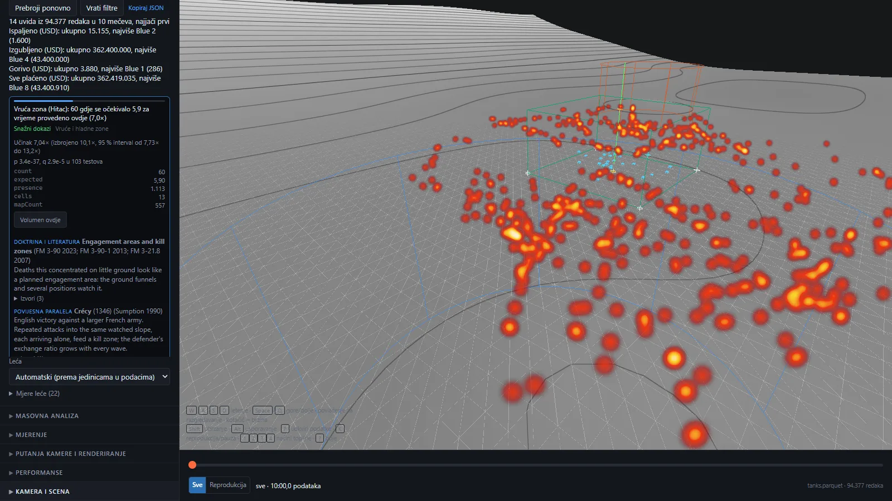

# Leća znanja

Kad [Uvidi](insights.md) nađu nešto, ovaj dio to objašnjava idejama iz vojne povijesti, dizajna igara i analize sporta, i imenuje knjigu ili rad iz kojih dolazi. Koristite to da naučite *zašto* obrazac važi, a ne samo da postoji.

## Isprobajte {#try-it}

1. Učitajte podatke i otvorite **Uvide**, zatim pritisnite **Pronađi uvide**.
2. Kliknite nalaz da ga otvorite.
3. Pročitajte **Doktrina i literatura** i **Povijesna paralela**. Potpune reference su sklopljene ispod.
4. Promijenite **Leću** (na primjer na *Vojna doktrina*) da biste isti nalaz pročitali kroz drugo tijelo literature.

## Kako radi {#how-it-works}

Panel Uvidi svoje nalaze procjenjuje kao što bi to radio stručni analitičar: kroz vojnu doktrinu i istraživanje operacija, povijesne sukobe te literaturu o dizajnu igara, dizajnu razina i analitici. To radi bez veze, iz pažljivo odabrane baze znanja u preglednik, a istu građu predaje vanjskom modelu kad on piše sažetak.

## Što panel prikazuje {#what-the-panel-shows}

- **Leća** bira tijelo literature kroz koje se nalazi čitaju: *Automatski* (prema vrstama jedinica u podacima: zrakoplovi, brodovi, kopnena vozila, pješaštvo), *Vojna doktrina*, *Zračna borba*, *Pomorska*, *Urbana borba*, *Dizajn igara i ravnoteža*, *E-sport*. Unosi izvan odabrane leće se izostavljaju.
- Svaki otvoreni nalaz prikazuje svoj najbliži unos **doktrine i literature** i svoju najbližu **povijesnu paralelu**, s potpunim referencama sklopljenim ispod.
- **Mjere leće** navode mjere analize operacija izračunate nad istim redcima (dolje), svaka s onim što znači i svojom literaturom.
- **Sažetak** dodaje retke za vodeće nalaze i mjere leće: "Doktrina i literatura: ..." i "Povijesna paralela: ...", svaki s citatima autor-godina i referencama sklopljenim ispod.
- **Napiši uz UI** šalje najrelevantnije unose (sažetak, pouku, nalaze s kojima su povezani, potpune reference) uz izvještaj i traži od modela da ih citira po id-u, `{concept.lanchester-square}`, i da ne koristi druge izvore.

Oznake su prevedene; sadržaj znanja je na engleskom.

## Mjere leće {#lens-metrics}

Računaju se u radniku uvida, u istom prolazu kroz redke kao i detektori (`src/insights/lensMetrics.ts`). Svaka se izostavlja kad je podaci ne mogu nositi.

| Mjera | Što mjeri | Treba |
|---|---|---|
| Lanchesterova prilagodba | Gubici svake strane po 20 s regresirani na žive snage obiju strana (Poissonove, kvazi-vjerodostojne pogreške); eksponenti na neprijateljsku i vlastitu snagu, testirani protiv zakona kvadrata (ciljana vatra) i linearnog zakona (područna vatra) | vrijeme, timovi, ubojstva i smrti |
| Omjer razmjene | Ubojstva po smrti po strani i po mjestu; udio smrti na najsmrtonosnijem terenu koji drži 5 % vremena, naspram udjela koji sama slučajnost daje za toliko smrti; Ginijev koeficijent smrti kroz vrijeme; Moranov I stopa smrti | ubojstva i smrti |
| Lokalni omjer snaga | Prijateljske i neprijateljske jedinice žive unutar dometa angažmana svakog ubojstva (domet postavljen iz podataka: dvostruka medijalna udaljenost do najbližeg neprijatelja); udio ubojstava lokalno nadmoćne strane i njezin višak iznad onoga što same brojke predviđaju | vrijeme, timovi, osobe |
| Polja vatre | Vidljivost s najprometnijih mjesta ubojstava na 2,5D površini zapreka (geometrija razine do visine zida, ili prijeđeno tlo) u odnosu na prosječno mjesto, i rang-korelacija vidljivosti i udjela ubojstava | položaji; učitana razina to izoštrava; ne za zrak |
| Energetsko stanje | Specifična energija (visina plus visina koju brzina može kupiti) zračnih ubojica i zračnih žrtava, uspoređena statistikom Mann-Whitney | klase zrakoplova, vrijeme, visina |
| Ključni teren | Koliko često je koje mjesto među tri najprometnija mjesta ubojstava utakmice | nekoliko utakmica |
| Uzajamna podrška (zamjene) | Smrti na koje je suigrač odgovorio ubojstvom unutar dometa angažmana i 5 s | vrijeme, timovi |
| Prvi udarac | Angažmani (ubojstva grupirana po utakmici, po 20 s mira i po tri dometa angažmana) koje je dobila strana koja je prva zabilježila pogodak | vrijeme, timovi |
| Model salve | Huesova jednadžba salve prilagođena na razdoblja od 20 s brodova u kontaktu: brodovi izbačeni iz borbe po napadačkom brodu i spašeni po braniteljskom brodu; Lanchesterova prilagodba samo na brodovima | klase brodova, vrijeme, timovi |
| Borbena učinkovitost | Ubojstva po jedinici-satu u akciji za svaku stranu i omjer dviju najvećih (vrijednost borbene učinkovitosti u Dupuyevom smislu) s 95 % intervalom, te udio ubojstava svake strane pri jednakom lokalnom broju | vrijeme, timovi |
| Dometi angažmana | Udaljenost do najbližeg neprijatelja pri ubojstvima, lansiranjima i pri prvom pucnju svakog života (otkrivanje do angažmana), po vrsti jedinice | vrijeme, timovi; lansiranja gdje ih podaci imaju |
| Lanac ubojstava | Sekunde od posljednjeg lansiranja ubojice do ubojstva i od njegovog prvog pucnja u borbi do ubojstva | vrijeme; lansiranja ili događaji paljbe |
| Koncentracija ili raspršenost | U svakom razdoblju od 20 s, raspršenost dviju najvećih strana i udio ubojstava koje uzima gušća | vrijeme, timovi |
| Izleti | Po strani: izleti (polijetanja, ili pojave zrakoplova), slijetanja, izgubljeni zrakoplovi i ubojstva zrakoplovima; stopa gubitka i ubojstva po izletu | klase zrakoplova; polijetanja ili pojave |

Podaci s rundama dodaju mjere bliske borbe i e-sporta: vjerojatnost pobjede runde, vrijednost akcija, uvodne dvoboje, zamjene, provirivanje naspram držanja, ciljanje, unakrsnu vatru, pomoćna sredstva, prednost u broju, završnice, postavljanja, situacije nakon postavljanja, fatalne lijevke i utjecaj igrača: vidi [Borba iz blizine i krugovi](close-quarters.md).

Staze i timovi dodaju mjere kolektivnog ponašanja iz znanosti o gomilama, kolektivnog kretanja, bihevioralne ekonomije i vojne psihologije: poravnanje i vrtnja u mjestu, usmjeravanje rute, trake i tragovi, zagušenje, vođe i sljedbenici, zaostali, prijelomna točka, rizik nakon gubitaka, nizovi, sporazum o kupnji i potiskivanje, svaka uz vlastiti nulti model: vidi [Kolektivno ponašanje](collective-behaviour.md).

Oružje, mamci i zgrade se ne broje kao jedinice. Gdje redci oružja imenuju jedinicu koja ga lansira (stupac `Shooter` ili `Launcher`, kakav imaju podaci izvedeni iz Tacviewa), lansiranje se pripisuje toj jedinici, uparenoj po njezinu nazivu ili id-u objekta.

## Kako se nalazi susreću s literaturom {#how-findings-meet-the-literature}

Unosi i nalazi susreću se kroz **taksonomiju obrazaca** (`src/insights/knowledge/patterns.ts`): koncentracija, lokalna nadmoć, ciljana i područna vatra, uska grla, zone ubojstava, polja vatre, obrnuta padina, bočni napadi, uzajamna podrška, energetska prednost, pritisak pojavljivanja, ravnoteža i tako dalje. Svaka vrsta detektora i svaka mjera leće kaže koje obrasce njezini brojevi pokazuju (`src/insights/lens.ts`). Svaki unos znanja kaže na koje se obrasce odnosi, s težinom. Relevantnost unosa za nalaz je ponderirano preklapanje, skalirano time koliko se domena unosa (kopno, zrak, more, urbano) uklapa u podatke i snagom samog nalaza. Prikazano obrazloženje je brojka nalaza u jednoj rečenici, iza koje slijedi pouka unosa.

## Katalog {#catalogue}

Svaki obrazac, pojam, metoda, povijesni slučaj, načelo dizajna i studija, s bibliografijom: vidi [Katalog znanja](knowledge-catalogue.md).

## Za razvojne programere {#for-developers}

### Dodavanje unosa {#adding-entries}

1. Odaberite datoteku prema vrsti: `concepts.ts` i `concepts-more.ts`, `methods.ts`, `cases.ts`, `cases-land.ts`, `cases-air-sea.ts`, `cases-esports.ts`, `design.ts` (načela dizajna) ili `studies.ts` u `src/insights/knowledge/`.
2. Dajte mu novi id `<vrsta>.<slug>` (nikad ne ponovno koristite), njegove leće, domene i obrasce na koje se odnosi s težinama 0..1. Dodajte obrazac u `patterns.ts` samo kad ga nalaz može pokazati, i mapirajte ga iz nalaza ili mjere u `lens.ts`.
3. Sažetak i pouku napišite **svojim riječima**. Citati samo iz djela u javnoj domeni (`pd: true` u referenci), i kratki.
4. Citirajte: svaki novi rad dodajte u `refs.ts` s autorima, godinom, naslovom i izdavačem (časopis s volumenom i stranicama); URL ili DOI tamo gdje postoji javni zapis.
5. Pokrenite `npx vitest run src/insights/lens.test.ts` (jedinstveni id-ovi, poznati obrasci, rješivi reference, citati iz javne domene, slučajevi s datumom i ishodom) i `node tools/knowledge-doc.mjs` da osvježite [katalog](knowledge-catalogue.md).
