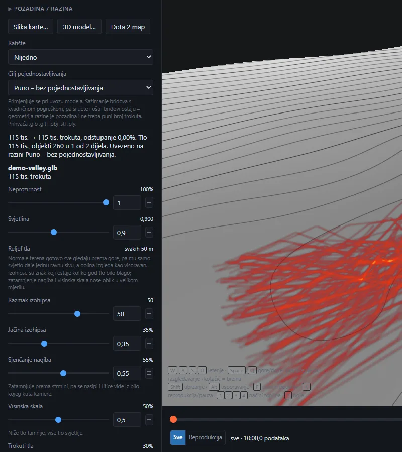

# Razine i pozadinska geometrija

Razina je 3D mjesto na kojem se igra odvijala: karta, grad, staza. Stavite jednu iza svojih podataka i vidite *gdje* je toplina. Panel **Pozadina / razina** (pogledajte [Pojmovnik](glossary.md) za "razina") daje tri vrste konteksta:

- **slika karte**, georeferencirana s dva sidra - pogledajte [Slike karata](map-images.md);
- **3D razina** - `.glb`, `.gltf`, `.obj`, `.stl` ili `.ply` - podijeljena na tlo, objekte i vodu te pojednostavljena pri uvozu - pogledajte [3D razine](model-levels.md) i [Izgled razine](level-appearance.md);
- **stvarni svijet kao pozadina** - za snimku koja kaže gdje je na Zemlji (Tacview ACMI datoteka): pravi teren, ceste, vodu, zračne luke i zgrade, preuzeti iz otvorenih podataka - pogledajte [Stvarni svijet kao pozadina](world-backdrop.md).

Kad se ništa ne učita, scena je tamna, s mrežom i obojanim osima (**Mreža** i **Osi** u [Kamera i scena](camera.md)), a panel kaže *Ništa nije učitano - scena prikazuje mrežu i osi. Dodajte sliku karte ili mrežu razine da toplina dobije kontekst.*

Razina je zajednička svim trima karticama: tok učitan na kartici Analiza utrke je ista razina koju prikazuje toplinska karta.

## Stavite razinu iza svojih podataka {#put-a-level-behind-your-data}

1. Najprije učitajte podatke ([Učitavanje podataka](getting-data-in.md)), da se razina prilagodi njima.
2. Otvorite **Pozadina / razina** na bočnoj traci.
3. Pritisnite **Slika karte…** za sliku ili **3D model…** za 3D razinu i odaberite datoteku. Za snimku iz stvarnog svijeta koristite umjesto toga **Stvarni svijet kao pozadina** ili **Ratište**.
4. Pričekajte da linija napretka završi. Veliki model se prvo pojednostavljuje (pogledajte **Cilj pojednostavljivanja** niže).
5. Pritisnite **F** u prikazu da uokvirite sve. Koristite **Neprozirnost** i **Svjetlinu** dok se toplina ne istakne od razine.
6. Pritisnite **Spremi u biblioteku** ako ćete razinu opet koristiti ([Biblioteka razina](level-library.md)).

## Što razina čini za toplinu {#what-a-level-does-for-the-heat}

- **Zakriva**: podatkovne točke iza nje zatamnjuju se po površini, a podatkovne točke iza terena skrivene su ([Dubina i odsijecanje](depth-and-culling.md)). Bez razine nema zakrivanja.
- **Reže** je [Isječak](slice.md) i, uz *Reži i razinu*, [odsijecanje po udaljenosti](depth-and-culling.md#distance-culling), zajedno s toplinom.
- Jedino je što [dubina polja](camera.md#depth-of-field) muti, uz mrežu i kutije.
- 3D razina **proširuje daleku ravninu kamere** kad je veća od podataka: bliska i daleka ravnina baždare se prema skupu podataka, a izvezena karta široka nekoliko kilometara inače bi cijela ležala iza daleke ravnine i ostavila prazan pogled. Daleka ravnina postaje 3 × vodoravni opseg razine kad je on veći, bliska ravnina se pomiče s njom (najmanje daleka / 100.000) da bi se održala preciznost dubine o kojoj zakrivanje ovisi, a brzina letenja se podiže na najmanje opseg / 12. Ravnina se samo proširuje, nikad sužava.

## Panel, od vrha prema dnu {#the-panel-top-to-bottom}

| Dio | Pojedinosti |
|---|---|
| **Slika karte…**, **3D model…** | Učitava jednu; zamjenjuje trenutnu razinu. |
| **Stvarni svijet kao pozadina**, **Zaboravi pločice karte** | Samo za skup podataka s geografskom referencom: gradi stvarno mjesto ispod njega kao razinu, ili briše preuzete pločice. [Stvarni svijet kao pozadina](world-backdrop.md) |
| **Cilj pojednostavljivanja** | Proračun trokuta za sljedeći uvoz modela: *Puno - bez pojednostavljivanja* (zadano), *Visoko - 8M*, *Srednje - 3M*, *Nisko - 800k*, *Siluete - 100k*. [3D razine](model-levels.md#simplification) |
| Napredak i **Odustani** | Dok se dekodira ili uvozi. |
| Napomena o uvozu | Trokuti prije i poslije, podjela na tlo / objekte / vodu, korištena razina detalja. |
| Ime i veličina | `širina×visina px · x × z m/px` za sliku, `N trokuta (od M)` za model. |
| **Neprozirnost**, **Svjetlina** | Obje vrste. |
| Kontrole slike | **Smanji zasićenost**, **Zamijeni sjever/jug**, **Položaj** (dva sidra), **Prilagodi granicama podataka**, **Visina**. [Slike karata](map-images.md) |
| Kontrole modela | Reljef tla, voda, trokuti tla, žičani model, tekstura, snimljena boja, objekti, klasifikacija dijelova. [Izgled razine](level-appearance.md) |
| **Spremi u biblioteku**, **Ukloni** | [Biblioteka razina](level-library.md); Ukloni izbacuje razinu. |
| **Biblioteka** | Razine spremljene u ovom pregledniku. [Biblioteka razina](level-library.md) |

## Stranice u ovom odjeljku {#pages-in-this-section}

- [Slike karata](map-images.md)
- [3D razine](model-levels.md) - formati, dijelovi, klasifikacija, pojednostavljivanje, teksture
- [Izgled razine](level-appearance.md) - svaka kontrola za 3D razinu
- [Biblioteka razina](level-library.md)
- [Stvarni svijet kao pozadina](world-backdrop.md) - pravi svijet ispod snimke, iz otvorenih podataka

Kako izvući razine iz igara i motora posao je zasebnih alata za izvoz (pogledajte [README](https://github.com/Holdi601/3DHeat/blob/main/README.md) repozitorija); ugovor u koji oni pišu sažet je u [3D razine](model-levels.md#the-exporter-contract).
