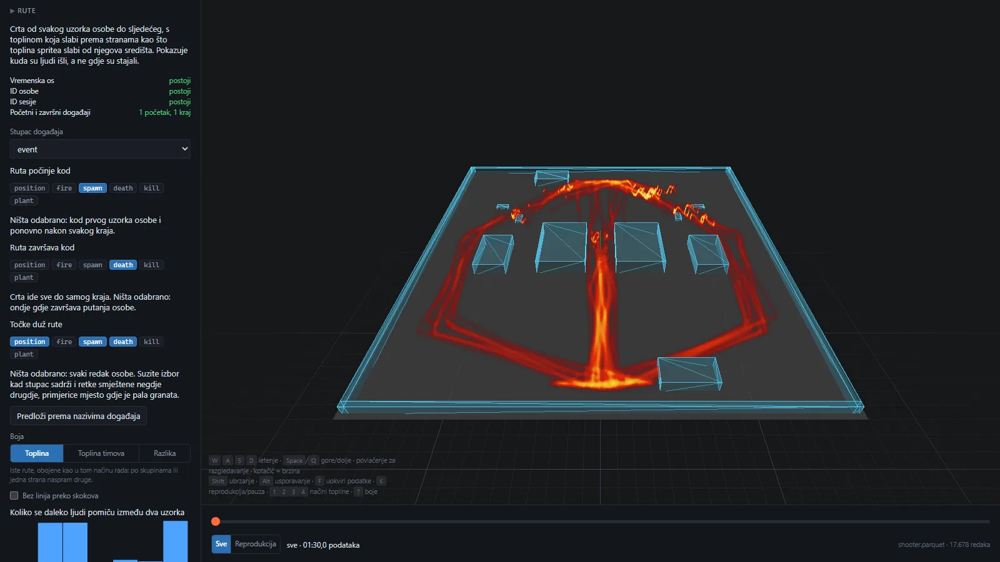

# Linijska toplina

Toplina pokazuje gdje su ljudi stajali. Crte pokazuju putanje kojima su hodali.

**Crte** (tipka 4) su linijska toplina: linija od svakog uzorka [osobe](glossary.md) do njezina sljedećeg, raspršena istim slabljenjem kakvo ima [sprite](glossary.md), ali preko linije umjesto oko točke. Pokazuje kamo su ljudi *išli*, a ne gdje su stajali. Hodnik kojim se prošlo jednom vidljiv je koliko i soba u kojoj se kampiralo. Rijetki uzorci brzog igrača spajaju se u neprekinutu rutu, a ne u isprekidani trag. Treba stupac osobe i stupac vremena.

## Kako se koristi {#how-to-use-it}

1. Pritisnite `4` (ili odaberite **Crte** u traci načina).
2. Otvorite **Rute** i provjerite zeleni popis: os vremena i ID osobe moraju biti prisutni.
3. Pritisnite **Predloži prema nazivima događaja** da se popune mjesta gdje rute počinju i završavaju.
4. Pročitajte redak statistike: "N ruta, M ih dolazi do kraja".
5. Ako linije skaču preko karte, podesite **Najduži korak** (vidi [Granica skoka](#the-jump-limit)).

Linija ima smisao samo između početka i kraja, pa panel **Rute** kaže što omeđuje rutu. Sve od [Pravila rute](#the-rules-of-a-route) nadalje su pojedinosti koje možete preskočiti.

## Panel Rute {#the-routes-panel}

Prikazuje se iznad panela toplote u načinu Crte.

### Što podaci imaju {#what-the-data-has}

Popis provjere, zelen kad je nešto prisutno, žut kad nije:

| Redak | Stanja |
|---|---|
| **Os vremena** | *prisutna* / *nedostaje - potrebna* |
| **ID osobe** | *prisutan* / *nedostaje - potreban* |
| **ID sesije** | *prisutan* / *nema - svi redovi su jedna sesija* |
| **Početni i završni događaji** | *N početaka, M završetaka* / *nijedan odabran - cijele putanje* (zeleno samo sa stupcem događaja i barem jednim početkom i jednim završetkom) |

### Kontrole {#controls}

| Kontrola | Značenje |
|---|---|
| **Stupac događaja** | Stupac kategorije čije vrijednosti su događaji (pojavljivanje, smrt, položaj, ...). *Nijedan - cijele putanje*: putanja svake osobe u svakoj sesiji je jedna ruta, prekinuta tamo gdje putanja ima prazninu. Nude se samo stupci zadržani za filtriranje pri učitavanju. |
| **Ruta počinje kod** | Vrijednosti događaja koje počinju rutu (pojavljivanje, ponovno pojavljivanje, spuštanje). Nijedna odabrana: ruta počinje na prvom uzorku osobe, a opet nakon svakog završetka. |
| **Ruta završava kod** | Vrijednosti događaja koje završavaju rutu (smrt, izvlačenje, teleportacija). Linija ide do samog retka završetka. Nijedna odabrana: ruta završava tamo gdje završava putanja osobe. |
| **Točke duž rute** | Vrijednosti događaja čiji redovi leže duž rute. Nijedna odabrana: svaki redak osobe. Suzite kad stupac također sadrži redove postavljene negdje drugdje, kao mjesto gdje je pala granata. |
| **Predloži prema nazivima događaja** | Popunjava tri popisa prema nazivima vrijednosti (dolje). |
| **Boja** | *Toplina*, *Toplina timova* ili *Razlika*. Iste rute u bojanju tog načina: svaka grupa svojom nijansom, ili jedna strana nasuprot drugoj, s popisom grupa, podjelom i skalama koje rade kao u tim načinima. Zadano *Toplina*. Toplina timova i razlika trebaju stupac grupe. |
| **Bez linija preko skokova** / **Najduži korak** | Sljedeći uzorak osobe udaljeniji od ovoga je ponovno pojavljivanje, teleportacija ili pad, a ne mjesto kamo je otišla, pa se dva uzorka ne spajaju linijom. Popunjava se pri učitavanju kad podaci pokažu jasnu prazninu (dolje), a inače je isključeno. Radi sa stupcem događaja ili bez njega. |
| Redak statistike | `N ruta, M ih dolazi do kraja, K segmenata`, osvježava se nekoliko puta u sekundi. |

Svaki popis je red gumba-čipova, po jedan za svaku vrijednost, najčešća prva. Kad lebdite mišem nad čipom, prikazuje se broj njegovih redaka. Nudi se najviše 120 vrijednosti (*još N vrijednosti nije prikazano*).

Kad se izabere drugi stupac događaja, primjenjuje se prijedlog ako prijedlog odabire baš taj stupac. Inače se počinje s praznim popisima.

### Prijedlog {#the-suggestion}

Pri svakom učitavanju i pri **Predloži prema nazivima događaja** ([`suggestLineSettings`](https://github.com/Holdi601/3DHeat/blob/main/src/data/lines.ts)):

- **Stupac događaja:** prvi zadržani stupac kategorije imena `event`, `eventname` ili `eventtype`. Ako ga nema, `kind`, `type` ili `action`. Ako ni to, bilo koji koji sadrži *event*, *kind*, *action* ili *type*.
- **Počeci:** vrijednosti koje sadrže *spawn, deploy, join, enter, start, begin, respawn, revive, land/landed/landing, drop*, osim ako se podudaraju i s završnom riječi.
- **Završeci:** vrijednosti koje sadrže *death, died, dead, kill/killed, eliminat…, extract, evac, teleport, leave, left, disconnect, quit, exit, end, finish, downed*, osim vrijednosti `kill` i `kills` (ubojstvo je nešto što ubojica radi, a ne kraj njegove rute).
- **Točke:** vrijednosti koje su točno *position, location, player location, move, movement, tick, sample* ili *pos*. Kad se neka nađe, počeci i završeci dodaju se i točkama. Kad nijedna nije nađena, točke ostaju prazne (svaki redak).

### Granica skoka {#the-jump-limit}

Tamo gdje ljudi skaču, duljine koraka padaju u dvije skupine s gotovo ničim između: koliko osoba prijeđe između dva uzorka i širina karte. Pri učitavanju ([`suggestMaxJump`](https://github.com/Holdi601/3DHeat/blob/main/src/data/lines.ts)) koraci se broje po udvostručenju njihove kvadratne duljine, do 16 milijuna njih. Granica ide u sredinu prvog raspona iznad medijana koji je širok barem jedno udvostručenje duljine, u kojem je manje od 0,02 % koraka po binu i iza kojeg ima koraka. Bez takvog raspona ništa se ne reže, jer skok ne bi bio moguće razlikovati od brzog automobila. Ručno uključena granica tada počinje na desetini dijagonale podataka.

Grafikon iznad granice pokazuje koliko su koraci zaista dugi, s linijom na granici. Stupci desno od nje se ne crtaju. Obje osi su logaritamske, jer skokovi mogu biti stotinka svih koraka i tisuću puta dulji. Kad lebdite mišem nad stupcem, prikazuje se njegov raspon i udio. Kad kliknete grafikon, granica se postavlja tamo. Ispod njega je udio koraka iznad granice.

## Pravila rute {#the-rules-of-a-route}

Redovi se obilaze redom vremena, po osobi ([`buildLines`](https://github.com/Holdi601/3DHeat/blob/main/src/data/lines.ts)):

1. Redovi [zajedničkog naziva](sessions-persons-groups.md#names-worn-by-several-things-at-once) potpuno se preskaču.
2. Kad su odabrane točke, redak koji nije ni početak, ni kraj, ni točka se preskače.
3. Redovi se prate po osobi i po sesiji, pa osoba čije se sesije isprepliću u vremenskom redoslijedu ima po jednu rutu u svakoj. Ruta se zatvara kad prethodni redak nema sljedbenika (njegovo [trajanje](sessions-persons-groups.md#person) je "nijedno"). Ruta nikad ne prelazi granicu sesije ili prazninu za koju je učitavanje odlučilo da nema sljedeći uzorak. Na kojoj ruti je redak određuje se jednom i zadržava, 4 bajta po retku, pa promjena najdužeg koraka ne ponavlja taj dio.
4. Redak **početka** zatvara svaku otvorenu rutu i tamo otvara novu.
5. Kad su odabrani početci, redak izvan rute se zanemaruje. Bez početaka svaki redak koji nije završetak, a izvan rute, otvara jednu.
6. Svaki drugi redak unutar rute dodaje **segment** od prethodnog retka rute do ovog.
7. Redak **završetka** koji produžuje rutu zatvara je nakon njezina segmenta. Ta ruta se broji kao *dolazi do kraja*.
8. Korak duži od **Najdužeg koraka** zatvara rutu tamo gdje je bila, a nova ruta počinje na udaljenom kraju, osim ako taj redak nije završetak. Preko njega se ne crta linija, a redak statistike ga broji.

Svaki segment pohranjen je na svom *završnom* retku, pa segmenti ostaju u vremenskom redoslijedu. [Vremenska os](timeline.md) prozor, uzorkovanje, [filtri](filters.md), vidljivost grupa i predznak razlike sve rade s njima kao s točkama. Filtar se zato primjenjuje na redak u kojem segment završava.

## Reprodukcija {#playback}

U načinu **Sve** crta se svaka ruta cijela. U načinu **Reprodukcija** svaka osoba je točka koja se pomiče između svojih uzoraka i za sobom crta rutu:

- segment koji počinje nakon glave za reprodukciju se ne crta;
- segment u kojem je osoba trenutno crta se do njezina interpoliranog položaja, s krajnjom kapicom na glavi;
- toplina blijedi duž **repa**: s poviješću *Kumulativno* rep je neograničen i sva dosadašnja ruta ostaje; s *Prozor* blijedi do nule kroz *Raspon* (zadano 30 s). S *Trajanje* rep je također *Raspon*, a u načinu Crte vremenska os prikazuje za tu povijest okvir *Raspon* (umjesto *Rezervni vijek* i *Blijeđenje*, koje linijska toplina ne koristi).

Tijekom reprodukcije svaki kadar se crta cijel, a ne nakuplja, jer se glave pomiču svakim kadrom i pomični prosjek bi svaku razmazao u trag.

## Za razvojne programere {#for-developers}

### Memorija {#memory}

Rute se grade na glavnoj niti kad se uđe u način Crte (ili kad se promijene postavke rute), a oslobađaju kad se iz njega izađe: 5 bajtova po retku u memoriji i 8 bajtova po retku na GPU-u (početni položaj svakog segmenta, kvantiziran na 16 bitova po osi unutar graničnog okvira podataka, i njegove zastavice).

### Kako se linija crta {#how-a-line-is-drawn}

Oba backend-a crtaju svaki segment od njegova završnog retka kao **18 vrhova** ([`lineHeatVs`](https://github.com/Holdi601/3DHeat/blob/main/src/render/webgl2/shaders.ts) i njegov WGSL blizanac):

- Polupoluprečnik na svakom kraju je [polumjer spritea](sprite-shape.md#sprite-radius) na udaljenosti tog kraja, uz primijenjena ograničenja u pikselima. Linija uža od 2,5 px crta se 2,5 px široka, a toplina joj se smanji da se slaže. Tako tanke linije ni ne nestaju ni ne postaju presvijetle.
- Toplina slabi **preko** linije istim nagibom kao sprite: slabljenje ili krivulja, intenzitet u središtu i na rubu.
- Okrugle kapice crtaju se **samo** tamo gdje ruta počinje ili završava, pa spojevi između uzastopnih segmenata ne tvore niz perli.
- Geometrija se gradi u prostoru zaslona i tamo linearno interpolira, pa slabljenje ostaje centrirano na liniji kako god ona ulazi u dubinu. Segment koji prelazi bližu ravninu reže se tamo, a ne odbacuje.

Linijska i točkasta toplina unose vrlo različite količine topline po retku, pa se zasićenje ponovno mjeri pri prebacivanju između njih ([Boja i ekspozicija](colour-and-exposure.md#auto-exposure)).
