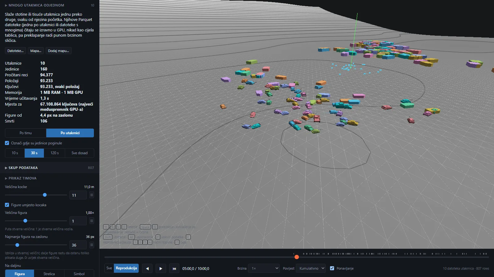

# Mnogo utakmica odjednom

**Mnogo utakmica odjednom** pušta puno utakmica jednu preko druge, pa vidiš gdje obično idu igrači svake utakmice. Upotrijebi je da usporediš stotine ili tisuće utakmica na jednoj slici.

Svaka utakmica počinje na svom početku, a njezine jedinice se kreću kao figure. Datoteke idu izravno u grafičku karticu i ne gradi se nijedna puna tablica, pa se reproducira glatko tamo gdje bi se obično učitavanje ponestalo memorije.

## Kako se koristi {#how-to-use-it}

1. Otvori **Mnogo utakmica odjednom** u bočnoj traci Toplinske karte.
2. Pritisni **Datoteke…** (odaberi mnogo datoteka), **Mapa…** (mapu i njezine podmape) ili **Dodaj mapu…** (dodaj u ono što je učitano).
3. Preglednik prelazi na sloj figura i počinje od početka. Pritisni **Reprodukcija**.

Svaka datoteka je jedna utakmica (ili ih sadrži nekoliko). Datoteke Parquet i spremnici [`.3dheat`](container.md) rade. Datoteka treba stupac položaja, vremena i jedinice; stupci naziva, tipa i strane se čuvaju. Ostale datoteke i pomoćne datoteke pretvarača (let, poruke, događaji, razgovor, ciljevi) se preskaču. Za običnu tablicu vidi [Unos podataka](getting-data-in.md).

## Postavke {#settings}

| Postavka | Što radi |
|---|---|
| **Po timu** / **Po utakmici** | Boja po strani, ili boja po utakmici. |
| **Označi gdje su jedinice poginule** | Oznaka na mjestu gdje je svaka jedinica poginula, 10 s, 30 s, 120 s ili sve do sad. |

Ploča pokazuje koliko je utakmica, jedinica, redaka i položaja pročitano, koliko je memorije upotrijebljeno i vrijeme učitavanja. *Prostor za* je koliko još položaja grafička kartica još može primiti. *Figure od* je veličina na zaslonu ispod koje se jedinica crta kao mala strelica umjesto svoje figure.

Izgled figura koristi iste kontrole kao [reprodukcija utakmice](match-replay.md#figures): **Veličina figura**, **Najmanja figura na zaslonu** i **Na daljinu**.

## Savjeti {#tips}

- Kad sve ne bi stalo u memoriju, položaji se prorijeđuju (zadržava se samo položaj svakih nekoliko metara) i ploča to kaže.
- Načini topline rade i na podacima sloja.
- Za statistiku nad tisućama utakmica bez njihova crtanja vidi [Masovna analiza](mass-analysis.md).
