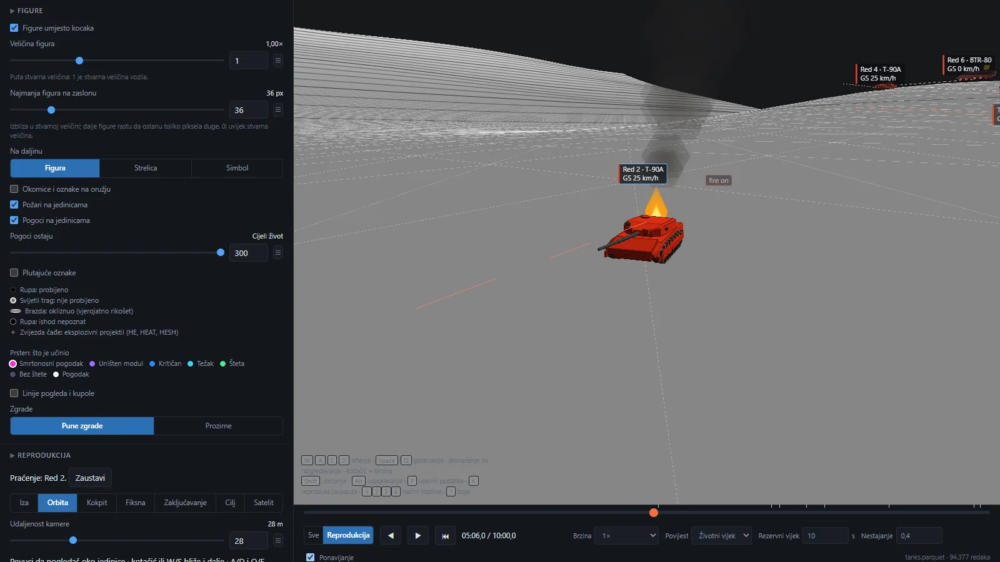
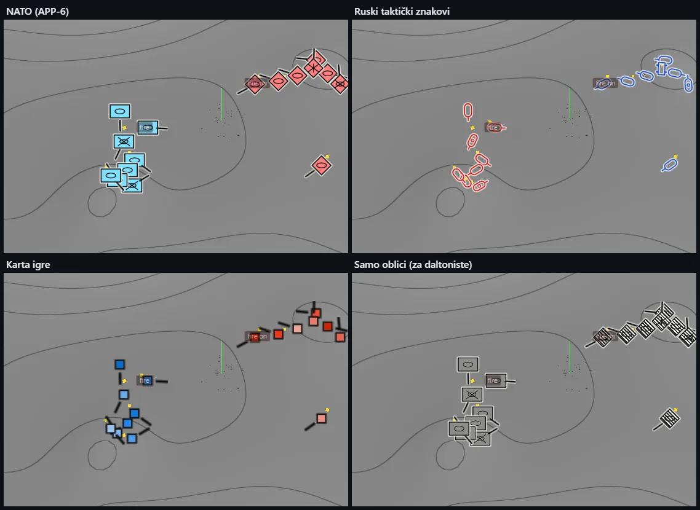
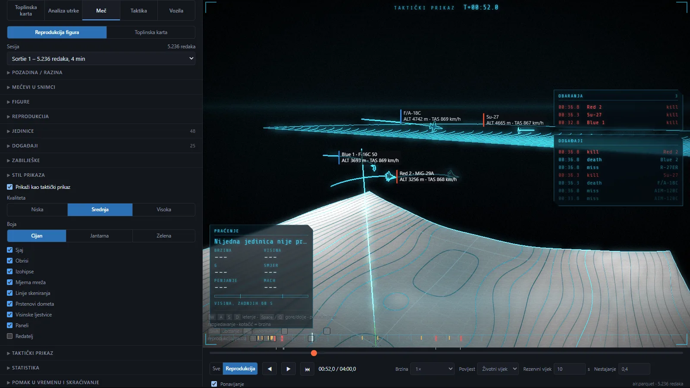

# Reprodukcija utakmice

Reprodukcija je film utakmice u kojem je svaki igrač nacrtan kao ono čime je upravljao. Koristite je da ponovno pogledate borbu, pratite jednu jedinicu i vidite tko je koga pogodio.

Hici, pogoci, požari i olupine crtaju se na jedinicama i ciljevima na razini. Kamere, oznake i taktički prikaz pomažu vam čitati borbu. Poznajete Tacview? [Paritet s Tacviewom](tacview-parity.md) pokazuje gdje je svaki njegov alat.

## Pokrenite reprodukciju {#start-a-replay}

1. Učitajte snimku s **Izvor → Datoteke…** ili spuštanjem na panel Izvor (bilo koja tablica sa stupcem **osoba** i **vrijeme**, Tacview datoteka, pretvorena reprodukcija, [`.3dheat`](container.md) utakmica). Vidi [Unos podataka](getting-data-in.md).
2. Otvorite karticu **Meč** i odaberite **Reprodukcija figura**, ili odaberite **Preklapanje figura** na traci načina na kartici Toplinska karta.
3. Pod **Mečevi u snimci** odaberite jednu utakmicu, sve odjednom ili nekoliko.
4. Pritisnite **Reprodukcija** na vremenskoj traci (ili `K`). Povucite vremensku traku za skok.

Figure zamjenjuju kutije za svaku jedinicu čije se ime ili tip zna (vidi [Figure](figures.md)). Podaci bez stupca imena ili tipa crtaju se kao vojnici.

## Figure {#figures}

| Postavka (odjeljak **Figure**) | Zadano | Što radi |
|---|---|---|
| **Figure umjesto kocaka** | uključeno | Isključeno crta obične kutije. |
| **Veličina figura** (puta stvarna veličina) | 1 | 1 je stvarna veličina; 0,25 do 20 puta (logaritamska skala). Veće pomaže izdaleka. |
| **Najmanja figura na zaslonu** | 36 px | Daleke figure rastu da ostanu ovoliko velike, 0 do 200 px; 0 zadržava stvarnu veličinu. |
| **Na daljinu**: Figura, Strelica, Simbol | Figura | U što se daleka jedinica pretvara. |
| **Simboli** | NATO (APP-6) | NATO (APP-6), ruski taktički znakovi, ikone **Karte igre**, ili **Samo oblici (za daltoniste)**. |
| **Veličina simbola**, **Moja strana**, **Neprijatelj / Neutralno**, **Oznake kursa** | 28 px (12 do 64), automatski, neprijateljski, uključeno | Kako simboli izgledaju i koja je strana prijateljska. |
| **Okomite linije** | uključeno | Linija od svake jedinice ravno dolje do tla, pa se visine čitaju u 3D. |
| **Okomice i oznake na oružju** | isključeno | Linije do tla i oznake na projektilima i bombama. |
| **Požari na jedinicama** | uključeno | Plamen od trenutka kad jedinica planu do gašenja. |
| **Pogoci na jedinicama** | uključeno | Oznake gdje su hici pogodili (dolje). **Pogoci ostaju**: 1 do 300 sekundi, ili **Cijeli život**. **Plutajuće oznake**: oznake nacrtane iznad površine. |
| **Linije pogleda i kupole** | isključeno | Isprekidano: gdje igrač gleda; puno: gdje je usmjeren top. |
| **Zgrade** | puno | Pune ili prozirne zgrade, kad ih razina prikazuje. |

### Simboli na daljinu {#symbols-at-a-distance}

Kad bi jedinica bila manja od **Najmanja figura na zaslonu**, može postati simbol koji ostaje čitljiv. Oblik kaže vrstu (na primjer zaobljena kutija s oznakom gusjenica za oklopna vozila); boja kaže stranu. Otvorite izbornik **Simboli** da promijenite stil.

### Oznake pogodaka, olupine i požari {#hit-marks-wrecks-and-fires}

- **Oznake pogodaka** sjede na površini koju je hitac dotaknuo, u mjerilu figure. Njihov izgled kaže što se dogodilo: rupa (prošao je), svijetla prskotina (nije prošao), brazda (odbio se), zvjezdica od čađe (eksplozivni projektil). Obojeni prsten kaže što je učinio: hitac koji ubija, uništen modul, kritično, teško, šteta, bez štete, pogodak. Zadržite pokazivač na oznaku za ime runde.
- Uništena jedinica se crta **ugljenisana** kao olupina od svoje smrti do ponovnog spawnanja ili uklanjanja; njezin simbol je precrtan.
- **Požari** gore na jedinici od trenutka kad planu do gašenja.
- **Kupole** se okreću tamo gdje podaci kažu da je usmjeren top (ili, bez toga, tamo gdje igrač gleda).

### Oružje, mamci i tragovi {#weapons-decoys-and-tracers}

Uz uključeno **Oružje, hici i pogoci** (odjeljak Prikaz tima): projektili, rakete, bombe i torpeda lete kao vlastite figure s tragom dima; meci i granate su tragovi; udari i eksplozije bljeskaju. Trag nacrtan **isprekidano** izračunat je iz pogotka, jer podaci nisu imali hitac. Bljeskalice i pljevu crtaju se kao mamci; skriveni su s popisa jedinica osim ako nije označeno *Mamci i granate*.

## Kamere {#cameras}

Kliknite jedinicu ili njezinu oznaku da je **pratite**; odjeljak **Reprodukcija** nudi **Iza**, **Orbita**, **Kokpit** (s prikazom na čelnom staklu, `H`), **Fiksna**, **Zaključavanje**, **Cilj** i **Satelit**. `V` ih izmjenjuje, **Udaljenost kamere** postavlja koliko daleko. Esc zaustavlja.

- **Prikaz dviju jedinica**: odaberite **Cilj** (ili Ctrl/Alt-klik na jedinicu) da je gledate iz one koju pratite; **Zamijeni** ih mijenja.
- **Mjera**: Shift-klik na dvije jedinice za smjer, razmak i razliku visine između njih.
- **2D karta** (`M`): kutni ili puni prikaz, s tragovima i imenima.
- **Zabilješke** (`B`): spremaju trenutak i kameru; navode se i vlastita ubojstva, smrti i oznake snimke.
- **Događaji**: svaki događaj po vremenu; klik skače tamo. `Page Up` / `Page Down` skaču između događaja; **Pauza na događaju** staje na svakom.

## Taktički prikaz {#tactical-display}

Odjeljak **Taktički prikaz** crta, za nijednu jedinicu, odabrane, sve ili jednu vrstu (zrakoplove, kopno, brodove, oružje): vektore brzine i put ispred, linije nosa i uzgona, stošce radara, zaključavanja, podatkovne veze, zone i linije angažmana, linije vida, gdje igrači gledaju (stošci pogleda), usmjerenje kupole i snimljenu kameru.

### Stil prikaza {#display-style}

`T` (ili preklopnik **Prikaži kao taktički prikaz**) prebacuje izgled na stil radarskog zaslona: sjaj, obrisi, konturne linije, mreža za mjerenje, linije skeniranja, prstenovi dometa, ljestve visine, paneli s ubojstvima i događajima, i **Redatelj** koji sam pomiče kameru na događaje.

## Ciljevi {#objectives}

Kad utakmica dolazi s ciljevima, odjeljak **Ciljevi** crta ih na razini: zone zauzimanja (s vlasnikom i napretkom zauzimanja), spawnove, zračne luke, područja i mete za bombardiranje, svaki sloj se može uključiti ili isključiti, s oznakama. Vide se kroz tlo. Kad je učitano više načina igre, **Način** filtrira utakmice po načinu. Ciljevi dolaze iz datoteke utakmice pretvarača uz snimku ili unutar [`.3dheat`](container.md) kontejnera.

## Oznake i statistika {#labels-and-statistics}

- **Oznake**: pravila po vrsti (**Odabrane**, **Zrakoplovi**, **Kopno**, **Brodovi**, **Oružje**, **UI**): prikazuje se ili ne, koje vrijednosti, i **Prioritet** za to tko dobiva prostor kad se oznake preklapaju. **Razmakni oznake** pomiče oznaku pored njezine jedinice kad bi pokrivala drugu, a izostavlja je tamo gdje nema mjesta. **Veličina oznaka** je 60 do 250 %. **Natrag na ime, vozilo, visinu i brzinu** vraća pravila na početno.
  - Kopnene jedinice počinju s imenom, vozilom i brzinom.
  - Zrakoplovi počinju s imenom, vozilom, visinom i brzinom.
  - Brodovi počinju s imenom, vozilom, brzinom i kursom.
  - Zadržite pokazivač na jedinici da vidite svaku vrijednost koju ima.
- **Statistika**: po timu i jedinici: ubojstva, smrti, hici, pogoci, omjer pogodaka, polijetanja, slijetanja, vrijeme u zraku, najveća brzina, visina i G, udaljenost. Izvoz u CSV.
- **Grafikoni**: vrijednosti jedinice kroz vrijeme, dvije jedinice uspoređene, ili jedna vrijednost naspram druge.

## Mnogo utakmica odjednom {#many-matches-at-once}

Da stotine ili tisuće utakmica položite jednu preko druge, vidi [Mnogo utakmica odjednom](many-matches.md). Pojedinosti o figurama (dim, vatra, drugi vremenski učinci): [Figure u preklapanju figura](figure-replay.md). Popis mogućnosti Tacviewa: [Paritet s Tacviewom](tacview-parity.md), podstranica ove stranice.
