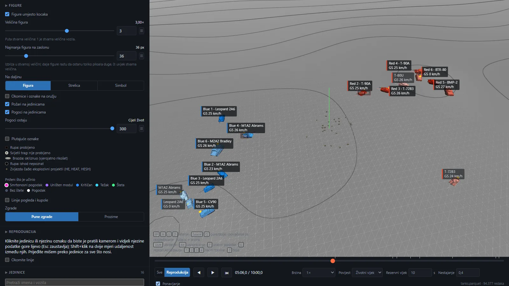
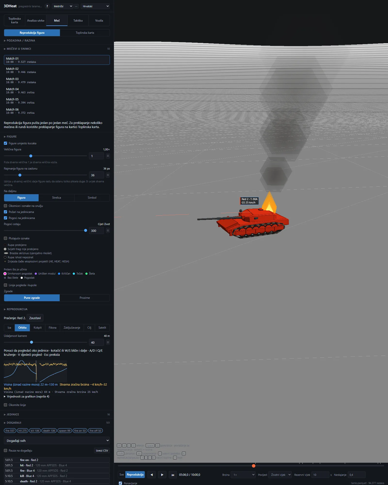
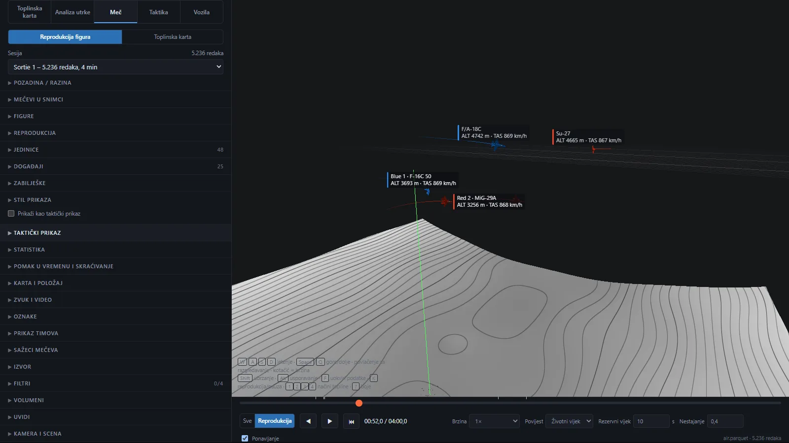

# Reprodukcija meča

Reprodukcija je snimka meča u kojoj je svaki igrač nacrtan kao ono čime je upravljao. Koristite je da ponovno pogledate borbu, pratite jednu jedinicu i vidite tko je koga pogodio.

Hici, pogoci, požari i olupine nacrtani su na jedinicama i ciljevima na razini. Kamere, oznake i taktički prikaz pomažu vam čitati borbu. Poznajete li Tacview? [Tacview paritet](tacview-parity.md) pokazuje gdje je svaka od njegovih alatki.

## Pokretanje reprodukcije {#start-a-replay}

1. Učitajte snimku s **Izvor → Datoteke…** ili je ispustite na ploču Izvor (bilo koja tablica sa stupcem **osoba** i stupcem **vrijeme**, Tacview datoteka, pretvorena snimka ili [`.3dheat`](container.md) meč). Pogledajte [Učitavanje podataka](getting-data-in.md).
2. Otvorite karticu **Meč** i odaberite **Reprodukcija figura**, ili odaberite **Preklapanje figura** u traci načina na kartici Toplina.
3. Pod **Mečevi u snimci** odaberite jedan meč, sve odjednom ili nekoliko.
4. Pritisnite **Reprodukcija** na vremenskoj crti (ili `K`). Povucite vremensku crtu za skok na drugo mjesto.

Figure zamjenjuju kocke za svaku jedinicu čije su ime ili vrsta poznati (pogledajte [Figure](figures.md)). Podaci bez stupca imena ili vrste crtaju se kao vojnici.

## Figure {#figures}

| Postavka (odjeljak **Figure**) | Zadano | Što radi |
|---|---|---|
| **Figure umjesto kocaka** | uključeno | Isključeno crta obične kocke. |
| **Veličina figura** (puta stvarna veličina) | 1 | 1 je stvarna veličina; od 0,25 do 20 puta (logaritamska skala). Veća veličina pomaže izdaleka. |
| **Najmanja figura na zaslonu** | 36 px | Udaljene figure rastu da ostanu ovoliko velike, od 0 do 200 px; 0 zadržava pravu veličinu. |
| **Na daljinu**: Figura, Strelica, Simbol | Figura | U što se pretvara udaljena jedinica. |
| **Simboli** | NATO (APP-6) | NATO (APP-6), ruski taktički znakovi, ikone **Karta igre** ili **Samo oblici (za daltoniste)**. |
| **Veličina simbola**, **Moja strana**, **Neprijateljski / Neutralni**, **Oznake kursa** | 28 px (od 12 do 64), automatski, neprijateljski, uključeno | Kako simboli izgledaju i koja je strana prijateljska. |
| **Okomite linije** | uključeno | Linija od svake jedinice ravno dolje do tla, pa se visine čitaju u 3D. |
| **Okomice i oznake na oružju** | isključeno | Linije do tla i oznake na raketama i bombama. |
| **Požari na jedinicama** | uključeno | Plamen od trenutka kad jedinica planu do trenutka kad se ugasi. |
| **Pogoci na jedinicama** | uključeno | Oznake gdje su hici pogodili (dolje). **Pogoci ostaju**: od 1 do 300 sekundi, ili **Cijeli život**. **Plutajuće oznake**: oznake nacrtane iznad površine. |
| **Linije pogleda i kupole** | isključeno | Crtkano: gdje igrač gleda; puno: gdje je usmjeren top. |
| **Zgrade** | puno | Pune ili prozirne zgrade, kad ih razina tako prikaže. |

### Simboli na daljinu {#symbols-at-a-distance}

Kad bi jedinica bila manja od **Najmanje figure na zaslonu**, može postati simbol koji ostaje čitljiv. Oblik kaže vrstu (na primjer zaobljena kutija s oznakom gusjenica za oklopna vozila), a boja kaže stranu. Otvorite izbornik **Simboli** da promijenite stil.

### Oznake pogodaka, olupine i požari {#hit-marks-wrecks-and-fires}

- **Oznake pogodaka** nalaze se na površini na koju je hitac naišao, u mjerilu figure. Njihov izgled kaže što se dogodilo: rupa (prošao je kroz), svijetla prskotina (nije prošao), ureznica (odbio se), zvjezdica od čađe (eksplozivni projektil). Obojeni prsten kaže što je učinio: ubojiti hitac, modul uništen, kritično, teško, oštećenje, bez oštećenja, pogodak. Prijeđite mišem preko oznake da vidite naziv projektila.
- Uništena jedinica crta se **zgorena** kao olupina od trenutka smrti do ponovnog pojavljivanja ili uklanjanja. Njezin simbol je precrtan.
- **Požari** gore na jedinici od trenutka kad planu do trenutka kad se ugase.
- **Kupole** se okreću tamo gdje podaci kažu da je usmjeren top (ili, bez toga, tamo gdje igrač gleda).

### Oružje, mamci i trasirke {#weapons-decoys-and-tracers}

Uz uključeno **Oružje, hici i pogoci** (odjeljak Pregled tima): rakete, projektili, bombe i torpeda lete kao vlastite figure s dimnim tragom. Meci i granate su trasirke. Trasirka nacrtana **crtkano** izvedena je iz pogotka, jer podaci nisu imali hitac. Baklje i zrna pljeve crtaju se kao mamci. Skriveni su s popisa jedinica, osim ako je označeno *Mamci i granate*.

## Kamere {#cameras}

Kliknite jedinicu ili njezinu oznaku da je **pratite**. Odjeljak **Reprodukcija** nudi **Iza**, **Orbita**, **Kokpit** (s prikazom na čelnom staklu, `H`), **Fiksna**, **Zaključavanje**, **Cilj** i **Satelit**. `V` ih mijenja redom, a **Udaljenost kamere** postavlja koliko su daleko. Esc prekida praćenje.

- **Prikaz dviju jedinica**: odaberite **Cilj** (ili Ctrl/Alt-klik na jedinicu) da je gledate iz one koju pratite. **Zamijeni** ih međusobno zamjenjuje.
- **Mjera**: Shift-klik na dvije jedinice za smjer, udaljenost i razliku visina među njima.
- **2D karta** (`M`): kut ili cijeli prikaz, sa tragovima i imenima.
- **Zabilješke** (`B`): spremaju trenutak i kameru. Ubojstva, smrti i oznake iz same snimke također su navedeni.
- **Događaji**: svaki događaj po redu vremena; klik vas odvede tamo. `Page Up` / `Page Down` skaču između događaja; **Pauza na događaju** staje na svakom.

## Taktički prikaz {#tactical-display}

Odjeljak **Taktički prikaz** crta, za nijednu jedinicu, odabrane, sve ili jednu vrstu (zrakoplovi, kopno, brodovi, oružje): vektore brzine i put ispred, linije nosa i uzgona, stošce radara, zaključavanja, podatkovne veze, zone i linije angažmana, linije pogleda, gdje igrači gledaju (stošci pogleda), usmjerenje kupole i snimljenu kameru.

### Stil prikaza {#display-style}

`T` (ili preklopnik **Prikaži kao taktički prikaz**) mijenja izgled u stil radarskog zaslona: sjaj, obrisi, konturne linije, mreža za mjerenje, linije skeniranja, prstenovi dometa, ljestve visina, paneli s ubojstvima i događajima te **Redatelj** koji sam pomiče kameru na događaje.

## Ciljevi {#objectives}

Kad meč dolazi sa svojim ciljevima, odjeljak **Ciljevi** crta ih na razini: zone zauzimanja (s vlasnikom i napretkom zauzimanja), spawnove, zračne luke, područja i mete za bombardiranje, svaki sloj može se uključiti ili isključiti, s oznakama. Vidljivi su kroz tlo. Kad su učitani načini igre, **Način** filtrira meč po načinu. Ciljevi dolaze iz datoteke meča pretvarača uz snimku ili unutar [`.3dheat`](container.md) spremnika.

## Oznake i statistika {#labels-and-statistics}

- **Oznake**: pravila po vrsti (**Odabrane**, **Zrakoplovi**, **Kopno**, **Brodovi**, **Oružje**, **UI**): prikazuju se ili ne, koje vrijednosti i **Prioritet** za to tko dobiva mjesto kad se oznake preklapaju. **Razmakni oznake** pomiče oznaku pored jedinice kad bi prekrila drugu, a gdje nema mjesta, izostavlja je. **Veličina oznaka** je od 60 do 250 %. **Natrag na ime, vozilo, visinu i brzinu** vraća pravila na zadano.
  - Jedinice na kopnu počinju s imenom, vozilom i brzinom.
  - Zrakoplovi počinju s imenom, vozilom, visinom i brzinom.
  - Brodovi počinju s imenom, vozilom, brzinom i kursom.
  - Prijeđite mišem preko jedinice da vidite sve vrijednosti koje ima.
- **Statistika**: po timu i jedinici: ubojstva, smrti, hici, pogoci, omjer pogodaka, polijetanja, slijetanja, vrijeme u zraku, najveća brzina, visina i G, udaljenost. Izvoz u CSV.
- **Grafikoni**: vrijednosti jedinice kroz vrijeme, dvije jedinice u usporedbi ili jedna vrijednost nasuprot drugoj.

## Mnogo mečeva odjednom {#many-matches-at-once}

Za slaganje stotina ili tisuća mečeva jedan preko drugoga pogledajte [Mnogo mečeva odjednom](many-matches.md). Pojedinosti o figurama (dim, vatra, drugi vremenski efekti): [Figure u preklapanju figura](figure-replay.md). Popis značajki Tacviewa: [Tacview paritet](tacview-parity.md), podstranica ove stranice.
