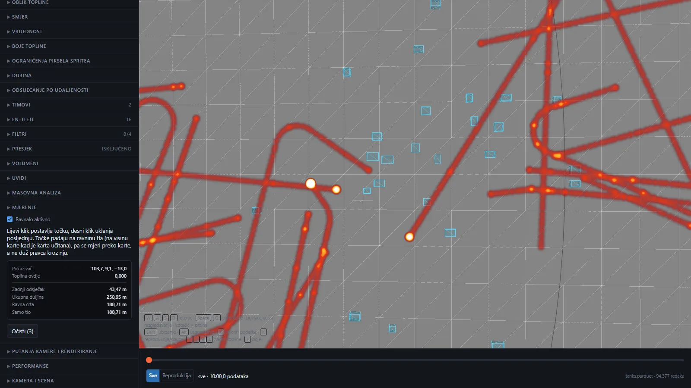

# Mjera

**Mjera** pretvara miš u ravnalo i kaže koliko je zauzeto mjesto pod pokazivačem. Upotrijebi je da saznaš koliko su dva mjesta udaljena ili koliko prometa ima jedno mjesto.

## Isprobaj {#try-it}

1. Otvori **Mjera** u bočnoj traci i označi **Ravnalo aktivno**.
2. Lijevim klikom klikni tri mjesta na karti. Svaki klik ostavlja točku.
3. Pročitaj **Ukupnu duljinu** (duljina cijele putanje) i **Zadnji odsječak** (zadnju dionicu).
4. Desnim klikom ukloni zadnju točku, ili pritisni **Očisti (3)** da ukloniš sve.

| Radnja | Učinak |
|---|---|
| Lijevi klik | Ostavlja točku tamo gdje pokazivač dodiruje ravninu tla. Klik koji se pomaknuo više od 4 piksela između pritiska i otpuštanja je povlačenje kamere, a ne točka. |
| Desni klik | Uklanja zadnju točku. |
| Pomicanje | Položaj pokazivača i toplina ispod njega se ažuriraju uživo. |

Kamera i dalje radi dok je ravnalo uključeno: povlačenje i dalje gleda okolo, tipke i dalje lete. Dok je ravnalo uključeno, ono preuzima svaki klik, pa [odabir klikom](camera.md#click-to-pick) čeka dok se ne isključi.

**Ravnina tla** je nadmorska visina [slike karte](map-images.md) kad je slika karte učitana, inače najniži Y skupa podataka (0 bez nje). Točke na nju padaju, pa ravnalo mjeri preko karte, a ne duž crte kroz nju. Uz 3D razinu ravnina je i dalje najniži Y skupa podataka, a ne površina razine - za točku na stvarnoj površini isključi ravnalo i klikni je ([odabir klikom](camera.md#click-to-pick)), što očitava koordinate iz vlastitih trokuta razine.

## Očitanja {#readouts}

| Stavka | Značenje |
|---|---|
| **Pokazivač** | Svjetske X, Y, Z točke ispod pokazivača, na ravnini. |
| **Toplina ovdje** | Koliko topline ima na pikselu pokazivača. Veći broj znači više prometa na tom mjestu. To je vrijednost koju skala boja dobija prije nego je točka zasićenja podijeli, pa je možeš usporediti s [Točkom zasićenja](colour-and-exposure.md#saturation-point). |
| **Zadnji odsječak** | Udaljenost od zadnje točke do pokazivača (ili između zadnje dvije točke). |
| **Ukupna duljina** | Duljina lomljene linije kroz svaku točku i pokazivač. |
| **Ravna crta** | 3D udaljenost od prve točke do pokazivača (ili zadnje točke). |
| **Samo tlo** | Isto, samo na osima X i Z. |
| **Očisti (N)** | Uklanja sve točke. |

Udaljenosti se prikazuju u centimetrima ispod 1 jedinice, u metrima ispod 1.000, u kilometrima iznad - uz pretpostavku da je jedna svjetska jedinica metar ([Osi, jedinice i vrijeme](axes-units-and-time.md#unit-scale)). Koordinate su svjetske, pa i kad je os [obrnuta za prikaz](camera.md#invert-world-axis).

Točke i crta između njih crtaju se kao sloj u pogledu, veličine prema razmaku mreže. Točke ravnala se ne spremaju u pogledima; ostaju kad učitaš druge podatke.

## Za razvojne programere {#for-developers}

**Toplina ovdje** se čita s GPU-a najviše svakih 120 ms, jer čitanje jednog piksela zaustavlja cjevovod. Koristi isti put kao `engine.readHeatProbe()`: dijeli se s pojačanjem s kojim je kadar zapisan, pa je na putu akumulacije u polupreciznom formatu (`?heat=f16`) u istim jedinicama kao na 32-bitnom cilju ([Akumulacija u polupreciznom formatu](half-float-accumulation.md)).
