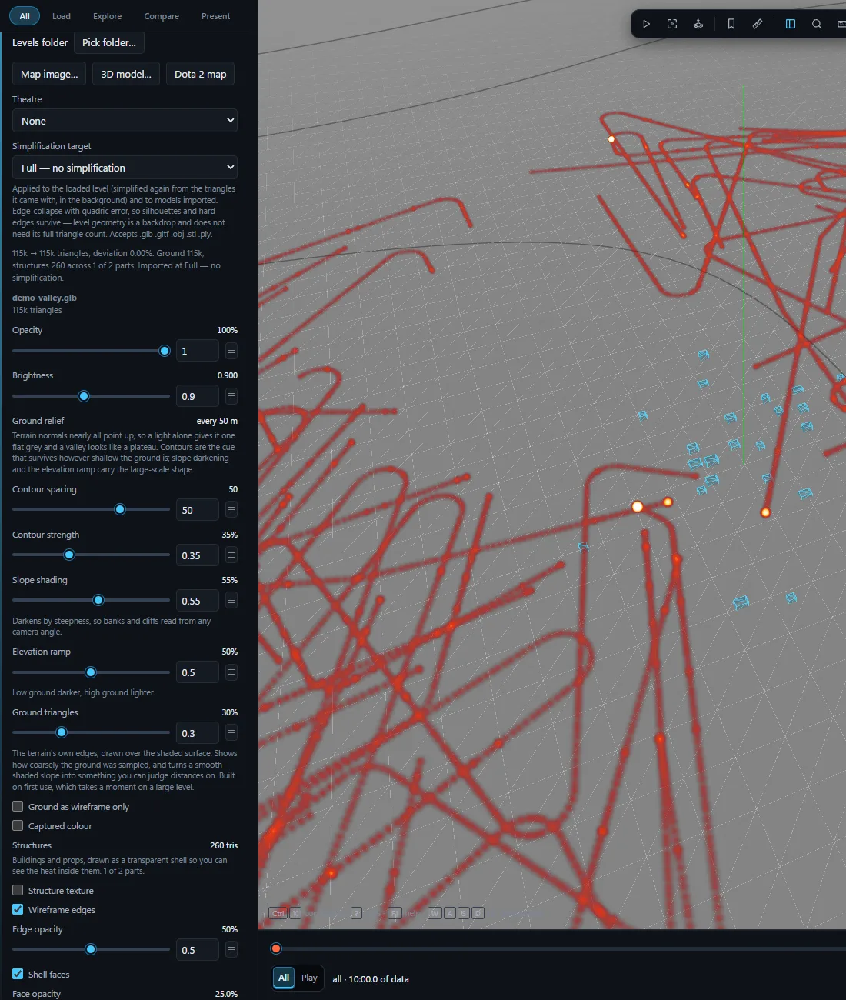

# 3D razine

3D razina je model mjesta (brda, ulice, zgrade) u kojem se nalaze vaši podaci. Omogućuje vam da vidite na kojem katu, brdu ili krovu je toplina. Preglednik je dijeli na kopno (puno), objekte (prozirne, pa se može gledati unutra) i vodu.

## Učitajte 3D razinu {#load-a-3d-level}

1. Prvo učitajte svoje podatke ([Unos podataka](getting-data-in.md)). Model mora koristiti isti svjetski prostor i jedinicu kao podaci, s Y prema gore.
2. U **Pozadina / razina** odaberite **Cilj pojednostavljivanja**. Ostavite na *Puno - bez pojednostavljivanja*, osim ako je model ogroman.
3. Pritisnite **3D model…** i odaberite datoteku `.glb`, `.gltf`, `.obj`, `.stl` ili `.ply`.
4. Pričekajte redak napretka. **Odustani** ga zaustavlja.
5. Pritisnite **F** u prikazu. Kopno je puno, objekti su prozirne ljuske, a voda je ravna.
6. Podesite izgled u [Izgled razine](level-appearance.md). Pritisnite **Spremi u biblioteku** da zadržite rezultat ([Biblioteka razina](level-library.md)).

**3D model…** učitava mrežu razine. Ona se parsira, klasificira i pojednostavljuje u pozadinskom radniku ([`modelWorker.ts`](https://github.com/Holdi601/3DHeat/blob/main/src/data/modelWorker.ts)) s retkom napretka i **Odustani**: *Čitanje modela*, *Parsiranje datoteke*, *Pakiranje N tekstura*, *Klasificiranje N dijelova*, *Pojednostavljivanje kopna (N trokuta)*, *Pojednostavljivanje objekata (N trokuta)*, *Izrada žičanog okvira*.

## Formati {#formats}

| Format | Što se čita | Ograničenja |
|---|---|---|
| `.glb` | Svaka primitiva mreže s `mode` 4 (trokuti) ili bez moda, s primijenjenom svjetskom transformacijom svakog čvora; `POSITION`; `COLOR_0` (vec3 ili vec4) kao boja vrha; `baseColorTexture` materijala i njegov `TEXCOORD_n` kao tekstura; imena čvora i mreže kao imena dijelova. | Linije i točke se preskaču. |
| `.gltf` | Isto. | Samo s ugrađenim međuspremnicima. glTF koji upućuje na vanjski `.bin` odbija se s *Export as a single .glb so the geometry is embedded.* |
| `.obj` | Plohe, s blokovima `o` i `g` kao dijelovima. | Samo geometrija (bez materijala). |
| `.stl` | Binarni i ASCII (`solid …`). | Jedan dio. |
| `.ply` | Samo ASCII. | Binarni PLY se odbija s *Convert to .glb or binary .stl.* |

Samo geometrija: položaji, normale i trokuti spojeni u jedan međuspremnik, plus boje i teksturne koordinate gdje postoje ([`modelParse.ts`](https://github.com/Holdi601/3DHeat/blob/main/src/data/modelParse.ts)). Model bez trokuta se odbija. Model mora biti u istom svjetskom prostoru i jedinici kao podaci (Y gore): ništa se ne transformira da bi odgovaralo.

## Kopno, objekti i voda {#ground-structures-and-water}

Razina se pri uvozu dijeli u tri klase, jer traže suprotne tretmane ([`classify.ts`](https://github.com/Holdi601/3DHeat/blob/main/src/data/classify.ts)):

- **Kopno** (Ground): crta se neprozirno i osjenčano s naznakama reljefa (nagib, konture, rampa visine) da se položaj može čitati naspram njega.
- **Objekti** (Structures): zgrade i rekviziti stoje između kamere i topline unutar njih, pa se crtaju kao **prozirna ljuska** (blijedi rubovi sa svijetlim obrubom, plus deduplicirani bridovi), ili, kad imaju teksture, puni u svojim teksturama.
- **Voda** (Water): ravna, bez naznaka terena: kontura preko jezera je besmislica.

Svaki dio (čvor glTF-a, objekt OBJ-a ili grupa) klasificira se zasebno, prvim pravilom koje se primjenjuje:

1. **Oznaka izvoznika.** Ime koje počinje s `ground:`, `structure:` ili `water:` (ili s `|` umjesto `:`) uzima se doslovno. Vlastiti izvoznici projekta označavaju svaki dio ovako.
2. **Imena vode.** `water` kao riječ (ne *water tower*, *-tank*, *-mill*, *-front*, *-fall*, *-pump*, *-pipe*), `ocean`, `sea`, `lake`, `pond`, `lagoon`, `river`.
3. **Imena kopna.** `terrain`, `landscape`, `ground…`, `…_ground`, `heightmap`, `floor…`, `map` / `map_…`, `base` / `base_…`, `road`, `street`, `pavement`, `sidewalk`.
4. **Imena objekata.** `house`, `building`, `bldg`, `wall`, `roof`, `door`, `window`, `stair`, `prop`, `asset`, `clutter`, `debris`, `crate`, `barrel`, `fence`, `tree`, `rock`, `bush`, `vehicle`, `car`, `truck`, `tank`, `bridge`, `tower`, `silo`, `hangar`, `bunker`.
5. **Geometrija.** Dio koji pokriva više od 25% površine X-Z karte s više od 60% površine trokuta okrenute prema gore kopno je. Dio s manje od 45% okrenutim prema gore, ili viši od 15% visine razine dok pokriva manje od 10% njezine površine, je objekt. Udio okrenut prema gore vagan je površinom, pa se kuća ne zove ravnom zato što ima krov.
6. **Inače kopno.** Dvosmislen dio zadano je kopno, jer bi zadana gotovo nevidljiva ljuska učinila da razina izgleda kao greška prikaza.

Model koji je jedan dio klasificiran kao objekt pretvara se u kopno (*single unnamed mesh - treated as ground*: jedna neimenovana mreža, tretirana kao kopno).

### Navigacijske mreže {#navigation-meshes}

Dio imenovan `nav:…` (`nav:walkable` izvoznika razine) je navigacijska mreža: mjesta gdje vojnik može stajati. Navodi se kao kopno (*navigacijska mreža - nije nacrtana, jer leži na kopnu; klikovi je i dalje nalaze*), ali **nije nacrtana**. Položena je preko kopna iz kojeg je nastala, koplanarna s njim unutar centimetara. Da je crtana kao kopno, dvije površine bi se borile za svaki piksel: na razini s pečenom teksturom tla cijelo igrivo područje prikazalo bi se kao oštre mrlje sive i bež boje, po jedna za svaki trokut navigacije. Zadržava se, nepojednostavljena, da [odabir klikom](camera.md#click-to-pick) može reći je li mjesto prohodno. Unosi biblioteke je ne zadržavaju.

**Prikaži klasifikaciju dijelova (N)** na ploči (prikazano za modele s više od jednog dijela) navodi svaki dio s njegovom klasom i razlogom: *označio izvoznik*, *ime odgovara obrascu*, *pokriva X% karte, Y% okrenuto prema gore*, *Y% okrenuto prema gore, Z% visine razine*, *dvosmisleno - zadano kopno*. Da promijenite jedan, preimenujte dio u izvornom modelu i ponovno uvezite. Podjela je pečena u međuspremnike indeksa.

## Pojednostavljivanje {#simplification}

**Cilj pojednostavljivanja** postavlja proračun trokuta za sljedeći uvoz ([`simplify.ts`](https://github.com/Holdi601/3DHeat/blob/main/src/data/simplify.ts)):

| Postavka | Trokuti |
|---|---|
| *Puno - bez pojednostavljivanja* (zadano) | svi |
| *Visoko - 8 mil. trokuta* | 8.000.000 |
| *Srednje - 3 mil. trokuta* | 3.000.000 |
| *Nisko - 800 tis. trokuta* | 800.000 |
| *Silueta - 100 tis. trokuta* | 100.000 |

Proračun je podijeljen **60% na objekte i 40% na kopno**, a pojednostavljuje se zasebno, jer objekti najbrže gube oblik pod proređivanjem. Voda se ne pojednostavljuje. Pojednostavljivanje je sažimanje bridova s metrikama kvadratne greške ([meshoptimizer](https://github.com/zeux/meshoptimizer), preko WebAssemblyja), nakon spajanja vrhova na istom mjestu, pa siluete i oštri bridovi ostaju. Napomena uvoza prikazuje `izvor → sada trokuta, odstupanje X%`, podjelu kopna / objekata / vode po dijelovima, i, kad je korišteno *Puno* na modelu iznad 8 mil. trokuta, predlaže *Visoko* (do 30 mil.) ili *Srednje* (iznad). Bez WebAssemblyja pojednostavljivač nije dostupan, a uvoz to kaže.

Razine iz vlastitih izvoznika projekta već imaju proračun. Cilj postoji za sirovu umjetnost bez proračuna iza nje.

## Teksture {#textures}

`.glb` čiji dijelovi nose teksture osnovne boje crta se u njima. Izvoz trkaće staze, na primjer, nosi jednu teksturu po pločici terena i jednu po postavljenom modelu.

Tekstura tla prikazuje se zadano kad postoji. Objekti koji nose teksture počinju **puni, u vlastitim teksturama** (rubnjaci, ograde, zidovi od guma i znakovi su rubovi ceste, a ne zgrade u koje se gleda), sa isključenim žičanim okvirom i isključenim ravnim osjenčavanjem. Vidi [Izgled razine](level-appearance.md).

## Velike razine {#large-levels}

- Iznad **300.000** trokuta objekata bridovi objekata počinju isključeni, a neprozirnost lica na 35%: kad je brid u svakom pikselu, četvrt se čita kao ravno bijela.
- Daleka ravnina kamere širi se da stane razina ([Razine](levels.md#what-a-level-does-for-the-heat)).

## Za razvojne programere {#for-developers}

### Atlas tekstura {#texture-atlas}

Svaka tekstura pakira se u **jedan atlas** u radniku uvoza ([`atlas.ts`](https://github.com/Holdi601/3DHeat/blob/main/src/data/atlas.ts)), pa razina ostaje jedno crtanje, jedan uzorkivač i jedan atribut teksturnih koordinata na oba pozadinska sustava:

- pakiranje u policama po vlastitoj veličini svake slike, smanjeno samo ako se skup ne bi uklopio u **8192 px** u bilo kojem smjeru (zadano ograničenje veličine teksture WebGPU-a);
- **rub od 16 piksela** oko svake slike, i samo 5 mip-razina koje taj rub štiti, pa daleki znak nikad ne uzorkuje teksturu svog susjeda;
- **ponavljajuće teksture** ostaju ponavljajuće. Slika čiji glTF uzorkivač ponavlja (zadano u glTF-u) i čije teksturne koordinate izlaze iz 0..1, kao zid od opeke čiji UV ide od 0 do 40 duž njega, postaje *pločica*: njezini vrhovi zadržavaju vlastite koordinate i 16-bitni broj pločice, a sjenčari u svakom pikselu omotavaju koordinatu u pravokutnik pločice, uzimajući mip-razinu iz neomotane koordinate da se šavovi ne vide. Rub pločice drži vlastiti suprotni rub. Os čiji uzorkivač stišće ostaje stisnuta; slika čije koordinate ostaju unutar 0..1 crta se kao prije. Razina s pločicama košta 4 bajta po vrhu više.

### Ugovor izvoznika {#the-exporter-contract}

Što preglednik treba od razine, bez obzira na to tko ju je napravio:

- jedan samostalni `.glb`;
- `POSITION` float32, primitive trokuta;
- imena čvorova `ground:*`, `structure:*` i `water:*` (sve drugo klasificira se gornjim pravilima), i `nav:*` za navigacijsku mrežu, koja se zadržava, ali ne crta;
- koordinate u svjetskom prostoru, **Y gore**, u istoj jedinici kao telemetrija, pa podaci stoje na razini bez ikakvog koraka smještanja.
