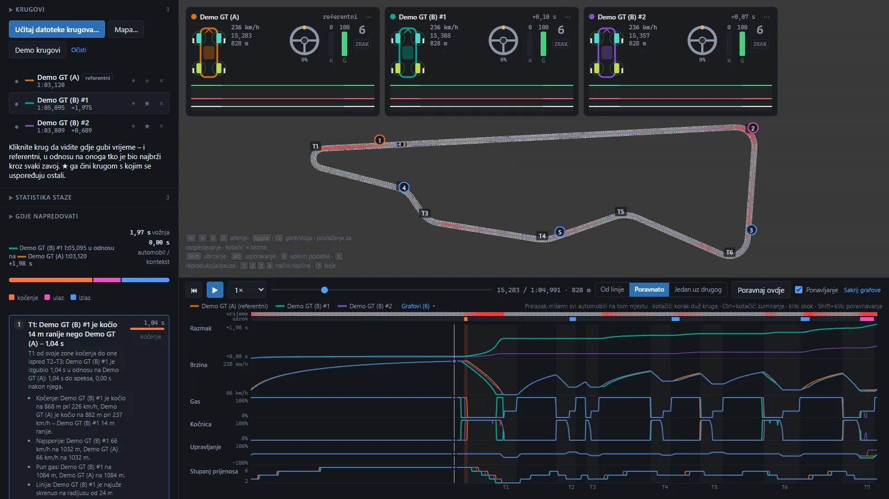

# Analiza utrke

Vozili ste istu stazu dvaput. Kartica **Analiza utrke** pušta obje vožnje zajedno u 3D, pokazuje gdje je jedan krug bio sporiji i kaže vam zašto. Nemate još krugova? Pritisnite **Demo krugovi**.

Kartica uspoređuje dva ili više krugova jedne staze. S toplinskom kartom dijeli platno, kameru i učitani model staze (**Pozadina / razina**). Sve ostalo je njezino: vlastita bočna traka i vlastita traka ispod prikaza. Riječi poput *krug*, *referentni krug* i *tjeme* nalaze se u [pojmovniku](glossary.md).

Ova stranica je karta kartice. Svaki dio ima vlastitu stranicu:

| Stranica | Što pokriva |
|---|---|
| [Učitavanje krugova](race-loading-laps.md) | svaka vrsta datoteke, mape i staze, nazivi automobila, demo krugovi, popis krugova, referentni i fokusirani krug |
| [Reprodukcija i 3D scena](race-replay-and-scene.md) | traka za reprodukciju, tri načina reprodukcije, poravnavanje automobila, kamera praćenja, linije, karte, automobili, oznake, zrcaljeni svjetovi |
| [Grafikoni i HUD](race-charts-and-hud.md) | grafikoni udaljenosti, izbornik grafikona, lebdenje i zumiranje, kartice automobila, tablica kanala |
| [Događaji upravljanja vozilom](race-control-events.md) | blokade, proklizavanje, prekomjerno upravljanje, okreti, podupravljanje, udarci, sudari, ABS/TC, ručna kočnica, zrak; kako se svaki prepoznaje, sa svakim pragom |
| [Analiza zavoj po zavoj](race-corner-analysis.md) | poravnanje po udaljenosti, zavoji i segmenti, vremenski obračun zavoja, svaki uzrok i redoslijed u kojem se isprobavaju, oblik linije i savjet |
| [Profili vozila i usporedba](race-car-profiles.md) | što koji automobil može, izmjereno iz njegovih krugova; *Usporedba automobila*; što automobil odlučuje u svakom zavoju |
| [Statistika staze](race-course-statistics.md) | mnogo krugova jedne staze: pogreške po zavoju i po vrsti, karta pogrešaka, izvoz toplinske karte, granice performansi |
| [Analitika utrka: metoda](race-analytics.md) | istraživanje iza pravila, s izvorima |
| [Ostale igre utrka](other-games.md) | što preglednik radi s krugovima iz svake igre: klizanje i drift izračunati tamo gdje igra to ne šalje, zrcaljeni svjetovi, dodatni kanali |

## Zaslon {#the-screen}

**Bočna traka**, odozgo prema dolje (odjeljci se mogu sklopiti):

1. **Krugovi**: učitavanje, popis, prikaži/sakrij, referentni, fokusirani, praćenje. Vidi [Učitavanje krugova](race-loading-laps.md).
2. **Statistika staze**: tek od tri učitana kruga. Vidi [Statistika staze](race-course-statistics.md).
3. **Gdje napredovati**: nalazi fokusiranog kruga, zavoj po zavoj. Vidi [Analiza zavoj po zavoj](race-corner-analysis.md).
4. **Zavoj po zavoj** (ili *Zavoj po zavoj - klasa X* uz više klasa): najbrži krug kroz svaki zavoj i njegova linija. Prikazuje se uz dva ili više krugova.
5. **Kontrola automobila**: blokade, klizanja, guranja i udarci fokusiranog kruga. Vidi [Događaji upravljanja vozilom](race-control-events.md).
6. **Usporedba automobila** (ili **Automobil** uz jedan automobil). Vidi [Profili vozila i usporedba](race-car-profiles.md).
7. **Prikaz**: koja se karta slika na stazi i što se crta. Vidi [Reprodukcija i 3D scena](race-replay-and-scene.md).
8. Zajednički paneli **Razina** i **Kamera i scena** (model staze, obrtanje osi, kamera). Dokumentirani su uz toplinsku kartu i [Kameru](camera.md).

**Prikaz** pokazuje stazu, odvožene linije, kartu, automobile, oznake pričvršćene za stazu i do šest kartica automobila gore lijevo (vidi [Grafikoni i HUD](race-charts-and-hud.md)). Bez učitanih krugova piše: "Nema učitanih krugova. Ovdje ispustite dvije ili više datoteka krugova ili učitajte demo krugove iz bočne trake."

**Traka ispod prikaza** sadrži kontrole reprodukcije i, ako nije sakrivena, grafikone udaljenosti.

## Brzi početak {#quick-start}

1. Otvorite karticu **Analiza utrke** (pored **Toplinske karte** na vrhu bočne trake).
2. Unesite krugove. Pritisnite **Demo krugovi** da vidite što kartica radi s tri izmišljena kruga. Za vlastite krugove prvo ih snimite ([formati datoteka i snimači](race-loading-laps.md#file-formats)), zatim pritisnite **Učitaj datoteke krugova…** ili **Mapa…**, ili ispustite datoteke ili mape na prikaz.
3. Najbrži potpuni krug postaje referentni. Najsporiji ostali krug je fokusiran. Kliknite bilo koji krug na popisu da ga fokusirate. ★ čini krug referentnim.
4. Pročitajte **Gdje napredovati**. Kliknite nalaz: automobili se poravnaju 40 m prije njega, kamera ga uokviruje, reprodukcija prolazi kroz njega i otvaraju se mjerenja.
5. Lebdite mišem nad grafikonima da svaki automobil pomaknete na taj metar. Shift+klik ih poravnava tamo.

## Tipkovnica {#keyboard}

Dok je kartica Utrka otvorena:

| Tipka | Radi |
|---|---|
| **K** | pokreće / pauzira reprodukciju |
| **Home** | na početak reprodukcije |
| tipke s brojevima | ništa (na toplinskoj karti mijenjaju načine) |

Tipke upisane u polje za tekst ili padajući izbornik se zanemaruju. Tipke kamere rade kao na toplinskoj karti (**W A S D**, **Razmak** gore, **Q** dolje, **Shift** brže, **Alt** sporije, miš za gledanje; sve u [Kameri](camera.md)). **F** uokviruje učitane krugove (kao što to radi učitavanje krugova).

## Mnogo krugova {#many-laps}

- Svi učitani krugovi se analiziraju i broje. Desetci traju sekundu ili dvije.
- Nakon **8** krugova (`SHOW_ALL_UP_TO`), dodani krugovi se crtaju samo kad su referentni, fokusirani ili najbolji krug klase fokusiranog kruga. Prekidači *Prikaži sve* / *Samo oni koji se gledaju* to mijenjaju.
- Nakon **10** vidljivih automobila (`PLAIN_PAST`), krugovi koji se ne gledaju (nisu fokusirani, ni automobil koji se prati, ni referentni) crtaju se s linijama prorijeđenim na točku svakih 6 m umjesto 1,5 m, i s običnim automobilima.
- Grafikoni crtaju najviše **8** krugova; HUD prikazuje najviše **6** kartica.
- Statistika staze pojavljuje se od **3** kruga.

Pojedinosti: [Statistika staze](race-course-statistics.md#performance-with-many-laps).

## Zadane postavke prikaza {#default-view-settings}

| Postavka | Zadano |
|---|---|
| Karta | Karta vremena |
| Odvožene linije, Automobili, Gume i ovjes, Oznake, Staza iz krugova | uključeno |
| Sve vrijednosti na karticama | isključeno |
| Veličina automobila | 1× |
| Grafikoni | prikazani |
| Način reprodukcije | Iz linije |
| Brzina reprodukcije | 1× |
| Petlja | uključeno |

Ništa od toga se ne sprema; ponovno učitavanje kreće od zadanih postavki. U pregledniku se pamti: jezik i nazivi automobila naučeni iz datoteka krugova (vidi [Učitavanje krugova](race-loading-laps.md#car-names)).

## Za razvojne programere {#for-developers}

### Što se događa kad se krugovi učitaju {#what-happens-when-laps-are-loaded}

Svaki put kad se promijeni skup krugova, referentni ili jezik, cijela analiza se ponovno radi (`analyse` u [`src/race/analysis.ts`](https://github.com/Holdi601/3DHeat/blob/main/src/race/analysis.ts)):

1. Izvedeni kanali dodaju se svakom krugu tamo gdje ih igra ne šalje: kut drifta, klizanje kotača iz brzina kotača, u zraku, rastresit teren, brzina zakretanja ([`derive.ts`](https://github.com/Holdi601/3DHeat/blob/main/src/race/derive.ts)).
2. Odabire se referentni krug i svaki krug se projicira na njegovu putanju te se ponovno uzorkuje svakih 2 m ([`align.ts`](https://github.com/Holdi601/3DHeat/blob/main/src/race/align.ts)).
3. Iz krugova se računa je li svijet igre zrcaljen ([`handedness.ts`](https://github.com/Holdi601/3DHeat/blob/main/src/race/handedness.ts)).
4. Zavoji se nalaze na referentnom krugu i grupiraju u segmente od jedne zone kočenja do sljedeće ([`segments.ts`](https://github.com/Holdi601/3DHeat/blob/main/src/race/segments.ts)).
5. Po automobilu: njegova ovojnica (prianjanje, kočenje, vuča po brzini), njegov profil, njegove krivulje guma ([`envelope.ts`](https://github.com/Holdi601/3DHeat/blob/main/src/race/envelope.ts), [`profile.ts`](https://github.com/Holdi601/3DHeat/blob/main/src/race/profile.ts), [`control.ts`](https://github.com/Holdi601/3DHeat/blob/main/src/race/control.ts)).
6. Po krugu i segmentu: što je napravio (točka kočenja, najsporija točka, puni gas, ...) i linija kojom je vozio ([`line.ts`](https://github.com/Holdi601/3DHeat/blob/main/src/race/line.ts)).
7. Po krugu: njegovi događaji upravljanja vozilom, svaki postavljen uz krug s kojim se tamo uspoređuje.
8. Po krugu i segmentu: vremenski obračun u odnosu na njegov usporedni krug i nalaz riječima.
9. Karta vremena i karta uzroka po krugu.

Tekstovi se pišu na trenutačnom jeziku. Promjena jezika ponovno pokreće analizu (i preimenuje demo krugove). Greška u analizi prikazuje se kao pogreška ispod gumba **Krugovi**, a krugovi ostaju učitani.

### Izvorne datoteke {#source-files}

| Datoteka | Uloga |
|---|---|
| `src/race/adapters.ts`, `ibt.ts` | čitanje datoteka krugova |
| `src/race/lap.ts`, `carNames.ts`, `synthetic.ts` | tip kruga, imenovanje, demo krugovi |
| `src/race/derive.ts`, `handedness.ts` | izvedeni kanali, zrcaljeni svjetovi |
| `src/race/align.ts`, `segments.ts`, `line.ts` | os udaljenosti, zavoji, linije |
| `src/race/analysis.ts` | uspoređeni zavoji, uzroci, nalazi |
| `src/race/envelope.ts`, `profile.ts` | što automobil može |
| `src/race/control.ts`, `impacts.ts` | upravljanje vozilom, udarci i sudari |
| `src/race/stats.ts` | mnogo krugova |
| `src/race/replay.ts`, `scene.ts`, `glyph.ts`, `geometry.ts` | reprodukcija i crtanje |
| `src/race/schema.ts`, `graphs.ts` | tablica kanala, redovi grafikona |
| `src/ui/race/*` | bočna traka, grafikoni, HUD, oznake |
| `src/state/raceStore.ts` | stanje kartice i sat reprodukcije |
