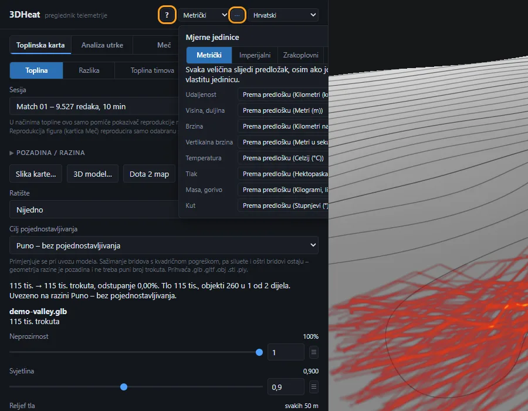
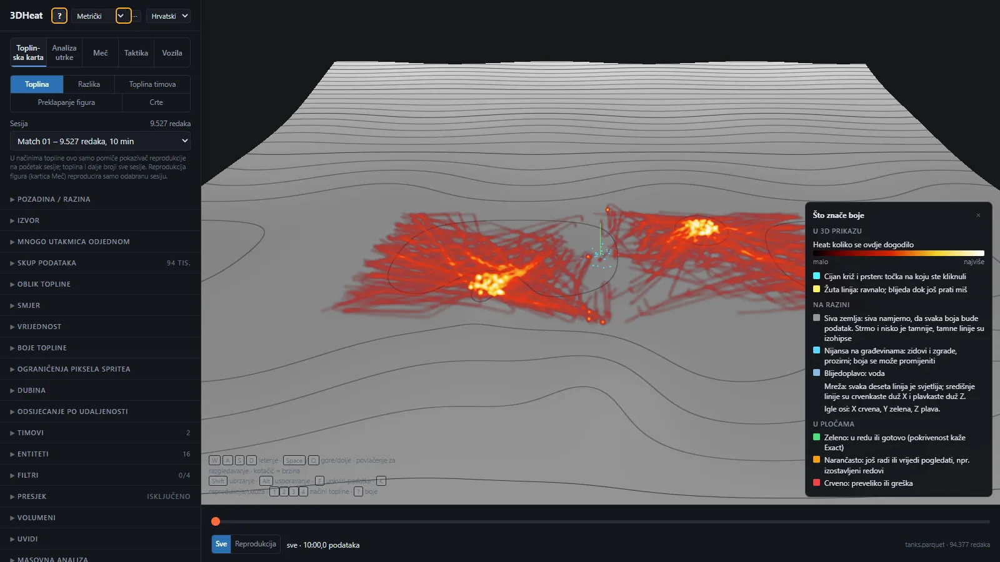
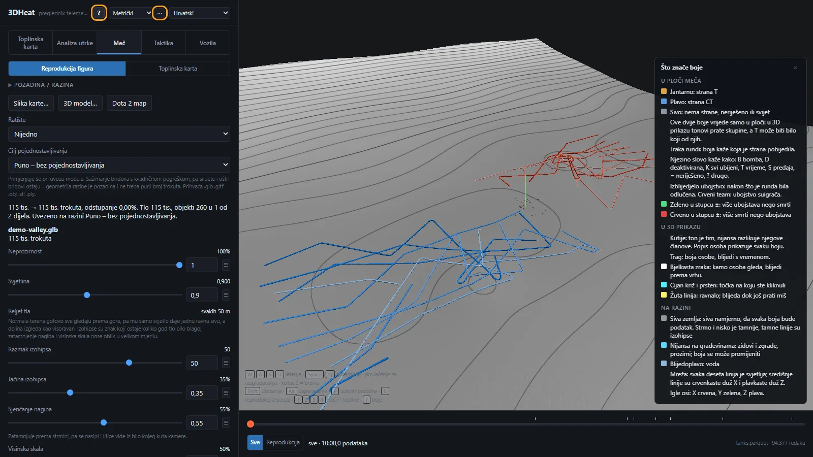

# Postavke, jedinice i tipke

Mali upravljači na vrhu bočne trake mijenjaju način na koji ti preglednik govori: jezik, jedinice (metri ili stope, km/h ili čvorovi) i način pomoći koji objašnjava boje. Tvoj izbor se pamti u pregledniku.

## Zaglavlje {#the-header}

Na vrhu bočne trake:

| Kontrola | Što radi |
|---|---|
| **?** | Način pomoći: što znači svaka boja (također `?` ili `F1`) |
| Izbornik **Jedinice** | Metrički, Imperijalni, Zrakoplovni ili Nautički |
| Gumb **...** pored **Jedinice** | Otvara "Odaberi jedinicu za svaku veličinu": jedan padajući izbornik po veličini |
| Izbornik **Jezik** | Jezik preglednika: [40 jezika](languages.md), ili jezik preglednika |

Brojevi koje upisuješ u okvir mogu imati točku ili zarez (`0.35` ili `0,35`). Preglednik čita oba i prikazuje brojeve onako kako ih piše jezik preglednika.

## Jedinice {#units}

1. Odaberi unaprijed postavljenu vrijednost u izborniku **Jedinice**. Sve se veličine mijenjaju zajedno.
2. Da promijeniš samo jednu veličinu, klikni gumb **...** pored nje i odaberi jedinicu za tu veličinu. Izbornik tada pokazuje `*` iza unaprijed postavljene vrijednosti.
3. Veličina koju nisi postavio prati unaprijed postavljenu vrijednost. Odaberi "Kao unaprijed postavljeno" za povratak.

| Veličina | Metrički (zadano) | Imperijalni | Zrakoplovni | Nautički |
|---|---|---|---|---|
| Udaljenost | km | mi | NM | NM |
| Visina, duljina | m | ft | ft | m |
| Brzina | km/h | mph | kt | kt |
| Vertikalna brzina | m/s | ft/min | ft/min | m/s |
| Temperatura | °C | °F | °C | °C |
| Tlak | hPa | inHg | hPa | hPa |
| Masa, gorivo | kg, l | lb, gal | lb, gal | t, m³ |
| Kut | stupnjevi | stupnjevi | stupnjevi | stupnjevi |

Ostale jedinice koje možeš odabrati za jednu veličinu: udaljenost km, mi, NM; brzina km/h, m/s, kt, mph; vertikalna brzina m/s, ft/min, m/min; temperatura °C, °F, K; tlak hPa, inHg, mmHg, psi; masa kg, lb, t; kut stupnjevi ili NATO mili (mils) (6400 u krugu). Jedinice su iste svugdje u pregledniku: oznake, kartice, grafovi, statistika.

## Način pomoći {#help-mode}

Pritisni `?` ili `F1`, ili klikni gumb **?**. Prikazuje *Što znače boje*: legende za 3D prikaz, skale topline, boje timova, boje razine, boje statusa ploča, ploču meča i prikaz utrke. Ostaje uključen dok ga ne isključiš. Na kartici Meč objašnjava i boje ploče meča.

## Što preglednik pamti {#what-the-browser-remembers}

Ove postavke se čuvaju u pregledniku između posjeta (ništa se nigdje ne šalje):

- jezik, jedinice i način pomoći;
- postavke figure, simbola, oznake, kamere i taktičkog prikaza reprodukcije;
- brzina reprodukcije i zrcaljenje;
- oznake po snimci, glasnoće po skupu podataka, slojevi ciljeva;
- postavke vanjske AI (ključ samo ako označiš *Zapamti*).

Postavke topline, filtri i način počinju ispočetka pri svakom učitavanju. Potpuni, generirani popis: [Spremljene postavke](ref-settings-storage.md).

## Tipke koje preglednik ne preuzima {#keys-the-viewer-keeps-from-the-browser}

Sesija s velikim podacima dugo se učitava, pa preglednik sprječava da se ona slučajno odbaci:

- `Ctrl`/`Cmd` + slova koja bi ispisala, spremila, otvorila, ponovno učitala, zatvorila ili otvorila nove prozore ne rade ništa izvan tekstualnih okvira; `F1`, `F3`, `F5`, `F6` i `F7` ne rade ništa.
- Zatvaranje ili ponovno učitavanje kartice s učitanim podacima ili razinom prvo pita.
- Na cijelom zaslonu preglednik zaključava tipke koje koristi (W, T, N, S, R, P, Q, Esc), pa ih preglednik ne preuzima.

Točan popis: [Tipke preglednika](ref-browser-keys.md). Sve tipke samog preglednika: [Referenca tipkovnice i miša](keyboard-reference.md).
