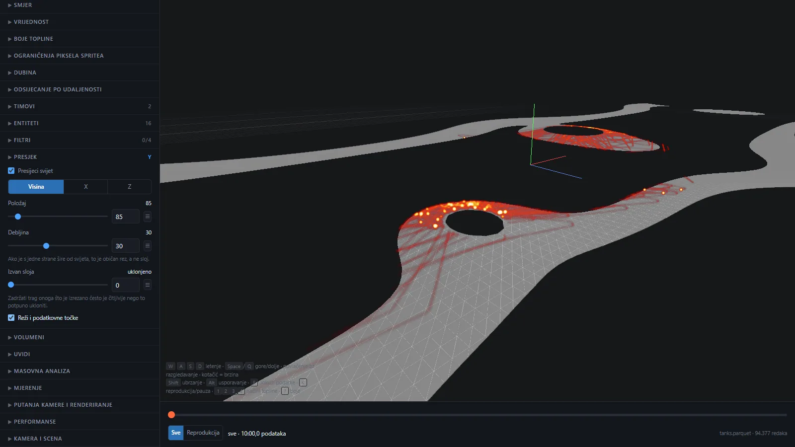

# Presjek

**Presjek** reže svijet kao kriška torte, pa možeš pogledati unutar zgrada. Koristi ga kad zidovi skrivaju zanimljivu toplinu, na primjer da vidiš jedan kat zgrade.

## Isprobaj {#try-it}

1. Učitaj razinu i neke podatke, pa otvori **Presjek**.
2. Označi **Presijeci svijet**. Os je **Visina**.
3. Povuci **Položaj** gore i dolje: sloj se pomiče kroz razinu.
4. Učini **Debljinu** tankom za tlocrt kata, ili širokom za "sve ispod ovdje".
5. Ostavi **Izvan sloja** na 0 da ukloniš ostatak, ili ga podigni da zadržiš slabi trag.



Sloj reže **geometriju razine i podatkovne točke zajedno** - rezanje samo razine ostavilo bi toplinu da lebdi tamo gdje je bila zgrada. To je suprotnost [zaklonu dubine](depth-and-culling.md): kad razina ispravno skriva što je iza nje, unutrašnjost zgrade je također skrivena. Ploča se prikazuje kad ima što rezati (skup podataka ili 3D razina); njezino zaglavlje pokazuje os dok je uključena, inače *isključeno*.

```
side view         Position = where the slab is
 ----------       Thickness = how tall the slab is
 | floor 3 |
 |=========|  <--- slab (kept)
 | floor 2 |  <--- outside: removed (or faint)
 | floor 1 |
 ----------
```

## Kontrole {#controls}

| Kontrola | Zadano | Značenje |
|---|---|---|
| **Presijeci svijet** | isključeno | Uključuje sloj. Dok je položaj još na početnoj vrijednosti 0 a debljina na početnoj 500, uključivanje ih premješta na sredinu osi i na 15% njezina raspona. |
| Os | **Visina** | *Visina* (Y), *X* ili *Z*. Promjena osi premješta sloj na sredinu nove osi. |
| **Položaj** | sredina | Središte sloja, u svjetskim jedinicama, kroz raspon osi (500 koraka). |
| **Debljina** | 15% raspona | Od 1/500 raspona do dvostrukog raspona, u logaritamskim koracima. Pokazuje *Izvan svijeta* kad je jednako širok kao raspon: tada jedna strana seže izvan svijeta i to je obični rez, a ne sloj. |
| **Izvan sloja** | 0, *uklonjeno* | Koliko onoga što je izvan ostaje vidljivo, 0-100%. Slabi trag onoga što je odrezano često je lakše čitati nego potpuno uklanjanje. |
| **Reži i podatkovne točke** | uključeno | Isključeno ostavlja toplinu cijelu, pa se vidi kroz rez - korisno za vidjeti što je iznad i ispod sloja. |

Raspon osi je raspon 3D razine kad je učitana, inače raspon skupa podataka.

Presjek je neovisan o [odbacivanju po udaljenosti](depth-and-culling.md#distance-culling), koje reže duž smjera pogleda, a ne duž osi svijeta; oboje se kombinira. Promjena bilo koje postavke presjeka ponovno pokreće akumulaciju topline.

## Za razvojne programere {#for-developers}

Sloj se provjerava na svjetskom položaju svakog retka u vertex shaderu: redak izvan njega ima svoj doprinos pomnožen vrijednošću *Izvan*, pa se pri 0 odbija prije nego se nacrta ijedan fragment. Shaderi razine primjenjuju isti test na svaki fragment tla, građevina i vode.
