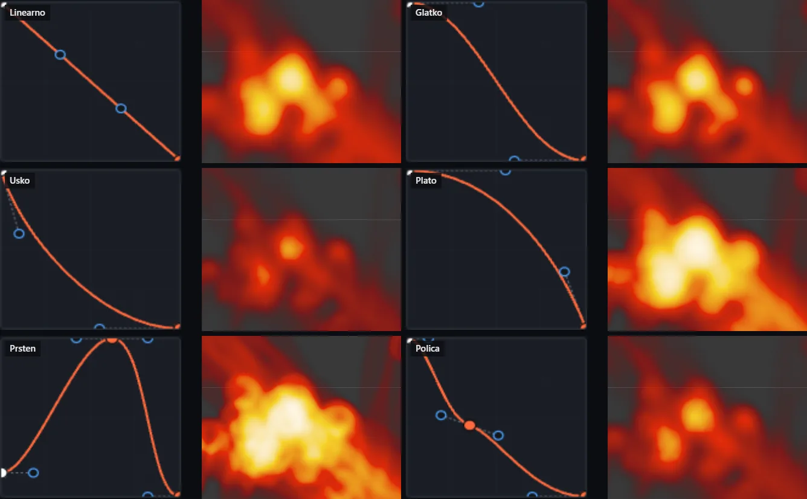
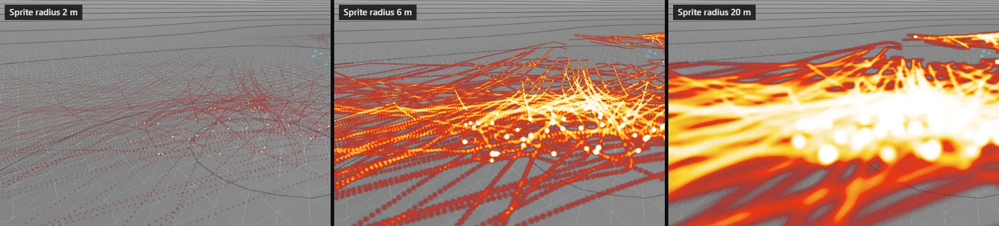

# Oblik spritea

Svaki redak crta se kao okrugli sprite koji uvijek gleda prema kameri. Njegova veličina i profil od središta do ruba, **skala**, odlučuju hoće li se vruća točka čitati kao uska točka, meki oblak, disk ili prsten. Ovi upravljači nalaze se u odjeljcima **Oblik topline** i **Ograničenja piksela spritea** na bočnoj traci, a vrijede za [Toplinu](heat.md), [Razliku](difference.md), [Toplinu timova](team-heat.md) i, kao polovicu širine linije, za [Linijsku toplinu](line-heat.md).

Promjena bilo kojeg od njih ponovno pokreće akumulaciju (polje se mora ponovno iscrtati s novim oblikom).

Zamislite svaku točku kao meku mrlju svjetla. Mala mrlja pokazuje pojedinačna mjesta, a velika mrlja spaja susjede u oblak. Oblik određuje koliko je rub mekan.



## Polumjer spritea {#sprite-radius}

Polumjer spritea u **jedinicama svijeta** (označen kao metri). Zadano je 6, a pri svakom učitavanju vodoravni raspon podataka / 120, dovoljno velik da se susjedni uzorci duž putanje spoje u pojas, a ne čitaju kao tanka crta. Logaritamski klizač od 0,05 do 2000, ručica se može povući do 50.000.



Stvari koje su daleko izgledaju manje, pa se sprite na zaslonu smanjuje s udaljenošću. Pod paralelnom projekcijom je isti svuda, što je dio razloga zašto je paralelni prikaz pravi za usporedbu vrućih točaka ([Kamera](camera.md#projection)).

## Ograničenja piksela {#pixel-clamps}

**Ograničenja piksela spritea** (zadano zatvoreno) ograničavaju polumjer na zaslonu nakon gornje pretvorbe.

| Upravljač | Zadano | Raspon (klizanje) | Zašto |
|---|---|---|---|
| **Najmanji radijus u pikselima** | 1 px | 0–16 (512) | Sprječava da udaljeni podaci nestanu ispod jednog piksela. |
| **Najveći radijus u pikselima** | 96 px | 2–1024, logaritamski (8192) | Zaštita od prekomjernog iscrtavanja. Sprite koji pokriva N piksela košta N operacija miješanja, pa je neograničen radijus blizu kamere ono što pretvara brz kadar u spor. Iznad visine prikaza prestaje išta ograničavati. |

**Ista gustoća pri svakom zumiranju** (u odjeljku Oblik topline, zadano uključeno) radi zajedno s ograničenjima. Sprite koji ga ograničenje čini većim (daleko) ili manjim (izbliza) zadržava toplinu koju bi dodao njegov pravi oblik, pa boja znači isti broj redaka po površini tla pri svakom zumiranju. Kad je isključeno, ograničeni sprite dodaje punu težinu pri svojoj ograničenoj veličini, a slika se mijenja dok letite prema njoj.

## Intenzitet u središtu i na rubu {#centre-and-edge-intensity}

Toplina koju sprite dodaje u svom točnom središtu (**Intenzitet u središtu**, zadano 1, od 0 do 10, klizanje 1000) i na svom rubu (**Intenzitet na rubu**, zadano 0, od -2 do 10, klizanje 1000). Vrijednost skale *t* (1 u središtu, 0 na rubu, oblikovana opadanjem ili krivuljom ispod) miješa ih (formula je pod [Za razvojne programere](#for-developers)).

**Negativan intenzitet na rubu** čini da rub oduzima, što izrezuje hladnu aureolu oko svake vruće točke i izoštrava grupe jednu naspram druge. Vidljivost uključuje [zakrivanje](depth-and-culling.md) i [isječak](slice.md). Nestajanje je [efekt nestajanja Trajanja](timeline.md#history), a predznak je ±1 u [Razlici](difference.md).

## Oblik skale: opadanje ili krivulja {#ramp-shape-falloff-or-curve}

**Oblik skale** prebacuje između dva načina oblikovanja *t* preko spritea. Uz *d* kao udaljenost od središta (0) do ruba (1):

### Opadanje {#falloff}

Prikazuje se kad je odabrano *Opadanje* (zadano).

- **Opadanje** (zadano 1,6, od 0,1 do 8, klizanje 64): `t = (1 - d) ^ opadanje`. 1 je ravna linearna skala; veće vrijednosti vuku toplinu prema središtu i sužavaju vruću točku; ispod 1 spljoštava je u disk.
- **Glatka skala** (zadano uključeno): primjenjuje S-krivulju *smoothstep* na *t*, pa sprite nestaje prema rubu umjesto da završi vidljivim rubom.

### Urednik krivulje {#the-curve-editor}

Prikazuje se kad je odabrana *Krivulja*. Doslovan presjek spritea: udaljenost od središta preko (*središte* lijevo, *rub* desno), toplina gore. Krivulja je dijelom kubični Bézier kroz kontrolne točke, svaka s dvije ručice.

| Radnja | Učinak |
|---|---|
| Dvostruki klik na grafikon | Dodaje točku na toj udaljenosti (zadržava se između 0,02 i 0,98), na krivulji i s nagibom krivulje tamo, pa dodavanje ništa ne mijenja dok je ne povučete. |
| Povlačenje točke | Pomiče je. Visine se zadržavaju između 0 i 1. |
| Povlačenje malog kruga | Savija segment uz njega (pomiče tu ručicu). |
| Alt-klik ili desni klik na točku | Uklanja je. Dvije krajnje točke ne mogu se ukloniti. |
| Gumb pretpostavke | Zamjenjuje krivulju pretpostavkom. |

Krajnje točke fiksirane su na središtu i rubu; njihova visina je i dalje vaša.

**Pretpostavke** ([`curve.ts`](https://github.com/Holdi601/3DHeat/blob/main/src/state/curve.ts)):

| Pretpostavka | Oblik | Upotreba |
|---|---|---|
| **Linearno** | Ravno od 1 do 0 | Isto kao *Opadanje* 1 uz *Glatka skala* isključeno. |
| **Glatko** | S-krivulja | Zadana krivulja; ono što *Glatka skala* daje pri opadanju 1. |
| **Usko** | Strma jezgra, dug blijed rub | Rijetki podaci. |
| **Plato** | Ravno, pa brz pad | Čita se kao disk, a ne kao mrlja. |
| **Prsten** | 0,15 u središtu, 1 na 62% polumjera, 0 na rubu | Šupalj sprite: pokazuje gdje putanje prolaze, a ne gdje staju. |
| **Polica** | Pad u dvije faze, 0,45 na 35% | Odvaja gustu jezgru od okolice. |

## Spljošti na ravninu tla {#flatten-onto-ground-plane}

**Spljošti na ravninu tla** (zadano isključeno) zanemaruje visinu svakog retka i crta svu toplinu na jednoj visini, najnižoj Y vrijednosti skupa podataka, klasičnu 2D toplinsku kartu. Kad je uključeno, zakrivanje dubinom i *Sakrij iza terena* su isključeni (svaka točka bi ležala točno na površini na kojoj se provjerava), a odjeljak Dubina to kaže.

## Za razvojne programere {#for-developers}

### Formule {#formulas}

Polumjer na zaslonu u pikselima: `radius × P[1][1] / w × visina prikaza / 2`, gdje je `P` matrica projekcije, a `w` dubina pogleda točke.

Toplina koju sprite dodaje:

```
heat added = mix(edge, centre, t) × sample weight × sign × fade × visibility
```

### Krivulja {#the-curve}

Ručice su vodoravno ograničene na svoj segment, pa je krivulja uvijek funkcija udaljenosti. Povlačenje ručice daleko preko sljedeće točke izravnava je uz nju umjesto da savije krivulju natrag, što bi učinilo rezultat ovisnim o tome koji korijen je rješavač slučajno našao.

### Kako se krivulja crta {#how-the-curve-is-drawn}

Krivulja se unaprijed izračunava u tablicu od 256 unosa pri svakoj promjeni, učitava kao tekstura s 16-bitnim decimalnim brojevima i uzorkuje po fragmentu s linearnim filtriranjem i pomakom od pola teksela, pa oba kraja ostaju točna. Rješavanje Béziera za x treba iteraciju, a ona nema mjesta u najvećem shaderu programa. Dohvat iz tablice je i jeftiniji od `pow()` koji koristi opadanje. 16-bitni, a ne 8-bitni, jer 8 bita pokazuje pruge čim se zbroje tisuće spritea. 16-bitni decimalni polovični broj može se filtrirati u osnovnom WebGL2, dok 32-bitni treba proširenje.
