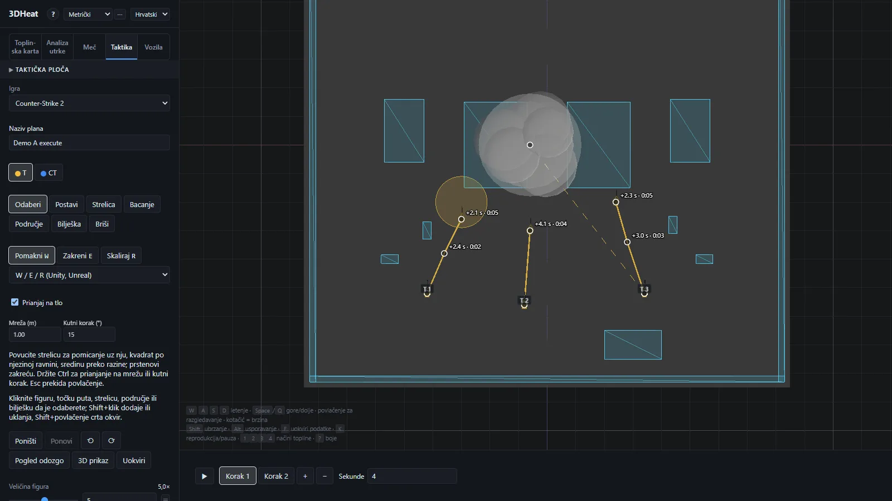

# Ploča taktika

Kartica **Taktika** je ploča za crtanje plana tima. Na kartu stavljate male figure, crtate strelice za to kamo idu i pritisnete reprodukciju da vidite što se događa. Koristite je da isplanirate rundu ili napad prije igre. Dijeli platno, kameru i [razinu](levels.md) s drugim karticama, a ništa više. Plan nije podatak i ne crta toplinu.

## Vaš prvi plan {#your-first-plan}

1. Otvorite karticu **Taktika**. Odaberite **Igra** (na primjer Counter-Strike 2). Za Valorant pritisnite **Učitaj karte za Valorant** i odaberite **Karta**. Ili prvo učitajte [razinu](levels.md).
2. Odaberite **Stranu** (ona određuje boju) i pritisnite **Pogled odozgo**.
3. Odaberite **Mjesto**, odaberite figuru u **Figure** (koristite **Traži figure** da je nađete) i kliknite na kartu. Postavite dvije ili tri.
4. Odaberite **Strelica**, kliknite na figuru, kliknite duž puta kojim bi trebala ići i pritisnite **Enter** da završite strelicu.
5. Pritisnite **+** ispod prikaza da dodate korak 2. Svaka figura počinje tamo gdje je završila njezina strelica. Tamo nacrtajte još strelica.
6. Pritisnite **▶** (ili `K`) da pustite plan od prikazanog koraka do kraja.
7. Imenujte plan u **Naziv plana** i pritisnite **Spremi**.

## Početak plana {#starting-a-plan}

| Kontrola | Što radi |
|---|---|
| **Igra** | Odabire strane i figure koje paleta nudi: Counter-Strike 2 (T, CT; igrači i pomoćna sredstva), Valorant (Napad, Obrana; igrači i opće sposobnosti), Battlefield, Squad, Arma (pješaštvo, kopnena vozila, zrakoplovi, brodovi), DCS / War Thunder / IL-2 (mlažnjaci, elisni zrakoplovi, helikopteri, protuzračna obrana, kopno, brodovi, oružje) i Ostalo. Plan koji već ima figure zadržava svoje strane kad se igra promijeni. |
| **Naziv plana** | Ime pod kojim se plan sprema. |
| **Karta**, **Učitaj karte za Valorant** | Kad je odabran Valorant: **Učitaj karte za Valorant** dohvaća popis karata s [valorant-api.com](https://valorant-api.com). **Karta** zatim postavlja mini-kartu odabrane karte kao razinu, uokvirenu odozgo. Slika se preuzima kad se odabere i nikad se ne isporučuje uz program. Obavijest Riota prikazuje se dok je na zaslonu (vidi dolje). |
| **Strana** | Strana kojoj pripada sljedeća figura, strelica ili područje. Dobiva boju strane. |

Bez razine ploča je ravna površina tla. Učitajte razinu pod **Razina** da planirate na pravoj karti: karta CS2 izvezena CS2 alatom, razina iz biblioteke ili slika karte.

## Alati {#tools}

| Alat | Klik | Napomene |
|---|---|---|
| **Odaberi** | Figura, točka puta, strelica, područje ili bilješka odabire se. | Shift+klik dodaje ili uklanja; Shift+povlačenje crta okvir oko onoga što se dodaje. Odabir dobiva alat za transformaciju (vidi dolje); `Delete` ili `Backspace` ga uklanja. `M` pomiče odabranu figuru na sljedeći klik. |
| **Mjesto** | Postavlja odabranu figuru. | Figura se bira u paleti **Figure** (uz **Traži figure**). Kad ništa nije odabrano, `R` okreće sljedeću figuru za 15° prije postavljanja (`Shift+R` u drugom smjeru). |
| **Strelica** | Svaki klik dodaje točku; Enter, dvostruki klik ili desni klik završava je, Esc je odbacuje. | **Kretanje**, **Napad** (šire vrh) ili **Promatranje** (tanka linija na visini oka). Strelica započeta na figuri je put te figure u ovom koraku: pri reprodukciji figura ga prođe, a sljedeći korak počinje tamo gdje je završio. |
| **Bacanje** | Bacač, zatim mjesto pada. | Isprekidani luk od jednog do drugog. Odabrano pomoćno sredstvo (dim, bljesak, molotov, ...) pojavljuje se tamo gdje padne i ostaje od ovog koraka nadalje. |
| **Područje** | Središte, zatim rub. | Disk u boji strane. |
| **Bilješka** | Mjesto bilješke; traži njezin tekst. | Prikazuje se kao pribadača, a njezin tekst iznad nje. |
| **Briši** | Figura, strelica, područje ili bilješka. | Uklanja je od ovog koraka nadalje; u prvom koraku uklanja je potpuno. |

**Poništi** i **Ponovi** (`Ctrl+Z`; `Ctrl+Y` ili `Ctrl+Shift+Z`) prolaze kroz svaku promjenu. Crta ispod plana pokazuje koliko figura, strelica i koraka ima. **Pogled odozgo** gleda ravno dolje (ortografski), **3D prikaz** vraća perspektivu, **Kadar** uklapa plan, ili razinu kad je plan prazan.

**Veličina figura** skalira svaku figuru na ploči. 1× je stvarna veličina. Odozgo iz daljine, čovjek je tada nekoliko piksela.

## Pomicanje, okretanje i skaliranje {#moving-turning-and-scaling}

Sve na ploči može se pomicati kao u 3D uređivaču: figure, pomoćna sredstva, oznake, pojedinačne točke puta i cijele strelice, područja i bilješke. Ono što je odabrano dobiva alat na svojoj sredini:

| Način | Ključevi | Ručke |
|---|---|---|
| **Pomakni** | W (ili G) | Strelica po osi (X crveno, Y zeleno i prema gore, Z plavo) pomiče se duž nje; kvadrat pomiče se u svojoj ravnini; sredina se pomiče po razini ispod pokazivača. |
| **Zakreni** | E (ili R) | Prsten po osi zakreće oko nje. Prstenovi jedne figure su njezin vlastiti zaošijanje, posrtanje i valjanje; grupa se zakreće oko osi svijeta oko svoje sredine. |
| **Skaliraj** | R (ili S) | Širi ili skuplja odabir od svoje sredine duž osi ili na sve strane; polumjer područja raste s njim. |

**Ključevi** prebacuju između W / E / R (Unity, Unreal) i G / R / S (Blender). Tipke biraju način samo dok je nešto odabrano. Inače lete kamerom. Tako `R` znači **Skaliraj** s tipkama W / E / R, a **Zakreni** s tipkama G / R / S dok je nešto odabrano. Kad ništa nije odabrano, okreće sljedeću figuru za postavljanje. Sve tipke ploče navedene su u [referenci tipkovnice](keyboard-reference.md#tactics-board). Držite **Ctrl** dok povlačite da pomak prikvačite na **Mrežu** (metri) ili okret na **Kutni korak**. **Prianjaj na tlo** (uključeno prema zadanom) stavlja pomaknute ljude, vozila, oznake, točke puta i područja na površinu razine. Zrakoplovi i helikopteri zadržavaju svoju visinu, a povlačenje duž Y strelice nikad ne prianja. **Esc** prekida povlačenje, a svaka promjena je jedan korak Poništi.

Točke puta prikazuju se kao točkice na strelicama prikazanog koraka. Kliknite jednu da je odaberete, povucite je da je pomaknete, a Delete je uklanja. Odjeljak **Odabrane** prikazuje mjesto odabira u metrima, zaošijanje, posrtanje i valjanje figure u stupnjevima te polumjer područja, sve upisivo.

## Mjerenje vremena {#timing}

Put figure ima vrijeme: svaki segment traje onoliko koliko je dug preko razine. Površina se uzorkuje svakih nekoliko metara, pa se brdo ili stepenice između dvije točke računaju. Brzina je načina **kretanja** te figure u toj igri, plus eventualno **čekanje** na točki puta. Pješaštvo puže, čuči, hoda (tiho), trči ili sprinta. Vozila i brodovi puze, idu oprezno, normalno ili jure. Zrakoplovi i helikopteri lete sporo, krstare, idu borbenom brzinom ili maksimalnom. Način koji igra nema (CS2 nema sprint) uzima najbliži koji ima. Kako nagib usporava ovisi o igri: u CS2 i Valorantu računa se samo vodoravna udaljenost, kao u samim igrama. Vojne simulacije usporavaju pješaštvo uzbrdo (Toblerova funkcija hodanja), a vozila prema nagibu.

Brzine dolaze iz tablica po igri s njihovim izvorima (vidi [Brzine kretanja](tactics-speeds.md)). CS2 ih daje prema oružju u ruci, iz definicija oružja igre. Valorant prema oružju. Battlefield, Squad, Arma i zračne igre prema vrsti vozila i klasi. **Kreće se kao** bira profil figure (oružje, vrstu vozila). **Vlastita (m/s)** poništava bilo koji način za tu figuru. Načini su imenovani kako ih ploča prikazuje: *Puzanje*, *Čučanj*, *Hodanje (tiho)*, *Trčanje*, *Sprint*; *Oprezno*, *Normalno*, *Rush*; *Sporo*, *Krstarenje*, *Borba*, *Maksimalno*.

Svaka točka puta prikazuje vrijeme od prethodne i vrijeme od početka plana ("+3,9 s · 0:12"). Put odabrane figure navodi svaki segment s njegovim načinom, duljinom i vremenom, zadržavanjem i dolaskom. **Dolasci** pod **Mjerenje vremena** stavlja svaku figuru s putem na jednu vremensku os, prvi dolazak na vrhu. Uz **Reproduciraj u stvarnom vremenu** (uključeno prema zadanom) korak traje dok ne stigne najsporija ruta, a svaka figura se kreće svojom brzinom. **Sekunde** su tada najkraća duljina koraka. **Jedinica razine po metru** kaže u čemu je razina: 39,37 za karte CS2 (jedinice igre), 1 za karte u metrima.

## Usporedba s podacima mečeva {#compare-with-match-data}

**Učitaj datoteke mečeva…** čita CS2 tablice mečeva ove karte (Parquet datoteke alata CS2, koliko god ih ima; samo potrebni stupci, u pozadini). **Koristi učitane podatke** uzima podatke učitane u preglednik. Zatim:

- **Najraniji dolazak na karti** boji kartu prema vremenu od početka runde u kojem je igrač prvi put stigao do svakog mjesta. Gumb **Najbrži** prikazuje najbrže kroz sve runde, **Tipično (medijan)** srednju rundu. Zeleno je rano, crveno kasno, za jednu stranu ili obje. Pokazuje što je moguće i kada.
- Odabrana ruta uspoređuje se s onim što su igrači postigli od njezina početka (ili od početka runde) do njezina kraja. Svaki kraj je disk zadanog polumjera: "Najbrži uočen 14,2 s, p10 15,0 s, medijan 18,3 s u 41 pokušaju; vaš plan 15,1 s".
- Brzine kojima su se igrači zaista kretali (trčanje, hodanje, čučanje, iz stupaca tablica za hodanje i čučanje) u m/s.

## Koraci {#steps}

Traka ispod prikaza sadrži korake. Plan počinje s jednim. **+** dodaje jedan, a svaka figura u njemu počinje tamo gdje je završila njezina ruta u zadnjem koraku. **−** uklanja prikazani. **Sekunde** su koliko traje prikazani korak kad se pusti. **▶** (K) pušta od prikazanog koraka do kraja: figure s rutom hodaju njome, figure pomaknute na novo mjesto u sljedećem koraku kliznu tamo, a ostale stoje. Dok je korak prikazan, mjesto svake figure u sljedećem koraku nacrtano je kao blijedi duh, a strelice zadnjeg koraka blijedo su ispod strelica ovog.

## Spremanje {#saving}

Odjeljak **Datoteka** sadrži **Spremi**, **Otvori** i **Očisti**. **Spremi** zapisuje plan kao `<naziv>.h3dplan.json` (običan JSON: strane, koraci, figure s mjestom po koraku, strelice, područja, bilješke). **Otvori** ga čita natrag. Datoteka druge verzije ili datoteka koja nije plan odbija se uz razlog. **Očisti** prazni plan. Poništi ga vraća.

## Figure {#figures}

Svaku figuru gradi sam preglednik: jednostavni oblici u objavljenoj veličini tipa, s obilježjima koja je razlikuju od susjeda. Gusjenice i kupola tenka, topovi, rakete i radari protuzračnog vozila, tlocrt krila zrakoplova, rep i motori, rotori i kratka krila helikoptera. Ništa nije preuzeto iz igre. Dizajn koji je igra izmislila prikazuje se kao generička figura svoje klase. Kako podaci nalaze svoju figuru: vidi [Figure](figures.md#which-figure-a-unit-gets).

## Obavijest Riota {#riots-notice}

Karte Valoranta prikazuju se prema politici Riot Gamesa "Legal Jibber Jabber", koja dopušta slobodnim projektima zajednice da ih koriste i traži ovu obavijest gdje god se pojave: *3DHeat je nastao prema politici "Legal Jibber Jabber" tvrtke Riot Games, uz imovinu u vlasništvu tvrtke Riot Games. Riot Games ne odobrava niti sponzorira ovaj projekt.* Sposobnosti na ploči su generički oblici, a ne Riotova umjetnost.
