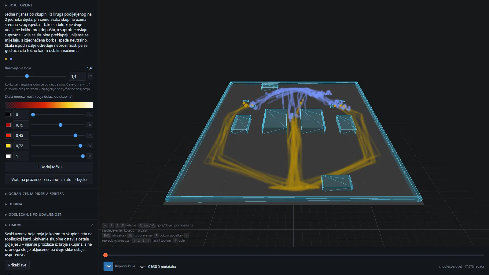

# Toplina timova

Toplina timova pokazuje gdje je bio svaki tim, svaki u svojoj boji. Gdje se timovi preklapaju, boje se miješaju.

**Toplina timova** (tipka 3) je gustoća polja [Topline](heat.md) s tim da je svaka [grupa](glossary.md) dobila svoju nijansu. Gdje se grupe preklapaju, njihove nijanse se miješaju; izjednačeno natjecanje ispadne neutralno. Neprozirnost i dalje nosi gustoću kao u drugim načinima, pa slika odjednom odgovara *koliko* i *čije*. Treba stupac grupe.

Nije to [sloj figura](box-replay.md): on crta jednu figuru po osobi; ovo je polje topline obojeno istim stupcem.

## Kako se koristi {#how-to-use-it}

1. Pritisni `3` (ili odaberi **Toplina timova** u traci načina).
2. Otvori **Boje topline**. Uzorci pokazuju boju svake grupe; pređi mišem preko uzorka za naziv tima.
3. Ako sve izgleda sivo, povisi **Razdvajanje boja**.
4. Odznači grupu na [Popisu timova](teams-list.md) da je izvučeš; ostale boje ostaju gdje su bile.

## Kontrole {#controls}

U odjeljku **Boje topline**:

| Kontrola | Zadano | Značenje |
|---|---|---|
| Uzorci | | Boja svake grupe, za prvih 12 grupa, zatim *+N više*. Pređi mišem za naziv grupe i boju. |
| **Razdvajanje boja** | 1,4 | Koliko se mješavina odgurne od neutralne, 0-4. 0 sve čini sivim; 1 je pravi prosjek; iznad oko 2 najsvjetlije mješavine izlaze iz prikazivog raspona i po kanalu se steže, što pomiče njihovu nijansu. |
| **Skala neprozirnosti (boja dolazi od skupine)** | zadana skala topline | Ovdje se koristi samo **alfa** skale: prozirno tamo gdje nema ničega, neprozirno na vrhu. Njezine boje se zanemaruju. |

Grupa čija oznaka znači "bez grupe" (`0`, prazno, `none`, `unknown`, `null` ili `-1`) crta se sivo.

Sve ostale kontrole topline - oblik, zasićenje, odziv, najmanja toplina, dubina, odbacivanje - rade kao u [Toplini](heat.md).

[Popis timova](teams-list.md) u ovom načinu pokazuje boju toplina timova svake grupe kao njezin uzorak. Sakrivanje grupe ostavlja boju svake druge grupe tamo gdje je bila: nijanse dolaze iz ukupnog broja grupa, a ne iz onoga što je uključeno, pa dvije slike ostaju usporedive.

## Za razvojne programere {#for-developers}

### Paleta {#the-palette}

Iz [`colors.ts`](https://github.com/Holdi601/3DHeat/blob/main/src/render/colors.ts):

- Boje žive u **Oklab** ravnini boja pri stalnoj svjetlini (0,7) i kromi (0,115), pa je svaka grupa jednako svijetla i crvena grupa ne izgleda vrućija od plave.
- Uz *n* grupa, krug nijansi podijeljen je na *n* jednakih dijelova i grupa *i* uzima **središte** svog dijela, `(i + 0,5) / n` okreta. Svake dvije grupe su što dalje jedna od druge koliko broj dopušta, a suprotnosti ostaju suprotne bez obzira na broj.
- Najviše se koristi **16** različitih nijansi. S više grupa, id-ovi se raspoređuju ponovljenim prepolovljavanjem (id-ovi s obrnutim bitovima: 0, ½, ¼, ¾, ⅛, …) pa susjedni id-ovi ne dijele nijansu; grupe iza 16. nužno dijele.
- Grupa čija oznaka znači "bez grupe" - `0`, prazno, `none`, `unknown`, `null` ili `-1`, bez obzira na velika i mala slova - crta se **neutralno sivo** umjesto da uzima dio kruga. Samo se prva takva oznaka na popisu grupa tretira tako.

Zadano razdvajanje je 1,4, a ne 1, jer je pri 1 mješavina pet ravnomjerno raspoređenih nijansi *siva*: točno, ali nečitljivo. Malo iznad 1 zadržava izjednačenja poštenima, a čini podjelu 60/40 vidljivom.

### Kako radi {#how-it-works}

Cilj topline u ovom načinu ima četiri kanala. Svaki sprite dodaje svoju gustoću *v* prvom kanalu, a *v* × Oklab koordinate *a* i *b* grupe drugom i trećem. Pri kompozitu mješavina piksela je prosjek ponderiran gustoćom: *a* = G / R, *b* = B / R, skaliran razdvajanjem boja i pretvoren u sRGB pri svjetlini palete. Dijeljenje s akumuliranom gustoćom održava nijansu neovisnom o tome koliko podataka ima, i zato svaka kontrola gustoće i dalje djeluje samo na neprozirnost.

Cilj s četiri kanala troši četiri puta više memorije GPU-a od cilja topline s jednim kanalom pri istoj rezoluciji.
