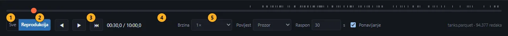

# Vremenska traka i reprodukcija

Traka ispod slike je kao video player: podatke možete pustiti kao film, pauzirati, skakati po njima i mijenjati brzinu.

Traka ispod prikaza je vremenska traka ([`Timeline.tsx`](https://github.com/Holdi601/3DHeat/blob/main/src/ui/Timeline.tsx)). Ona odlučuje koji su redci vidljivi u svakom trenutku. Treba stupac vremena; bez njega je cijela traka onemogućena, prikaz ostaje u **Sve**, a bočna traka kaže *Nema stupca vremena u ovim podacima - vremenska traka je onemogućena i svaka točka podataka prikazuje se odjednom.*

## Sve i Reprodukcija {#all-and-play}

Dva načina najviše razine, jer odgovaraju na različita pitanja.

- **Sve** (zadano pri svakom učitavanju) potpuno zanemaruje pokazivač reprodukcije i prikazuje svaki redak koji prolazi filtre. To je prikaz „gdje se ovo događa” i nije isto što i premotavanje do kraja. Klizač je onemogućen, a sat pokazuje `sve · <raspon> podataka`.
- **Reprodukcija** pušta podatke kao timelapse. Pojavljuju se klizač, upravljanje i postavke povijesti.

Odabir **Sve** zaustavlja i reprodukciju.

## Kontrole {#the-controls}

| Kontrola | Zadano | Značenje |
|---|---|---|
| Klizač | početak | Pokazivač reprodukcije. Povucite za premotavanje; 20.000 koraka kroz raspon. |
| **Sve** / **Reprodukcija** | Sve | Vidi gore. |
| ▶ / ❚❚ | pauzirano | Pusti ili pauziraj; također `K`. |
| ◀ **Reprodukcija unatrag (J)** | | Pušta podatke unatrag. Prikazuje se samo u načinu **Preklapanje figura**; ista tipka `J` radi i tamo (vidi [Tipkovnica](#keyboard)). |
| ⏮ | | Natrag na početak raspona. |
| Sat | | `proteklo / ukupno` kao `mm:ss.s` (ili `h:mm:ss`) i, kad je stupac vremena apsolutna vremenska oznaka, stvarno doba dana pokazivača kao `HH:MM:SSZ` (UTC). |
| **Brzina** | 1× | Sekunde skupa podataka po stvarnoj sekundi. Izbornik ima 17 koraka od 0,01× do 1800× (0,01, 0,02, 0,05, 0,1, 0,25, 0,5, 1, 2, 4, 8, 16, 32, 64, 128, 256, 600, 1800), plus **Prilagođeno…**: upišite bilo koju brzinu od 0,001× do 3600× (na primjer 0,3 ili 12) i pritisnite Enter; Esc zadržava trenutnu brzinu. Posljednja brzina pamti se za sljedeći posjet (vidi [Spremljene postavke](ref-settings-storage.md)). |
| **Povijest** | Kumulativno | Što se smatra vidljivim pri pokazivaču: *Kumulativno*, *Prozor* ili *Životni vijek* (u nastavku). |
| **Raspon** (Prozor; u načinu Crte i Životni vijek) | 30 s | Duljina prozora koji završava na pokazivaču; najmanje 0,01 s. U [Linijskoj toplini](line-heat.md#playback) to je duljina repa. |
| **Rezervni vijek** (samo Životni vijek, ne u načinu Crte) | 10 s | Koliko dugo točka podataka bez sljedećeg uzorka svoje osobe ostaje vidljiva. |
| **Nestajanje** (samo Životni vijek, ne u načinu Crte) | 0,4 | Udio vijeka svake točke podataka koji se troši na nestajanje, 0-1. |
| **Ponavljanje** | uključeno | Na kraju počinje ispočetka; isključeno zaustavlja na kraju. |
| Desna strana | | Ime skupa podataka. |

**Raspon** je vremenski raspon skupa podataka - ili, u [prekrivanju figura](box-replay.md) s odabranom sesijom, raspon te sesije.

## Povijest {#history}

U načinu Reprodukcija:

- **Kumulativno** - sve od početka raspona do pokazivača. Toplina se gradi dok se pušta.
- **Prozor** - fiksni raspon povijesti koji završava na pokazivaču (*Raspon*).
- **Životni vijek** - svaka točka podataka živi do **sljedećeg uzorka iste osobe** (u istoj sesiji), pa je u svakom trenutku točno jedna pozicija po osobi aktualna. Točka podataka čija osoba se više nikad ne pojavi - smrt, prekid veze, kraj zapisnika - nema sljedeći uzorak i živi za *Rezervni vijek*, umjesto da odmah nestane ili zauvijek ostane. Točke podataka **nestaju** tijekom posljednjeg udjela *Nestajanje* svog vijeka, umjesto da iskoče: kad je jedan uzorak po osobi živ, točka koja nestane između jednog okvira i sljedećeg učini cijelo polje treperavim pri brzini uzorkovanja. *Nestajanje* 0 vraća tvrdi prekid.

Životni vijek treba stupac osobe uz stupac vremena; bez njega se povijest pri učitavanju vraća na Kumulativno. U [Linijskoj toplini](line-heat.md#playback) povijest određuje koliko dugo rep rute ostaje vidljiv; u [prekrivanju figura](box-replay.md) *Rezervni vijek* je koliko dugo se drži osoba bez daljnjih uzoraka.

## Ponašanje reprodukcije {#playback-behaviour}

Iz petlje okvira ([`engine.ts`](https://github.com/Holdi601/3DHeat/blob/main/src/render/engine.ts)):

- Pokazivač napreduje za *vrijeme okvira × brzina*. Vrijeme okvira ograničeno je na 0,1 s, pa prebacivanje kartica ne teleportira pokazivač.
- Pritisak na reprodukciju na samom kraju raspona kreće od početka, kao što to radi media player. Pri svakom učitavanju pokazivač se postavlja na početak, pa prvi pritisak na reprodukciju pušta.
- Na kraju raspona pokazivač skače natrag na početak (Ponavljanje uključeno) ili tamo staje i reprodukcija završava (Ponavljanje isključeno).
- Klizač čita pokazivač motora izravno svaki okvir; stanje aplikacije se ažurira pri premotavanju, pokretanju, zaustavljanju i ponavljanju.
- Odabir sesije u biraču sesija premotava na početak te sesije.

## Zašto je reprodukcija glatka i jeftina {#why-playback-is-smooth-and-cheap}

Redci su spremljeni sortirani po vremenu, pa je vremenski prozor dva binarna pretraživanja nad stupcem vremena: pomicanje pokazivača pomiče dva cijela broja i ne dira nijedan redak, a trošak reprodukcije prati broj redaka u prozoru, a ne veličinu skupa podataka.

Kako se toplina održava stabilnom dok se prozor pomiče, ovisi o povijesti ([Akumulacija](accumulation.md)):

- **Kumulativno** samo raste, pa svaki okvir dodaje samo redke koji su postali vidljivi od prošlog, punom težinom. Polje se gradi monotono, a pauza ništa ne mijenja, jer više nema što stići. (Ponovna procjena bi umjesto toga svaki okvir osvijetlila drugi slučajni podskup pa ga utišala, što izgleda kao rafali koji bljesnu i nestanu.)
- **Prozor** i **Životni vijek** se zaista mijenjaju svaki okvir i ponovno se procjenjuju, miješani kao eksponencijalni pomični prosjek (težina 0,34 za novi okvir), što je u stacionarnom stanju nepristrano i mnogo mirnije nego kad se krene ispočetka.
- U načinu Životni vijek kandidati su redci od *pokazivač − max(najduži razmak u podacima, Rezervni vijek)* do pokazivača; shader zatim odbacuje svaki redak čiji je vlastiti vijek završio i primjenjuje nestajanje.

Prebacivanje između Sve i Reprodukcija, ili promjena povijesti, ponovno pokreće akumulaciju.

## Tipkovnica {#keyboard}

| Tipka | Učinak |
|---|---|
| `K` | Reprodukcija / pauza |
| `J` | Reprodukcija unatrag; ponovni pritisak pauzira (samo Preklapanje figura) |
| `L` | Reprodukcija unaprijed; ponovni pritisak pauzira (samo Preklapanje figura) |

`J` i `L` također prebacuju vremensku traku na **Reprodukcija**. Tipke se ignoriraju dok tekstni okvir ili izbornik ima fokus. Na kartici Analiza utrke tipka `K` umjesto toga upravlja vlastitom reprodukcijom te kartice.
