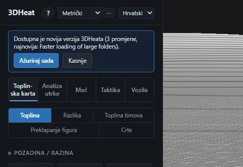

# Ažuriranja

Preglednik vam kaže kad postoji novija verzija, a ažurira se sam tek kad kažete da. Ništa se ne mijenja na vašem računalu bez vašeg odgovora.

## Ažuriranje preglednika {#update-the-viewer}

1. **Na stranici.** Kad postoji novija verzija, ispod imena na vrhu bočne trake pojavljuje se okvir: "Dostupna je novija verzija 3DHeat-a". Kliknite **Ažuriraj sada**. Stranica se sama ponovno učitava kad završi. **Kasnije** skriva okvir dok ponovno ne učitate stranicu.
2. **Ako piše da pokrenete restart.bat**, zatvorite prozor servera (crni prozor koji je otvorio `start.bat`) i dvaput kliknite `restart.bat`.
3. **Pri pokretanju preglednika.** I `start.bat` provjerava. Ako postoji novija verzija, pita **Ažurirati sada? [Y/N]**. Pritisnite `Y` za ažuriranje. Pritisnite `N`, ili pričekajte 60 sekundi bez odgovora, da pokrenete verziju koju imate.



Primjerak s vašim vlastitim izmjenama nikad se ne ažurira za vas. Okvir samo kaže da čeka ažuriranje i traži da spremite ili odložite svoje izmjene te pokrenete `git pull`. Primjerak koji nije instaliran s gitom (na primjer zip datoteka) ne prikazuje ništa.

Kako provjera radi, korak po korak:

```
page ---(after 4 s, then every 6 h)---> dev server ---> git fetch
   behind?  no  -> nothing is shown
            yes -> your own changes or commits?  yes -> tell you only
                                                 no  -> [Update now] -> git pull
                                                        -> reload, or "run restart.bat"
```

## Pravila sigurnosti {#the-safety-rules}

- **Samo unaprijed** (`git pull --ff-only`): ažuriranje nikad ništa ne spaja,
  ne preslaguje niti prepisuje.
- **Nema lokalnih izmjena**: primjerak s nepredanim izmjenama na praćenim datotekama
  (`git status --porcelain --untracked-files=no` nije prazan) nikad se ne ažurira
  automatski. Tuđi rad nije za ažuriranje da ga prepiše. Samo se javlja da
  ažuriranje čeka. Nepraćene datoteke (podaci, izvozi) ne broje se kao izmjene.
- **Nema lokalnih commitova**: primjerak s commitovima koje nadređeni ogranak nema
  ("divergirao") se ne ažurira. Unaprijed ga ne može dovesti u red, a spajanje
  je za `git pull` ručno. Stranica i `start.bat` kažu to istim riječima, a
  `start.bat` pokreće verziju koja tu jest.
- **Samo sa same stranice**: zahtjev za ažuriranje dev servera mora nositi
  prilagođeno zaglavlje i, kad preglednik šalje `Origin`, mora dolaziti s
  vlastitog hosta servera (dolje).
- Ažurira se samo git primjerak s nadređenim ogrankom; sve drugo (primjerak bez
  `.git`, bez instaliranog gita, statički build) ostaje netaknuto i ništa ne kaže.

## Što radi start.bat {#what-startbat-does}

`start.bat` (dvaput kliknite; prozor je server) radi, redom:

1. Pronalazi Node.js: u `PATH`-u, inače u `%ProgramFiles%\nodejs`,
   `%ProgramFiles(x86)%\nodejs` ili `%LOCALAPPDATA%\Programs\nodejs`. Ako ga
   nema, nudi instalaciju s `winget install -e --id OpenJS.NodeJS.LTS` (pita,
   Y/N; nakon toga prozor treba ponovno otvoriti da Windows pokupi novi `PATH`).
2. **Ažuriranja**, kad je git instaliran i mapa ima `.git`:
   - `git fetch --quiet` (bez mreže ili nadređenog ogranka: tiho preskače);
   - broji `git rev-list --count HEAD..@{u}`; ništa iza: ništa se ne kaže;
   - lokalne izmjene: "Dostupna je novija verzija 3DHeat-a (N promjena), ali ovaj
     primjerak ima lokalne izmjene pa se ne ažurira. Spremite ih ili odložite,
     zatim pokrenite git pull." - i pokreće verziju koja tu jest;
   - vlastiti commitovi (`git rev-list --count @{u}..HEAD` nije 0): "Dostupna je
     novija verzija 3DHeat-a (N promjena), ali ovaj primjerak ima vlastite
     commitove koje najnovija verzija nema, pa se ne ažurira. Ažurirajte ga s
     git pull." - i pokreće verziju koja tu jest;
   - inače "Dostupna je novija verzija 3DHeat-a (N promjena)." i pitanje **Ažurirati sada? [Y/N]**. `N`, ili nema odgovora 60 sekundi, ispisuje "Nije ažurirano; pokrećem verziju koju imate." i pokreće verziju koja tu jest. Na `Y`: "Ažuriram...", javlja mijenjaju li se `package.json` ili `package-lock.json`, pokreće `git pull --ff-only` (ako i to ne uspije, npr. zbog mreže: "Ažuriranje nije uspjelo; pokrećem verziju koju imate."), zatim `git submodule update --init` (fiksirani alati, vidi [Održavanje dokumentacije](maintaining.md#the-tools-under-exporters)), zatim `npm install` kad su se datoteke paketa promijenile i kad `node_modules` postoji, i "Ažurirano."
3. Odbija pokrenuti drugi server: kad nešto već sluša port **5273**, to kaže i upućuje na `restart.bat` / `stop.bat`.
4. Pri prvom pokretanju (nema `node_modules`) pita prije preuzimanja ovisnosti (oko 300 MB u `node_modules\`, ništa na razini sustava).
5. Pokreće dev server na `127.0.0.1:5273` (`--strictPort`) i otvara preglednik kad je spreman.

`restart.bat` zaustavlja server (po portu) i ponovno pokreće `start.bat`, pa postavlja isto pitanje. `stop.bat` samo zaustavlja.


## Za razvojne programere {#for-developers}

### Dok radi: ruta ažuriranja {#while-it-runs-the-update-route}

Dev server (Vite dodatak `heat3d-self-update` u `vite.config.ts`) služi
`/__heat3d/update`. Postoji samo na dev serveru, ne u statičkom buildu i ne u
`vite preview`.

**`GET /__heat3d/update`** odgovara je li primjerak iza:

```json
{ "checkout": true, "upstream": "origin/main", "behind": 3, "ahead": 0, "dirty": false, "latest": "the newest commit's subject" }
```

- `checkout: false` kad mapa nije git primjerak;
- pokreće `git fetch --quiet` **najviše svakih 30 minuta** (zahtjevi između
  odgovaraju iz zadnjeg dohvaćanja);
- `behind` / `ahead` iz `git rev-list --count HEAD..@{u}` / `@{u}..HEAD`,
  `dirty` iz `git status --porcelain --untracked-files=no`, `latest` predmet
  najnovijeg commita nadređenog ogranka;
- bez nadređenog ogranka, `upstream: null` i `behind: 0`.

**`POST /__heat3d/update/apply`** dovodi primjerak u red:

1. Odbija se s `403 { ok: false, reason: "forbidden" }` osim ako zahtjev nema
   zaglavlje `X-Heat3d-Update: 1` i, kad nosi `Origin`, host tog izvora nije
   `Host` zahtjeva. Obrazac s drugog sajta ne može poslati prilagođeno zaglavlje
   bez CORS pretprovjere, a ovaj server je nikad ne odobrava.
2. Ništa za raditi (nije primjerak, nema nadređenog ogranka, nije iza):
   `{ ok: true, updated: false }`.
3. Lokalne izmjene: `{ ok: false, reason: "dirty" }`; lokalni commitovi:
   `{ ok: false, reason: "diverged" }`.
4. Inače: bilježi datoteke koje se mijenjaju (`git diff --name-only HEAD @{u}`),
   `git pull --ff-only` (timeout 2 min), `git submodule update --init`
   (greška se ignorira), `npm install` kad su se `package.json` ili
   `package-lock.json` promijenili (timeout 15 min), i odgovara
   `{ ok: true, updated: true, restart }`. `restart` kaže zašto pokrenuti server
   ne može preuzeti ažuriranje: `"dependencies"` kad su ovisnosti ponovno
   instalirane, `"config"` kad se promijenila samo `vite.config` datoteka,
   `false` kad ne treba ponovno pokretanje.
5. Neuspjela git ili npm naredba odgovara `{ ok: false, reason: "<the error,
   up to 300 characters>" }`.

Odgovori su JSON s `Cache-Control: no-store`. Server sluša samo na `127.0.0.1`,
pa ruta nije dostupna s mreže.

### Obavijest na stranici {#the-notice-in-the-page}

`UpdateBanner`, ispod imena na vrhu bočne trake:

- Pita rutu **4 sekunde** nakon učitavanja stranice (ne u prvim sekundama: stranica
  ima skup podataka za učitati i GPU za pokrenuti), a zatim ponovno **svakih
  6 sati** dok je stranica otvorena.
- Ne prikazuje **ništa** kad rute nema (statički build), mapa nije primjerak ili
  ništa nije novije. Obavijest pri svakom pokretanju je nešto što ljudi nauče
  ignorirati.
- Iza, bez lokalnih izmjena: "Dostupna je novija verzija 3DHeat-a (N promjena,
  najnovija: <predmet>)." s **Ažuriraj sada** i **Kasnije** (*Kasnije* skriva
  okvir dok se stranica ponovno ne učita).
- Iza, s lokalnim izmjenama: ista rečenica i "Ovaj primjerak ima lokalne izmjene,
  pa se ne ažurira automatski; spremite ili odložite ih, zatim pokrenite git
  pull." - bez gumba.
- **Ažuriraj sada** šalje zahtjev na `/apply` ("Ažuriram..."). Zatim:
  - "Ažurirano. Stranica se ponovno učitava." - i ponovno se učitava 1,5 s kasnije
    (server već služi nove datoteke);
  - kad su ovisnosti ponovno instalirane: "Ažurirano. Njegove ovisnosti su se
    promijenile: zatvorite prozor servera i pokrenite **restart.bat** da
    dovršite.";
  - kad su se promijenile samo postavke servera: "Ažurirano. Njegove postavke
    servera su se promijenile: zatvorite prozor servera i pokrenite **restart.bat**
    da dovršite.";
  - ništa za uvesti nakon svega (`updated: false`, primjerak je u međuvremenu doveden
    u red, recimo preko `start.bat`): "Nema što ažurirati: ovaj primjerak je već
    najnovija verzija." - i bez ponovnog učitavanja;
  - odbijeno: rečenica o *dirty* stanju, ili "Ovaj primjerak ima vlastite commitove
    koje najnovija verzija nema; ažurirajte ga s git pull.", ili "Ažuriranje nije
    uspjelo: <reason>".
