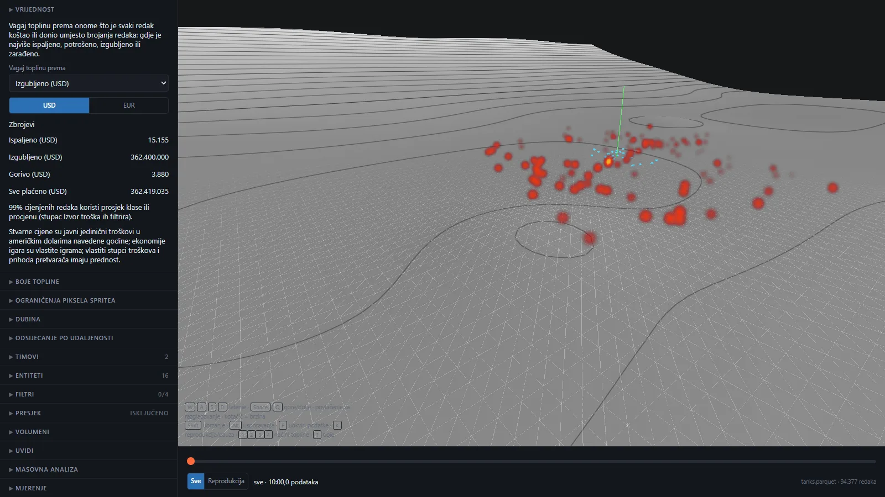

# Ponderiranje vrijednosti

Svaki hitac, streljivo, izgubljeno vozilo i litra goriva imaju cijenu. Preglednik izračunava što je svaki redak koštao ili zaradio i može toplinu vagati prema tome, pa karta pokazuje **kamo je otišao novac** umjesto gdje su retci.

## Kako se koristi {#how-to-use-it}

1. Učitaj podatke s događajima (hici, ubojstva, smrti) i nazivima vozila ili oružja.
2. Otvori **Vrijednost** u bočnoj traci kartice Toplinska karta.
3. Odaberi **Vagaj toplinu prema**, na primjer *Izgubljeno (USD)*. Toplina sada zbraja cijenu svakog retka umjesto 1.
4. Pročitaj **Zbrojeve**: zbroj svakog stupca vrijednosti za ono što je prikazano (vrijede filtri i vremenski prozor).
5. Tamo gdje su cijene stvarni novac pojavljuje se prekidač **USD / EUR**.

Odaberi prazan prvi unos izbornika da ponovno brojiš retke.

## Što se može vagati {#what-can-be-weighed}

Stupci vrijednosti dodaju se pri učitavanju, jedan po vrsti i valuti:

| Vrsta | Retci na koje pada | Kako se određuje cijena |
|---|---|---|
| **Ispaljeno** | hici i lansiranja | oružje, inače prosjek za vrstu streljiva |
| **Potrošeno** | kupnja, pojavljivanje | novčani stupci igre (na primjer izbornik kupnje u pucačini) |
| **Izgubljeno** | smrti, uništenja | vlastito vozilo, inače prosjek njegove klase |
| **Uništen** | ubojstva | ciljno vozilo |
| **Nanesena šteta** | pogoci | udio vrijednosti cilja |
| **Gorivo** | položaji | potrošeno gorivo, iz stupca goriva ili procijenjeno iz klase i vremena |
| **Sve plaćeno** | | ispaljeno + potrošeno + izgubljeno + gorivo |
| **Zarađeno** | nagrade | vlastiti stupci nagrada igre (`earn_…`) |
| **Neto** | | zarađeno minus plaćeno; crta se kao toplina s predznakom (pozitivna rampa gdje je zarađeno više, negativna gdje je plaćeno više) |

Nazivi stupaca su `cost_<kind>_<currency>`, `earn_<currency>` i `net_<currency>`. Pretvarač koji poznaje valutu same igre (na primjer pretvarač reprodukcije koji piše kredite iz igre) ima prednost pred ugrađenim tablicama cijena.

## Tablice cijena {#the-price-tables}

| Tablica | Valuta |
|---|---|
| Stvarna vojna oprema: rakete, bombe, streljivo, protumjere, zrakoplovi, helikopteri, kopnena vozila, brodovi, gorivo | USD (EUR = USD × 0,92, fiksni `EUR_PER_USD` u [`cost.ts`](https://github.com/Holdi601/3DHeat/blob/main/src/data/cost.ts); nije tečaj uživo) |
| Izbornici kupnje u pucačinama i nagrade za ubojstva | krediti igre |
| Igre s tenkovima i brodovima | krediti igre |
| Strateške igre (više resursa) | jedan stupac po resursu plus jedan zbirni |
| Ratne igre | bodovi |

Igra se prepoznaje iz naziva u podacima. Stvarne cijene dolaze iz javnih izvora (proračunski dokumenti, enciklopedije) ili su označene kao procjene; nisu usklađene s inflacijom. Generirani popis tablica nalazi se na stranici [Tablice vrijednosti](ref-value-tables.md).

## Procjene {#estimates}

Dodatni stupac kategorije **Cost source** kaže kako je svaki redak određen: `table`, `class average`, `estimate` ili `none`. Odjeljak Vrijednost pokazuje koji udio označenih redaka čine prosjeci ili procjene. Da zadržiš samo točno određene retke, odznači *estimate* i *class average* pod **Cost source** u [Filtrima](filters.md).

## Gdje se još prikazuje vrijednost {#where-else-value-shows}

- [Uvidi](insights.md): nalazi *Costly ground* i *Earning ground*.
- [Raščlamba](breakdown.md): Zarađeno, Izgubljeno i Neto novac po timu, igraču ili oružju.
- [Volumeni i usporedba](volumes.md): stupci vrijednosti u statistici i usporedbi.
