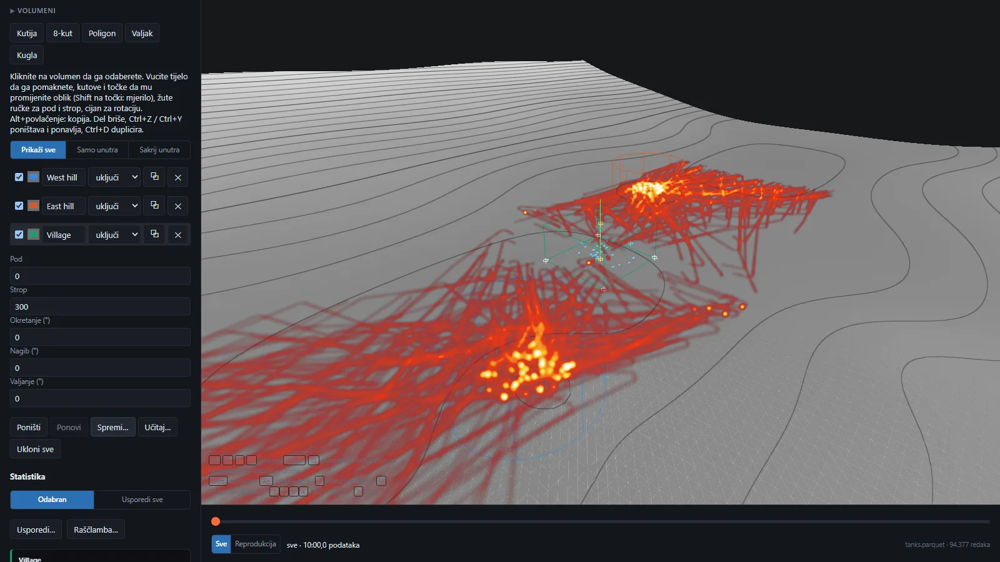
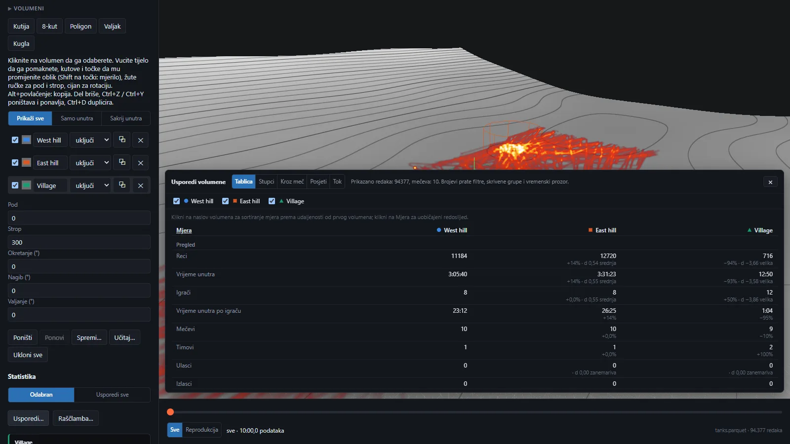
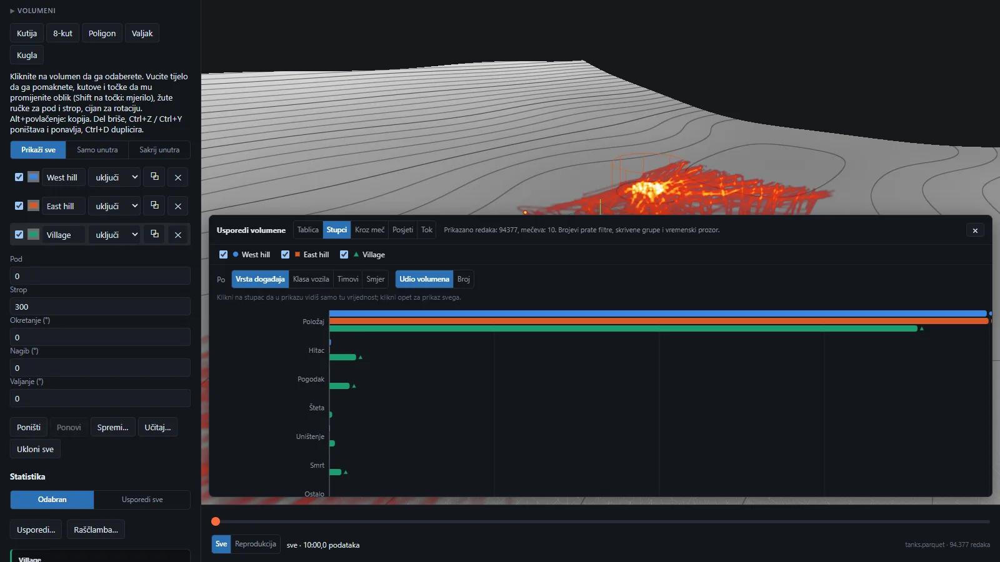

# Volumeni i usporedba

**Volumen** je nevidljiva kutija (ili valjak, ili kugla) koju crtate oko nekog mjesta da pitate: što se ovdje dogodilo? Koristite ga da prebrojite ubojstva kod jednog mosta, usporedite dva brda ili prikažete samo aktivnost u jednom području.

```
 pogled odozgo            Nacrtate oblik ->  preglednik broji
 +------------+           što je unutra:
 |   ( A )    |            redci, igrači, ubojstva, vrijeme ...
 |        [B] |           Usporedi A s B, jedno uz drugo.
 +------------+
```



Volumeni mjere što se događa unutar njih, filtriraju prikaz na njih, izvoze njihove redke i mogu se uspoređivati jedan uz drugi. Vidi i [pojmovnik](glossary.md) za redak, osobu i utakmicu.

## Nacrtajte volumen {#draw-a-volume}

1. Otvorite **Volumeni** u bočnoj traci.
2. Odaberite alat i crtajte u 3D prikazu ili na 2D karti. Pod i strop počinju od podataka ispod. Esc odustaje.
3. Kliknite volumen da ga odaberete; pojavljuje se njegova **Statistika**.

| Alat | Kako se crta |
|---|---|
| **Kutija** | Povucite pravokutnik (Shift: kvadrat). Klik postavlja zadanu kutiju. |
| **n-kut** | Povucite od središta (Shift ga čuva pravilnim). *Vrhovi* postavlja n, od 3 do 64 (zadano 8, pa gumb glasi **8-kut**). |
| **Poligon** | Kliknite vrhove; zatvorite dvostrukim klikom, Enterom ili klikom na prvi vrh. Backspace uklanja zadnji vrh. |
| **Valjak** | Povucite polumjer. |
| **Kugla** | Povucite polumjer; leži na tlu. |

## Uređivanje {#edit}

- Kliknite volumen da ga odaberete. Povucite njegovo tijelo za pomicanje, vrhove za oblikovanje (Shift na vrhu skalira).
- **Žuti** ručci postavljaju pod i strop, **cijan** ručka ga okreće.
- Alt+povlačenje kopira, Del uklanja, Ctrl+Z / Ctrl+Y poništava i ponavlja, Ctrl+D duplicira. **Ukloni sve** briše svaki volumen.
- Točne vrijednosti: Pod, Strop, Okret / Nagib / Kotrljanje (kutije), Polumjer (kugle, valjci).

Svaki redak volumena ima potvrdni okvir za prikaz, boju, ime, **uključi** ili **isključi**, duplicirati i obrisati. Volumeni se spremaju u pregledniku za svaki skup podataka, a **Spremi…** / **Učitaj…** pišu i čitaju datoteku `volumes.json`.

## Filtriranje prikaza {#filter-the-view}

| Filtar | Učinak |
|---|---|
| **Prikaži sve** (zadano) | Volumeni samo mjere. |
| **Samo unutra** | Toplina, reprodukcija i [analiza pogodaka](hit-analysis.md) crtaju samo ono što je unutar uključenih volumena, a izvan isključenih. |
| **Sakrij unutra** | Suprotno. |

GPU filtar prima do 8 volumena s ukupno 64 točke obrisa; "!" označava volumen iza te granice. Statistika i izvoz ga i dalje broje.

## Statistika {#statistics}

Područje **Statistika** slijedi filtre, vremenski prozor i skrivene grupe. *Odabrano* prikazuje odabrani volumen, a *Usporedi sve* stavlja svaki volumen jedan uz drugi. Prikazuje:

- **Redaka unutra (prikazanih)** i **Redaka unutra (svi podaci)**, **Igrači**, **Timovi**, **Mečevi**, **Vrijeme unutra**, **Ulasci / izlasci**, **Vrh topline**, **Prosječna toplina**, **Volumen / površina** i histogram **Kada**;
- **Postotak pobjeda**, ako podaci govore tko je pobijedio ([stupci ishoda](data-formats.md#outcome-columns)): od rundi s igračem unutra, runda svakog igrača brojena jednom, udio koji je njegova strana osvojila - privučen prema udjelu u svemu prikazanom za 4 runde, kao što to radi [raščlamba](breakdown.md) - uz osvojene i odigrane runde i taj ukupni udio;
- po stupcu: kategorije s **Odnosom udjela** (udio unutra podijeljen s udjelom u svim prikazanim podacima), a brojevi s rasponom, medijanom i 5. do 95. percentilom.

**Statistika kao CSV / JSON** sprema ih. **Izvezi podatke unutra** zapisuje redke unutra kao CSV ili Parquet (*Samo prikazani redci* uključeno prema zadanom), jedan volumen ili sve, sa stupcem koji kaže koji volumen drži koji redak.

## Usporedba volumena {#compare-volumes}

Uz dva ili više vidljivih volumena pritisnite **Usporedi…**.

1. Nacrtajte tri volumena, na primjer Zapadno brdo, Istočno brdo i Selo.
2. Pritisnite **Usporedi…** pod Statistikom.
3. U **Tablici** pročitajte razliku svake vrijednosti od prvog volumena.
4. Prebacite na **Stupce** da vidite udjele kao stupce.



| Prikaz | Prikazuje |
|---|---|
| **Tablica** | Redci, vrijeme unutra, igrači, mečevi, timovi, ulasci, izlasci, posjeti, duljina posjeta, ubojstva, smrti, ubojstva po smrti, ubojstva po minuti, vrijeme po igraču, stupci vrijednosti; grupirano po događajima, klasi vozila, igraču ili UI-ju, timu i smjeru. Svaka vrijednost prikazuje svoju razliku od prvog volumena i veličinu efekta (zanemarivo, malo, srednje, veliko). Kliknite naslov volumena da sortirate po udaljenosti od prvog. |
| **Stupci** | Brojevi ili udjeli po događaju, klasi, akteru, timu ili smjeru. Kliknite stupac da filtrirate prikaz na njega. |
| **Kroz meč** | Jedan grafikon po volumenu kroz minute utakmice: prisutnost, redci ili ubojstva. Kliknite za skok tamo. |
| **Posjeti** | Kutijasti i violin grafikoni koliko dugo traju posjeti (logaritamska skala). |
| **Tok** | Kamo putanje idu nakon izlaska iz svakog volumena: matrica prijelaza ili vrpce toka. |



## Savjeti {#tips}

- Počnite od nalaza: u [Uvidima](insights.md), **Volumen ovdje** dodaje valjak oko mjesta nalaza.
- **Raščlamba…** otvara [Raščlambu](breakdown.md) za odabrani volumen: tko i što najbolje radi unutra.
- [Usmjerena toplina](directional-heat.md) može grafički prikazati smjerove unutar odabranog volumena.
- [Kartica Vozila](hit-analysis.md#restrict-to-an-area) koristi iste volumene kao svoj filtar područja.
