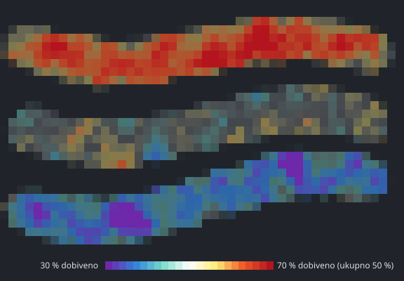

# Postotak pobjeda: koliko često mjesto, put ili potez pobjeđuje

Gdje igrač stoji, kojim putem ide, kamo baca granate i druga pomagala - i koliko često njegova strana zatim osvoji rundu. **Karta postotka pobjeda** boji svako mjesto prema udjelu redaka na njemu koji pripadaju rundama koje je strana retka osvojila, u odnosu na udio u svemu prikazanom: toplo gdje je veći, hladno gdje je manji, ništa gdje je isti.

*Slika prikazuje izmišljene podatke: tri puta na praznoj razini, 68 %, 50 % i 33 % njihovih redaka u osvojenim rundama.*

Potrebni su podaci koji govore tko je pobijedio: [stupci ishoda](data-formats.md#outcome-columns) (`won`, `matchWon`, `roundEndReason`). Pišu ih pretvarači za CS2 i War Thunder, a pretvarač za Tacview za kampanje DCS poslužitelja ([DCS poslužitelji](tacview-acmi.md#dcs-servers-who-won-and-how-each-sortie-ended)); može ih imati bilo koja datoteka.

## Isprobajte {#try-it}

1. Učitajte mečeve sa stupcem ishoda i pritisnite `2` (**Razlika**).
2. U **Podjela razlike** pritisnite **Postotak pobjeda po rundi** (ili **Postotak pobjeda po meču**). Osvojene runde stavlja na **+**, izgubljene na **−** i prebacuje ploču na **Udio +**.
3. Čitajte boje. Ploča navodi ukupni udio: *Ukupno je 52,0 % od 1.200.000 redaka na +.*
4. Suzite pomoću [filtara](filters.md): jedna strana (T ili CT), jedna vrsta događaja (*Položaj* za mjesta gdje su ljudi stajali, *Hitac* ili *Ispaljivanje (raketa, projektil, bomba)* za mjesta odakle su pucali ili bacali), jedna kupnja, jedna karta.

Mjesto koje je toplo s recima *Položaj* mjesto je čiji su držatelji rundu uglavnom osvojili. S recima *Uništenje* to je mjesto gdje su ubojstva koja su se tamo dogodila vodila do osvojenih rundi.

## Postavke {#the-settings}

| Postavka | Što radi | Zadano |
|---|---|---|
| **Razlika** / **Udio +** | sama razlika ili udio strane + među recima obiju strana | Razlika |
| **Puna boja pri** | koliko iznad ili ispod ukupnog udjela se mjesto prikazuje punom bojom, u postotnim bodovima | ± 20 bodova |
| **Najmanje redaka za bojenje mjesta** | mjesto s manje redaka nije obojeno; postupno se pojavljuje od polovice te vrijednosti | 12 |
| **Privlačenje ukupnom udjelu (reci)** | svako mjesto počinje s ovoliko redaka na ukupnom udjelu, pa mjesto s 3 retka, sva osvojena, nije prikazano kao 100 % | 12 |

Sve tri djeluju na gotovu sliku: njihovo pomicanje nikada ne pokreće skupljanje ispočetka.

Udio može biti bilo koje podjele, ne samo pobjeda: *Udio +* s podjelom po strani pokazuje gdje su Ts bili veći dio prisutnosti, a s podjelom po datotekama dviju karata gdje reci jedne datoteke nadmašuju retke druge.

## Reci, ne runde {#rows-not-rounds}

Karta broji retke. Igrač koji dvadeset sekundi stoji na jednom mjestu dodaje redak pri svakom uzorku, sve iz jedne runde, pa su dokaz na mjestu reci blizu njega, a ne runde. Zato su najmanji broj i privlačenje u recima i zato su veći od onoga što daje jedna runda.

Za same runde:

- **[Raščlamba](breakdown.md)** na mjestu, pogledu ili volumenu: *Pobjede %* broji rundu svakog igrača jednom, s istim privlačenjem prema ukupnom udjelu mjesta (4 runde).
- Statistika **[Volumena](volumes.md)**: *Postotak pobjeda* - runde s igračem unutar volumena, svaka jednom, s privlačenjem prema udjelu u svemu prikazanom, uz brojeve.

## Filtri ishoda {#outcome-filters}

Ploča [Filtri](filters.md) navodi stupce ishoda odmah nakon vlastitih stupaca preglednika: **Ishod runde** i **Ishod meča** (*Bilo koji*, *Pobjeda*, *Poraz*) te **Kako je runda završila** (Eliminacija, Bomba je eksplodirala, Bomba je deaktivirana, Vrijeme je isteklo, Predaja, Neriješeno, Cilj, Zadržane zone, Izgubljeni bodovi, Izgubljena sva vozila), na jeziku preglednika.

## Za programere {#for-developers}

Prolaz topline zapisuje tri zbroja u četverokanalni cilj koji koristi toplina timova: toplinu `R = Σ|v|`, toplinu strane + `P` i `S = Σ v²/w`, gdje je `w` težina prolaza (težina uzorkovanja puta pojačanje okvira). Slaganje čita udio `P/R` (prosjek ponderiran jezgrom) i broj redaka na kojima počiva, `n = R²/S` (Kishova efektivna veličina uzorka), privlači udio prema ukupnom, `p = (n·P/R + m·r0)/(n + m)`, i boji `p - r0` preko raspona na rampama razlike.

`n` poništava svaki faktor zajednički recima u pikselu - pojačanje okvira, težinu uzorkovanja, težinu površine odrezanog spritea - pa je slika ista pri svakom zumu i gustoći uzorkovanja, a okviri svakog k-tog retka spajaju se u cjelinu bez skokova boja. Ukupni udio dolazi iz brojeva strana na CPU-u, na desetinku postotka točno; ništa se ne čita natrag s GPU-a. Računanje i njegove provjere: [`render/rateMap.ts`](https://github.com/Holdi601/3DHeat/blob/main/src/render/rateMap.ts) i njegov test.

Košta koliko i toplina timova: četverokanalni cilj učetverostručuje propusnost miješanja u prolazu topline, samo dok je uključen *Udio +*.
