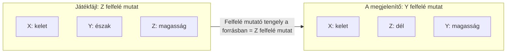

# Tengelyek, mértékegységek és idő

A játékok és a térképek nem értenek egyet abban, melyik irány a fel, mekkora egy egység, és hogyan írják az időt. Ez az oldal a három beállítást mutatja, amelyek miatt az adatai a megfelelő módon állnak, méreteződnek és játszódnak le.

Ha a térképe falként áll, nem pedig padlóként fekszik, kapcsolja át a **Felfelé mutató tengely a forrásban** beállítást.

Rossz **Felfelé mutató tengely a forrásban** beállítással a térkép falként áll; a helyessel padlóként fekszik.

## A világ, amelyben a megjelenítő rajzol {#the-world-the-viewer-draws-in}

A megjelenítő világa **Y felfelé mutat**: az X és a Z a talajsík, az Y a magasság. A legtöbb játékmotor **Z felfelé mutat**: ezeknél az X és az Y a talaj, a Z a magasság. Néhány motor tükrözött is (balkezes). A leképezés azt mondja meg, hogyan alakítsa a fájl tengelyeit a megjelenítő tengelyeivé. (Technikailag a megjelenítő jobbkezes, a three.js szabálya szerint.)

### Felfelé mutató tengely {#up-axis}

A **Felfelé mutató tengely a forrásban** a [Oszlopleképezés](column-mapping.md) oldalon:

| Beállítás | A fájl (x, y, z) világgá (X, Y, Z) válik |
|---|---|
| *Z felfelé mutat (a legtöbb játékmotor)* – az alapérték | (x, **z**, **y**): a fájl Z-je lesz a magasság, a fájl Y-ja a világ Z-je |
| *Y felfelé mutat (grafikai szokás)* | (x, y, z) változatlanul |

Z-felfelé adatnál a három tömböt átcímkézzük, nem másoljuk ([`remapAxesInPlace`](https://github.com/Holdi601/3DHeat/blob/main/src/data/ingest.ts)), ami nagy betöltéseknél száz megabájtokat takarít meg. A tippet a mintából készítjük: az Y- és Z-oszlop közül a kisebb szórásúé a felfelé mutató.

### Tükrözések {#flips}

A **Tükrözés X**, **Tükrözés Y** és **Tükrözés Z** a *fájl* adott nevű tengelyét negálja, az átcímkézés előtt – tehát Z-felfelé adatnál a *Tükrözés Y* azt negálja, ami végül a világ Z-je lesz. A tükrözés megváltoztatja a betöltött adatokat: a [vonalzó](measure.md), a szelet és a kamerapozíció a tükrözött koordinátákat mutatják.

Hogy egy tükrözött világot **az adatok megváltoztatása nélkül** helyesen fordítva rajzoljon, használja helyette a **Kamera és jelenet → Világtengely megfordítása** beállítást ([Kamera](camera.md#invert-world-axis)). Ez a jobb választás a balkezes világú játékoknál, mert az eszközök által mutatott összes koordináta a játék saját marad.

### Egységlépték {#unit-scale}

Az **Egységlépték** minden pozíciót megszoroz. Az *1 (m)* az 1-et állítja be, a *0,01 (cm→m)* a 0,01-et (az Unreal Engine egységei centiméterek, ezért 0,01; a Source-motor egységei hüvelykek, ezért 0,0254; egyik sem méter), a mező pedig bármilyen értéket elfogad. Egy beírt 0-t vagy nem szám értéket 1 vált fel.

A megjelenítő méterben írja a távolságokat (sprite-sugár, levágási távolságok, vonalzó, repülési sebesség), ami csak akkor igaz, ha a skálázott világegység méter. Ha nem az, semmi nem törik el; a feliratok egyszerűen „m”-et írnak bármilyen egységre.

## Idő {#time}

### Időegységek {#time-units}

Hüvelykujjszabály: az olyan értékek, mint a 17000000000 (tíz vagy több számjegy), Unix-időbélyegek; az olyanok, mint a 0, 0,25, 0,5, a kezdettől számított másodpercek.

| Időegység (menüfelirat) | Így olvassa | Megjelenített órajel |
|---|---|---|
| *Másodperc (relatív)* | érték × 1 s | nem |
| *Milliszekundum (relatív)* | érték × 0,001 s | nem |
| *Mikroszekundum (relatív)* | érték × 10^-6 s | nem |
| *Nanoszekundum (relatív)* | érték × 10^-9 s | nem |
| *Unix-időbélyeg (s)* | másodperc 1970-01-01 UTC óta | igen |
| *Unix-időbélyeg (ms)* | milliszekundum 1970-01-01 UTC óta | igen |
| *ISO-8601 dátumszöveg* | olyan szöveg, mint `2026-03-14T18:02:11.250Z`, a böngésző `Date.parse` függvényével értelmezve | igen |

Abszolút egységnél (az utolsó három) az adatkészlet megtartja a legkorábbi sorának órajel szerinti időpontját, az idővonal pedig a lejátszófej mellett a jelenlegi UTC-napszakot mutatja (`HH:MM:SSZ`).

A **Parquet `TIMESTAMP` és `DATE` oszlopok** valódi időpontokká alakulnak, így az egységbeállításuk figyelmen kívül marad, és a panel ezt jelzi. Egy `DATE` oszlop egész nap: egy nap minden sora ugyanazt az időpontot osztja, a lejátszás pedig napról napra ugrik, amire a panel figyelmeztet.

**Az ISO-8601 szövegek CSV-ben és Parquet-ben egyaránt működnek.** Az ISO egységgel megadott szöveges időoszlopot minden különböző szövegre egyszer értelmezzük; ha egyik sem értelmezhető, a betöltés elbukik: *Nincs értelmezhető ISO-8601 időbélyeg a leképezett időoszlopban.* – a leképezés pedig már akkor sem indul el, ha a mintában vett értékek egyike sem értelmezhető. Egy Parquet `TIMESTAMP` oszlopot időbélyegként olvasunk, bármilyen egység van beállítva, a számszerű Parquet-oszlopot ISO egységgel pedig Unix-milliszekundumként. Egy szöveges időoszlopot számszerű egységgel a betöltés előtt elutasítunk: minden érték NaN-ként olvasódna.

### Hogyan tároljuk az időt {#how-time-is-stored}

Míg a fájlok egyesülnek, az idő 64 bites másodperc, így egy abszolút korszak-időpont megtartja a másodperc tört részét. Amikor minden fájl megvan, a teljes kijelölés legkorábbi ideje 0 lesz, és minden sor 32 bites másodpercet tárol attól kezdve. Egy 32 bites lebegőpontos számnak 24 bit a mantisszája: legfeljebb nagyjából másfél napnyi tartomány 1/100 s-nál pontosabban, fél évnyi tartomány körülbelül egy másodpercre oldódik fel. Az a sor, amelynek ideje hiányzik vagy nem szám, 0-ra, a kezdetre kerül.

A sorokat ezután időrend szerint rendezzük, ettől olcsó az idővonal: egy időablakot két bináris kereséssel találunk meg (lásd [Mintavétel és keretek](sampling-and-budgets.md)).

### Eltelt idő kontra órajel {#elapsed-time-versus-wall-clock}

Egy olyan időoszlop, mint a `match_time` vagy a `round_time`, minden meccs saját kezdetétől számol. Ennek kiválasztása minden meccset egy közös tengelyre tesz – jó, ha azt akarja összehasonlítani, mi történik minden meccs 3. percében –, a panel ezt ki is mondja. Egy órajel-oszlop a meccseket abban a sorrendben mutatja, ahogy valójában lezajlottak, átfedésben, ahol átfedtek.

## Nézési irány {#look-direction}

A nézési irányt csak a [dobozos visszajátszás](box-replay.md) használja (az egyes dobozokból induló sugarak). Két szögként tároljuk, a legyezést (yaw) és a bólintást (pitch), radiánban.

- A **Legyezés / bólintás oszlopokat** úgy olvassuk, ahogy vannak; ha a *Fok* van kiválasztva, fokokból alakítjuk át. Nem igazítjuk a felfelé mutató tengelyhez vagy a tükrözésekhez.
- Az **Irányvektor-oszlopok** ugyanazon az átcímkézésen és tükrözésen mennek át, mint a pozíciók, majd a világtengelyekben yaw = atan2(x, -z) és pitch = atan2(y, √(x² + z²)) lesznek, így a sugár akkor is abba az irányba mutat, ahová a doboz néz, ha a forrásvilág tükrözött.

Ha a legyezés/bólintás oszlopok tükrözés, irányvektor vagy igazított szögek után rossz irányba mutatnak, az a megoldás.
