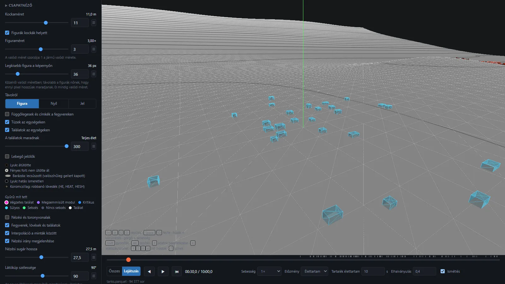

# Figurás átfedés (dobozos visszajátszás)

Egy kis film: minden személyhez egy figura, amely az idő múlásával mozog, mögötte nyomvonallal.

A módot a módsávon **Figurás átfedésnek** hívjuk. Ez az oldal régen a „dobozos visszajátszás” nevet viselte, mert a figurák előtt minden személy egy doboz volt; a „figurás visszajátszás” és a „dobozos visszajátszás” ugyanazt jelenti. A **Figurás átfedésnek** nincs számbillentyűje: a módsávon válassza ki. Minden [személyhez](glossary.md) egy figurát (vagy dobozt) rajzol, amely az [idővonal](timeline.md) mentén mozog, opcionális nézési sugarakkal és nyomvonalakkal. Ez lejátszás, nem sűrűség: *ki hol volt, mikor*. Szükséges hozzá egy személy-oszlop; időoszlop nélkül minden minta egyszerre rajzolódik ki.

## Használat {#how-to-use-it}

1. Töltsön be adatot személy- és időoszloppal.
2. Válassza a **Figurás átfedés** módot a módsávon.
3. Állítsa az idővonalat **Lejátszás** módba, és nyomja meg a lejátszást (`K`).
4. Nyissa meg a **Csapatnéző** részt a **Nyomvonal hossza**, a figuraméret vagy a nézési sugarak megváltoztatásához.

Ebben a módban nincs hő, és az adaptív sprite-keret tétlen.

Alapértelmezésben minden személy abban a figurában jelenik meg, amit képvisel, nem dobozként – lásd: [Figurák](figures.md), hogy melyik egységhez melyik figura tartozik, és a [Meccs-visszajátszás](match-replay.md) oldalt a feliratokhoz, a követőkamerához, két egység közötti méréshez és az eseménylistához.

## A Csapatnéző panel {#the-team-viewer-panel}

Ebben a módban a hőpanelek helyett jelenik meg.

| Vezérlő | Alapérték | Tartomány (jog) | Jelentés |
|---|---|---|---|
| **Figurák kockák helyett** | be | | Minden személy abban a figurában, amit képvisel: gyalogos katona, vagy az adatok által megnevezett tank vagy repülőgép. Ami az adatokban nem szerepel, doboz marad. |
| **Figuraméret** | 1× | | 1× az igazi méret. |
| **Legkisebb figura a képernyőn** | 36 px | 0 = mindig igazi méret | Közelről az igazi méret; távolabb a figurák ennyi pixel hosszúra nőnek. |
| **Fegyverek, lövések és találatok** | be | | Repülő fegyverek füsttel, nyomjelzők, becsapódások, találatok és ölések. A találatból következtetett nyomjelzők szaggatottak. |
| **Kockaméret** | az egység mérete, vagy a kiterjedés / 500 betöltéskor | 0,05–200 m, logaritmikus (5000) | Minden doboz élhossza. Lásd: [egység mérete](sessions-persons-groups.md#entity-size). |
| **Interpoláció a minták között** | be | | Ugyanazon személy két mintája között, ugyanabban a munkamenetben, a dobozt arányosan közéjük helyezi. Soha nem munkamenet-határon át. |
| **Nézési irány megjelenítése** | be | | Sugár minden dobozból a személy nézési iránya mentén (a [nézési oszlopok](axes-units-and-time.md#look-direction) kellenek hozzá). |
| **Nézési sugár hossza** | egység mérete × 4, vagy a kiterjedés / 200 betöltéskor | 0,5–500 m, logaritmikus (20 000) | Akkor látszik, ha a nézési irány be van kapcsolva. |
| **Nyomvonal hossza** | 8 s | 0–300 s (86 400); 0 = ki | Az előzményből hány másodperc látszik minden személy mögött. |
| **Minden nyers minta kirajzolása** | ki | | Az ablakban minden tárolt mintához egy doboz, nem személyenként egy interpolált doboz. Ritkítva, hogy interaktív maradjon. |

A panel tippjei elmagyarázzák, hogy az interpoláció és a nyomvonalak csak egy munkameneten belül kötnek össze mintákat, és – ha a betöltésnek vannak [közös nevei](sessions-persons-groups.md#names-worn-by-several-things-at-once) – hány nevet rajzolunk egyedi mintaként.

## A lejátszott munkamenet {#the-session-being-played}

Munkamenet-oszlop esetén az oldalsáv tetején lévő **Munkamenet** választó ([Munkamenetek](sessions-persons-groups.md#the-session-picker)) dönti el, melyik meccs játszódik vissza. Betöltéskor a legforgalmasabbat választjuk. Csak ennek a munkamenetnek a sorai lesznek dobozok és nyomvonalak, az idővonal pedig ennek a munkamenetnek a tartományán fut, nem az egész adatkészletén. A *Minden munkamenet* egyszerre játssza az összeset, továbbra sem kötve össze mintákat munkamenetek között.

## Mit mikor rajzolunk {#what-is-drawn-when}

A [`TrackCursor`](https://github.com/Holdi601/3DHeat/blob/main/src/data/tracks.ts) fájlból:

**Élő dobozok** (Lejátszás mód, nyers minták nélkül). Minden látható személyre: az a legutolsó minta, amely a lejátszófejnél vagy előtte van:

- Ha a személynek van következő mintája, az ugyanabban a munkamenetben van, és a név nincs megosztva, a doboz a két minta közé kerül az idő arányában, a legyezés a rövidebb úton, a bólintás lineárisan interpolálva (ha az *Interpoláció* be van kapcsolva).
- Különben a doboz az utolsó mintánál marad az idővonal **Tartalék élettartama** (alapértelmezés 10 s) idejéig, majd eltűnik, hogy a kiesett játékosok ne maradjanak ott.

A **Mind** mód figyelmen kívül hagyja a lejátszófejet, és minden tartományon belüli mintát dobozként rajzol.

A **Nyers minták** minden tárolt mintához egy dobozt rajzol az ablakban: a *Tartomány* az *Ablak* előzménnyel, egyébként a lejátszófejig minden. Legfeljebb 65 536 doboz; több minta esetén minden *k*-adikat rajzoljuk.

A **nyomvonalak** (ha a nyomvonal hossza 0 fölött van, és a nyers minták nincsenek kirajzolva): egy vonal egy személy egymást követő mintapárjai között, a lejátszófejig az utolsó *nyomvonal hossza* másodpercben, az életkorral 80%-os átlátszatlanságról átlátszóra halványodva. A nyomvonal munkamenet-váltásnál megáll, és közös neveknél nem rajzolódik. Legfeljebb 131 072 csúcs; több esetén a sorok egyenletesen ki vannak hagyva.

**Ki látható:** egy személy rejtve van, ha a csoportja ki van pipálva a [Csapatok listájában](teams-list.md) (csoportja az első sora alapján), ha egy csoportszűrő kizárja, vagy ha az [Entitások](entities.md) panelen van kijelölés, amely nem tartalmazza. Az oszlop-[szűrők](filters.md) nem vonatkoznak a dobozokra.

## Színek {#colours}

Csoportonként egy színcsalád, tagonként egy árnyalat, így egy pillantásból látszik, melyik oldalon áll valaki ([`teamMemberColor`](https://github.com/Holdi601/3DHeat/blob/main/src/render/colors.ts)). A csoportszínek egy rögzített tízes listában váltakoznak – kék, piros, zöld, borostyán, ibolya, cián, bíbor, lime, narancs, indigó –, a csoport tagjai pedig a 42–76%-os világosság és a 90–65%-os telítettség között oszlanak el.

## Megjegyzések {#notes}

- A figurás átfedés csak akkor építi újra a figuráit, ha valami megváltozik; a tétlen képkocka az utolsókat rajzolja újra.
- A [statisztikai réteg](performance-and-stats.md) *Kockák* sora a képernyőn lévő dobozokat számolja.
- A figurás átfedés ugyanabban a jelenetben rajzol, mint a pálya, ezért a [mélységélesség](camera.md#depth-of-field) elmossa a dobozokat, de soha nem a hőt.
