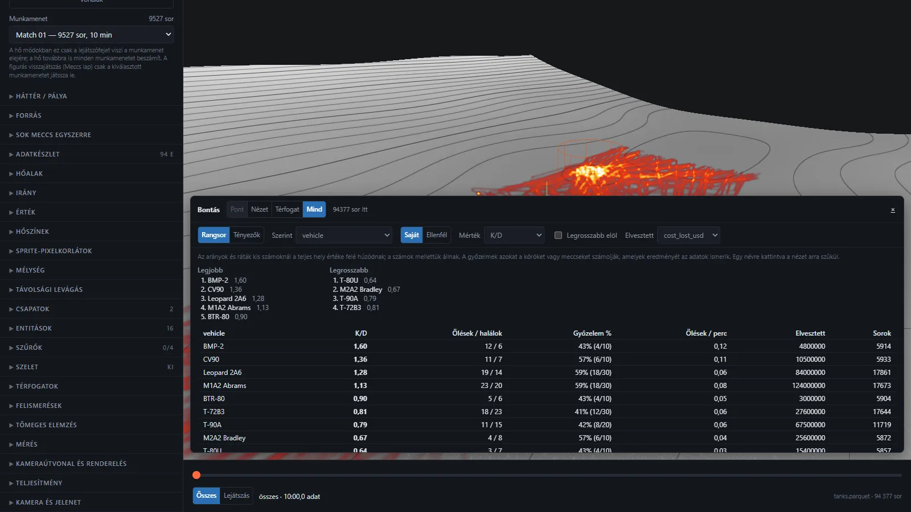
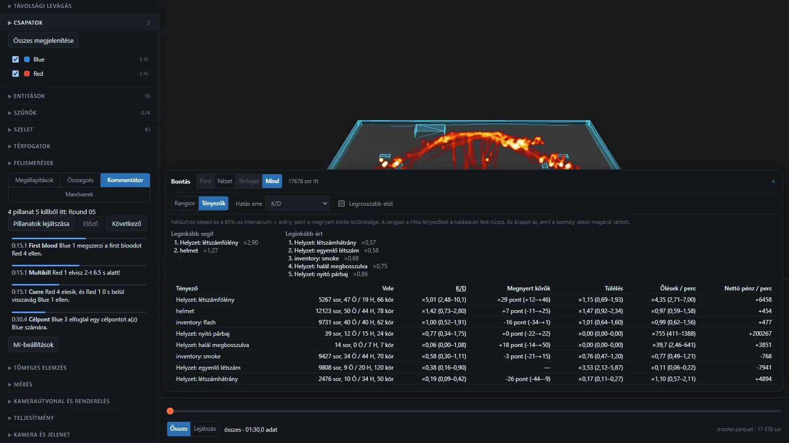

# Bontás: ki és mi teljesít a legjobban hol

A **Bontás** egyetlen kérdésre válaszol: ezen a helyen melyik jármű, játékos vagy fegyver teljesít a legjobban? Használja arra, hogy megtalálja azt a tankot, amely a hídnál nyer, vagy hogy lássa, valóban segít-e a sisak.

Egy helyen történő dolgokat rangsorol (egy kiválasztott pont, a nézet, egy térfogat vagy minden látható) bármely kategória szerint, és minden állapot-tényezőt mér: van–nincs összehasonlításban.

## Próbálja ki {#try-it}

1. Töltsön be egy meccset ölésekkel és halálesetekkel, és nyissa meg a **Térfogatok** részt.
2. Rajzoljon egy térfogatot a helyre, amely érdekli, és jelölje ki.
3. Nyomja meg a **Bontás…** gombot a Statisztika alatt.
4. A **Szerint** alatt válassza a *Jármű*-et, a mérték pedig a *K/D* (ölés halálonként) legyen.
5. Olvassa a listát, a legjobb elöl. A **Legrosszabb elöl** gombbal megfordítja. Egy névre kattintva a nézetet arra szűri; újabb kattintással eltörli a szűrőt.

## Megnyitás {#open-it}

| Honnan | Régió, amellyel indul |
| --- | --- |
| **Bontás…** a [Térfogatok](volumes.md) részben (Statisztika) | a kijelölt térfogat |
| **Bontás itt** a kiválasztó kártyán, egy pontra kattintás után | az adott pont körüli gömb (**Sugár**, alapértelmezés az adatok méretének 3%-a) |
| a **Különbség** felosztó panel | a nézet |

A fejléc váltja a régiót: **Pont**, **Nézet** (amit a kamera az utolsó számoláskor látott; mozgatás után **Újraszámolás**), **Térfogat** (egyet kiválasztva) vagy **Mind**. A háttérben számol; az állapotsor megmondja, hány sor van a régióban.

## Rangsorolás {#ranking}

Válassza ki, mi szerint rangsoroljon, és a mértéket:

| Mérték | Mit jelent |
| --- | --- |
| A, B | a sorok a különbségtérkép két oldalán, úgy osztva, ahogy a hő osztja őket |
| A / B, A - B, A / (A + B) | a két réteg egymással szemben |
| K/D | ölések a halálesetek ellen |
| Győzelmi % | megnyert körök (vagy meccsek), ahol az adatok megmondják, ki nyert |
| Ölés / perc | a jelenlévő percenkénti ölések (a mozgásminták közei) |
| Keresett, Elveszített, Nettó pénz | az `earn_*` és `cost_*` oszlopok összegei; egy választó adja a pénznemet |

Az ölések, halálesetek, jelenlét, győzelmek és pénz a nézetben a helyen látható minden sort számolnak, a felosztás mindkét oldalán vagy egyiken sem.

Az arányokat és rátákat a teljes hely értéke felé húzzuk, ha a számok kicsik, így 1 életből 2 ölés nem kerül a lista élére. A számok mellettük láthatók.

Rangsorolhat a csoportok, játékosok és meccsek szerint, bármely kategória-oszlop szerint (jármű, fegyver, oldal, vásárlástípus, ügynök vagy felszerelés), bármely számoszlop tartományai szerint (páncélzat, a felszerelés értéke), egy fegyveroszlop **osztálya** szerint (puska, mesterlövész, géppisztoly, pisztoly…), és azzal, hány **segédeszköz**-darabot tartalmaz egy listaoszlop, például az `inventory`.

A **Saját** a sor saját értéke szerint rangsorol. Az **Ellenfél** a másik fél értéke szerint: az áldozat fegyvere ölésnél, a gyilkosé halálnál (egy `other` / `victim` oszlopot igényel, amely megnevezi őket).

## Állapot az adott időben {#state-at-the-time}

Egy sor értéke a saját, hacsak a sor nem naplóz semmit (egy eseménysor felszerelés nélkül), vagy ha halál (amelynek fegyver-oszlopa megnevezheti a gyilkos fegyverét); ilyenkor az az érték, amelyet ugyanaz a személy a meccsen korábban utoljára hordott.

## Tényezők: van és nincs {#factors-with-against-without}

Váltson a **Rangsorolás**-ról a **Tényezők**-re, válassza ki a **Hatás erre**-t, és olvassa a *Leginkább segít* és a *Leginkább árt* sorokat:

Minden tényező hatása a K/D-re, a megnyert körökre, a túlélésre (perc halálonként), a percenkénti ölésekre és a percenkénti nettó pénzre, 95%-os intervallummal: az arányok szorzóként (x), a megnyert körök pontkülönbségként. A rangsor minden becslést a saját bizonytalanságával a hatástalanság felé húz, így egy ritka tényezőnek egyértelmű hatás kell ahhoz, hogy előre kerüljön; a megjelenített intervallum a nem húzott.

A körökkel rendelkező adatok hozzáadják a közelharci **helyzeteket** ([Közelharc és körök](close-quarters.md)), amelyek adathalmazonként egyszer számítódnak: *megvakítva* (a sor `state_flashed` értéke, vagy egy ellenséges villanás 15 m-en belül az utolsó 3 másodpercben), *halál cserélve*, *nyitó párharc*, valamint *emberfölény*, *egyenlő számok* vagy *emberhátrány* (a sor oldalán élő játékosok az ellenséggel szemben). Egy halál abban a helyzetben számít, amelyben az áldozata volt közvetlenül előtte.

Egy menetben legfeljebb 256 tényező mérhető.

## Fejlesztőknek {#for-developers}

### Kis minták húzása {#pulling-small-samples}

A rangsorolási érték `(n + m*r0) / (d + m)`: az `n` és a `d` a számok, az `r0` a teljes hely aránya, az `m` pedig ennek az előzetes értéknek a súlya.

### Konverterszerzőknek: a tényezőoszlopok elnevezése {#for-converter-authors-naming-factor-columns}

A konverter úgy ad hozzá tényezőt, hogy elnevezi az oszlopát:

| Oszlop | Tényező |
| --- | --- |
| `state_<name>` szám | bekapcsolva, amíg nem nulla (`state_scoped`, `state_suppressor`) |
| `state_<name>` kategória | értékenként egy tényező (`state_ammo` = AP, HE…) |
| `active_<name>` | ugyanaz, valami bekapcsolt vagy nemrég használt dologra: képesség, ultimate, kütyü, buff (`active_ult`, `active_stim`) |
| listaoszlop (`inventory`, `loadout`, `perks`, `abilities`, `attachments`, `modules`, `buffs`, `debuffs`, `upgrades`, vagy `state_`/`active_` név, amely `s`-re végződik) | tényező minden elemre egy `a\|b\|c` értékben |
| már általános felszerelés-jelzők (`helmet`, `defuser`, `armor`, `scoped`, `airborne`, `duck`, `flashed`…) | bekapcsolva, amíg nem nulla |
| `ammoType`, `shellType`, `ammoName` | az utoljára leadott lövedék |

Eredmények: egy 0/1 `won` oszlop (a sor oldala megnyerte a kört vagy a meccset) és egy `round` oszlop - az [eredményoszlopok](data-formats.md#outcome-columns); ahol egy fájlban `won` és `matchWon` is van, a *Győzelem %* köröket számol. Pénz: `earn_<currency>` és `cost_<kind>_<currency>`; a típus szerinti bevétel önmagában (`earn_round_cs2`, a konverter pontos körjutalmai) csak az adott típusú költségmodell-bevételt cseréli le (a `round` a telepítéseket és hatástalanításokat is lefedi), a modell pedig a többit továbbra is árazza.

A leképezés ezeket az oszlopokat maga tölti be, a fájl saját listája mellett: minden `state_*`, `active_*`, `won`, `round` és listaoszlopot, kivéve azokat, amelyekről egy Parquet-fájl statisztikái azt mutatják, hogy végig egy értéket tartalmaznak (minden betöltött oszlop soronként 4 bájt).
