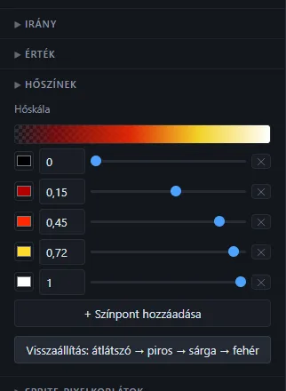

# Szín és expozíció

Ezek a vezérlők döntik el, hogy a hő mennyisége milyen színt kap. A **Telítési pont** azt mutatja meg, mennyi hő számít fehér izzásnak.

## Gyors javítások {#quick-fixes}

- Minden fehér: emelje a **Telítési pont** értékét, vagy nyomja meg az **Automatikus expozíció a mezőből** gombot.
- Semmi nem látszik: csökkentse a **Telítési pont** értékét, vagy nyomja meg az **Automatikus expozíció a mezőből** gombot.
- Csak néhány egyedi pont látszik: emelje a **Minimális hő** értékét.

Ezen az oldalon minden vezérlő akkor hat, amikor a hőt színné alakítjuk, így bármelyiknek a húzása azonnal újrarajzolja a képet, és **soha nem indítja újra a halmozást**.

## Telítési pont {#saturation-point}

**Telítési pont** (a Hőalak szakasz): a halmozott hő, amely a színskála tetejének felel meg (a *Lineáris* válasznál; a többinél lásd lent). Logaritmikus csúszka 0,1–4000, a fogantyú 10 000 000-ig húzható, mert a halmozott hő a sorok számával nő. Alapérték 24; minden betöltéskor először egy **analitikus becslés** készül, majd a képből **mérés** következik.

Ezen múlik, hogy hőtérképet vagy üres (vagy fehér) képernyőt kapunk, és nem lehet megbízhatóan levezetni: a telemetria annyira csoportosul – egy kezdőpont, egy ajtó, egy szűk keresztmetszet –, hogy a csúcs és az átlagos sűrűség aránya nagyságrendet ingadozik adatkészletenként és kameraszögenként.

## Automatikus expozíció {#auto-exposure}

Az **Automatikus expozíció a mezőből** a shader által ténylegesen előállított mezőt méri. Figyelmen kívül hagyja az üres pixeleket, a megvilágított pixelek 98. percentilisét veszi, és ezt a telítési pont 85%-ára teszi, így a színskála teteje a valódi csúcsoknak marad fenntartva.

A panel ezt írja ki: *X%-nyi képkocka mérve; a 98. percentilis (R) a színskála teteje közelében*. A *Telítődő* válasznál a telítési pont 85%-os értéke a skála kb. 57%-ára esik, nem 85%-ára.

Ez **automatikusan** is lefut:

- 8 megjelenített képkocka után, miután egy adatkészlet betöltődött;
- 8 képkocka után, miután a [szűrők](filters.md) megváltoznak (ha minden pozíciót százra szűrünk le, a sűrűség nagyságrendeket változik);
- 8 képkocka után, miután a pontszerű hő és a [vonal-hő](line-heat.md) között váltunk, vagy megváltoztatjuk, mely útvonalakat rajzolja a vonal-hő, mert egy vonal sokkal kevesebb hőt rak le mintánként, mint egy sprite.

Ha semmi nincs megvilágítva, az automatikus futás békén hagyja a telítést; a gomb az analitikus becslésre esik vissza, és ezt írja ki: *nincs megvilágított rész a méréshez – az analitikus becslést használtuk*.

### Nézet követése {#follow-the-view}

A **Nézet követése** (a Hőalak szakasz, alapértelmezésben bekapcsolva) minden alkalommal újra mér, amikor a kamera megáll, így egy régió, amelybe belerepül, a színskála egész tartományát használja, nem a teljes térképre mért skálát. A kis változásokat figyelmen kívül hagyja, a skála pedig átsiklik, nem ugrik. A négy hőmódban fut, az ábra-rétegben nem.

Ha kikapcsolja, a skála zárva marad, így helyeket hasonlíthat össze egy skálán. A **Telítési pont** kézi húzása is zárja.

## Sűrűségválasz {#density-response}

**Sűrűségválasz** – hogyan képezi le a *k* (hő / telítés) értéket a skálára:

| Válasz | Képlet | Használat |
|---|---|---|
| **Telítődő** (alapértelmezés) | t = 1 - e^(-k) | Aszimptotikusan közelíti a skála tetejét, ahogy az egymásra rakott átlátszó sprite-ok viselkednek. Semmi sem fordul át lapos fehérbe, ezért ez az ismeretlen adatokhoz biztonságos alapérték. |
| **Lineáris** | t = k | Az egyetlen leképezés, ahol az azonos szín azonos darabszámot jelent. Két adatkészlet vagy két időablak összehasonlítására használja. |
| **Log** | t = log₂(1 + 7k) / 3 | Összenyomja a hosszú farkat, így egy szélsőséges forróponttól nem lapul le minden más a skála aljára. Felemeli a ritka területeket. |

## Minimális hő {#minimum-heat}

**Minimális hő** (alapértelmezésben ki, 0–100%): minden pixelt, amely bármekkora hőt hordoz, legalább ennyi pontra emeli a skálán. Emelje fel, és csökkentse a sprite sugarát, hogy lássa, **hol történt egyáltalán valami** – az egyedi adatpontok jól láthatók lesznek, nem csak az átlátszó fölött ülnek. Sűrűség megítélésekor hagyja kikapcsolva, mert ez szándékosan lapítja le a skála alját. A küszöb (k > 0,0001) az igazán üres pixeleket üresen hagyja.

## A színskála-szerkesztő {#the-ramp-editor}

A **Hőszínek** szakaszban. A címke megmondja, mire való a skála: *Hőskála* a Hőben és a Vonalakban, *Pozitív (additív csapatok)* a Különbségben, *Átlátszósági skála (a szín a csoportból jön)* a [Csapathőben](team-heat.md), ahol csak az alfa értéke számít.



A tetején lévő sáv a skálát mutatja előnézetben. Alatta egy sor van minden színponthoz:

| Rész | Jelentés |
|---|---|
| Színminta | A színpont színe (a böngésző színválasztója). |
| Szám | A színpont helye a skálán, 0-tól 1-ig (0 = nincs hő). |
| Csúszka | A színpont átlátszatlansága, 0–100%. |
| ✕ | Eltávolítja a színpontot; le van tiltva, ha csak kettő maradt. |

A **+ Színpont hozzáadása** gomb az utolsó két színpont közé tesz egy új pontot, az utolsó pont színével és átlátszatlanságával. A **Visszaállítás: átlátszó → piros → sárga → fehér** visszaállítja az alapértelmezést.

A színpontok bármilyen sorrendben megadhatók; a skála építésekor rendezve lesznek. Az **alfa** az, ami a hőt a jelenetre keveri, ezért az alapértelmezett skála nulla végpontja teljesen átlátszó.

### Az alapértelmezett skálák {#the-default-ramps}

| Hely | Pozitív (Hő, Vonalak, Különbség +) | Negatív (Különbség −) |
|---|---|---|
| 0,00 | fekete, alfa 0 | fekete, alfa 0 |
| 0,15 | rgb(180, 0, 0), alfa 0,55 | rgb(0, 170, 60), alfa 0,55 |
| 0,45 | rgb(255, 40, 0), alfa 0,85 | rgb(0, 190, 200), alfa 0,85 |
| 0,72 | rgb(255, 220, 40), alfa 0,95 | rgb(40, 80, 255), alfa 0,95 |
| 1,00 | fehér, alfa 1 | rgb(170, 60, 255), alfa 1 |

## Amíg a kamera mozog {#while-the-camera-moves}

Amikor a kamera mozog, a halmozás minden képkockánál újraindul. Ha a **Minden sort kirajzolja minden képkockában** be van kapcsolva (az alapértelmezés), minden mozgó képkocka még pontos; kikapcsolva a mozgó képkocka egy mintavételes becslést mutat – fényesebb, súlyozással kiemelt csomókat –, amely megálláskor a simább, valódi képhez konvergál. Ez várt viselkedés; lásd a [Halmozás](accumulation.md) oldalt.

## Fejlesztőknek {#for-developers}

### A kompozit menet {#the-composite-pass}

Miután a hő felhalmozódott, minden pixel értékét egy kompozit menetben alakítjuk színné ([`COMPOSITE_FS`](https://github.com/Holdi601/3DHeat/blob/main/src/render/webgl2/shaders.ts)). A lépések:

```
k = |hő| / telítési pont
t = válasz(k)                           0..1-re szorítva
ha minimális hő > 0 és k > 0,0001:  t = minimum + (1 - minimum) × t
szín, alfa = skála(t)                   (a negatív skála, ha hő < 0, csak Különbségnél)
pixel = keverés(jelenet, szín, alfa)
```

### Az analitikus becslés {#the-analytic-estimate}

Az **analitikus becslés** ([`estimateSaturation`](https://github.com/Holdi601/3DHeat/blob/main/src/data/calibrate.ts)) feltételezi, hogy a sorok az adatok X–Z lábnyomán oszlanak el: átlagos hő = sorok × (π r² / lábnyomterület) × 1/3 × középső intenzitás (az 1/3 a lineáris rámpa korongon vett átlaga), szorozva egy feltételezett csúcs–átlag aránnyal, 25-tel, és 0,1–1 000 000 közé szorítva. Csak nagyságrendileg kell jónak lennie.

### Mérés {#metering}

[`exposure.ts`](https://github.com/Holdi601/3DHeat/blob/main/src/render/exposure.ts):

1. a hő célterületét visszaolvassuk a GPU-ról, legfeljebb 40 000 értékre ritkítva;
2. az üres pixelek (hő ≤ 0,0001) kikerülnek – a hőmező legtöbb része üres, és ha ezeket is átlagolnánk, minden alulexponált lenne, ahogy egy fekete háttérre irányított fénymérő is alulmérne;
3. a megvilágított pixelek 98. percentilise a viszonyítási alap;
4. a telítési pont az alapérték / 0,85 lesz, így a viszonyítási alap a telítési pont 85%-ánál ül, és a skála teteje a valódi csúcsoknak marad fenntartva.

### A színtábla {#the-colour-table}

A skála egy 256 × 2-es RGBA táblázatba kerül (a pozitív skála az első sorban, a negatív a másodikban) ([`buildColorLut`](https://github.com/Holdi601/3DHeat/blob/main/src/render/colors.ts)). A színek lineáris fényben interpolálódnak, és sRGB-ként tárolódnak; az átlátszatlanság lineárisan interpolálódik.
