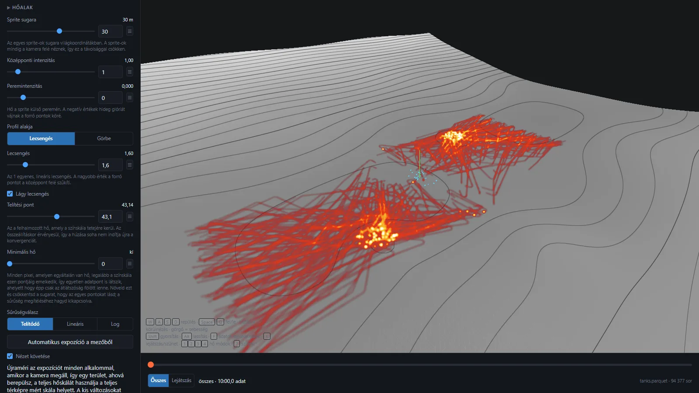
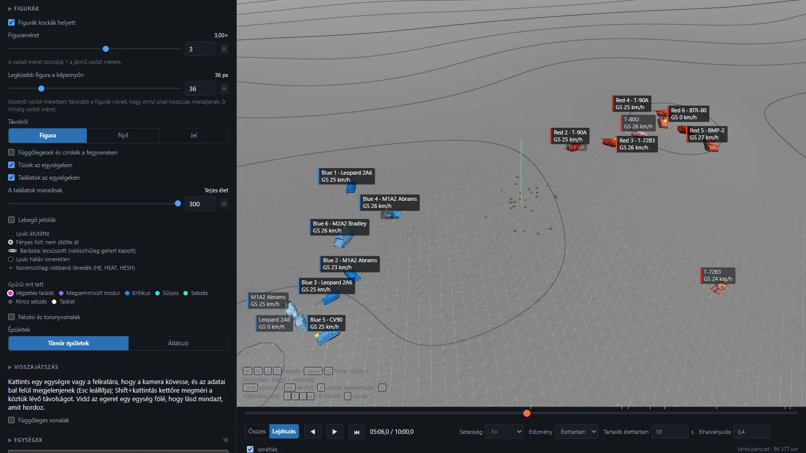

# Demóadatok: próbálja ki a megjelenítőt öt perc alatt



Még nincsenek saját adatai? A tároló készít néhányat. Minden benne kitalált: egy völgy, egy udvar, és három kitalált játékstílus meccsei, *Blue 1* vagy *Red 3* nevű játékosokkal. Az oldal összes képe ezzel készült.

## Készítse el {#make-it}

```bash
node tools/demo-data.mjs
```

Ez a `tools/.shots/demo/` mappába ír:

| Fájl | Mi ez |
|---|---|
| `demo-valley.glb` | egy 12 km-es völgy két dombbal és egy faluval, 3D-s pályaként |
| `demo-yard.glb` | egy 160 m-es, falakkal körülvett udvar épületekkel, 3D-s pályaként |
| `tanks.parquet` | 10 harckocsimeccs, 8 a 8 ellen: mozgás, lövések, találatok a páncél helyével, tüzek, halálok, roncsok, toronyirány, győztesek |
| `tanks/match-NN.parquet` | ugyanezek a meccsek, fájlonként egy, [sok meccs egyszerre](many-matches.md) nézethez |
| `air.parquet` | egy 4 a 4 elleni légi harc rakétákkal, fáklyákkal, halálokkal és tévesztésekkel |
| `shooter.parquet` | 12 kör 5 a 5 elleni gyalogos harcban: lövések, halálok, egy elhelyezés, megszerzett és elköltött kreditek, sisakok és segédeszközök |
| `mass/` | kis `.3dheat` meccsek mappája, a [tömegelemzéshez](mass-analysis.md) |
| egy körkészlet | egy autó két köre egy kitalált pályán, a [Versenyelemzéshez](race-analysis.md) |

Minden táblázat a láblécében nevezi meg a saját oszlopait, így hozzárendelés nélkül betöltődik.

## Próbálja ki {#try-it}

1. Indítsa el a megjelenítőt (Windowson a `start.bat`, vagy bármely rendszeren egyszeri `npm install`, majd `npm run dev`), és nyissa meg a `http://127.0.0.1:5273/` címet.
2. **Háttér / pálya → 3D-modell…**, és válassza a `demo-valley.glb` fájlt.
3. **Forrás → Fájlok…**, és válassza a `tanks.parquet` fájlt.
4. Nyomja meg az `F` billentyűt az adatok kereteléséhez. Látja tíz meccs [hőjét](heat.md).
5. Próbálja ki a módválasztó sávot: **Különbség** (Blue a Red ellen), **Csapathő**, **Vonalak**.
6. Nyissa meg a **Felismerések** panelt (a Hőtérkép oldalsávjában): megtalálja azokat a helyeket, ahol sokkal többet lőttek, találtak el és semmisítettek meg, mint máshol – a két domb körül.
7. Nyissa meg a **Meccs** fület; a **Meccsek a visszajátszásban** alatt válassza a *Match 01*-et; nyomja meg a **Lejátszás** gombot az idővonalon: ez a [visszajátszás](match-replay.md).



A lövöldözős játékhoz töltse be a `demo-yard.glb` és a `shooter.parquet` fájlt; a légi harchoz az `air.parquet` fájlt (a figurák a **Figuraméret** 4-es értékén jobban látszanak, ez egy csúszka a Hőtérkép oldalsávjának **Csapatnéző** panelén).

## A képernyőképek {#the-screenshots}

Az oldal képeit ebből az adatból egy szkript készíti, a megjelenítő bármely nyelvén:

```bash
node tools/demo-data.mjs
HEAT3D_FIGURE_PACK=none npx vite --port 5321 --strictPort --host 127.0.0.1   # PowerShell: $env:HEAT3D_FIGURE_PACK="none"; npx vite ...
node tools/docs-shots.mjs --lang en
```

A képernyőkép-kiszolgáló helyi figuracsomag nélkül fut, így csak a nyilvános figurakatalógus látszik. A képek a `docs/assets/img/<lang>/` mappába kerülnek. Lásd [A dokumentáció karbantartása](maintaining.md).
