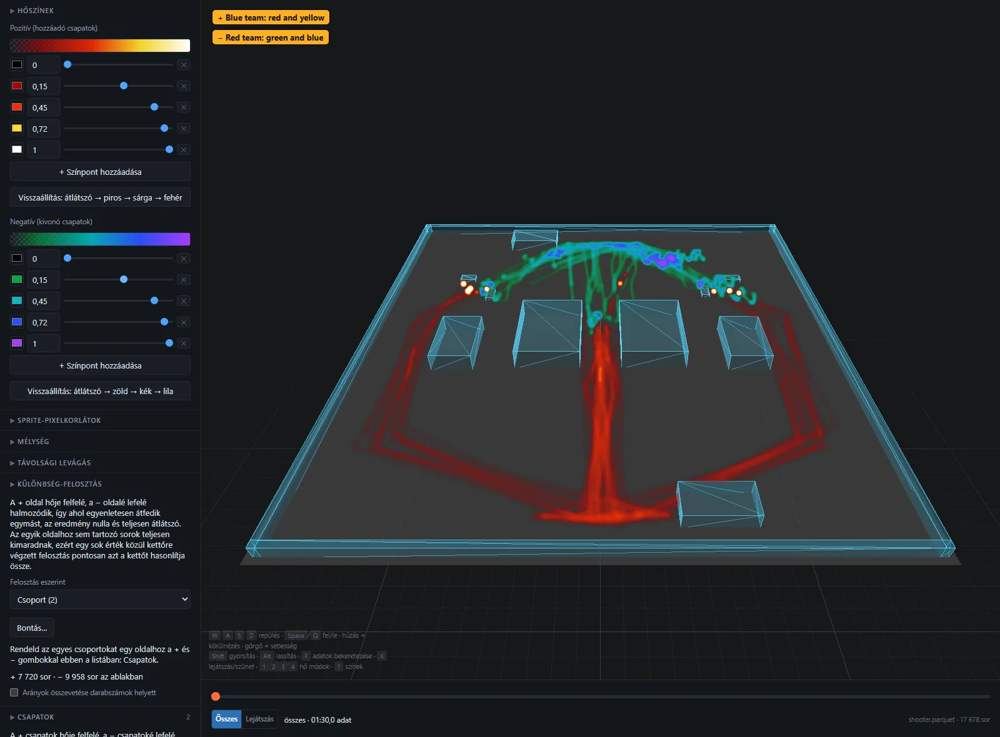

# Különbség

Pirossal, ahol az A csapat volt többet jelen, zöldeskékkel, ahol a B, és semmi, ahol egyenlők voltak.

A **Különbség** (2-es billentyű) előjeles hő. Az egyik népesség sorai hozzáadnak hőt, egy másik népesség sorai elvesznek belőle. Ahol a kettő egyenletesen átfedi egymást, az eredmény nulla és teljesen átlátszó; ahol az egyik dominál, annak az oldalnak a színeiben jelenik meg – alapértelmezés szerint melegen (átlátszó → piros → sárga → fehér) a **+** oldalnak, hűvösen (átlátszó → zöld → kék → lila) a **−** oldalnak.

## Használat {#how-to-use-it}

1. Nyomja meg a `2`-t (vagy válassza a **Különbség** módot a módválasztó sávon).
2. Nyissa meg a **Különbség-felosztás** részt az oldalsávban.
3. Válassza ki, mi szerint **Felosztás eszerint**: általában *Csoportok*.
4. Tegyen egy csoportot (vagy értéket) a **+** oldalra, egy másikat a **−** oldalra.
5. Olvassa le a színeket: a meleg a + oldalt, a hűvös a − oldalt jelenti. A panel figyelmeztet, ha az egyik oldalon nincs sor (lásd [Üzenetek, amiket láthat](#messages-you-may-see)).

Az, hogy *melyik* két népesség, a teljes kérdés, így a felosztás bármely megtartott oszlop lehet, nem csak csoport. Azok a sorok, amelyek **egyik** oldalra sem esnek, **kimaradnak**, nem számítanak nullának: ettől pontosan a kiválasztott két értéket hasonlítja össze a felosztás, és kombinálható a [szűrőkkel](filters.md) – szűrjön le egy térképre, majd bontsa azt verzió szerint.

A módhoz két oldal kell: egy csoportoszlop legalább két csoporttal, vagy egy szűréshez megtartott oszlop szerinti felosztás. Olyan adaton, amelynek kevesebb mint két csoportja van, a betöltés egy oszlop-felosztással indul – többfájlos betöltésnél először a *Forrásfájl* oszlop, különben az első kategóriaoszlop két értékkel, különben az első számoszlop, amelynek van tartománya –, így a *két betöltés összehasonlítása* csoportok nélküli adaton is működik. Csak az az adat tesz elérhetetlenné a módot, amelynek egyik sem áll rendelkezésre; ugyanígy az a felosztás, amelynek az egyik oldalán nincs semmi.

## A Különbség-felosztás panel {#the-difference-split-panel}

Különbség módban látható, a hőpanelek alatt.

A **Felosztás eszerint** lehetőségei:

| Lehetőség | Így jelenik meg | Felosztási szabály |
|---|---|---|
| Csoportok | *Csoport (N)* (ha van csoportoszlop) | Minden csoport a +, a − vagy egyik oldalra kerül, a [Csapatlistában](teams-list.md) beállítva |
| Kategóriaoszlop | *oszlop (N érték)* | Az értékek a +, a − vagy egyik oldalra kerülnek |
| Számoszlop | *oszlop (numerikus)* | Minden oldalnak egy értéktartomány |
| A forrásfájl | *Forrásfájl – két betöltés összehasonlítása* (ha több fájl van betöltve) | A fájlok a +, a − vagy egyik oldalra kerülnek |

Csak azok az oszlopok kínálkoznak, amelyek betöltéskor a *Megtartás szűréshez* alatt szerepeltek.

### Arányok összevetése, ne darabszámok {#compare-shares-not-counts}

Az **Arányok összevetése darabszámok helyett** (alapértelmezés szerint ki) minden oldalt az saját sorszámának reciprokával súlyoz, így az az oldal, amelynek ötször annyi sora van, nem nyer pusztán a számok miatt. A szín ekkor azt mutatja, hol fordul elő az egyik oldal arányosan gyakrabban, mint a másik. Akkor használja, ha a két oldalon nagyon eltér az adatmennyiség, például két, különböző hosszúságú munkamenet.

### Üzenetek, amiket láthat {#messages-you-may-see}

A panel figyelmeztet, ha a kép nem valódi különbség:

| Üzenet | Jelentése |
|---|---|
| *N + / M −* (vagy *N + / M − / K nincs használva*) | Hány érték van az egyes oldalakon (és egyiken sem). |
| Az ablakban nincs sor a **+** oldalon | Csak a **−** oldal rajzolódik. Mozgassa az idővonal ablakát, vagy módosítsa a felosztást. |
| Az ablakban nincs sor a **−** oldalon | Csak a **+** oldal rajzolódik. |
| Egyik oldalon sincs érték | A különbség nem rajzol semmit. Tegyen legalább egy értéket a **+** vagy a **−** oldalra. |
| *oszlop* nem osztható fel így | A kiválasztott oszlop nem illik a felosztáshoz. Válassza újra az oszlopot. |
| A felosztási oszlop nem fért bele a GPU-memóriába N a M darabból | Ezek a sorok nem rajzolódnak. Emelje a GPU-keretet a Teljesítmény → Erőforráskeretek alatt, vagy töltsön be kevesebb sort. |

### Csoportok szerint {#by-group}

A panel csak a [Csapatlistára](teams-list.md) mutat, ahol minden csoportnak van **+** és **−** gombja. Minden betöltésnél a csoportok első fele (felfelé kerekítve) a +-ra kerül, a többi a −-ra; a Csapatlista **Egyenletes felosztás** gombja ugyanezt újra elvégzi. Az egyik oldalra sem tartozó, vagy jelölőnégyzetével elrejtett csoport nem ad hozzá semmit.

### Kategóriaértékek szerint {#by-category-values}

| Rész | Jelentése |
|---|---|
| `a + / b − / c nincs használva` | Hány érték van az egyes oldalakon és egyiken sem. |
| **Törlés** | Minden értéket az egyik oldalról sem tesz ki. |
| Értéklista | Minden érték egy **+** és egy **−** gombbal (az aktívra újra kattintva kiveszi az adott oldalról). Egy üres értéket *(hiányzik)* néven sorol fel. |
| Korlát-megjegyzés | Csak az első 200 érték látszik: *Az első 200 érték látszik, N-ből. Egy ilyen széles oszlopot jobb előbb szűréssel szűkíteni, vagy tartomány szerint felosztani, ha az értékei rendezettek.* |

Az oszlop kiválasztásakor az első értéke a +-ra, a második a −-ra kerül. Ha egyik oldalon sincs érték, a felosztás csoportokra esik vissza, ahelyett hogy egy üres képet mutatna. A *Forrásfájl* ugyanígy működik, fájlonként egy értékkel – így hasonlítunk össze két exportot, két tesztfutást vagy két verziót.

### Tartomány szerint {#by-range}

| Rész | Jelentése |
|---|---|
| Súgó | Az oszlop minimuma és maximuma. |
| **Pozitív tartomány (+)**, **ettől** / **eddig** | Ebbe a tartományba eső értékű sorok adnak hozzá; mindkét végpont beleszámít. |
| **Negatív tartomány (−)**, **ettől** / **eddig** | Ebbe a tartományba eső sorok elvesznek. |
| **Felosztás a felezőpontnál** | A + tartományt [minimum, középső] értékre, a −-ot [középső, maximum] értékre állítja – az oszlop kiválasztása is ezt teszi. |

Az az érték, amely mindkét tartományba beleesik, +-nak számít. A tartományoknak nem kell lefedniük az oszlopot; az egyikbe sem eső értékek kimaradnak. *Az első két perc az utolsó két perc ellen* egy időszerű oszlop tartomány szerinti felosztása.

## Színek {#colours}

A **Hőszínek** szakasz ebben a módban két skálaszerkesztőt mutat: **Pozitív (hozzáadó csapatok)** és **Negatív (kivonó csapatok)**, mindegyiknek saját visszaállító gombbal (*Visszaállítás: átlátszó → piros → sárga → fehér*, *Visszaállítás: átlátszó → zöld → kék → lila*). Az összeállítás a nettó hő abszolút értékét a [telítési ponton és válaszon](colour-and-exposure.md) keresztül viszi, és a negatív skálát választja, ahol a nettó érték nulla alatt van. Lásd [Szín és expozíció](colour-and-exposure.md#the-ramp-editor).

Ha a különbség nagysága számít, a *Lineáris* sűrűségválaszt használja: ez az egyetlen válasz, ahol az azonos szín azonos darabszámot jelent.

## Hogyan működik {#how-it-works}

Minden sor előjelet kap, +1-et, -1-et vagy 0-t a csúcsshaderben ([`POINT_HEAT_VS`](https://github.com/Holdi601/3DHeat/blob/main/src/render/webgl2/shaders.ts)); a 0 a sort még a fragmensek rajzolása előtt elutasítja.

- Csoportonként az előjel egy 4096 bejegyzéses csoporttáblából jön, a sor csoport-azonosítója szerint indexelve (a csoport-azonosító a sor pozícióstexelének negyedik csatornáján utazik).
- Kategóriánként az előjel egy második, 4096 bejegyzéses táblából jön, amelyet kategóriaértékenként töltenek fel, a sor értékét pedig az oszlop szűrőtextúrájából olvassák; a tábla végét meghaladó értéket mindkét háttérrendszer elutasítja.
- Tartományonként a sor értékét a két tartománnyal hasonlítjuk össze.

A felosztás megváltoztatása újraindítja a halmozást.

**A rejtett csoportok minden felosztásnál rejtve maradnak.** Oszlop szerinti felosztásnál a csoporttábla már nem hordoz előjeleket; a látható csoportnak 1-et, a rejtettnek 0-t tartalmaz ([`frameSignTables`](https://github.com/Holdi601/3DHeat/blob/main/src/render/filterTables.ts)), és mindkét tábla egyszerre jut el a shaderbe – WebGL2-n egy előjel-textúra két sorában, WebGPU-n egy tárolópuffer két felében. Egy sort csak akkor rajzolunk, ha a csoportja látható *és* az oszlopértéke valamelyik oldalon van. Így a [Csapatlistában](teams-list.md) kijelölés nélkül hagyott csoport, vagy a Meccs fül oldalfókusza által kizárt csoport bárhogy is osztjuk a különbséget, nem ad hozzá semmit.
