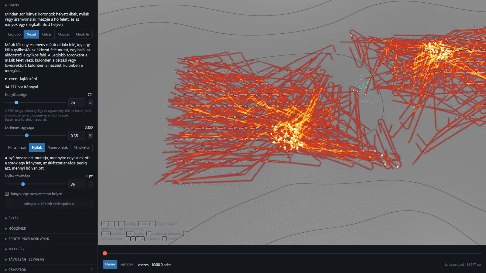

# Irányított hő

A sima hő azt mutatja meg, **hol** történnek a dolgok. Az irányított hő azt is megmutatja, **melyik irányba**: merre néztek az emberek, merre céloztak, merre mozogtak, vagy hol volt a harc másik oldala.

Egy normál sprite teljes korong (360 fok). A **Ék nyílásszöge** 70 fokra állítva ugyanaz a sprite keskeny éké válik, amely azt az irányt mutatja, amerre a sor nézett, és ugyanannyi összhőt ad hozzá.

## Használat {#how-to-use-it}

1. Töltsön be olyan adatot, amelyben van irány (lásd [Mi ad a sornak irányt](#what-gives-a-row-a-direction)).
2. Válassza a **Hő**, a **Különbség** vagy a **Csapathő** módot a módsávon.
3. Nyissa meg az **Irány** részt az oldalsávon.
4. Válasszon **forrást** (melyik irányt használja), majd kapcsolja be a rajzolást:
   - csökkentse az **Ék nyílásszögét** 360° alá, hogy minden sort a saját irányába mutató ékként rajzoljon, korong helyett;
   - válasszon **Mezőt**, hogy nyilakat vagy áramvonalakat rajzoljon a hő fölé;
   - pipálja be az **Irányok egy megkattintott helyen** opciót, és kattintson a hőre, hogy az adott helyről poláris diagramot kapjon.

Az állapotsor megmondja, hány sornak van irányt adó a kiválasztott forrásból.

## Beállítások {#settings}

| Beállítás | Alapérték | Mit csinál |
|---|---|---|
| Forrás: **Legjobb**, **Nézet**, **Célzás**, **Mozgás**, **Másik fél** | Legjobb | Melyik irányt kapja minden sor. A *Legjobb* soronként a másik felet veszi, különben a célzást, különben a nézetet, különben a mozgást. |
| **Eseménytípusonként** | mint fent | Eseménytípusonként más forrás, például a *Másik fél* az ölésekre és a *Nézet* a pozíciókra. Akkor látszik, ha az adatokban van legfeljebb 40 értékű eseményoszlop. |
| **Ék nyílásszöge** | 360° | A 360° a normál korong (ki). A kisebb keskenyebb éket jelent. Az ék ugyanannyi hőt ad hozzá, mint a korongja, így az összegek és a különbségek összehasonlíthatók maradnak. |
| **Ék élének lágysága** | 0,35 | 0 az éles szélű ék, 1 a lágy legyező. |
| **Mező**: Nincs mező, Nyilak, Áramvonalak, Mindkettő | Nincs mező | Nyilak: a nyíl hossza azt mutatja, mennyire értenek egyet ott a sorok egy irányban, átlátszatlansága pedig azt, mennyi hő van ott. A nyilak csak ott látszanak, ahol van hő. |
| **Nyilak távolsága** | 28 px | A nyilak távolsága a képernyőn. |
| **Áramvonalak animálása** | be | Bekapcsolva az áramvonalak folynak. |
| **Irányok egy megkattintott helyen** | ki | Kattintson a hőre, hogy lássa az ottani irányokat (lent). |
| **Irányok a kijelölt térfogatban** | | Ugyanez a diagram a kijelölt [térfogaton](volumes.md) belül lévő mindenre. |

## A poláris diagram egy helyen {#the-polar-chart-at-a-spot}

Az **Irányok egy megkattintott helyen** bekapcsolva kattintson a hőre. Az e ponthoz közeli sorok (1,5 sprite-sugáron belül) egy 24 szeletes, 15°-os rózsába gyűlnek:

- **narancs** szirmok: kimenő irányok (amerre a sorok mutatnak);
- **kék** szirmok: bejövő irányok (ahonnan jöttek);
- egy szirom **területe** a darabszámával nő; egy nyíl mutatja a fő irányt;
- a diagram alatti sorok adják a fő irányszöget, azt, mennyire erősen értenek egyet a sorok (R, 0 és 1 között), a szórást fokban, és a sorok számát.

0° a diagram tetején van, ami a világ −Z (a Tacview-felvételeknél észak). A helyet a 3D-s nézetben egy nyíl és egy gyűrű is jelöli.

## Mi ad a sornak irányt {#what-gives-a-row-a-direction}

| Forrás | Ami kell az adatokban |
|---|---|
| Nézet | egy legyezés-oszlop (nézési irányként leképezve): `yaw`, `heading`, `azimuth`, `view_yaw`, `rot_z` |
| Célzás | számpárok, például `aim_x`/`aim_y`, `shot_x`/`shot_y`, `fire_x`/`fire_y`, `hit_dir_x`/`hit_dir_y` (opcionális `…_z`) |
| Mozgás | semmi több: ugyanannak a személynek az előző mintájától mért lépés (legfeljebb 10 másodperccel korábbi, ugyanabban a munkamenetben) |
| Másik fél | egy oszlop, amely egy esemény másik oldalát nevezi meg (`other`, `victim`, `target`, `killer`, `attacker`, `shooter`, `other_player` …), és amelynek értékei személynevek; egy ölés a gyilkostól az áldozat felé mutat, egy halál az áldozattól a gyilkos felé |

## Tippek {#tips}

- Az éknek kell némi méret a képernyőn; néhány pixel alatt újra korongként rajzolódnak.
- Használja a *Másik fél* forrást az ölés-sorokon, hogy lássa, **honnan** nyertek a harcok, és a *Nézet* forrást a pozíció-soroknál, hogy lássa, **hol figyelnek az emberek**.
- A **Különbség** módban a két oldal ékei a saját irányukba mutatnak, így a vitatott tüzelési vonalak kiemelkednek.
