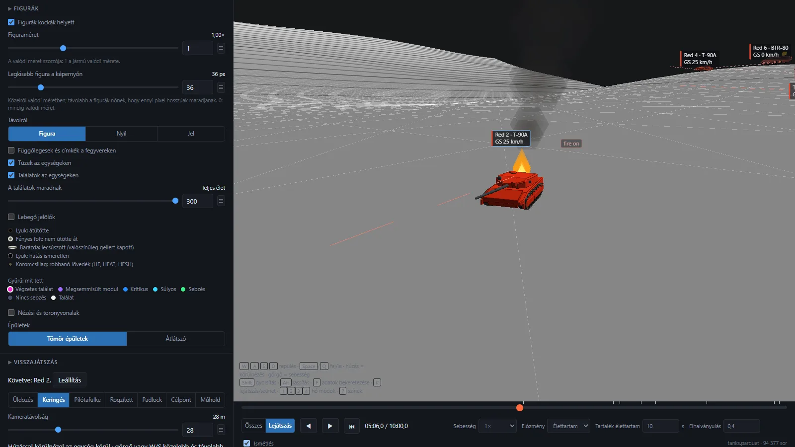

# Figurák

A **figura** annak egy kis 3D-s modellje, hogy valójában mi egy egység: egy tank, egy vadászgép, egy hajó, egy katona. A [visszajátszás](match-replay.md) minden egységet a saját figurájaként rajzol, valódi méretben, sima doboz helyett.

Körülbelül 2000 névvel ellátott jármű, repülőgép, hajó, fegyver és katona van, mindegyiket maga a nézegető építette.

## Mi van a katalógusban {#what-is-in-the-catalogue}

| Terület | Példák |
|---|---|
| Emberek | katona állva, guggolva, hasonfekve; mesterlövész, páncéltörő, mentős, legénység |
| Szárazföld | tankok, gyalogsági harcjárművek, légvédelem, tüzérség, teherautók és autók, vonatok és villamosok |
| Levegő | vadászgépek, támadórepülőgépek, bombázók, szállítók, helikopterek, a kétfedelű gépektől a modern sugárhajtásúakig |
| Tenger | osztályok szerinti hadihajók, repülőgép-anyahajók, tengeralattjárók, csónakok, kereskedelmi hajók |
| Fegyverek | rakéták, lőszerek, bombák, torpedók, fáklyák és csalóhalmazok |
| Jelölők | füst-, villanó- és gyújtógránátok, elhelyezett bombák, zászlók, megjelenési pontok, útpontok |
| Közelharc | katonák lapmellényben, gépkarabéllyal, géppisztollyal, sörétes puskával, DMR-rel, golyószóróval, pisztollyal vagy pajzzsal; drónok, kamerák, szögesdrót, pajzsok, falmegerősítés, barikádok, robbantótöltetek, csapdák, ablakok, gránátok, a hatástalanító |

## Hogyan készülnek a figurák {#how-the-figures-are-made}

- **Nyilvános méretekből építve.** A legtöbb figurát a nézegető saját figuraépítője készíti nyilvános számokból: hossz, szélesség, magasság, görgők, torony és ágyú, szárnyak és farok. Alakjukat ezután nyilvános fényképekhez, rajzokhoz és közzétett méretekhez hangolják. Egyetlen játék modelljét sem használjuk.
- **Szabad modellek.** Néhány figura szabad 3D-s modellt használ (CC0 vagy CC BY), ahol azok hűbbek, néha az épített testtel kombinálva. A CC BY művek szerzőit a [Figura-elismerések](figure-credits.md) oldal említi; a CC0 művekhez nincs szükség elismerésre, és ott nincsenek felsorolva.
- Minden figurának van teljes, durva és távoli változata (részletességi szintek, LOD), így több ezer is rajzolható egyszerre.

## Melyik figurát kapja egy egység {#which-figure-a-unit-gets}

A nézegető az adat saját oszlopait nézi:

1. **Nevek** - a *Name*, *Vehicle*, *Unit*, *Unit type*, *Model*, *Aircraft*, *Plane*, *Tank*, *Ship*, *Craft*, *Loadout*, *Kit* vagy *Figure* nevű oszlopok - összevetjük a katalógussal: pontosan, körülbelül 4000 álnéven keresztül (több játék egységazonosítói), a leghosszabb ismert előtag alapján (`F-16C_50` az F-16C), vagy a legrövidebb olyan figuranév alapján, amely azzal kezdődik.
2. Az a név, amelynek figurája nem illik az egység **típusához**, nem használható (a *Typhoon* nevű teherautó nem a vadászgép).
3. **Típusok** - a *Type*, *Class*, *Kind*, *Category*, *Icon*, *Role* vagy *Domain* nevű oszlopok - egy osztályfigurát adnak: Tacview-címkék (`Air+FixedWing`, `Ground+Heavy+Armor+Vehicle+Tank`, `Sea+Watercraft+Warship`, `Weapon+Missile`), térképikonok vagy sima szavak (tank, helikopter, gyalogság).
4. Ami egyikkel sem rendelkezik, az emberek adata: mindenki katona.

A helyes figurák legkönnyebb módja tehát egy `vehicle` oszlop a valódi nevekkel, vagy egy `type` oszlop Tacview-címkékkel.

**Az egységem dobozként vagy katonaként jelenik meg.** Adj egy `vehicle` oszlopot a valódi névvel, vagy egy `type` oszlopot Tacview-címkével. Húzd az egységre az egeret, hogy lásd, melyik nevet illesztette. Az olyan adat, amelynek van ilyen oszlopa, de egy egységről nem mond semmit, dobozként marad; amelynek egyik sincs, katonaként rajzolódik.

## Közelharci figurák (Rainbow Six Siege) {#close-quarters-figures-rainbow-six-siege}

Azok a táblázatok, amelyek úgy vannak írva, mint a Rainbow Six Siege visszajátszás-olvasóé (`operator`, `pawn`, `primaryClass`, `side` oszlopok), saját figurákat kapnak:

- **A játékosok** a saját operátoruk. A 78 operátor mindegyike saját figurát kap, kb. 1,8 m magasat, a saját ruhájában: két vagy három szín a dzsekire, a nadrágra és a felszerelésre, a szokásos nyilvános megjelenésük szerint (fekete, olajzöld, homokszín, városi szürke, fehér, sötétkék, piros, narancs vagy kékeszöld felszereléssel). És saját formákkal, amelyek egyharmaddal nagyobbak a valóságnál ott, ahol felülről is látszaniuk kell: fejfedő (sisakok, egy sisakrostély vagy nehéz sisak, sapkák, kötött sapkák, svájcisapkák, egy széles boonie kalap vagy prémsapka, kapucnik, sálak, haj), az arc (védőszemüveg, gázálarc, szemüveg, maszk, szakáll, háromlencsés szemüveg), könnyű, közepes vagy nehéz testalkat (a nehezek szélesek, nagy vállvértekkel és gallérral), hosszú kabát vagy öltöny, ghillie-ruha, amit a hátukon visznek (kalapács, töltetek, drónok, tartályok, üzemanyagtartály, indítócső, számszeríj, panelek, zavaró, pajzs) vagy a karjukon (indító, fémkar), a saját pajzsuk (magas, rohampajzs, lámpás pajzs), és egy kiemelő szín a vállon. Az elsődleges fegyverük osztályát tartják. Az az operátor, akit a nézegető nem ismer, egy egyszerű katona lapmellényben, a csapat színében.
- **Az oldal** a ruhától külön látszik: egy gyűrű a talajon minden operátor alatt, **borostyánsárga a támadóknak, halvány ciánkék a védőknek**, belül a csapat színével, valamint kar- és fejpántok ugyanabban a színben. Egy `stance` oszlop (állva, guggolva, fekve) adja a testhelyzetet; ha nincs ilyen, állnak.
- **Megkülönböztethetők visszajátszási távolságból:** 48 pixel magasan kirajzolva felülről és háromnegyedes nézetből bármely két operátor egy oldalon tiszta színkülönbségben vagy eltérő formában különbözik (ezt a nézegető tesztjei ellenőrzik).
- **A feliratok** megnevezik a játékost és az abban a pillanatban játszott operátort, az operátor szerepével szimbólumként: ✸ kemény áttörő, ⚒ puha áttörő, ➤ behatoló, ✦ fragger, ✚ támogató, ⬟ pajzs, ◉ felderítés, ◇ rugalmas, ↺ szárnybiztosító, ⚓ horgony, ✕ csapdázó, ⇄ portyázó, ↯ eszközellenes, ▣ áttörésgátló.
- **A drónok** egy kétkerekű, dobható drónként jelennek meg, kb. 30 cm szélesen. Mindegyik saját nyomvonal, a tulajdonosáról elnevezve („Ash · drone 2”).
- **A lerakott eszközök** ott állnak, ahová tették őket, onnantól a kör végéig. Mindegyik annak a figurája, amit csinál: kamera, szögesdrót, telepíthető pajzs, robbantótöltet, kemény áttörő töltet, kis tapadó töltet, padlócsapda, claymore a kioldólézerével, egyirányú ablak, páncélpanel, gránát, gáztartály, zavaró, érzékelő, lézerkapu, ellátóláda. Egy figura szolgál minden eszközt, amely ugyanazt a feladatot végzi. Az az eszköz, amelynek fajtáját az adat nem mondja meg, egy kis szerkezet egy lámpával.
- **A hatástalanító** ott áll, ahová lerakták, a 45 másodpercéig.

Minden drón és eszköz a fájl betöltésekor saját nyomvonallá válik, így a játékos saját figurája a testén marad. Az operátorok egyszerűsített formák a nyilvános leírásaik és rajzaik alapján (amit viselnek, az eszköz, amely a képességük), az eszközök formáját pedig az adja, amit csinálnak. Mindez a nézegető saját terve, a tárgy valódi méretében (egy claymore kb. 22 cm széles, egy ajtó méretű panel 1 m × 2,1 m), nem a játék modelljei.

## Beállítások {#settings}

A visszajátszás oldalsávjának **Figurák** része állítja a méretet, a legkisebb méretet a képernyőn, azt, hogy mivé váljanak a távoli egységek (figura, nyíl, jel), és a rajtuk megjelenő hatásokat. Lásd: [Meccs-visszajátszás](match-replay.md#figures). Füst, tűz és más időzített hatások: [Figurák a figura-rétegen](figure-replay.md).

## Egy választható helyi figurakészlet {#an-optional-local-figure-pack}

A saját gépeden megtarthatsz egy választható saját figurakészletet. Ezek a figurák a katalógus azonos nevű figuráinak helyét veszik át. Soha nem része a tárolónak vagy a közzétett verziónak; készlet nélkül semmi sem változik.
