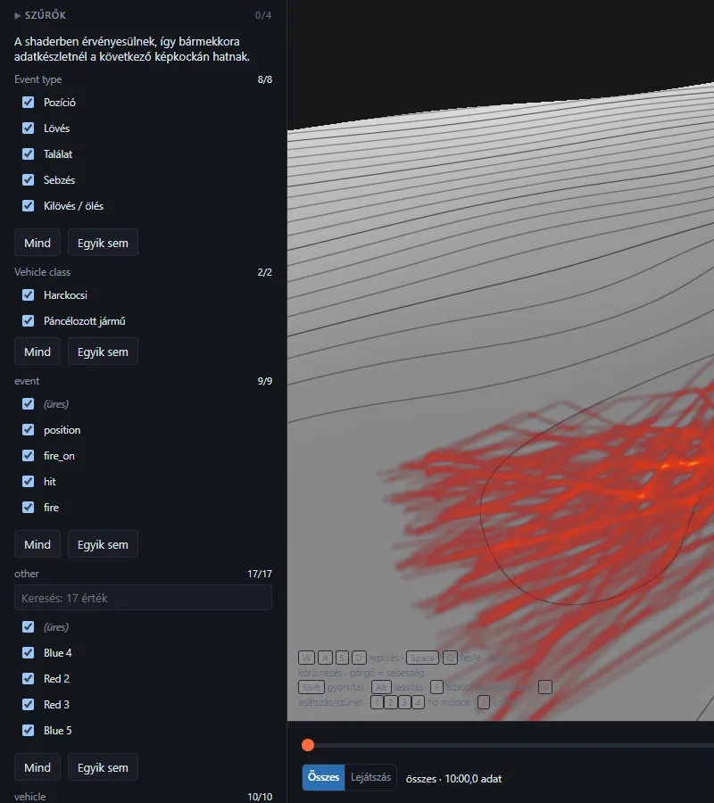
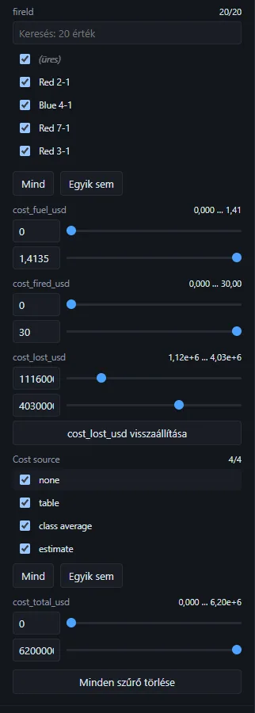

# Szűrők

A **Szűrők** elrejtik azokat a sorokat, amelyek nem érdekelnek, például egy járműosztályt vagy egy eseménytípust, és a kép azonnal frissül. A panel felsorolja a betöltéskor a *Megtartás szűréshez* alatt megtartott oszlopokat ([Oszlop-hozzárendelés](column-mapping.md)), valamint a *Forrásfájl* oszlopot, ha több fájl volt betöltve.

## Próbálja ki {#try-it}

1. Töltsön be egy adatkészletet, és nyissa meg a **Szűrők** panelt az oldalsávban.
2. A **Járműosztály** alatt vegye ki a *Harckocsi* jelölését. A kép azonnal változik.
3. A visszavonáshoz nyomja meg a **Minden szűrő törlése** gombot.

Az első sorok a megjelenítő saját oszlopai (lentebb). Az utánuk következők a fájlból származnak.

## A megjelenítő által hozzáadott oszlopok {#columns-the-viewer-adds}

Betöltéskor a megjelenítő négy saját oszlopot állít elő, és ezeket **elsőként** listázza, a neveikkel és értékeikkel az Ön nyelvén, így ugyanaz a szűrő minden játékhoz és adatforráshoz működik:

| Oszlop | Értékek | Ebből számítva |
|---|---|---|
| **Esemény típusa** | 23 fajta: Pozíció, Lövés leadva, Indítás (rakéta, lövedék, bomba), Találat, Tévesztés (a fegyver nem talált közeli célpontot), Robbanás, Sérülés, Ölés, Halál, Megsemmisítve, Lezuhanás, Katapultálás / kiugrás, Megjelenés, Eltűnés, Felszállás, Leszállás, Földérintés, Megállás a talajon, Újratöltés / tankolás, Elfoglalás / cél, Csalogató, Üzenet, Egyéb | egy `event`, `events`, `event_type` vagy `event_name` nevű oszlop; az egyes játékok saját szavai (`shot`, `burst`, `fired`, `struck`, `flare`, `plant` ...) ezekre a fajtákra képződnek le. A teljes táblázat: [Eseménytípusok és -osztályok](ref-event-types.md). |
| **Játékos vagy MI** | Játékos, MI | egy `ai`, `is_ai`, `bot` vagy `actor` oszlop; különben `is_player` / `human`; különben egy fiókazonosító (`user_id`, `steam_id`; üres vagy 0 jelentése MI); Tacview-felvételeknél az, hogy az objektumnak van-e pilótája |
| **Járműosztály** | 17 osztály: Vadászgép, Támadórepülő, Bombázó, Egyéb repülő, Helikopter, Harckocsi, Páncélozott jármű, Légvédelem, Tüzérség, Teherautó / autó, Hajó, Tengeralattjáró, Gyalogság, Fegyver, Csalogató, Építmény, Egyéb | a jármű vagy egység neve (összevetve a [figurakatalógussal](figures.md)) és a típusoszlopok |
| **Célpontosztály** | ugyanezek az osztályok | a másik fél járműve (`other_vehicle`, `target_vehicle`, `victim_type` ...) |

Rögtön utánuk jönnek az [eredményoszlopok](data-formats.md#outcome-columns), ahol az adatban megvannak: **Kör eredménye** és **Meccs eredménye** (*Bármelyik*, *Nyert*, *Vesztett*), valamint **Hogyan ért véget a kör**, az értékei az Ön nyelvén. Szűrjön rájuk, vagy ossza fel szerintük a hőt [győzelmi arány térképként](win-rate.md).

Csak a ténylegesen előforduló fajták jelennek meg. Az érték-oszlopok (`cost_*`, `earn_*`, `net_*` és a *Költségforrás*, lásd [Érték-súlyozás](value-weighting.md)) bármely számoszlophoz hasonlóan szűrhetők: például a *Költségforrás* alatt vegye ki a *becslés* jelölését, hogy csak az árazott sorok maradjanak.

A kategórialistában 12-nél több érték esetén keresőmező jelenik meg (*n érték keresése*), és egy **Csak ezek** gomb, amely pontosan az illeszkedő értékeket engedélyezi.

Hogy mely oszlopok szűrhetők, azt a betöltés döntötte el, mert akkor kell beolvasni őket. Megtartott oszlop nélkül a panel ezt megmondja, és a *Megtartás szűréshez* beállításra mutat.

## Számoszlopok (tartomány) {#numeric-columns-range}

| Rész | Jelentése |
|---|---|
| Név, és `min ... max` | Az oszlop és az aktuális tartomány (az oszlop teljes tartománya, amíg nincs szűrő beállítva). |
| Első sor: számmező és csúszka | Az alsó határ. A csúszka felhúzása a felső határ fölé a felső határt is magával viszi. |
| Második sor: számmező és csúszka | A felső határ. Az alsó határ alá húzva azt is eltolja. |
| **Oszlop visszaállítása** | Eltávolítja ezt a szűrőt. |

A csúszkák az oszlop minimumától a maximumáig, 1000 lépésben futnak; a számmezők bármilyen értéket elfogadnak. Egy sor akkor marad át, ha az értéke a tartományon belül van, mindkét végpontot beleértve. A nagy értékek kitevős alakban látszanak (`1.23e6`).

## Kategóriaoszlopok {#category-columns}

| Rész | Jelentése |
|---|---|
| Név, és `engedélyezett/összes` | Az oszlop, és hány értéke engedélyezett. |
| Értéklista | Jelölőnégyzet értékenként; az üres érték *(üres)* néven látszik. |
| **Mind** / **Egyik sem** | Minden érték engedélyezése / egy sem. |

Ha minden érték engedélyezett, a szűrő megszűnik.

## Szabályok {#rules}

- **Egyszerre négy szűrő.** A fejléc `aktív/4` értéket mutat. Egy ötödik szűrő nincs alkalmazva, és a panel ezt jelzi. Az [Entitások](entities.md) alatti kiválasztás (vagy a Meccs fül játékosfókusza) is az egyik négyet használja. Az az egy szűrő, amely az egész oszlopot lefedi, egyet sem használ.
- **Egy kategóriaoszlopnak legfeljebb 4096 értéke lehet**; a szélesebbet betöltéskor nem tartjuk meg.
- **A szűrők ÉS-kapcsolatban működnek**, és a csapatlátszással, a különbség-felosztással, az időablakkal, a távolságkihagyással és a [szelettel](slice.md) együtt.
- **Egy szűrő megváltoztatása újraindítja a halmozást**, és néhány képkocka múlva újra méri az expozíciót, mert a szűrés nagyot változtathat a sűrűségen ([Szín és expozíció](colour-and-exposure.md#auto-exposure)).
- **A Minden szűrő törlése** minden oszlopszűrőt eltávolít. A csapatok láthatósága és a máshol beállított játékos-kiválasztások megmaradnak.
- Az oszlopszűrők a hőmódokat változtatják. Nem változtatják a [figurás visszajátszás](box-replay.md) figuráit, amelyek a csapatok láthatóságát és az Entitások kiválasztását követik. Az Entitások kiválasztása mindkettőt változtatja.
- A [vonal-hőnél](line-heat.md) a szűrőt azon a soron ellenőrizzük, amelyben az egyes szakaszok *végződnek*.
- Minden új adatkészletnél minden szűrő törlődik.

## Fejlesztőknek {#for-developers}

**Rések.** Minden aktív szűrő a négy GPU-résálból egyet foglal el ([`MAX_FILTER_SLOTS`](https://github.com/Holdi601/3DHeat/blob/main/src/render/types.ts)), soronként 4 bájtos textúrában. A résekbe a szűrők abban a sorrendben kerülnek, ahogy utoljára változtak ([`filterSlots`](https://github.com/Holdi601/3DHeat/blob/main/src/render/filterTables.ts), amelyet a shader és mindkét panel használ). A negyedik fölött egy hiba jelenik meg: *Csak az első 4 szűrő van alkalmazva. Törölje az egyiket – a többi figyelmen kívül marad, nem csendben kombinálódik*, a többi szűrő neve pedig *oszlop (nincs alkalmazva)* alakú. A szűrők soronként futnak a csúcsshaderben, így a küszöb változtatásához nincs újraelemzés és újrafeltöltés.

**A panel által nem mutatott szűrők.** Az alkalmazásállapotban két további fajta létezik ([`FilterSpec`](https://github.com/Holdi601/3DHeat/blob/main/src/state/types.ts)):

- egy **csoportok** szűrő, amelyet a Meccs fül állít be, amikor az egyik oldalra fókuszál. Minden módban elrejti a többi csoportot, az oszlop szerinti [különbség-felosztást](difference.md) is beleértve.
- egy **személyek** szűrő, amelyet az [Entitások](entities.md) panel állít be, és a Meccs fül, amikor egy játékosra fókuszál. Korlátozza a figurás visszajátszást és a hőmódokat. A hőben ez a személyazonosítókon egy kategóriaszűrő, és a négy rés egyikét foglalja el. Maszkja 65 536 azonosítót tud tartani ([`FILTER_MASK_CAPACITY`](https://github.com/Holdi601/3DHeat/blob/main/src/render/types.ts)); az e fölötti személy aktív szűrő mellett nem rajzolódik a hőben, akkor sem, ha ki van jelölve. A figurás visszajátszás továbbra is mutatja őket.
