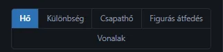

# Hőmódok

Minden pont ad egy kis izzást, az izzások halmozódnak, és a halmot színekkel festjük be. A módok öt különböző módszert jelentenek a festésre, és mindegyik egy kérdésre felel.

A Hőtérkép fül oldalsávjának tetején lévő módválasztó sáv határozza meg, hogyan rajzolódik ki az [adatkészlet](glossary.md). A 1–4 billentyűk a Hő, Különbség, Csapathő és Vonalak módokat választják. A Figurás átfedésnek nincs billentyűje.

| Mód | Kérdés, amire válaszol |
|---|---|
| **Hő** | Hol történt, és mennyi? |
| **Különbség** | Melyik oldal volt többet jelen? |
| **Csapathő** | Kié volt? |
| **Vonalak** | Merre mentek az emberek? |
| **Figurás átfedés** | Ki hol volt, és mikor? |

| Mód (sáv felirata) | Billentyű | Mit rajzol | Szükséges hozzá |
|---|---|---|---|
| **Hő** | 1 | Additív sűrűség: minden látható sor egy kamerafelé forduló sugárirányú sprite-ot ad hozzá. [Hő](heat.md) | egy adatkészlet |
| **Különbség** | 2 | Előjeles sűrűség: az egyik népesség ad, a másik vesz el. [Különbség](difference.md) | két oldal: legalább két csoport, vagy felosztás egy megtartott oszlop szerint |
| **Csapathő** | 3 | Csoport szerint színezett sűrűség: csoportonként egy árnyalat, átfedéseknél keverve. [Csapathő](team-heat.md) | egy csoportoszlop |
| **Figurás átfedés** | – | Személyenként egy figura (vagy doboz), amely az idővonal mentén mozog: a visszajátszás. [Figurás átfedés](box-replay.md), [Meccs-visszajátszás](match-replay.md) | egy személyoszlop |
| **Vonalak** | 4 | Vonal-hő: minden személy mintavételétől a következőig húzott vonal, oldalirányban elhalványuló hővel. [Vonal-hő](line-heat.md) | egy személy- és egy időoszlop |

A nem támogatott adatokkal működő módok szürkék, a súgójuk megmondja az okát, például *Nem elérhető – a Különbség módhoz két csoport vagy egy megtartott felosztó oszlop kell; ezekben az adatokban egy csoport van.* Ha egy új adatkészlet nem támogatja az aktuális módot, a nézet a **Hő** módra vált.

Az 1–4 billentyűket ugyanúgy ellenőrzi a rendszer az adatokkal szemben: a szürke mód billentyűje nem csinál semmit.

## Melyik mód melyik paneleket mutatja {#which-panels-each-mode-shows}

| Panel | Hő | Különbség | Csapathő | Figurás átfedés | Vonalak |
|---|---|---|---|---|---|
| Útvonalak ([vonal-hő](line-heat.md)) | | | | | igen |
| Hőalak (a **Nézet követése** és az **Azonos sűrűség minden nagyításnál** opciókkal), Hőszínek, Sprite-pixelkorlátok, Mélység, Távolságkihagyás | igen | igen | igen | | igen |
| Irány ([irányított hő](directional-heat.md)), Érték ([érték-súlyozás](value-weighting.md)) | igen | igen | igen | | igen |
| Csapatnéző ([figurás átfedés](box-replay.md)) | | | | igen | |
| Különbség-felosztás ([különbség](difference.md)) | | igen | | | |
| [Csapatok](teams-list.md), [Entitások](entities.md), [Szűrők](filters.md), Háttér / pálya, [Szelet](slice.md), [Mérés](measure.md), Kameraútvonal és renderelés, Teljesítmény, Kamera és jelenet | igen | igen | igen | igen | igen |

## Amit minden hőmód közösen használ {#what-every-heat-mode-shares}

Mind a négy hőmód (a figurás átfedés kivételével) ugyanaz a gépezet, eltérő bemenetekkel ([`engine.ts`](https://github.com/Holdi601/3DHeat/blob/main/src/render/engine.ts)):

1. **Melyik sorok.** Az [idővonal](timeline.md) ablaka az időben rendezett sorok összefüggő tartományát választja ki; a [szűrők](filters.md), a csoportláthatóság, a különbség-felosztás, a [távolságkihagyás](depth-and-culling.md#distance-culling) és a [szelet](slice.md) soronként dönti el a csúcsshaderben, hogy hozzájárul-e, és mennyire.
2. **Splatting.** Minden hozzájáruló sor egy sprite-ként (vagy Vonalak módban egy szakaszként) rajzolódik egy lebegőpontos **hőcélpontba**, hozzáadva a skálaértékét. Ha több sor van, mint amennyit egy képkocka elbír, a sorok rétegezett mintája rajzolódik, súlyozva a kompenzáláshoz. Lásd [Mintavétel és keretek](sampling-and-budgets.md).
3. **Halmozás.** Amíg semmi nem változik, a képkockák addig egyesülnek, amíg minden sor pontosan egyszer nem járult hozzá. Lásd [Halmozás](accumulation.md).
4. **Összeállítás.** Minden pixelnél a halmozott érték elosztódik a **telítési ponttal**, alakul a **sűrűségválaszon** keresztül, megemelődik a **minimális hővel**, és a **színskálán** keresve az **átlátszóság** alapján beleolvad a jelenetbe. Lásd [Szín és expozíció](colour-and-exposure.md).

A 4. lépés minden eleme az összeállításkor érvényesül, így ezeknek a vezérlőknek a húzása sosem indítja újra a halmozást; az 1–2. lépésbeli dolgok viszont igen.

## Az ebben a részben lévő oldalak {#pages-in-this-section}

- [Hő](heat.md) – a sima hőmód, és panelei áttekintése
  - [Sprite-alak](sprite-shape.md) – sugár, intenzitások, lecsengés, görbeszerkesztő, pixelkorlátok, lapítás
  - [Szín és expozíció](colour-and-exposure.md) – színskála-szerkesztő, telítési pont, automatikus expozíció, minimális hő, sűrűségválasz
  - [Mélység és kihagyás](depth-and-culling.md) – takarás a pálya által, elrejtés a terep mögött, távolságkihagyás
- [Különbség](difference.md) – a különbség-felosztás
- [Csapathő](team-heat.md)
- [Vonal-hő](line-heat.md) – útvonalak
- [Figurás átfedés](box-replay.md) – a visszajátszási mód (a fájl neve még mindig doboz-visszajátszás)
- [Irányított hő](directional-heat.md)
- [Érték-súlyozás](value-weighting.md)
