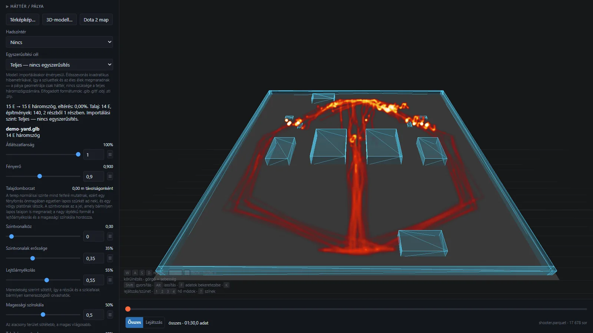
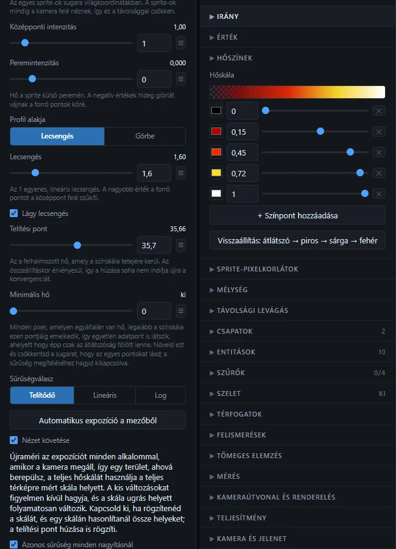

# Hő

A hő azokat a helyeket festi be, ahol sok minden történt: pirossal, ahol kicsit, fehér izzással, ahol nagyon sok. Arra felel, hogy „hol történik ez, és mennyi”.

A **Hő** (1-es billentyű) az alapértelmezett mód. Minden látható [sor](glossary.md) egy kamerafelé forduló kerek [sprite](glossary.md)-ot ad hozzá; az átfedő sprite-ok lebegőpontos pufferben összeadódnak; az összeget színskálán vezetjük át – alapértelmezés szerint átlátszó → piros → sárga → fehér –, és a jelenet fölé rajzoljuk.

A kép egy lövöldözős kör hőjét mutatja épületekkel teli pályán: a forró pontok a szobákban és a lépcsőkön ülnek, nem csak a talajon.

## Használat {#how-to-use-it}

1. Töltsön be adatot, és nyomja meg az `1`-et (vagy válassza a **Hő** módot a módválasztó sávon).
2. Ha minden fehér vagy üres, nyomja meg az **Automatikus expozíció a mezőből** gombot a **Hőalak** szakaszban.
3. Állítsa a **Sprite sugara** értékét, amíg a szomszédos pontok sávokká nem olvadnak: kisebb értéknél egyedi foltok látszanak, nagyobbnál területek.
4. Nyissa meg a **Hőszínek** részt a színek megváltoztatásához, vagy a **Mélység** részt, hogy a dombok és a falak elrejtsék mögöttük a hőt.

Ugyanezek a panelek formálják a [Különbség](difference.md), a [Csapathő](team-heat.md) és a [Vonal-hő](line-heat.md) módot is; azok abban különböznek, mit adnak hozzá (előjelesen, színezve vagy vonalak mentén), nem abban, hogyan.

## A panelek és alapértelmezéseik {#the-panels-and-their-defaults}

Minden alábbi vezérlő egy shaderparamétert állít, így a változtatás mindössze egy újrarajzolásba kerül. A csúszkák mellett beírható mező és húzófogantyú van (a jobb oldali kis markolat: felfelé vagy lefelé húzva, mennyire távolabb, annál gyorsabb, a Shift a finomhangoláshoz); ha a csúszka sínje egy valódi határ előtt ér véget, a fogantyú a megadott *jog-plafonig* tolható tovább. Az *indításkor* jelzett értékek minden új adatkészletnél újraszámítódnak.

### Hőalak (nyitva) {#heat-shape-open}

| Vezérlő | Alapérték | Tartomány (jog-plafon) | Részletek |
|---|---|---|---|
| **Sprite sugara** | 6 m; betöltéskor kiterjedés / 120 | 0,05–2000 m, logaritmikus (50 000) | [Sprite-alak](sprite-shape.md#sprite-radius) |
| **Középponti intenzitás** | 1 | 0–10 (1000) | [Sprite-alak](sprite-shape.md#centre-and-edge-intensity) |
| **Peremintenzitás** | 0 | -2–10 (1000) | [Sprite-alak](sprite-shape.md#centre-and-edge-intensity) |
| **Profil alakja** | *Lecsengés* | *Lecsengés* / *Görbe* | [Sprite-alak](sprite-shape.md#ramp-shape-falloff-or-curve) |
| **Lecsengés** (csak Lecsengésnél) | 1,6 | 0,1–8 (64) | [Sprite-alak](sprite-shape.md#falloff) |
| **Lágy lecsengés** (csak Lecsengésnél) | be | | [Sprite-alak](sprite-shape.md#falloff) |
| Görbeszerkesztő (csak Görbénél) | *Lágy* sablon | | [Sprite-alak](sprite-shape.md#the-curve-editor) |
| **Telítési pont** | 24; betöltéskor becslés, utána mérés | 0,1–4000, logaritmikus (10 000 000) | [Szín és expozíció](colour-and-exposure.md#saturation-point) |
| **Minimális hő** | ki (0) | 0–100% | [Szín és expozíció](colour-and-exposure.md#minimum-heat) |
| **Sűrűségválasz** | *Telítő* | *Telítő* / *Lineáris* / *Log* | [Szín és expozíció](colour-and-exposure.md#density-response) |
| **Automatikus expozíció a mezőből** | | gomb | [Szín és expozíció](colour-and-exposure.md#auto-exposure) |
| **Nézet követése** | be | | Minden alkalommal újra méri az expozíciót, amikor a kamera megáll, így a befelé repült terület a teljes színskálát használja. A kis változásokat figyelmen kívül hagyja, a skála simán áll át. Vegye ki a jelölést, vagy húzza a **Telítési pont** csúszkát, hogy rögzítse a skálát, és egy skálán hasonlítsa össze a helyeket. [Szín és expozíció](colour-and-exposure.md#follow-the-view) |
| **Azonos sűrűség minden nagyításnál** | be | | Egy szín mindig ugyanannyi sort jelent területegységenként, bármilyen közel van is. A pixelkorlátok által felnagyított (távolról) vagy összehúzott (közelről) sprite megtartja azt a hőt, amelyet valódi méretével adna, így a távolról expozált kép nem halványul el, ahogy belerepül. Kikapcsolva a korlátozott sprite a korlátozott méretében adja hozzá a teljes súlyát. [Sprite-alak](sprite-shape.md#pixel-clamps) |
| **Lapítás a talajsíkra** | ki | | [Sprite-alak](sprite-shape.md#flatten-onto-ground-plane) |

### Hőszínek (zárva) {#heat-colours-closed}

| Vezérlő | Alapérték | Részletek |
|---|---|---|
| Csoportmintaszínek és **Színszétválasztás** (csak Csapathő) | 1,4 | [Csapathő](team-heat.md) |
| **Hőskála** szerkesztő (*Pozitív (hozzáadó csapatok)* a Különbségben, *Átlátszatlansági skála* a Csapathőben) | átlátszó → piros → sárga → fehér | [Szín és expozíció](colour-and-exposure.md#the-ramp-editor) |
| **Visszaállítás: átlátszó → piros → sárga → fehér** | | |
| **Negatív (kivonó csapatok)** skála (csak Különbség) | átlátszó → zöld → kék → lila | [Különbség](difference.md#colours) |

### Sprite pixelkorlátok (zárva) {#sprite-pixel-clamps-closed}

| Vezérlő | Alapérték | Tartomány (jog-plafon) | Részletek |
|---|---|---|---|
| **Min. pixelsugár** | 1 px | 0–16 (512) | [Sprite-alak](sprite-shape.md#pixel-clamps) |
| **Max. pixelsugár** | 96 px | 2–1024, logaritmikus (8192) | [Sprite-alak](sprite-shape.md#pixel-clamps) |

### Mélység (nyitva) {#depth-open}

| Vezérlő | Alapérték | Részletek |
|---|---|---|
| **Elrejtés a terep mögött** | be | [Mélység és kihagyás](depth-and-culling.md#hide-behind-terrain) |
| **Geometria mögött rejtve** | 0,8 (*80%-kal halványabb*) | [Mélység és kihagyás](depth-and-culling.md#hidden-behind-geometry) |

### Távolságkihagyás (zárva) {#distance-culling-closed}

| Vezérlő | Alapérték | Tartomány (jog-plafon) | Részletek |
|---|---|---|---|
| **Közeli** | ki (0) | 0,5–5000 m, logaritmikus, a sáv alja = ki (200 000) | [Mélység és kihagyás](depth-and-culling.md#distance-culling) |
| **Távoli** | ki (0) | 1–200 000 m, logaritmikus, alja = ki (10 000 000) | [Mélység és kihagyás](depth-and-culling.md#distance-culling) |
| **Vágás síkkal** | be | | [Mélység és kihagyás](depth-and-culling.md#distance-culling) |
| **A pálya vágása is** | be | | [Mélység és kihagyás](depth-and-culling.md#distance-culling) |

Billentyűk: a `[` és a `]` befelé és kifelé tolják a távoli határt, a `\` ki- és bekapcsolja ([Mélység és kihagyás](depth-and-culling.md#keyboard)).

### Irány és Érték {#direction-and-value}

A Hőalak alatt további két szakasz van. Az **Irány** minden sort ékként rajzol, és nyilakat ad hozzá: lásd [Irányított hő](directional-heat.md). Az **Érték** a hőt ahhoz méri, amibe az egyes sorok kerültek vagy amit hoztak: lásd [Érték-súlyozás](value-weighting.md).

## Mi kerül mentésre {#what-is-saved}

A fenti hőbeállítások nem mentődnek munkamenetek között: az oldal újratöltése visszaállítja az alapértékeket. Két dolog marad meg a böngészőben: az utolsó lejátszási sebesség (`heat3d.speed`, lásd [Idővonal](timeline.md)), és a [figurás átfedés](box-replay.md) távoli figurák beállításai (jelstílus, méret, találatjelek stb.). Ugyanígy megmarad a nyelv, a [megfordított világtengelyek](camera.md#invert-world-axis), a versenyfül emlékezett autónevei és a [pályakönyvtár](level-library.md). A teljes lista a [Mentett beállítások](ref-settings-storage.md) oldalon található.
