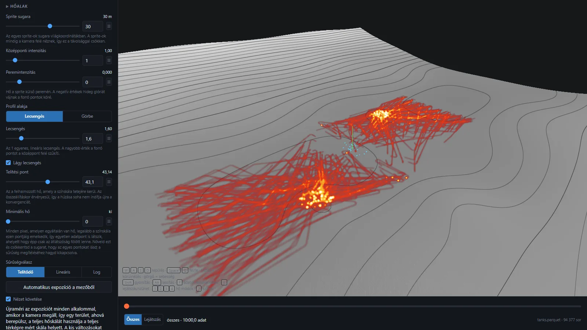
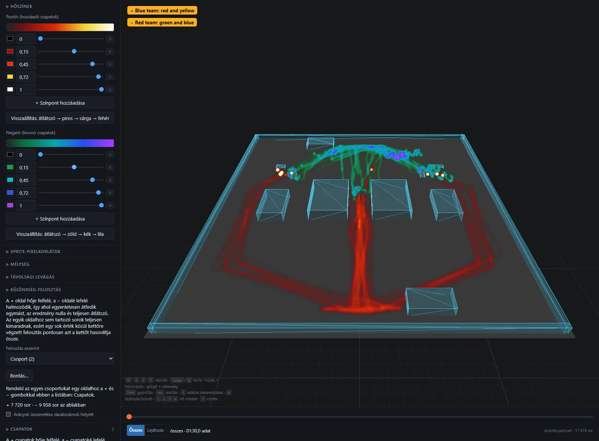
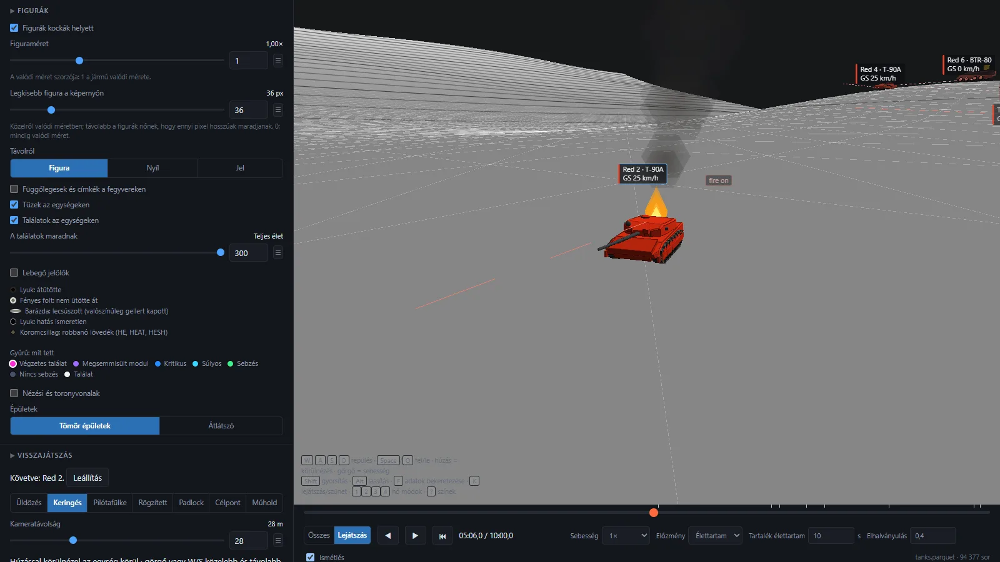
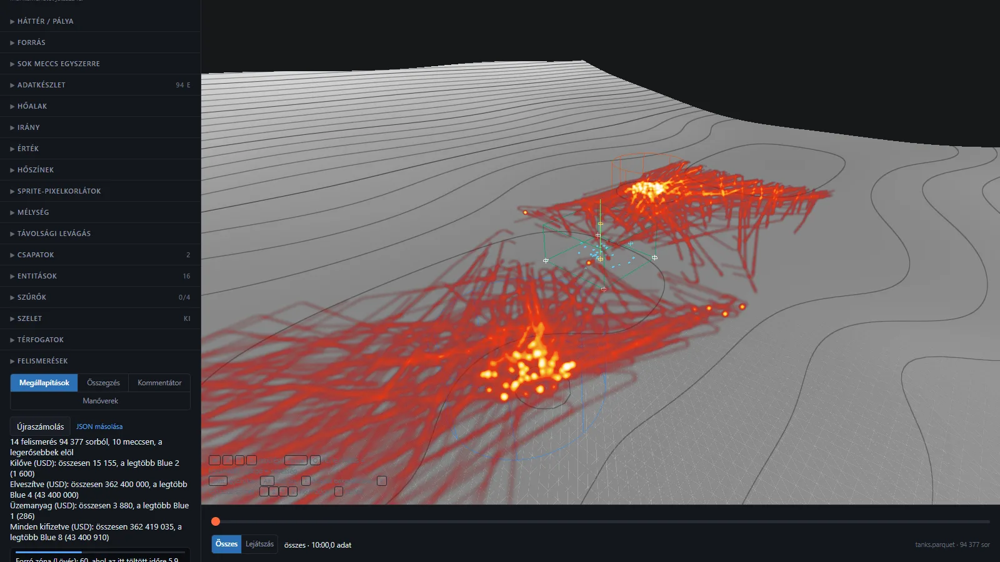
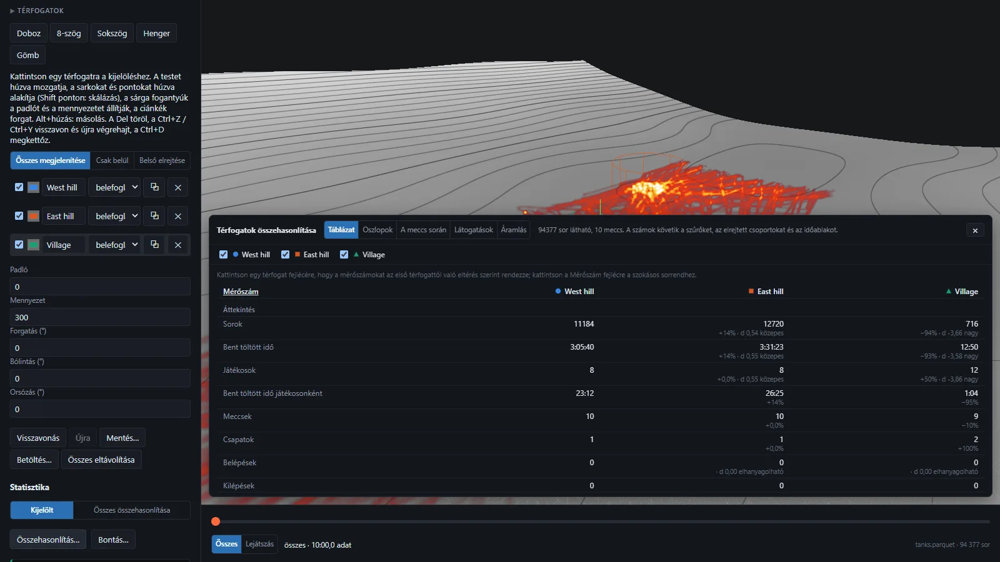
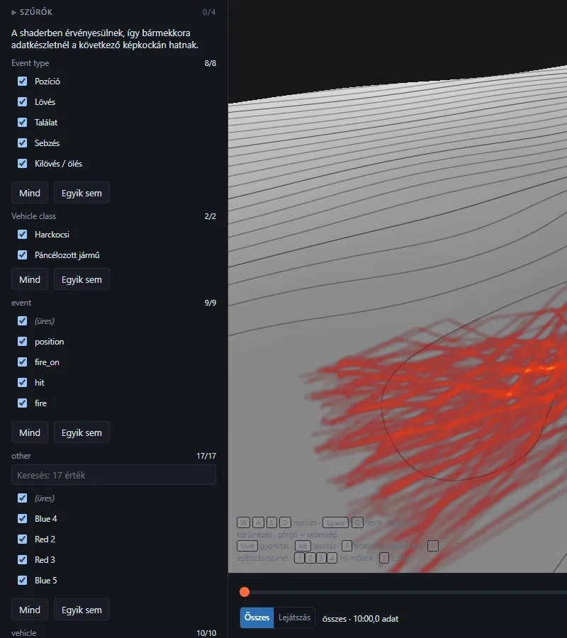
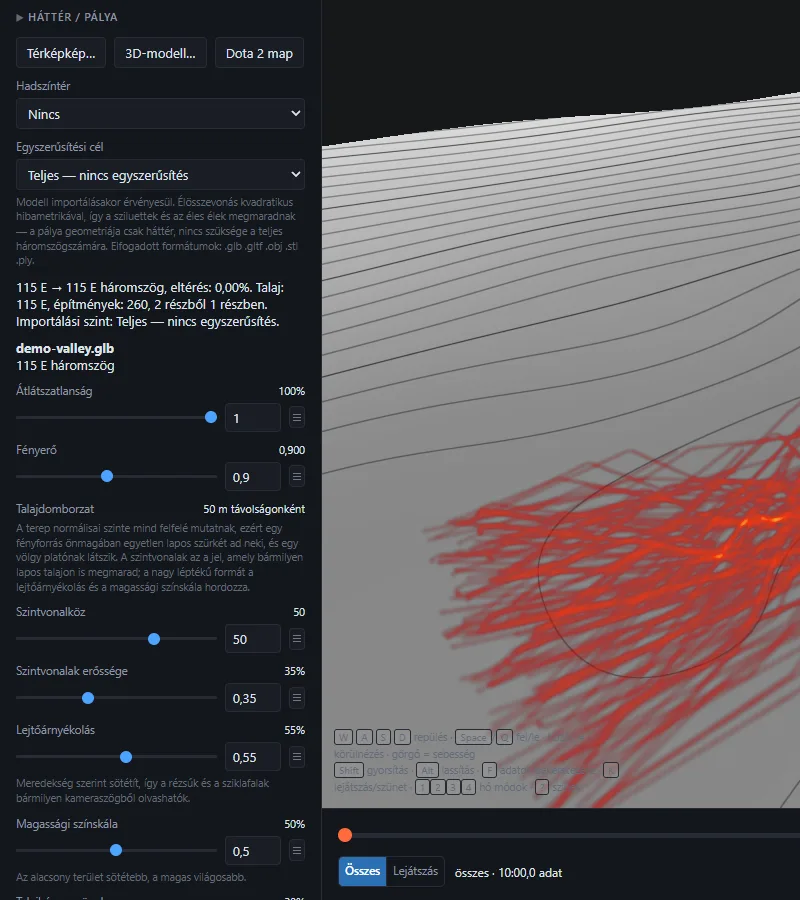

# 3DHeat

A 3DHeat megmutatja, hol történt valami egy játékban: hol mozogtak a játékosok, hol harcoltak és hol estek el. Ezt izzó színekként mutatja, amelyek között el lehet repülni, vagy apró 3D-s figuraként, amelyek visszajátsszák a meccset.

Töltsön be pozíciókat – CSV, Parquet, Tacview-felvételek, átalakított visszajátszások, egyetlen fájl, mappa vagy több ezer meccs –, és nézze meg őket **hőtérképként, amelyben el lehet repülni**, **figurákként, amelyek visszajátsszák a meccset**, vonalakként a játékosok útvonalai mentén, vagy egy populáció egy másikkal szembeni összevetéseként. Magától megtalálja, ami kiemelkedik, és teljes egészében a böngészőjében fut: semmit nem tölt fel sehová. A 3DHeat és minden eszköze ingyenes és nyílt forráskódú, az [MIT-licenc](https://github.com/Holdi601/3DHeat/blob/main/LICENSE) alatt.



**Új vagy itt?** Készítse el a [demóadatokat](demo-data.md), és kövesse a hét lépését. Ezen az oldalon minden képet ezzel készítettünk.

## Mit tud {#what-it-does}

| | |
|---|---|
|  | **[Hőmódok](heat-modes.md)** – hő, [különbség](difference.md) (piros, ahol az egyik oldal többet volt jelen, zöldeskék, ahol a másik), [csapathő](team-heat.md), [vonal-hő](line-heat.md); [irányított hő](directional-heat.md) ékekkel, nyílmezőkkel és poláris diagramokkal; hő [érték szerint súlyozva](value-weighting.md): mibe kerül a fegyver, a jármű és az üzemanyag. |
|  | **[Meccs-visszajátszás](match-replay.md)** – minden egység a saját [figurájával](figures.md), a távolabbiak NATO- vagy orosz jelekkel, rakéták és nyomjelzők, találatjelek, roncsok, tüzek, toronyok, célok, Tacview-szerű kamerák és taktikai megjelenítés; [sok meccs egyszerre](many-matches.md). |
|  | **[Felismerések](insights.md)** – erős pozíciók, halálos terep, spawn-csapdák, szűk keresztmetszetek és kiemelkedő játékosok, bizonyítékkal együtt megtalálva és rangsorolva; írott összegzés, opcionálisan a választott MI-vel; kommentátor egy meccshez; a [tudás-lencse](knowledge.md). |
|  | **[Térfogatok](volumes.md)** – dobozok, hasábok, hengerek és gömbök rajzolása, szűrés rájuk, a bennük történtek számlálása, exportálás, és helyek összehasonlítása egymás mellett; [bontás](breakdown.md) arról, hogy ki és mi teljesít a legjobban egy helyen. |
|  | **[Szűrők](filters.md)** – esemény típusa, játékos vagy MI, járműosztály, érték, bármely oszlop szerint, bármekkora adatmennyiségnél a videokártyán. |
|  | **[Pályák](levels.md)** – térképképek, 3D-s pályák az [adateszközökkel](#related-repositories), egyszerűsítés, a [világ-háttér](world-backdrop.md) valódi terepeivel repülési adatokhoz. |

Emellett: a [Versenyelemzés](race-analysis.md) fül versenyjátékok köreihez, a [Meccs](match-analysis.md) fül a Counter-Strike 2 összegzéseihez, a [Taktikatábla](tactics-board.md) pályán készült tervekhez, a [találatelemzés](hit-analysis.md) járművenként, a [tömegelemzés](mass-analysis.md) több ezer meccshez, a [kameraútvonalak és videó](camera-path-and-video.md), [40 nyelv](languages.md), [metrikus vagy angolszász mértékegységek](settings.md).

## A fülek {#the-tabs}

A fülek az oldalsáv tetején ülnek, a név, a mértékegységek és a nyelvmenü alatt.

| Fül | Mire való |
|---|---|
| **Hőtérkép** | Bármely pozíciós táblázat: a hőmódok, a figurás átfedés, a szűrők, a térfogatok, a felismerések, a pályák, a mérés és a videó. |
| **Versenyelemzés** | Egy pálya két vagy több köre: hol veszítenek időt, miért, és mit kell változtatni. |
| **Meccs** | Egy meccs figurás visszajátszása, és a Counter-Strike 2 meccsösszegzései. |
| **Taktika** | Tervek egy pályán: figurák, útvonalak, dobott segédeszközök, területek és jegyzetek lépésekben, amelyek lejátszhatók. |
| **Járművek** | Hogy hol találtak el minden egységet, ki és mivel. |

## Telepítés és futtatás {#install-and-run}

A 3DHeat ingyenesen használható, módosítható és megosztható (MIT-licenc), és ugyanígy a [Kapcsolódó tárolók](#related-repositories) alatt felsorolt minden eszköz is.

### Windows, a könnyű módon {#windows-the-easy-way}

A tároló gyökérmappája három kötegelt fájlt tartalmaz.

| Fájl | Mit csinál |
|---|---|
| `start.bat` | Elindítja a megjelenítőt. Akkor is megtalálja a Node.js-t, ha nincs a `PATH`-ban (ezeket a helyeket nézi: `%ProgramFiles%\nodejs`, `%ProgramFiles(x86)%\nodejs` és `%LOCALAPPDATA%\Programs\nodejs`), és ha a Node.js hiányzik, felajánlja az LTS-kiadás telepítését a `winget install -e --id OpenJS.NodeJS.LTS` paranccsal. Az első futtatáskor megkérdezi, mielőtt letöltené a függőségeket (nagyjából 300 MB a mappán belüli `node_modules\` mappába, rendszerszintű változtatás nélkül). Nem indul el, ha már valami figyel az 5273-as porton, és helyette a `restart.bat` használatát javasolja. Ha a mappa git-tár tiszta helyi változtatások nélkül, és van újabb verzió, megkérdezi, frissítsen-e (I/N; ha 60 másodpercig nincs válasz, megtartja ezt a verziót; lásd [Frissítések](updates.md)). Ezután elindítja a fejlesztői kiszolgálót a `http://127.0.0.1:5273/` címen, és megnyitja a böngészőt. **Az ablak maga a kiszolgáló**: hagyja nyitva; a bezárás vagy a Ctrl+C leállítja. |
| `restart.bat` | Lefuttatja a `stop.bat quiet` parancsot, majd a `start.bat`-ot. Csak a `vite.config.ts` módosítása, új függőség hozzáadása után vagy akkor kell, ha a kiszolgáló elakadt – a forrásfájl-változtatások élőben betöltődnek. |
| `stop.bat` | Leállítja azt, ami az 5273-as porton figyel, a folyamatazonosítót a `netstat` segítségével keresve, sosem a képfájl neve alapján, így a gépen futó többi Node.js-folyamat érintetlen marad. Nagyjából két másodpercet vár, hogy a socket felszabaduljon. A `quiet` argumentummal nem áll meg a végén. |

### Kézzel (bármely operációs rendszer) {#by-hand-any-os}


```bash
git clone --recursive https://github.com/Holdi601/3DHeat.git
cd 3DHeat
npm install
npm run dev      # http://127.0.0.1:5273
```

Az `exporters/` mappa a külön adateszközöket tartalmazza git-almodulokként, mindegyik saját tárolóként; sima klónozás után futtassa a `git submodule update --init` parancsot. A megjelenítőnek magának nincs szüksége rájuk a futáshoz. Az `exporters/ext/` mappa az opcionális átalakítókat tartalmazza (War Thunder, World of Tanks, World of Warships, Squad-visszajátszások; DCS- és IL-2-térképek), mindegyik önálló projekt.

Semmilyen játékadat nem jár a csomaggal: a pályákat, térképeket és felvételeket az Ön gépén, az eszközökkel készíti, az Ön által birtokolt játékokból.

### npm-parancsok {#npm-scripts}

| Parancs | Mit futtat |
|---|---|
| `npm run dev` | A Vite fejlesztői kiszolgáló az 5273-as porton, a `127.0.0.1` címhez kötve. |
| `npm run build` | Típusellenőrzés (`tsc --noEmit`) és éles csomag a `dist/` mappába. |
| `npm run preview` | Kiszolgálja az éles csomagot. |
| `npm run typecheck` | Csak a típusellenőrzés. |
| `npm test` / `npm run test:watch` | Egység- és integrációs tesztek (vitest). |
| `npm run smoke` | Vezérli az igazi alkalmazást fejléc nélküli Chromiumban, és ellenőrzi, hogy a vászon adatszínű pixeleket tartalmaz-e; a képernyőképek a `tools/.smoke/` mappába kerülnek. A fejlesztői kiszolgálónak futnia kell. |
| `npm run smoke:f16` | Ugyanaz a csomag a `?heat=f16` paraméterrel, kényszerítve a félpontos halmozási útvonalat (lásd [Félpontos halmozás](half-float-accumulation.md)). |
| `npm run bench` | Betöltési benchmark, a `tools/.smoke/ingest-bench.json` fájlba ír. |
| `npm run test:heavy` | Nagy valódi adatfájlokat igénylő tesztek; ha a fájlok hiányoznak, maguktól kimaradnak. |
| `npm run inspect -- <file.parquet>` | Kiírja egy Parquet-fájl sémáját és néhány sorát (`tools/inspect-parquet.mjs`). |

### Mit ad hozzá a fejlesztői kiszolgáló {#what-the-dev-server-adds}

A megjelenítő statikus weboldal, de a fejlesztői kiszolgáló (lásd `vite.config.ts`) két helyi útvonalat ad hozzá, amelyek a `dist/` statikus telepítésében nincsenek meg:

- A `/__host/memory` jelenti a gép telepített és szabad RAM-ját, és ha olvasható, a videokártya memóriáját is (az `nvidia-smi`-ből, Windowson pedig a kijelzőadapter registry-bejegyzéséből). Ez teszi lehetővé, hogy a [memóriakeretek](memory-and-budgets.md) valós értékeket használjanak a böngésző korlátozott becslései helyett.
- A `/__heat3d/update` ellenőrzi, hogy a másolat le van-e maradva, és tud rá gyors előrelépést végezni ([Frissítések](updates.md)).

A kiszolgáló csak a `127.0.0.1` címen figyel, így egyik útvonal sem érhető el hálózatról. A `http://127.0.0.1:5273` címen nyissa meg: a `localhost` feloldódhat az IPv6 loopback-címre (`::1`), ahol nincs figyelő. Nem küld származáson átívelő izolációs fejléceket (COOP/COEP): a megjelenítőben semmi sem használ `SharedArrayBuffer`-t, a munkafolyamatok pedig átadással adják át az adatot, ami ehhez nem kell.

## Böngésző- és GPU-követelmények {#browser-and-gpu-requirements}

- **WebGPU-t vagy WebGL2-t támogató böngésző.** A WebGPU-t próbálja először (a Chrome és az Edge rendelkezik vele); enélkül a WebGL2 háttérrendszer lép működésbe. A WebGL2-nek kínálnia kell az `EXT_color_buffer_float` bővítményt (lebegőpontos textúrákba rajzoláshoz), különben a megjelenítő ezt mutatja: „A renderelő nem inicializálható.” Lásd [A két háttérrendszer](backends.md). A megjelenítőt Chromiumban fejlesztik és tesztelik; más böngészők nincsenek ellenőrizve.
- **Hardveres gyorsítás bekapcsolva.** Ha a böngésző a processzorral rajzol (SwiftShader, llvmpipe, a Microsoft Basic Render Driver és hasonlók), az oldalsáv tetején piros szalag jelzi ezt, és megmondja a javítást. Lásd [Szoftveres renderelés felismerése](software-rendering.md).
- **Egy dedikált GPU segít, de nem kötelező.** Mindkét háttérrendszer a nagy teljesítményű adaptert kéri. A GPU-n tárolható adatmennyiség egy keret, amelyet lát és módosíthat ([Memória és keretek](memory-and-budgets.md)).
- **Az opcionális funkciók további böngésző API-kat használnak:** a videórenderelés WebCodecs `VideoEncoder`-t igényel VP9 vagy VP8 kodekkel ([Kameraútvonal és videó](camera-path-and-video.md)); a pályák egyszerűsítéséhez WebAssembly kell; a mappák dobásához a File and Directory Entries API; a pályakönyvtár IndexedDB-t használ; a gamepadek a Gamepad API-t.

## Dokumentációs térkép {#documentation-map}

**Kezdés**: [Demóadatok](demo-data.md) · [Adatok betöltése](getting-data-in.md) ([fájlok betöltése](loading-files.md), [oszlopok hozzárendelése](column-mapping.md), [tengelyek, mértékegységek és idő](axes-units-and-time.md), [munkamenetek, személyek és csoportok](sessions-persons-groups.md), [Tacview](tacview-acmi.md), [átalakítók](converters.md), [.3dheat](container.md), [memória és keretek](memory-and-budgets.md))

**Nézés**: [Hőmódok](heat-modes.md) ([hő](heat.md), [sprite-alak](sprite-shape.md), [szín és expozíció](colour-and-exposure.md), [mélység és kihagyás](depth-and-culling.md), [különbség](difference.md), [csapathő](team-heat.md), [vonal-hő](line-heat.md), [doboz-visszajátszás](box-replay.md), [irányított hő](directional-heat.md), [érték-súlyozás](value-weighting.md)) · [Idővonal](timeline.md) · [Pályák](levels.md) ([térképképek](map-images.md), [3D-s pályák](model-levels.md), [megjelenés](level-appearance.md), [könyvtár](level-library.md), [világ-háttér](world-backdrop.md), [forrásai](world-backdrop-sources.md)) · [Kamera](camera.md) ([gamepad](gamepad.md), [billentyűk](keyboard-reference.md)) · [Kameraútvonal és videó](camera-path-and-video.md)

**Elemzés**: [Szűrők és eszközök](filters-and-tools.md) ([szűrők](filters.md), [csapatok](teams-list.md), [entitások](entities.md), [szelet](slice.md), [mérés](measure.md), [térfogatok](volumes.md), [bontás](breakdown.md)) · [Felismerések](insights.md) ([tudás-lencse](knowledge.md)) · [Tömegelemzés](mass-analysis.md)

**Visszajátszás**: [Meccs-visszajátszás](match-replay.md) · [Sok meccs egyszerre](many-matches.md) · [Figurák](figures.md) ([a figurás átfedésben](figure-replay.md), [forrásai](figure-credits.md)) · [Tacview-egyenértékűség](tacview-parity.md) · [Találatelemzés](hit-analysis.md)

**Más fülek**: [Versenyelemzés](race-analysis.md) ([a módszer](race-analytics.md), [más játékok](other-games.md)) · [Meccselemzés](match-analysis.md) · [Taktikatábla](tactics-board.md) ([sebességek](tactics-speeds.md))

**A megjelenítő**: [Szójegyzék](glossary.md) · [Beállítások, mértékegységek és billentyűk](settings.md) · [Nyelvek](languages.md) · [Frissítések](updates.md) · [A renderelés belső működése](rendering-internals.md) ([háttérrendszerek](backends.md), [halmozás](accumulation.md), [mintavétel és keretek](sampling-and-budgets.md), [félpontos](half-float-accumulation.md), [GPU-memória](gpu-memory.md), [szoftveres renderelés](software-rendering.md), [teljesítménypanel és statisztikák](performance-and-stats.md)) · [Adatformátumok](data-formats.md) · [Hivatkozás](reference.md) · [A dokumentáció karbantartása](maintaining.md)

## Kapcsolódó tárolók {#related-repositories}

A megjelenítő adatokat olvas; ezek az eszközök készítik őket. Mindegyik saját, nyilvános tároló (MIT), saját dokumentációval. Egyikük sem tartalmaz játékadatot: a pályákat, térképeket és felvételeket az Ön gépén, az Ön által birtokolt játékokból készítik. Minden játékolvasó önálló kis projekt saját licencfájllal, kiadásokkal és hibakövetővel, így külön telepíthető, frissíthető, karbantartható – vagy egy jogtulajdonos kérésére visszavonható –, anélkül hogy a megjelenítőt vagy a többi eszközt érintené.

| Tároló | Mit csinál | Mire jó | Dokumentáció |
|---|---|---|---|
| [3DHeat-GameFiles](https://github.com/Holdi601/3DHeat-GameFiles) | A játékok által szállított archívumokból pályákat és versenypályákat olvas ki (Forza Horizon, BeamNG, Assetto Corsa Rally; Unreal-, Unity-, Frostbite- és Source 2-olvasók) glTF-formátumban | 3D-s pályát a hője vagy visszajátszása alá | [oldal](https://holdi601.github.io/3DHeat-GameFiles/) |
| [3DHeat-GameCapture](https://github.com/Holdi601/3DHeat-GameCapture) | A versenyjátékok nyilvánosan közzétett felületeiből rögzíti a körtelemetriát, és játékmenet-videóból építi újra a pályákat | körök a Versenyelemzéshez; pálya, ha nem olvashatók a fájlok | [oldal](https://holdi601.github.io/3DHeat-GameCapture/) |
| [3DHeat-UnrealExporter](https://github.com/Holdi601/3DHeat-UnrealExporter) | Unreal Editor-bővítmény, amely egy pályát egyetlen glTF-fájlba exportál | saját Unreal-projektek pályái | [oldal](https://holdi601.github.io/3DHeat-UnrealExporter/) |
| [3DHeat-CS2](https://github.com/Holdi601/3DHeat-CS2) | Counter-Strike 2 demókat hőtérképtáblákká és meccsösszegzésekké, a CS2-térképeket geometriává alakít | CS2-hő, visszajátszások és a Meccs fül | [oldal](https://holdi601.github.io/3DHeat-CS2/) |
| [3DHeat-Watcher](https://github.com/Holdi601/3DHeat-Watcher) | A játékok által közzétett adatokból rögzíti a játékát a háttérben: telemetria, játékállapot-integrációk, naplók, visszajátszások | saját statisztikák kézi munka nélkül | [oldal](https://holdi601.github.io/3DHeat-Watcher/) |
| [3DHeat-Ext-WarThunder](https://github.com/Holdi601/3DHeat-Ext-WarThunder) | War Thunder-visszajátszásokat (`.wrpl`) táblázatokká alakít: légi és földi útvonalak, lövések, találatok, halálok, tornyok, célok | War Thunder-visszajátszások, találatjelek és felismerések | [oldal](https://holdi601.github.io/3DHeat-Ext-WarThunder/) |
| [3DHeat-Ext-WoT](https://github.com/Holdi601/3DHeat-Ext-WoT) | World of Tanks-visszajátszásokat táblázatokká alakít: minden jármű pozíciója, halálai és öléseit | World of Tanks-hő és -visszajátszások | [oldal](https://holdi601.github.io/3DHeat-Ext-WoT/) |
| [3DHeat-Ext-WoWs](https://github.com/Holdi601/3DHeat-Ext-WoWs) | World of Warships-visszajátszásokat táblázatokká alakít: minden hajó pozíciója és elsüllyesztései | World of Warships-hő és -visszajátszások | [oldal](https://holdi601.github.io/3DHeat-Ext-WoWs/) |
| [3DHeat-Ext-Squad](https://github.com/Holdi601/3DHeat-Ext-Squad) | Squad-szerverdemókat táblázatokká alakít: minden játékos pozíciója, csapata és rajja | Squad-hő és -visszajátszások | [oldal](https://holdi601.github.io/3DHeat-Ext-Squad/) |
| [3DHeat-Ext-DCS](https://github.com/Holdi601/3DHeat-Ext-DCS) | A DCS World terepeit az Ön saját telepítéséből pályákká alakítja: talaj, utak, városok, repülőterek, mezők, víz | DCS- és Tacview-felvételek a valódi terepükön | [oldal](https://holdi601.github.io/3DHeat-Ext-DCS/) |
| [3DHeat-Ext-IL2](https://github.com/Holdi601/3DHeat-Ext-IL2) | Az IL-2 Great Battles térképeit pályákká alakítja | IL-2-felvételek a saját térképükön | [oldal](https://holdi601.github.io/3DHeat-Ext-IL2/) |

## A forráskód röviden {#source-layout-briefly}

| Mappa | Tartalma |
|---|---|
| [`src/data/`](https://github.com/Holdi601/3DHeat/tree/main/src/data) | Fájlválasztás, CSV- és Parquet-betöltés, automatikus hozzárendelés, érvényesítés, memóriamodell, adatkészlet-építő, modellfeldolgozás, osztályozás, egyszerűsítés, pályakönyvtár |
| [`src/render/`](https://github.com/Holdi601/3DHeat/tree/main/src/render) | A képkockaciklus (`engine.ts`), mintavétel, mindkét háttérrendszer, kamera, gamepad, mérés, kameraútvonal, videórögzítés |
| [`src/state/`](https://github.com/Holdi601/3DHeat/tree/main/src/state) | Az alkalmazás állapota (`store.ts`) minden alapértelmezéssel, a tartománytípusok (`types.ts`), a sprite-görbe |
| [`src/ui/`](https://github.com/Holdi601/3DHeat/tree/main/src/ui) | Az oldalsáv panelei, az idővonal, a rávetítések |
| [`src/race/`](https://github.com/Holdi601/3DHeat/tree/main/src/race), [`src/match/`](https://github.com/Holdi601/3DHeat/tree/main/src/match) | A Versenyelemzés és a Meccs fül |
| [`src/i18n/`](https://github.com/Holdi601/3DHeat/tree/main/src/i18n) | Fordítások |
| [`src/insights/`](https://github.com/Holdi601/3DHeat/tree/main/src/insights) | Felismerések: detektorok, összegzés, kommentátor, MI-szolgáltatók, a tudás-lencse |
| [`src/mass/`](https://github.com/Holdi601/3DHeat/tree/main/src/mass) | Tömegelemzés több ezer meccsen |
| [`src/volumes/`](https://github.com/Holdi601/3DHeat/tree/main/src/volumes) | Térfogatok, statisztikáik, exportjuk és összehasonlításuk |
| [`src/breakdown/`](https://github.com/Holdi601/3DHeat/tree/main/src/breakdown) | Bontás és tényezők |
| [`src/overlay/`](https://github.com/Holdi601/3DHeat/tree/main/src/overlay) | A sok meccses rávetítés |
| [`src/figures/`](https://github.com/Holdi601/3DHeat/tree/main/src/figures) | A figurakatalógus és építője |
| [`src/vehicle/`](https://github.com/Holdi601/3DHeat/tree/main/src/vehicle) | Találatelemzés (Járművek fül) |
| [`src/tactics/`](https://github.com/Holdi601/3DHeat/tree/main/src/tactics) | A taktikatábla |
| [`src/world/`](https://github.com/Holdi601/3DHeat/tree/main/src/world) | A világ-háttér |
| [`src/units/`](https://github.com/Holdi601/3DHeat/tree/main/src/units) | Mértékegységek |
