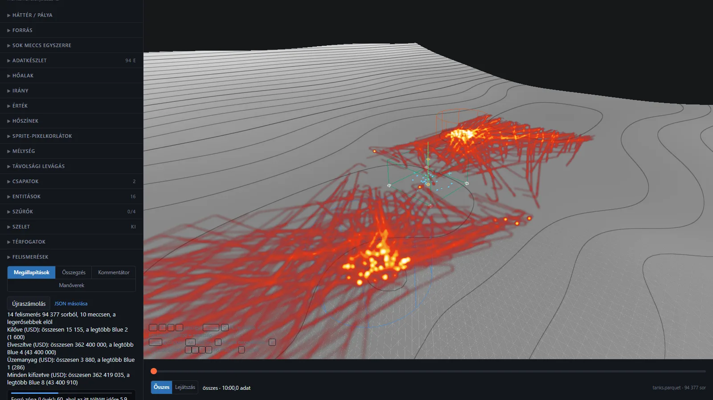
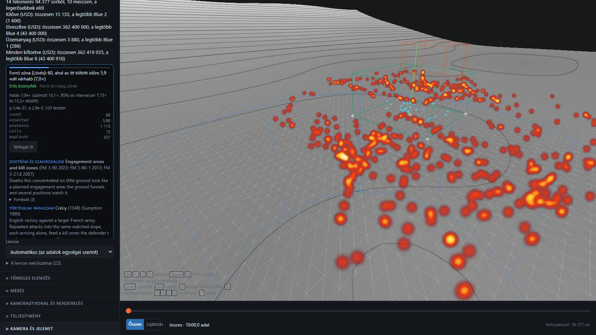
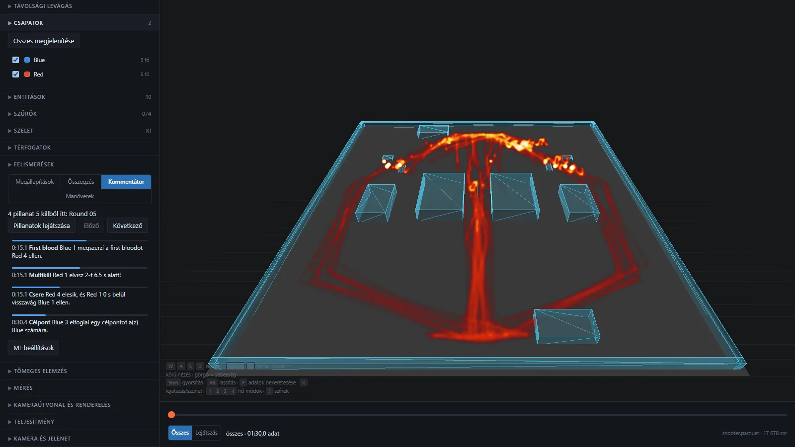

# Felismerések

A **Felismerések** átnézi a betöltött adatot, és megkeresi, ami kiemelkedik – erős pozíciókat, halálos terepet, spawn-csapdákat, szűk keresztmetszeteket, a társaiknál jóval erősebb játékosokat –, és erősség szerint, a legerősebbel kezdve, bizonyítékkal együtt megmondja. Arra használja, hogy egy perc alatt megtudja, hol nyerték vagy vesztették el a meccset. Ezután összegzést írhat, egyetlen visszajátszás esetén pedig kommentátorként ugrálhat a nagy pillanatokhoz.

Minden a böngészőjében számolódik. Semmi nem hagyja el a gépét, hacsak nem kapcsol be külső MI-t (lásd [Külső MI](#external-ai)).

A **Felismerések** szakasz a Hőtérkép és a Meccs fül oldalsávjában van. Három füle van: **Megállapítások**, **Összegzés** és **Kommentátor**.

## Megállapítások {#findings}

1. Töltsön be adatot, és nyissa meg a **Felismerések** részt. Nyomja meg a **Felismerések keresése** gombot („Számolás… n%” mutatja a haladást).
2. Olvassa el a listát. Minden megállapításnak van erősségsávja, egy mondata, a bizonyíték minősége (*Erős bizonyíték*, *Jó bizonyíték* vagy *Némi bizonyíték*), az a detektor, amely megtalálta, és – ahol számít – a járműosztály.
3. **Kattintson egy megállapításra**: a megjelenítő alkalmazza a szűrőit, a kamerát odarepíti, az időben odaugrik, és megnyitja a részleteket: a hatást 95%-os intervallumával, a p- és q-értékeket, a megszámolt bizonyítékot, és a **Térfogat itt** gombot, amely [térfogatot](volumes.md) rajzol a hely köré.
4. A **Szűrők visszaállítása** visszateszi a szűrőit. A **JSON másolása** a teljes jelentést másolja.

A számlálás a jelenlegi szűrőket, az elrejtett csoportokat és a kiválasztott meccset használja a teljes időtartományon. Ha utána módosítja a szűrőket, egy megjegyzés ezt jelzi; nyomja meg az **Újraszámolás** gombot.

A lista tetején lévő sorok (például a pénzösszegek) a megállapítások előtt foglalják össze az egész adatot.

### A detektorok {#the-detectors}

| Detektor | Mit talál | Ehhez kell az adatban |
|---|---|---|
| **Erőpozíciók** | Olyan helyek, ahol a gyilkosság-halál arány jóval jobb, mint a térkép többi része, és *biztonságos terep*, ahol kevesen halnak meg az ott töltött időhöz képest | gyilkosság- és halálesemények |
| **Forró és hideg zónák** | Olyan helyek, ahol egy eseménytípus (lövések, találatok, elfoglalások ...) sokkal gyakrabban vagy ritkábban fordul elő, mint amit az ott töltött idő megjósolna | egy eseményoszlop |
| **Nyílt terep és fedezék** | Halálok nyílt terepen közeli pályageometriával, és lassúság gyors mozgással szemben | halálok; a geometriarészhez 3D-s pálya |
| **Spawnok** | Erős spawnok, spawn-csapdák, biztonságos spawnok, idő az első érintkezésig | idő és személyek |
| **Osztály helyenként** | Egy járműosztály, vagy a játékosok az MI-vel szemben, akik sokkal jobbak vagy rosszabbak egy területen | gyilkosságok plusz egy járműosztály vagy játékos/MI oszlop |
| **Játékosok** | Játékosok, akik sokkal többet vagy kevesebbet ölnek vagy halnak, mint mások ugyanabban az osztályban | személyek és gyilkosságok |
| **Szűk keresztmetszetek és szárnyak** | Szűk keresztmetszetek (sokkal több átkelés, mint a környező terepen) és oldalsó útvonalak (ritkán használtak, de gyilkossághoz vezetnek) | személyek |
| **Érték** | *Költséges terep* és *Nyereséges terep* | [érték-oszlopok](value-weighting.md) |
| **Mi döntötte el a köröket** | Mi különböztette meg a megnyert köröket az elvesztettektől, és mely játékosok adták hozzá vagy vesztették el a legtöbb győzelmi valószínűséget (lásd [Ki nyert](#who-won-what-decided-the-rounds)) | körök, ölések és halálok, valamint az [eredményoszlopok](data-formats.md#outcome-columns) (`won`) |

Azok a detektorok, amelyek nem futhatnak az adatokon, az alján szerepelnek, az okukkal együtt.

### Hogyan rangsorolódnak a megállapítások {#how-findings-are-ranked}

Minden helyet vagy csoportot összevetünk a térkép többi részével (pontos binomiális vagy arányteszttel). A hamis felfedezési arány 5%-on van tartva (Benjamini–Hochberg). A véletlen mintázatnak tűnhet; ez alacsonyan tartja a téves riasztásokat: a látható megállapítások közül várhatóan legfeljebb körülbelül minden huszadik lehet véletlen. A kevés eseményből származó hatások a rangsorolás előtt a „nincs hatás” felé húzódnak. Legfeljebb 60 megállapítás jelenik meg, és minden detektor kap néhány helyet a lista élén.

### Ki nyert: mi döntötte el a köröket {#who-won-what-decided-the-rounds}

Ha az adatok megmondják, ki nyerte az egyes köröket (a `won` [eredményoszlop](data-formats.md#outcome-columns): CS2, Rainbow Six Siege, War Thunder ...), akkor a Felismerések az eredményről szólnak. Minden oldal köreit aszerint osztja fel, mi történt bennük, és összeveti a győzelmi arányokat:

| Tényező | Az oldal körei vele | ... és nélküle |
|---|---|---|
| Nyitópárbaj | az oldal ölt elsőként | az oldal halt meg elsőként |
| Vásárlás | jobban vásárolt, mint a másik oldal | rosszabbul |
| Megbosszult első halál | az első halálát 5 mp-en belül megbosszulták | nem bosszulták meg |
| Lerakás | lerakta a bombát | nem volt lerakás |
| Eszközök | több gránát, mint egy szokásos körében | kevesebb |
| Korai kontaktus | az első párbaj a meccs medián ideje előtt jött | később |
| Megtartott hely | egy játékos 5 mp-ig vagy tovább állt a helyen | senki |
| Korán elért hely | egy játékos az első 25 mp-ben odaért (az útvonal) | senki |

Minden összevetés két győzelmi arány különbsége a 95%-os intervallumával (Newcombe), Fisher pontos p-értékével és egy q-val az összes kipróbált tényezőn (Benjamini–Hochberg). A 8-nál kevesebb körből álló ágat a *kevés kör* jelzi. Az 5%-os hamis felfedezési arány alattiak megállapítások lesznek; a legerősebbek a többi detektor megállapításai fölé kerülnek (egy eredmény-megállapítás 1,35-ször annyit nyom, mint egy ugyanakkora hatású és bizonyítékú másik).

Egy kitalált példa 40 körre:

> A **T** megnyerte annak a 19 körnek a 79%-át, amelyben tartotta a **Mid**et, szemben a nélküle lévő 21 kör 24%-ával (55 pont, 95%: 26–74) – q 0,004.

A kör **győzelmi valószínűségét** is követi – minden oldal esélyét minden pillanatban, az életben lévő emberekből, a lerakásból és az órából: 30 vagy több kör esetén a körökre illesztve, különben egy rögzített a priori modellből (és a szöveg megmondja, melyikből). Ebből jönnek a **fordulópontok** (az ölések és lerakások, amelyek a legjobban megmozdították az esélyt), és minden játékos **hozzáadott győzelmi valószínűsége**: az ölései és lerakásai mellette, a halálai ellene szólnak, körökben számolva a meccsre, átlagosan egy körre az intervallumával, nullával szemben tesztelve. A helyek ugyanezt a mérleget kapják: melyik oldal nyert a legtöbbet az ott vívott párbajokban.

Az adatoknak körök, ölések és halálok kellenek mindkét oldallal, valamint a `won` oszlop; a megtartott helyekhez elnevezett helyek (`place`), a vásárláshoz egy `buy` oszlop.

## Összegzés {#debrief}

Az **Összegzés** fül a megállapításokat rövid szöveggé írja: egy bevezetőt, a legtisztább megállapítást, egyet a taktikáról, egyet az egyensúlyról, aztán – ha az adatok megmondják, ki nyert – azt, mi döntötte el a köröket, a többit detektor szerint csoportosítva, és azt, hány gyengébb bizonyítékon nyugszik.

Hogy mi döntötte el a köröket, az négy bekezdésben jön: az állás, és honnan származnak a győzelmi valószínűségek; a legerősebb tényezők a számaikkal, intervallumukkal és q-jukkal (ha egyik sem megy át a hamis felfedezési arányon, a szöveg azt mondja: *egyelőre semmi sem biztos*, és mégis megnevezi a legerősebbet); a három legnagyobb fordulópont; és a játékosok, akik a legtöbb győzelmi valószínűséget hozzáadták és elvesztették, a legtöbbet nyerő helyekkel. Egy kitalált példa:

> A T 23, a CT 17 kört nyert az ismert eredményű 40 körből (T: 58%, 95%: 42%–72%). A győzelmi valószínűségek egy ezekre a körökre illesztett modellből származnak.
>
> Ami megkülönböztette a megnyert köröket az elvesztettektől: a T megnyerte annak a 19 körnek a 79%-át, amelyben tartotta a Midet, szemben a nélküle lévő 21 kör 24%-ával (55 pont, 95%: 26–74) (q 0,004), ...
>
> Fordulópontok: a 17. körben 48 mp-nél a CT egy ölése a B site-on 31%-ról 58%-ra emelte az esélyét, és megnyerte a kört, ...

Minden bekezdés számozott gombokat tartalmaz, amelyek a megállapításait mutatják. A **Szöveg másolása** lemásolja.

A beépített narrátor offline fut, az Ön nyelvén. A fölötte lévő **Lencse** választó (lásd [A tudás-lencse](knowledge.md)) dönti el, melyik szakirodalomra hivatkoznak a bekezdések.

### Külső MI {#external-ai}

Az **MI-beállítások** lehetővé teszi, hogy a választott MI-modell írja meg az összegzést:

| Beállítás | Jelentése |
|---|---|
| **Szolgáltató** | Anthropic (Claude), OpenAI (ChatGPT), OpenRouter, Ollama (helyi), LM Studio (helyi), llama.cpp-kiszolgáló (helyi), vagy bármely OpenAI-kompatibilis végpont |
| **Alap-URL**, **Modell** | A szolgáltató tölti ki; a **Modellek listázása** lekérdezi a kiszolgálót |
| **API-kulcs** | Csak az alap-URL-nek küldjük. Soha nem naplózzuk, és nem mentjük nézetekbe, exportokba vagy `.3dheat` fájlokba. A legtöbb helyi kiszolgálónak nincs rá szüksége. |
| **Kulcs megjegyzése ebben a böngészőben** | Alapértelmezés szerint ki: az oldal bezárásakor a kulcs elfelejtődik |
| **Külső MI használata** | Alapértelmezés szerint ki |
| **Játékosnevek küldése** | Alapértelmezés szerint ki: a játékosok P1, P2 … néven mennek |

Ezután írjon egy opcionális kérdést, és nyomja meg az **Írás MI-vel** gombot. Csak a megállapítások és a számaik mennek ki – az adatai sorai soha. A válasz folyamatosan érkezik; a hivatkozott megállapítások gombokká válnak. Ha az adatok megmondják, ki nyert, a modell azt az utasítást kapja, hogy azzal kezdjen, mi döntötte el a köröket, minden szám intervallumával és q-jával, és mondja meg, ha egy tényező kevés körön alapul, vagy ha a győzelmi valószínűségek az a priori modellből származnak.

## Kommentátor {#caster}

**Egy meccsre** (ha több van betöltve, válasszon egyet) a **Kommentátor** megtalálja a megnézésre érdemes pillanatokat: első vér, többszörös gyilkosságok, cserék, befejezések, cél-fordulatok, visszatérések, kiemelkedő játékosok, hosszú lövések és **fordulópontok** – azok az ölések, amelyek a legjobban megmozdították egy oldal esélyét a kör megnyerésére (az oldalanként életben maradt játékosok alapján, újraéledés nélküli körökben).

Ha az adatok megmondják, ki nyerte az egyes köröket, minden pillanat kimondja: *„Anna leteríti Bent: T esélye a kör megnyerésére 38%-ról 62%-ra nő – és megnyerik a kört.”* A később győztes oldal pillanata többet ér, amikor a kommentátor kiválasztja, melyeket tartsa meg, és a visszatérést megnyert körökben számolja.

- Kattintson egy pillanatra: a nézet átvált a visszajátszásra, közvetlenül elé ugrik, odarepül és követi a játékost.
- A **Pillanatok lejátszása** mindegyiket a végéig játssza, és továbblép; az **Előző** / **Következő** végigléptet közöttük.
- Külső MI bekapcsolva a **MI-kommentár** a pillanatlistából (típusok, időpontok, nevek vagy álnevek, csapatok, osztályok, távolságok) kommentárt ír.

Személyekre és gyilkosság/halál (vagy elfoglalás) eseményekre van szüksége; egy `other`/`victim` oszlop teszi lehetővé a cseréket és a hosszú lövéseket.

## A tudás-lencse {#knowledge-lens}

Egy megállapítás olvasható egy **lencsén** keresztül, amely elismert tudásra épül: hadtudomány, légi és tengeri harc, városi műveletek, játéktervezés és e-sport (vagy *Auto*, amelyet az adatban szereplő egységek alapján választ). Egy megnyitott megállapítás ekkor megmutatja a legközelebbi **doktrína- és szakirodalmi** bejegyzést és egy **történelmi párhuzamot**, hivatkozásokkal, a **Lencse mérőszámai** pedig az adatra számítanak mértékeket ebből a szakirodalomból (Lanchester-illesztések, cserearányok, erőarányok, tűzmezők, kulcsfontosságú terep, cserék, kezdeményezés). Az összegzés és az MI-kérdés is tartalmazza őket. Minden erről: [A tudás-lencse](knowledge.md).

A lencse mérőszámai azt is mérik, hogyan viselkednek a játékosok tömegként és csoportként – összehangolódás és keringés, útvonalterelés, sávok és nyomvonalak, zsúfoltság, vezetők és követők, lemaradók, a törésponti pont veszteségek mellett, a kockázat egy elvesztett élet után, sorozatok, vásárlási egyetértés és a bejövő tűzre adott válasz –, mindegyik a saját null-modelljével szemben: [Kollektív viselkedés](collective-behaviour.md).

## Az adatok, amelyek a felismeréseket működtetik {#data-that-makes-insights-work}

- pozíciók **idővel**, egy **személy** és egy **csapat** oszloppal;
- egy **esemény** oszlop gyilkosságokkal és halálokkal (`kill`, `death`), és másokkal (`hit`, `fire`, `capture` ...);
- egy **másik fél** oszlop (`other`, `victim`) cserékhez és irányokhoz;
- egy **jármű** vagy **típus** oszlop az osztályokhoz; egy `ai` oszlop a játékosok és az MI megkülönböztetéséhez;
- egy **munkamenet** / **meccs** / **kör** oszlop, ha több meccs van.

A [demóadatok](demo-data.md) mindegyiket tartalmazzák.
