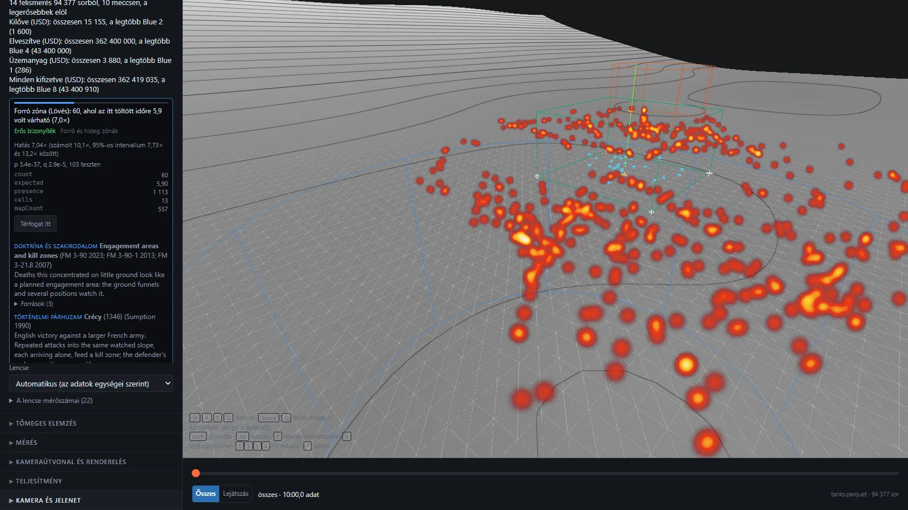

# A tudás-lencse

Amikor a [Felismerések](insights.md) valamit talál, ez a rész katonai történelemből, játéktervezésből és sportelemzésből vett gondolatokkal magyarázza meg, és megnevezi a könyvet vagy tanulmányt, amelyből származik. Azért használd, hogy megtudd, *miért* számít egy minta, nem csak azt, hogy létezik.

## Próbáld ki {#try-it}

1. Tölts be adatokat, nyisd meg a **Felismerések** fület, majd nyomd meg a **Felismerések keresése** gombot.
2. Kattints egy megállapításra, hogy megnyisd.
3. Olvasd el a **Doktrína és szakirodalom** és a **Történelmi párhuzam** részt; a teljes hivatkozások alattuk vannak összecsukva.
4. Változtasd meg a **Lencse** értékét (például *Katonai doktrínára*), hogy ugyanazt a megállapítást egy másik szakirodalmon át olvasd.

## Hogyan működik {#how-it-works}

A Felismerések panel úgy ítéli meg a megállapításait, ahogy egy szakmai elemző tenné: katonai doktrínán és hadműveleti kutatáson, történelmi összecsapásokon, valamint játéktervezési, pályatervezési és elemzési szakirodalmon keresztül. Ezt offline teszi, a megjelenítőben lévő, gondosan összeállított tudásbázisból, és ugyanezt az anyagot továbbadja egy külső modellnek, amikor az írja az összegzést.

## Mit mutat a panel {#what-the-panel-shows}

- A **Lencse** határozza meg, melyik szakirodalmon át olvassuk a megállapításokat: *Auto* (az adatban szereplő egységfajták alapján: repülőgépek, hajók, földi járművek, gyalogság), *Katonai doktrína*, *Légi harc*, *Tengeri*, *Városi harc*, *Játéktervezés és egyensúly*, *E-sport*. A kiválasztott lencsén kívüli bejegyzések kimaradnak.
- Minden megnyitott megállapítás megmutatja a hozzá legközelebbi **doktrína és szakirodalom** bejegyzést és a legközelebbi **történelmi párhuzamot**, a teljes hivatkozásokkal az alján összecsukva.
- Az **A lencse mérőszámai** felsorolja az ugyanazokon a sorokon számolt hadműveleti elemzési mutatókat (lent), mindegyiket azzal, mit jelent, és mi a szakirodalma.
- Az **Összegzés** sorokat ad a vezető megállapításokhoz és a lencse mutatóihoz: „Doktrína és szakirodalom: ..." és „Történelmi párhuzam: ...", mindegyik szerző–év hivatkozásokkal és az alá összecsukott hivatkozásokkal.
- Az **Írás MI-vel** elküldi a legrelevánsabb bejegyzéseket (összefoglaló, tanulság, a hozzájuk tartozó megállapítások, teljes hivatkozások) a jelentéssel együtt, és megkéri a modellt, hogy azokra azonosítójukkal hivatkozzon – `{concept.lanchester-square}` –, és más forrást ne használjon.

A címkék le vannak fordítva; maga a tudás angol nyelvű.

## A lencse mérőszámai {#lens-metrics}

Az insight-munkafolyamatban számoljuk, ugyanabban a menetben a sorokon, mint a detektorok (`src/insights/lensMetrics.ts`). Mindegyik kimarad, ha az adat nem bírja el.

| Mutató | Mit mér | Szükséges |
|---|---|---|
| Lanchester-illesztés | Mindkét oldal veszteségei 20 másodpercenként, mindkét oldal élő erejére regresszálva (Poisson, kvázi-valószínűségi hibák); a kitevők az ellenséges és a saját erőn, a négyzettörvénnyel (célzott tűz) és a lineáris törvénnyel (területi tűz) összevetve | idő, csapatok, ölések és halálesetek |
| Cserearány | Ölések halálesetenként, oldalanként és helyenként; a legveszélyesebb földi hely halálesetei részesedése, amely az idő 5%-át tette ki, szemben azzal, amit a véletlen adna ennyi halálesettel; a halálesetek Gini-együtthatója az idő függvényében; a halálozási ráták Moran-I-je | ölések és halálesetek |
| Helyi erőarány | A kiemelt ölés körüli elköteleződési távolságon belüli barát és ellenséges egységek (a távolságot az adat állítja be: a legközelebbi ellenségig mért medián kétszerese); a helyileg fölényes oldal ölésekből való részesedése, és ennek többlete afölött, amit a létszám önmagában jósol | idő, csapatok, személyek |
| Tűzmezők | A legforgalmasabb ölési helyek látóterei egy 2,5D-s akadálymezőn (a pálya geometriája a falmagasságig, vagy a bejárt talaj), az átlagos helyhez képest, és a látótér és az ölési részesedés rangkorrelációja | pozíciók; a betöltött pálya élesebbé teszi; légi egységeknél nem használható |
| Energiaállapot | A légi gyilkosok és légi áldozatok fajlagos energiája (a magasság, plusz amennyit a sebesség vásárolhatna), Mann–Whitney-statisztikával összevetve | repülőgép-osztályok, idő, magasság |
| Kulcsterep | Milyen gyakran szerepel egy hely egy meccs három legforgalmasabb ölési helye között | több meccs |
| Kölcsönös támogatás (cserék) | A halálesetekre egy csapattárs ölése válaszol az elköteleződési távolságon belül és 5 másodpercen belül | idő, csapatok |
| Első csapás | Összecsapások – a meccsenként, 20 másodperc csendenként és három elköteleződési távolságnyira csoportosított ölések – azon oldal nyeri, amelyik először szerzett ölést | idő, csapatok |
| Salvo-modell | Hughes salvó-egyenlete, 20 másodperces, érintkezésben lévő hajó-szakaszokra illesztve: harcképtelenné tett hajók támadó hajónként, és megmentett hajók védő hajónként; Lanchester-illesztés csak hajókra | hajóosztályok, idő, csapatok |
| Harci hatékonyság | Oldalanként az egységórákra eső ölések a harcban, a két legnagyobb oldal aránya (a Dupuy-értelemben vett harci hatékonysági érték) 95%-os intervallummal, és az oldalak ölésekből való részesedése egyenlő helyi létszámnál | idő, csapatok |
| Elköteleződési távolságok | A legközelebbi ellenségig mért távolság ölésnél, indításnál és minden élet első lövésénél (felfedezéstől az elköteleződésig), egységfajtánként | idő, csapatok; indítások, ahol az adat tartalmazza |
| Ölési lánc | Másodpercek a gyilkos utolsó indításától az ölésig, és a harc első lövésétől az ölésig | idő; indítások vagy tűzesemények |
| Koncentráció vagy szóródás | Minden 20 másodperces szakaszban a két legnagyobb oldal szétszórtsága, és a szorosabbik által elvett ölések részaránya | idő, csapatok |
| Kiröppenések | Oldalanként: kiröppenések (felszállások vagy légi egység-megjelenések), leszállások, elvesztett repülőgépek és a repülőgépek ölései; veszteségi ráta és ölés kiröppenésenként | repülőgép-osztályok; felszállások vagy megjelenések |

Ha az adat fordulókat tartalmaz, a közelharci és e-sport mérések is hozzáadódnak – fordulónyerési valószínűség, cselekvések értéke, nyitópárbajok, cserék, bekukkantó az tartóval szemben, célzás, kereszttűz, segédeszközök, létszámelőny, zárások, felállások, a telepítés utáni szakasz, halálos tölcsérek és a játékos hatása: lásd [Közelharc és fordulók](close-quarters.md).

A pályák és csapatok a csoportos viselkedés méréseit is hozzáadják – tömegtudomány, kollektív mozgás, viselkedésgazdaságtan és katonai pszichológia –: igazodás és körbe-körbe mozgás, útvonalterelés, sávok és nyomvonalak, zsúfoltság, vezetők és követők, lemaradók, a törésponti pont, a veszteségek utáni kockázat, sorozatok, vásárlási megállapodás és elnyomás, mindegyik a saját null-modelljéhez mérve: lásd [Csoportos viselkedés](collective-behaviour.md).

A fegyverek, csalik és épületek nem számítanak egységnek. Ahol a fegyversorok megnevezik az indító egységet (a Tacview-eredetű adatokban ott van a `Shooter` vagy `Launcher` oszlop), az indítás annak az egységnek számít jóvá, név vagy objektumazonosító szerint.

## Hogyan találkoznak a megállapítások a szakirodalommal {#how-findings-meet-the-literature}

A bejegyzések és a megállapítások egy **mintataxonómián** (`src/insights/knowledge/patterns.ts`) keresztül találkoznak: koncentráció, helyi fölény, célzott és területi tűz, szűk keresztmetszetek, tűzzónák, tűzmezők, fordított lejtő, oldalazás, kölcsönös támogatás, energiaelőny, megjelenési nyomás, egyensúly és így tovább. Minden detektortípus és minden lencse-mutató megmondja, mely mintákat mutatják a számai (`src/insights/lens.ts`); minden tudásbejegyzés megmondja, mely mintákról szól, súllyal. Egy bejegyzés relevanciája egy megállapításhoz a súlyozott átfedés, skálázva azzal, mennyire illik a bejegyzés területe (szárazföld, levegő, tenger, városi) az adathoz, és a megállapítás saját erejével. A megjelenített indoklás a megállapítás számai egy mondatban, utána a bejegyzés tanulsága.

## Katalógus {#catalogue}

Minden minta, fogalom, módszer, történelmi eset, tervezési elv és tanulmány, a bibliográfiával: lásd a [Tudáskatalógus](knowledge-catalogue.md) oldalt.

## Fejlesztőknek {#for-developers}

### Bejegyzések hozzáadása {#adding-entries}

1. Válaszd ki a fájlt típus szerint: `concepts.ts` és `concepts-more.ts`, `methods.ts`, `cases.ts`, `cases-land.ts`, `cases-air-sea.ts`, `cases-esports.ts`, `design.ts` (tervezési elvek) vagy `studies.ts` a `src/insights/knowledge/` mappában.
2. Adj neki új azonosítót, `<típus>.<slug>` alakban (soha ne használj újra egyet), a lencséit, a területeit és a mintákat, amelyekről szól, 0..1 közötti súlyokkal. Mintát csak akkor adj a `patterns.ts`-hez, ha egy megállapítás meg tudja mutatni, és a `lens.ts`-ben rendeld hozzá egy megállapításhoz vagy mutatóhoz.
3. Az összefoglalót és a tanulságot **saját szavaiddal** írd meg. Idézet csak közkincsű műből lehet (`pd: true` a hivatkozásban), és rövid legyen.
4. Hivatkozz: adj minden új művet a `refs.ts`-hez szerzőkkel, évvel, címmel és kiadóval (folyóirat kötetszámmal és oldalakkal); URL-t vagy DOI-t, ahol nyilvános nyilvántartás van.
5. Futtasd: `npx vitest run src/insights/lens.test.ts` (egyedi azonosítók, ismert minták, feloldható hivatkozások, közkincsű idézetek, dátummal és kimenetellel rendelkező esetek), majd `node tools/knowledge-doc.mjs` a [katalógus](knowledge-catalogue.md) frissítéséhez.
