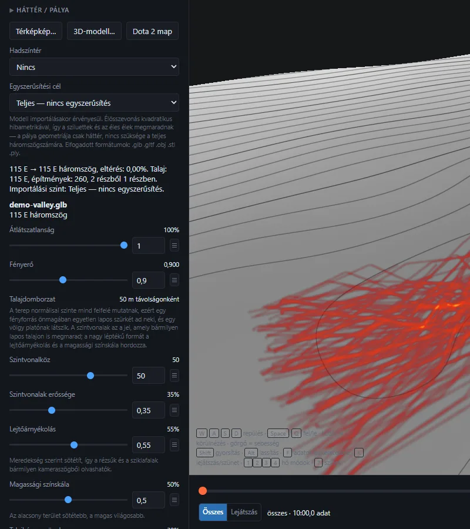

# Pályák és háttérgeometria

A pálya az a 3D-s hely, ahol a játék történt – egy térkép, egy város, egy pálya. Ha az adatai mögé helyezi, láthatja, *hol* van a hő. A **Háttér / pálya** panel (a „pálya” fogalmához lásd a [Szójegyzéket](glossary.md)) háromféle kontextust ad:

- egy **térképkép**, két horgonnyal földrajzilag igazítva – lásd [Térképképek](map-images.md);
- egy **3D-s pálya** – `.glb`, `.gltf`, `.obj`, `.stl` vagy `.ply` –, amely talajra, építményekre és vízre bontva, importáláskor egyszerűsítve érkezik – lásd [3D-s pályák](model-levels.md) és [Pálya megjelenése](level-appearance.md);
- egy **világ-háttér** – olyan felvételhez, amely megmondja, hol van a földön (egy Tacview ACMI-fájl): a valódi terep, utak, víz, repülőterek és épületek, nyílt adatokból letöltve – lásd [Világ-háttér](world-backdrop.md).

Semmi nincs betöltve, a jelenet sötét, rácsot és színes tengelyeket mutat (a **Rács** és a **Tengelyek** a [Kamera és jelenet](camera.md) oldalon), a panel pedig ezt írja ki: *Nincs betöltve semmi – a jelenet rácsot és tengelyeket mutat. Adjon hozzá térképképet vagy pályahálót, hogy a hőnek legyen kontextusa.*

A pálya mindhárom fülön közös: a Versenyelemzés fülön betöltött pálya ugyanaz a pálya, amelyet a hőtérkép mutat.

## Pálya tétele az adatai mögé {#put-a-level-behind-your-data}

1. Először töltse be az adatait ([Adatok betöltése](getting-data-in.md)), hogy a pálya hozzájuk illeszkedjen.
2. Nyissa meg a **Háttér / pálya** részt az oldalsávon.
3. Nyomja meg a **Térképkép…** gombot egy képhez, vagy a **3D-modell…** gombot egy 3D-s pályához, és válassza ki a fájlt. Valódi világbeli felvételhez használja inkább a **Valós világ háttérként** vagy a **Hadszíntér** gombot.
4. Várja meg, míg a haladási sor véget ér. Egy nagy modell először egyszerűsítésre kerül (lásd lent az **Egyszerűsítési cél** részt).
5. Nyomja meg az **F**-et a nézetben, hogy mindent kerettel bekeretezzen. Az **Átlátszatlanság** és a **Fényerő** használatával addig állítsa, amíg a hő ki nem emelkedik a pályából.
6. Nyomja meg a **Mentés a könyvtárba** gombot, ha újra használni fogja a pályát ([Pályakönyvtár](level-library.md)).

## Mit tesz a pálya a hőért {#what-a-level-does-for-the-heat}

- **Takar**: a mögötte lévő adatpontokat felületenként halványítjuk, a terep mögöttiek pedig el vannak rejtve ([Mélység és kihagyás](depth-and-culling.md)). Pálya nélkül nincs takarás.
- A [Szelet](slice.md) és – a *Pálya vágása is* beállítással – a [távolsági levágás](depth-and-culling.md#distance-culling) **kivágja**, a hővel együtt.
- A [mélységélesség](camera.md#depth-of-field) a rácson és a dobozokon kívül csak ezt mossa el.
- Egy 3D-s pálya **kiszélesíti a kamera távoli síkját**, ha nagyobb, mint az adatok: a közeli és távoli síkot az adatkészletből kalibráljuk, és egy több kilométeres exportált térkép másképp teljesen a távoli sík mögött maradna, üres nézetet hagyva. A távoli sík a pálya vízszintes kiterjedésének 3-szorosa lesz, ha az nagyobb, a közeli sík pedig vele együtt mozdul (legalább a távoli / 100 000), hogy megmaradjon a mélységpontosság, amelytől a takarás függ; a repülési sebesség legalább a kiterjedés / 12-re nő. Csak szélesítjük, sosem szűkítjük.

## A panel fentről lefelé {#the-panel-top-to-bottom}

| Rész | Részletek |
|---|---|
| **Térképkép…**, **3D-modell…** | Egyet betölt; lecseréli a jelenlegi pályát. |
| **Valós világ háttérként**, **Térképcsempék elfelejtése** | Csak földrajzi hivatkozású adatkészletnél: az alatta lévő valódi helyet pályaként felépíti, vagy törli a letöltött csempéket. [Világ-háttér](world-backdrop.md) |
| **Egyszerűsítési cél** | A következő modellimport háromszög-kerete: *Teljes – nincs egyszerűsítés* (alapértelmezés), *Magas – 8M*, *Közepes – 3M*, *Alacsony – 800k*, *Sziluett – 100k*. [3D-s pályák](model-levels.md#simplification) |
| Haladás és **Mégse** | Dekódolás vagy importálás közben. |
| Importmegjegyzés | Háromszögek előtte és utána, a talaj / építmény / víz bontás, a használt részletességi szint. |
| Név és méret | `szélesség×magasság px · x × z m/px` képnél, `N háromszög (M-ből)` modellnél. |
| **Átlátszatlanság**, **Fényerő** | Mindkét fajtánál. |
| Képvezérlők | **Színtelenítés**, **Észak/dél tükrözése**, **Elhelyezés** (két horgony), **Illesztés az adatok határaihoz**, **Magasság**. [Térképképek](map-images.md) |
| Modellvezérlők | Talajdomborzat, víz, talajháromszögek, drótváz, textúra, rögzített szín, építmények, alkatrészek osztályozása. [Pálya megjelenése](level-appearance.md) |
| **Mentés a könyvtárba**, **Eltávolítás** | [Pályakönyvtár](level-library.md); az Eltávolítás kiveszi a pályát. |
| **Könyvtár** | Ebben a böngészőben tárolt pályák. [Pályakönyvtár](level-library.md) |

## Oldalak ebben a szakaszban {#pages-in-this-section}

- [Térképképek](map-images.md)
- [3D-s pályák](model-levels.md) – formátumok, részek, osztályozás, egyszerűsítés, textúrák
- [Pálya megjelenése](level-appearance.md) – minden vezérlő egy 3D-s pályához
- [Pályakönyvtár](level-library.md)
- [Világ-háttér](world-backdrop.md) – a valódi világ a felvétel alatt, nyílt adatokból

Hogyan lehet pályákat kivinni játékokból és motorokból, az a különálló exportáló eszközök dolga (lásd a tároló [README](https://github.com/Holdi601/3DHeat/blob/main/README.md) fájlját); az a szerződés, amelybe írnak, a [3D-s pályák](model-levels.md#the-exporter-contract) oldalon van összefoglalva.
