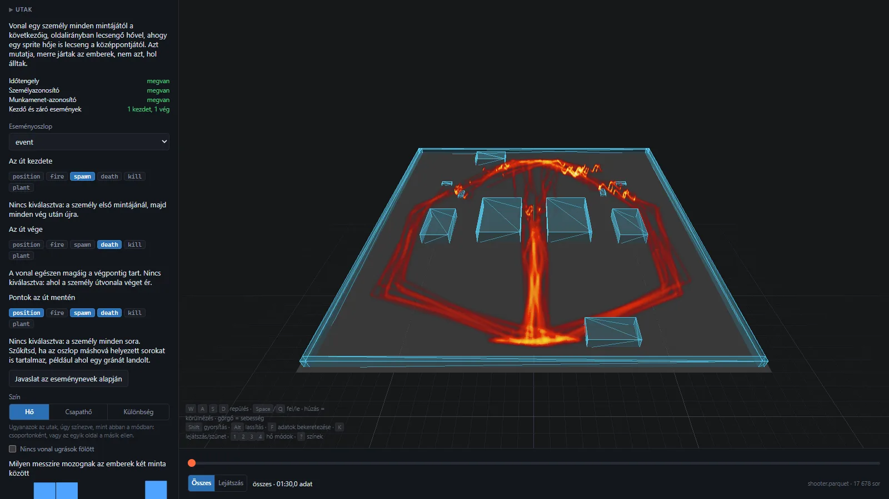

# Vonal-hő

A hő azt mutatja, hol álltak az emberek. A Vonalak azt mutatja, merre jártak.

A **Vonalak** (4-es gomb) a vonal-hő: minden [személy](glossary.md) mintavételi pontjától a következőig húzott vonal, ugyanazzal a csökkenéssel szórva, mint egy [sprite](glossary.md) – a vonal mentén, nem egy pont körül. Azt mutatja, hol *jártak*, nem azt, hol álltak: egy folyosón egyszer átfutva ugyanolyan látható, mint egy szobában megtelepedve, és egy gyors játékos ritka mintái folytonos úttá állnak össze, nem pontozott nyomvonallá. Személyoszlop és időoszlop kell hozzá.

## Használat {#how-to-use-it}

1. Nyomd meg a `4`-et (vagy válaszd a **Vonalak** gombot a módsávban).
2. Nyisd meg az **Utak** részt, és nézd meg a zöld ellenőrzőlistát: az időtengelynek és a személyazonosítónak meg kell lennie.
3. Nyomd meg a **Javaslat az eseménynevek alapján** gombot, hogy kitöltse, hol kezdődnek és hol végződnek az utak.
4. Olvasd el a statisztika sorát: „N út, ebből M eléri a véget".
5. Ha a vonalak átugranak a térképen, állítsd be a **Leghosszabb lépés** értékét (lásd [Az ugrás-határ](#the-jump-limit)).

Egy vonal csak egy kezdet és egy vég között értelmes, ezért az **Utak** panel megmondja, mi határolja az utat. Minden, ami [Egy út szabályai](#the-rules-of-a-route) alatt van, részletezés, amelyet átugorhatsz.

## Az Utak panel {#the-routes-panel}

Vonalak módban a hő-panelek fölött látszik.

### Mit tartalmaz az adat {#what-the-data-has}

Egy ellenőrzőlista: zöld, ha megvan, borostyánsárga, ha nincs:

| Sor | Állapot |
|---|---|
| **Időtengely** | *megvan* / *hiányzik – szükséges* |
| **Személyazonosító** | *megvan* / *hiányzik – szükséges* |
| **Munkamenet-azonosító** | *megvan* / *nincs – minden sor egy munkamenet* |
| **Kezdő és záró események** | *N kezdés, M vég* / *nincs kiválasztva – teljes pályák* (csak zöld, ha van eseményoszlop, és legalább egy kezdés és egy vég) |

### Vezérlők {#controls}

| Vezérlő | Jelentés |
|---|---|
| **Eseményoszlop** | Kategóriaoszlop, amelynek értékei események (megjelenés, halál, pozíció …). *Nincs – teljes pályák*: minden személy pályája minden munkamenetben egy út, amely ott törik, ahol a pályán rés van. Csak a betöltéskor szűrésre megtartott oszlopok ajánlódnak fel. |
| **Az út ettől kezdődik** | Olyan eseményértékek, amelyek egy utat indítanak (megjelenés, újraéledés, bevetés). Ha nincs kiválasztva: az út a személy első mintájánál kezdődik, és minden vég után újra. |
| **Az út ezen ér véget** | Olyan eseményértékek, amelyek egy utat lezárnak (halál, kivonás, teleportálás). A vonal magáig a záró sorig fut. Ha nincs kiválasztva: az út ott ér véget, ahol a személy pályája véget ér. |
| **Pontok az út mentén** | Olyan eseményértékek, amelyek sorai az út mentén fekszenek. Ha nincs kiválasztva: a személy minden sora. Szűkítsd, ha az oszlop olyan sorokat is tartalmaz, amelyek máshol vannak, például ahol egy gránát landolt. |
| **Javaslat az eseménynevek alapján** | Kitölti a három listát az értékek nevei alapján (lent). |
| **Szín** | *Hő*, *Csapat-hő* vagy *Különbség*. Ugyanazok az utak az adott mód színezésében: minden csoport a saját árnyalatában, vagy az egyik oldal a másik ellen, a csoportlistával, a felosztással és a skálákkal együtt, ahogy azokban a módokban működnek. Alapértelmezett: *Hő*. A csapat-hő és a különbség csoportoszlopot igényel. |
| **Nincs vonal ugrások fölött** / **Leghosszabb lépés** | Ha egy személy következő mintája ennél messzebb van, az újraéledés, teleportálás vagy leesés, nem pedig egy hely, ahová elment, így a kettőt nem köti össze vonal. Betöltéskor kitöltődik, ha az adatok egyértelmű rést mutatnak (lent), és ki van kapcsolva, ha nem. Eseményoszloppal és anélkül is működik. |
| Statisztika sor | `N út, ebből M eléri a véget, K szakasz`, másodpercenként többször frissül. |

Minden lista egy sornyi kapcsolókapocs, értékenként egy, a leggyakoribbal elöl; ha a kapocs fölé húzod, megmutatja a sorainak számát. Legfeljebb 120 érték ajánlódik fel (*N további érték nincs megjelenítve*).

Ha másik eseményoszlopot választasz, a javaslat akkor alkalmazódik, ha a javaslat ugyanazt az oszlopot választja; egyébként üres listákkal indul.

### A javaslat {#the-suggestion}

Minden betöltéskor, és a **Javaslat az eseménynevek alapján** gombnál ([`suggestLineSettings`](https://github.com/Holdi601/3DHeat/blob/main/src/data/lines.ts)):

- **Eseményoszlop:** az első megtartott kategóriaoszlop, amelynek neve `event`, `eventname` vagy `eventtype`; ennek hiányában `kind`, `type` vagy `action`; ennek hiányában bármelyik, amelyben *event*, *kind*, *action* vagy *type* szerepel.
- **Kezdések:** olyan értékek, amelyek tartalmazzák: *spawn, deploy, join, enter, start, begin, respawn, revive, land/landed/landing, drop* – kivéve, ha vég-szóval is egyeznek.
- **Végek:** olyan értékek, amelyek tartalmazzák: *death, died, dead, kill/killed, eliminat…, extract, evac, teleport, leave, left, disconnect, quit, exit, end, finish, downed* – kivéve a `kill` és `kills` értékeket (az ölés az, amit a gyilkos csinál, nem az útja vége).
- **Pontok:** azok az értékek, amelyek pontosan *position, location, player location, move, movement, tick, sample* vagy *pos*; ha bármelyik megvan, a kezdetek és a végek is pontokként adódnak hozzá. Ha egyik sincs, a pontok üresek maradnak (minden sor).

### Az ugrás-határ {#the-jump-limit}

Ahol az emberek ugrálnak, a lépések hosszai két csoportba esnek, köztük szinte semmi nincs: az, amit egy személy két minta között megtesz, és a térkép szélessége. Betöltéskor ([`suggestMaxJump`](https://github.com/Holdi601/3DHeat/blob/main/src/data/lines.ts)) a lépéseket a négyzetes hosszuk minden megduplázódására számoljuk, legfeljebb 16 millióig; a határ az első tartomány közepére kerül a mediánon felül, amely legalább egy hosszduplázódásnyi széles, a lépések 0,02%-ánál kevesebbet tartalmaz soronként, és van benne olyan lépés, amely túl van rajta. Ilyen tartomány hiányában semmit sem vágunk, mert nincs mód megkülönböztetni az ugrást egy gyors autótól; a határ kézi bekapcsolásakor az adatok átlójának egytizedénél kezd.

A határ fölötti diagram megmutatja, milyen hosszúak valójában a lépések, a határnál egy vonallal: a tőle jobbra eső oszlopok nincsenek kirajzolva. Mindkét tengely logaritmikus, mert az ugrások a lépések egy századát is kitehetik, és ezerszer olyan hosszúak lehetnek. A sáv fölé húzva látszik a tartománya és a részaránya; a diagramra kattintva a határt oda teszed. Alatta: a határon túli lépések részaránya.

## Egy út szabályai {#the-rules-of-a-route}

A sorokat időrendben, személyenként járjuk be ([`buildLines`](https://github.com/Holdi601/3DHeat/blob/main/src/data/lines.ts)):

1. Egy [közös név](sessions-persons-groups.md#names-worn-by-several-things-at-once) sorait teljesen kihagyjuk.
2. Ha pontokat választottunk, a sor, amely sem kezdet, sem vég, sem pont, kimarad.
3. A sorokat személyenként, munkamenetenként követjük, így az időben egymásba fonódó munkamenetekkel rendelkező személynek mindegyikben egy útja van. Egy út le van zárva, ha az előző sornak nem volt utódja (az [élettartama](sessions-persons-groups.md#person) „nincs”) – egy út soha nem lépi át a munkamenet határát vagy azt a rést, amelyről a betöltés eldöntötte, hogy nincs következő mintája. Azt, hogy egy sor melyik úton van, egyszer számoljuk ki és megtartjuk, soronként 4 bájt, így a leghosszabb lépés módosítása nem ismétli meg ezt a részt.
4. Egy **kezdet** sor bezár minden nyitott utat, és ott újat nyit.
5. Ha kezdeteket választottunk, az úton kívüli sort figyelmen kívül hagyjuk. Kezdetek nélkül bármely nem-vég sor az úton kívül újat nyit.
6. Minden más sor az úton belül egy **szakaszt** ad az út előző sorától ehhez a sorhoz.
7. Egy **vég** sor, amely meghosszabbít egy utat, lezárja azt a szakasza után; ez az út *eléri a véget* számként számít.
8. Egy **Leghosszabb lépés**-nél hosszabb lépés ott lezárja az utat, ahol volt, és egy új út indul a távoli végén, hacsak az a sor nem vég. Ezen át nem húzunk vonalat, a statisztika sor pedig beszámolja.

Minden szakaszt a *vég* során tárolunk, így a szakaszok időrendben maradnak, és az [idővonal](timeline.md) ablaka, a mintavevő, a [szűrők](filters.md), a csoportok láthatósága és a különbség előjele ugyanúgy működik rajtuk, mint a pontokon. Egy szűrő ezért arra a sorra vonatkozik, amelyen a szakasz végződik.

## Lejátszás {#playback}

**Mind** módban minden út egészben rajzolódik. **Lejátszás** módban minden személy egy pont, amely a mintái között mozog, és mögötte rajzolja az útját:

- az a szakasz, amely a lejátszófej után kezdődik, nincs kirajzolva;
- az a szakasz, amelyben a személy éppen van, a számolt pozíciójáig van kirajzolva, a fejnél végződő véglezárással;
- a hő a **farok**on halványul: az *Halmozott* előzménnyel a farok korlátlan, és az eddigi teljes út megmarad; az *Ablak* előzménnyel a *Tartomány* (alapértelmezés: 30 s) alatt eltűnik. Az *Élettartam* előzménynél a farok is a *Tartomány*, és Vonalak módban az idővonal ennek az előzménynek is a *Tartomány* dobozt mutatja (a *Tartalék élettartam* és a *Halványítás* helyett, amelyeket a vonal-hő nem használ).

Lejátszás közben minden képkocka egészként rajzolódik, nem halmozva, mert a fejek minden képkockánál mozognak, és a mozgóátlag minden fejet csíkká kenne el.

## Fejlesztőknek {#for-developers}

### Memória {#memory}

Az utakat a fő szálon építjük meg, amikor belépünk a Vonalak módba (vagy megváltoznak az út-beállítások), és felszabadítjuk, amikor kilépünk: soronként 5 bájt a memóriában és soronként 8 bájt a GPU-n (minden szakasz kezdő pozíciója, tengelyenként 16 bitre kvantálva az adat határoló dobozán belül, és a jelzői).

### Hogyan rajzolódik egy vonal {#how-a-line-is-drawn}

Mindkét háttérrendszer minden szakaszt a végsorából **18 csúcspontként** rajzol ([`lineHeatVs`](https://github.com/Holdi601/3DHeat/blob/main/src/render/webgl2/shaders.ts) és a WGSL-párja):

- A félszélesség mindkét végen a [sprite-sugár](sprite-shape.md#sprite-radius) abban a távolságban, a pixelhatárokkal együtt. A 2,5 px-nél keskenyebb vonal 2,5 px szélesen rajzolódik, a hője ehhez igazítva csökken, így a vékony vonalak nem tűnnek el és nem világosodnak ki.
- A hő a vonal **keresztirányában** csökken ugyanazzal a skálával, mint egy sprite-nál – csökkenés vagy görbe, középső és széli intenzitás.
- Kerek végsapkák **csak** ott rajzolódnak, ahol egy út kezdődik vagy végződik, így az egymást követő szakaszok csatlakozásai nem válnak gyöngysorrá.
- A geometriát képernyőtérben építjük, és ott lineárisan interpoláljuk, így a csökkenés a vonal közepén marad, bárhogy fut is a mélységbe. A közeli síkot átlépő szakaszt ott vágjuk el, nem dobjuk el.

A pont-hő és a vonal-hő nagyon eltérő mennyiségű hőt helyez le soronként, ezért a telítettséget újra mérjük, amikor közöttük váltasz ([Szín és expozíció](colour-and-exposure.md#auto-exposure)).
