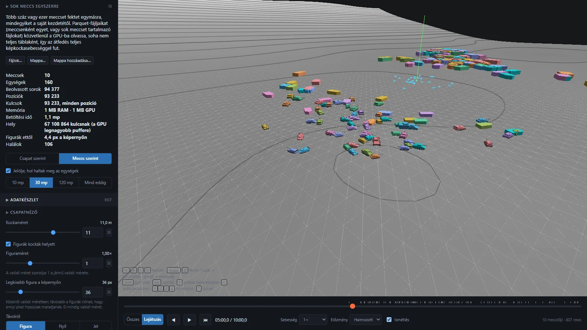

# Sok meccs egyszerre

A **Sok meccs egyszerre** sok meccset játszik egymás tetején, így látja, hová mennek általában minden meccs játékosai. Használja arra, hogy száz vagy több ezer meccset egy képen hasonlítson össze.

Minden meccs a saját kezdetén indul, az egységei pedig figuraként mozognak. A fájlok közvetlenül a videokártyába kerülnek, és nincs teljes táblázat, így simán fut ott, ahol a normál betöltés kifogyna a memóriából.

## Használat {#how-to-use-it}

1. Nyissa meg a **Sok meccs egyszerre** részt a Hőtérkép oldalsávjában.
2. Nyomja meg a **Fájlok…** gombot (több fájl kiválasztása), a **Mappa…** gombot (egy mappa és almappái), vagy a **Mappa hozzáadása…** gombot (a betöltöttekhez adás).
3. A megjelenítő a figurás átfedésre vált, és a kezdetnél indul. Nyomja meg a **Lejátszás** gombot.

Minden fájl egy meccs (vagy több is lehet benne). A Parquet-fájlok és a [`.3dheat`](container.md) tárolók működnek. Egy fájlnak kell pozíció-, idő- és egységoszlop; a név-, típus- és oldaloszlopok megmaradnak. Más fájlokat, valamint az átalakítók kísérőfájljait (repülés, üzenetek, események, csevegés, célok) kihagyjuk. Egy szokásos táblázathoz lásd [Adatok betöltése](getting-data-in.md).

## Beállítások {#settings}

| Beállítás | Mit csinál |
|---|---|
| **Csapat szerint** / **Meccs szerint** | Színezés oldal szerint, vagy meccsenként egy szín. |
| **Jelölje, hol haltak meg az egységek** | Jelölés ott, ahol minden egység meghalt, 10 s, 30 s, 120 s vagy az eddigi összes idejéig. |

A panel megmutatja, hány meccs, egység, sor és pozíció lett beolvasva, a felhasznált memóriát és a betöltési időt. A *Hely még* azt mutatja, hány további pozíciót bírna még a videokártya. A *Figurák innen* az a képernyőn látható méret, amely alatt az egységet a figurája helyett egy kis nyílként rajzoljuk.

A figurák kinézetét ugyanazok a vezérlők adják, mint a [meccs-visszajátszásnál](match-replay.md#figures): **Figuraméret**, **Legkisebb figura a képernyőn** és **Távolról**.

## Tippek {#tips}

- Ha minden nem férne bele a memóriába, a pozíciókat ritkítjuk (csak néhány méterenként marad pozíció), és a panel ezt jelzi.
- A hőmódok a rávetítés adatain is működnek.
- Több ezer meccs statisztikájához rajzolás nélkül lásd: [Tömegelemzés](mass-analysis.md).
