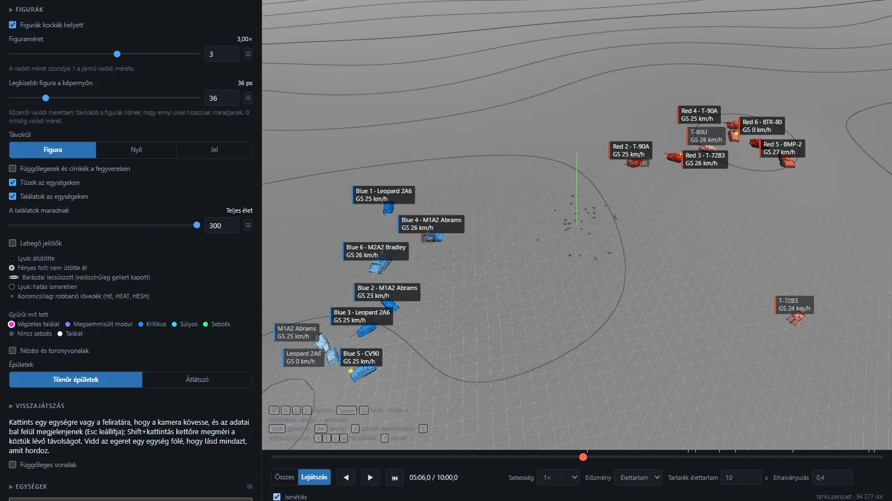
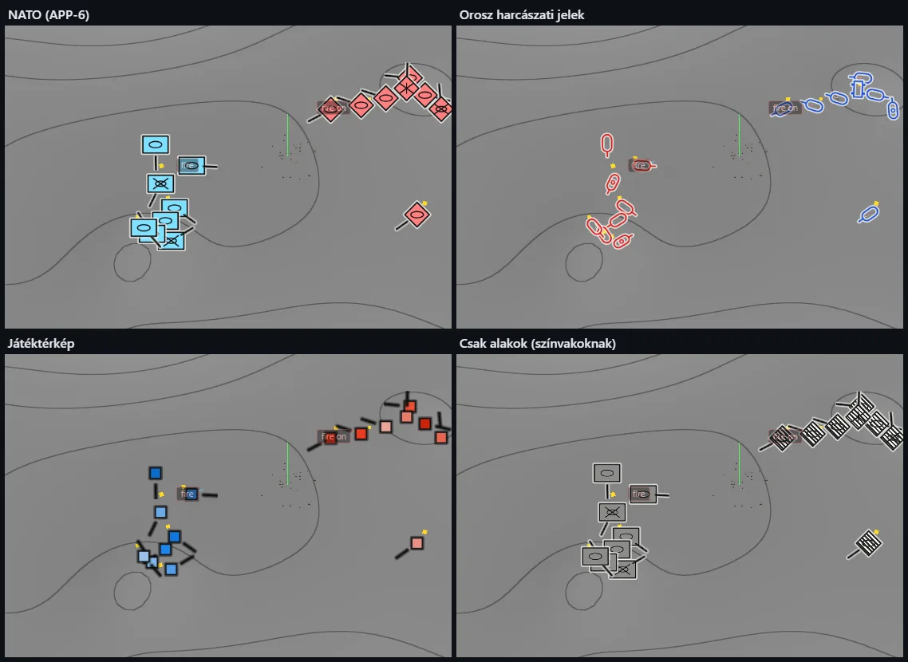
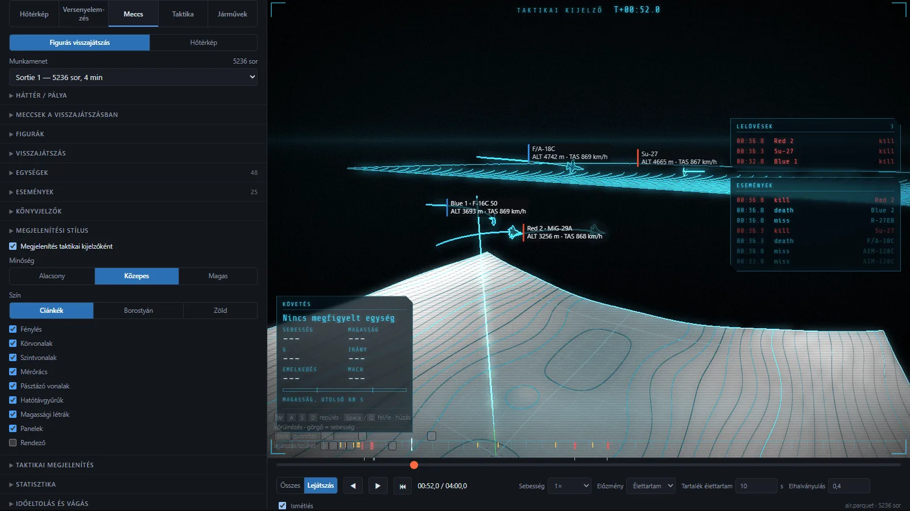
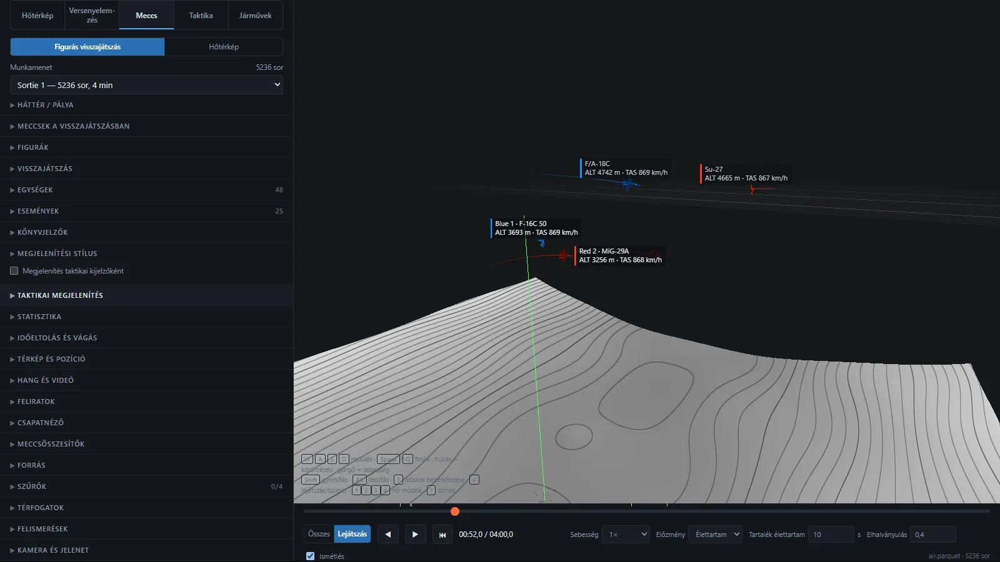

# Meccs-visszajátszás

A visszajátszás a meccs filmje: minden játékost abban a formában rajzol ki, amit vezetett. Használja arra, hogy újra megnézze egy harcot, kövessen egy egységet, és lássa, ki kit talált el.

A lövések, találatok, tüzek és roncsok az egységekre és a pálya célpontjaira kerülnek. Kamerák, feliratok és taktikai kijelző segítik a harc olvasását. Ismeri a Tacview-t? A [Tacview-paritás](tacview-parity.md) mutatja, hol található meg benne az egyes eszközök megfelelője.

## Visszajátszás indítása {#start-a-replay}

1. Töltsön be egy felvételt a **Forrás → Fájlok…** menüponttal, vagy húzza a Forrás panelre (bármely táblázat, amelyben van **személy** és **idő** oszlop, Tacview-fájl, átalakított visszajátszás, [`.3dheat`](container.md) meccs). Lásd: [Adatok betöltése](getting-data-in.md).
2. Nyissa meg a **Meccs** fület, és válassza a **Figurás visszajátszás** módot, vagy a Hő fül módsávjában a **Figurás átfedés** módot.
3. A **Meccsek a visszajátszásban** alatt válasszon ki egy meccset, az összeset egyszerre, vagy többet.
4. Nyomja meg az idővonal **Lejátszás** gombját (vagy a `K`-t). Az idővonal húzásával ugrani tud.

A figurák a kockák helyett jelennek meg minden olyan egységnél, amelynek neve vagy típusa ismert (lásd: [Figurák](figures.md)). Az adatok, amelyekben nincs név- vagy típusoszlop, katonákként jelennek meg.

## Figurák {#figures}

| Beállítás (**Figurák** szakasz) | Alapérték | Mit csinál |
|---|---|---|
| **Figurák kockák helyett** | be | Kikapcsolva sima kockákat rajzol. |
| **Figuraméret** (az igazi méret többszöröse) | 1 | Az 1 az igazi méret; 0,25-szörös és 20-szoros között (logaritmikus skála). Távolról nagyobb értékkel jobban látszik. |
| **Legkisebb figura a képernyőn** | 36 px | A távoli figurák ennyire nőnek, hogy olvashatók maradjanak, 0–200 px; 0 esetén megmarad az igazi méret. |
| **Távolról**: Figura, Nyíl, Jel | Figura | Mivé válik egy távoli egység. |
| **Jelek** | NATO (APP-6) | NATO (APP-6), orosz taktikai jelek, a **Játéktérkép** ikonjai, vagy **Csak alakok (színvakoknak)**. |
| **Jelméret**, **Saját oldal**, **Ellenséges / Semleges**, **Irányjelek** | 28 px (12–64), automatikus, ellenséges, be | A jelek megjelenése és az, melyik oldal a barát. |
| **Függőleges vonalak** | be | Egy vonal minden egységtől egyenesen lefelé a talajig, így a magasságok 3D-ben olvashatók. |
| **Függőlegesek és címkék a fegyvereken** | ki | Vonalak a talajig és címkék a rakétákon és bombákon. |
| **Tüzek az egységeken** | be | Lángok attól a pillanattól, hogy egy egység meggyullad, addig, amíg el nem oltják. |
| **Találatok az egységeken** | be | Jelek ott, ahol a lövések becsapódtak (lent). **A találatok maradnak**: 1–300 másodperc, vagy **Teljes élet**. **Lebegő jelölők**: a felszín fölé rajzolt jelölők. |
| **Nézési és toronyvonalak** | ki | Szaggatott: ahol a játékos néz; folytonos: ahová a fegyver céloz. |
| **Épületek** | tömör | Tömör vagy áttetsző épületek, ha a pálya így rajzolja ki őket. |

### Jelek távolról {#symbols-at-a-distance}

Ha egy egység kisebb lenne, mint a **Legkisebb figura a képernyőn**, olvasható jellé válhat. Az alakja megmutatja a fajtát (például lekerekített doboz nyomvályújellel a páncélosoknál); a színe az oldalt. A **Jelek** menüben változtathatja a stílust.

### Találatjelek, roncsok és tüzek {#hit-marks-wrecks-and-fires}

- A **találatjelek** a felületen ülnek, amelyet a lövés elért, a figura méretarányában. Megjelenésük elárulja, mi történt: lyuk (átment), fényes szikra (nem ment át), karcolás (lepattant), kormos csillag (robbanó lőszer). Egy színes gyűrű azt mutatja, mit tett: végzetes lövés, modul megsemmisült, kritikus, súlyos, sérülés, nincs sérülés, találat. Vigye a mutatót a jelre, és meglátja a lövedék nevét.
- A megsemmisült egységet a haláltól kezdve **megperzselt** roncsként rajzoljuk, amíg újra nem születik vagy el nem távolítják; a jelét áthúzzuk.
- A **tüzek** attól a pillanattól égnek egy egységen, hogy az meggyullad, addig, amíg el nem oltják.
- A **tornyok** oda fordulnak, ahová az adatok szerint a fegyver céloz (vagy ilyen adat hiányában oda, ahová a játékos néz).

### Fegyverek, csalétkek és nyomjelzők {#weapons-decoys-and-tracers}

Ha a **Fegyverek, lövések és találatok** be van kapcsolva (a Csapatnézet szakaszban): a rakéták, lőszerek, bombák és torpedók saját figuraként repülnek füstcsíkkal; a golyók és lövedékek nyomjelzők; a becsapódások és robbanások felvillannak. A **szaggatottan** rajzolt nyomjelző egy találatból lett kiszámítva, mert az adatokban nem szerepelt lövés. A fáklyákat és a csaffokat csalétekként rajzoljuk; ezeket az egységlistából el van rejtve, hacsak be nem pipálta a *Csalétkek és lövedékek* opciót.

## Kamerák {#cameras}

Kattintson egy egységre vagy annak feliratára, hogy **kövesse**; a **Visszajátszás** szakasz ezeket kínálja: **Üldözés**, **Keringés**, **Pilótafülke** (kijelzővel, `H`), **Rögzített**, **Padlock**, **Célpont** és **Műhold**. A `V` körbeforgatja őket, a **Kameratávolság** pedig beállítja, milyen messzire. Az Esc megállítja.

- **Két egységes nézet**: válasszon **Célpontot** (vagy Ctrl/Alt-kattintással egy egységet), hogy a követettből nézze; a **Csere** megcseréli a kettőt.
- **Mérték**: Shift-kattintással két egységet jelöljön ki a köztük lévő iránysszöghöz, távolsághoz és magasságkülönbséghez.
- **2D térkép** (`M`): sarokban vagy teljes nézetben, nyomvonalakkal és nevekkel.
- **Könyvjelzők** (`B`): mentse el a pillanatot és a kamerát; a felvétel saját kilövései, halálesetei és jelölései is listázva vannak.
- **Események**: minden esemény időrendben; kattintásra oda ugrik. A `Page Up` / `Page Down` események között ugrik; a **Szünet eseménynél** mindegyiknél megáll.

## Taktikai megjelenítés {#tactical-display}

A **Taktikai megjelenítés** szakasz egyetlen egységhez sem rajzol, a kijelöltekhez, mindegyikhez vagy egy fajtához (légi jármű, szárazföld, hajók, fegyverek) igen: sebességvektorok és az előttük álló útvonal, orr- és emelővonalak, radarkúpok, zárak, adatkapcsolatok, harctéri zónák és vonalak, látóvonalak, ahová a játékosok néznek (nézőkúpok), toronyirányzás és a rögzített kamera.

### Megjelenítési stílus {#display-style}

A `T` (vagy a **Megjelenítés taktikai kijelzőként** kapcsoló) radarképernyő-stílusra vált: fényhatás, körvonalak, szintvonalak, mérőrács, pásztázó vonalak, távolsággyűrűk, magassági létrák, ölés- és eseménypanelek, valamint egy **Rendező**, amely önmagától mozgatja a kamerát az események felé.

## Célok {#objectives}

Ha egy meccs a céljaival érkezik, a **Célok** szakasz rajzolja ki őket a pályán: elfoglalási zónák (tulajdonossal és elfoglalási állapottal), kiindulópontok, repülőterek, területek és bombázási célpontok, mindegyik réteg külön kapcsolható, feliratokkal. A talajon át is láthatók. Ha több játékmód van betöltve, a **Mód** szűri a meccseket játékmód szerint. A célok a felvétel mellett lévő átalakító meccsfájljából jönnek, vagy egy [`.3dheat`](container.md) konténerben lévő meccsből.

## Feliratok és statisztika {#labels-and-statistics}

- **Feliratok**: szabályok fajtánként (**Kijelöltek**, **Légi járművek**, **Szárazföld**, **Hajók**, **Fegyverek**, **MI**): látszik-e, mely értékek, és **Elsőbbség**, hogy átfedés esetén ki kapja a helyet. A **Feliratok szétválasztása** a feliratot a saját egysége mellé mozgatja, ha egy másikat takarna, és ott hagyja ki, ahol nincs hely. A **Feliratméret** 60–250%. A **Vissza a névre, járműre, magasságra és sebességre** visszaállítja a szabályokat.
  - A szárazföldi egységek névvel, járművel és sebességgel indulnak.
  - A légi járművek névvel, járművel, magassággal és sebességgel indulnak.
  - A hajók névvel, járművel, sebességgel és iránnyal indulnak.
  - Vigye a mutatót egy egységre, és látja minden értékét.
- **Statisztika**: csapatonként és egységenként: ölések, halálesetek, lövések, találatok, találati arány, felszállások, leszállások, levegőben töltött idő, csúcssebesség, magasság és G, megtett távolság. CSV-exportálás.
- **Diagramok**: egy egység értékei az idő függvényében, két egység összehasonlítva, vagy egy érték egy másikkal szemben.

## Sok meccs egyszerre {#many-matches-at-once}

Hogy több száz vagy több ezer meccset rakjon egymásra, lásd: [Sok meccs egyszerre](many-matches.md). Az ábra-réteg részletei (füst, tűz és más időzített effektek): [Figurák az ábra-rétegben](figure-replay.md). A Tacview-funkciók listája: [Tacview-paritás](tacview-parity.md), ez az oldal aloldala.
