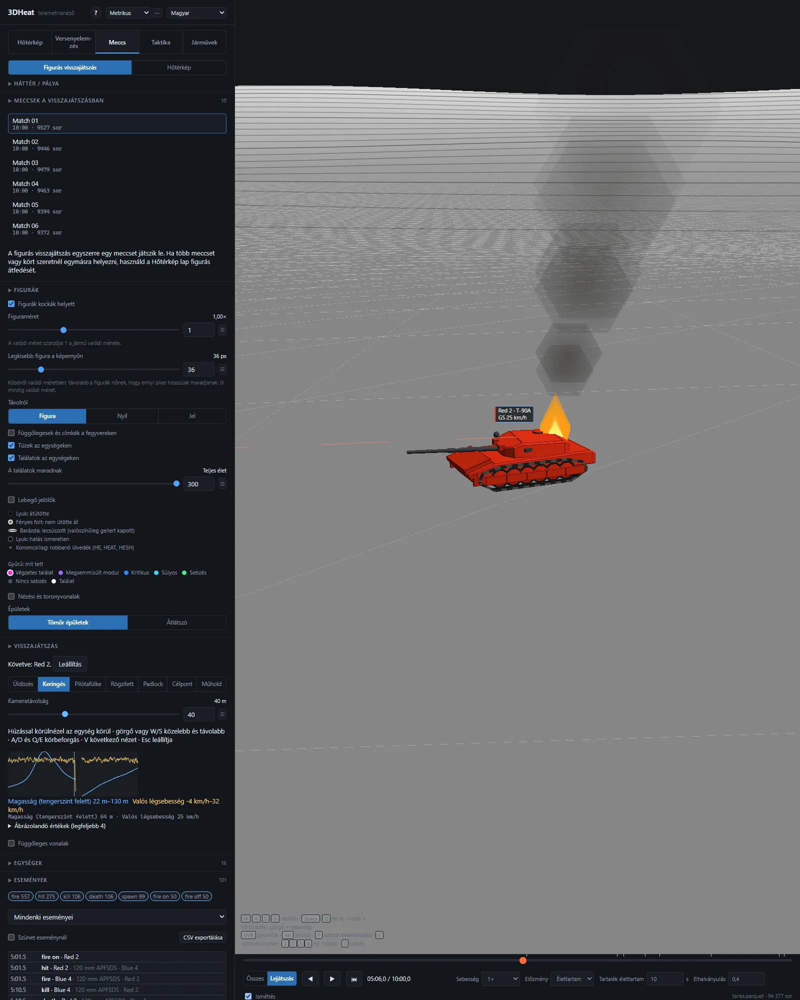
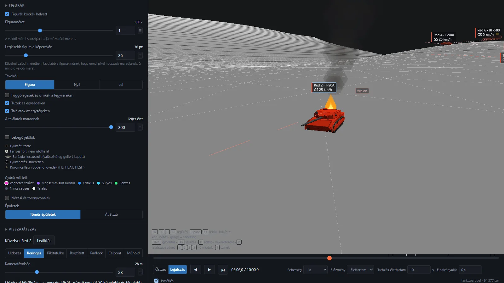

# Meccs-visszajátszás

A visszajátszás a meccs filmje, amelyben minden játékos az általa vezetett dologként jelenik meg. Arra használja, hogy újra megnézzen egy harcot, kövessen egy egységet, és lássa, ki kit talált el.

A lövéseket, találatokat, tüzeket és roncsokat az egységekre és a pálya célpontjaira rajzoljuk. Kamerák, feliratok és taktikai kijelző segítenek a harc olvasásában. Ismeri a Tacview-t? A [Tacview-egyenértékűség](tacview-parity.md) mutatja, hol található minden funkciója.

## Visszajátszás indítása {#start-a-replay}

1. Töltsön be felvételt a **Forrás → Fájlok…** menüponttal, vagy dobja a Forrás panelre (bármely táblázat, amelynek van **személy** és **idő** oszlopa, Tacview-fájl, átalakított visszajátszás, [`.3dheat`](container.md) meccs). Lásd [Adatok betöltése](getting-data-in.md).
2. Nyissa meg a **Meccs** fület, és válassza a **Figurás visszajátszás**t, vagy a Hőtérkép fül módválasztó sávján a **Figurás átfedés**t.
3. A **Meccsek a visszajátszásban** alatt válasszon egy meccset, az összeset egyszerre, vagy többet.
4. Nyomja meg a **Lejátszás** gombot az idővonalon (vagy a `K`-t). Húzza az idővonalat az ugráshoz.

A figurák minden olyan egység helyébe lépnek, amelynek a neve vagy típusa ismert (lásd [Figurák](figures.md)). Név- vagy típusoszlop nélküli adatot katonaként rajzolunk.

## Figurák {#figures}

| Beállítás (**Figurák** szakasz) | Alapérték | Mit csinál |
|---|---|---|
| **Figurák kockák helyett** | be | Kikapcsolva sima dobozokat rajzol. |
| **Figuraméret** (a valódi méret szorzója) | 1 | 1 a valódi méret; 0,25–20-szoros (logaritmikus skála). A nagyobb távolról segít. |
| **Legkisebb figura a képernyőn** | 36 px | A távoli figurák ennyire nőnek, 0–200 px; 0 esetén a valódi méret marad. |
| **Távolról**: Figura, Nyíl, Jel | Figura | Mivé lesz egy távoli egység. |
| **Jelek** | NATO (APP-6) | NATO (APP-6), orosz taktikai jelek, **Játéktérkép** ikonok, vagy **Csak alakok (színvakoknak)**. |
| **Jelméret**, **Saját oldal**, **Ellenséges / Semleges**, **Irányjelek** | 28 px (12–64), automatikus, ellenséges, be | A jelek kinézete és az, melyik oldal a barát. |
| **Függőleges vonalak** | be | Egy vonal minden egységtől egyenesen lefelé a talajig, hogy a magasságok 3D-ben olvashatók legyenek. |
| **Függőlegesek és címkék a fegyvereken** | ki | Vonalak a talajig, és feliratok a rakétákon és bombákon. |
| **Tüzek az egységeken** | be | Lángok attól a pillanattól, hogy az egység meggyullad, amíg el nem oltják. |
| **Találatok az egységeken** | be | Jelek, ahol a lövések becsapódtak (lent). **A találatok maradnak**: 1–300 másodperc, vagy **Teljes élet**. **Lebegő jelölők**: a felszín fölött rajzolt jelölők. |
| **Nézési és toronyvonalak** | ki | Szaggatott: ahova a játékos néz; folytonos: ahova a löveg mutat. |
| **Épületek** | tömör | Tömör vagy átlátszó épületek, ha a pálya úgy festi őket. |

### Jelek távolról {#symbols-at-a-distance}

Ha egy egység kisebb lenne a **Legkisebb figura a képernyőn** értéknél, olvasható jellé válhat. Az alakja mondja meg a fajtáját (például egy lekerekített doboz lánctalp-jelöléssel a páncélosoknál); a színe az oldalt. A **Jelek** menü nyitásával változtathatja a stílust.

### Találatjelek, roncsok és tüzek {#hit-marks-wrecks-and-fires}

- A **Találatpontok** azon a felületen ülnek, amelyet a lövés elért, a figura méretarányában. Megjelenésük elárulja, mi történt: lyuk (átment), fényes szóró (nem ment át), vájat (lepattant), korom-csillag (robbanógránát). Egy színes gyűrű azt mutatja, mit tett: halálos lövés, modul megsemmisült, kritikus, súlyos, sérülés, sérülésmentes, találat. Egy jelre rámutatva megjelenik a lövedék neve.
- Egy megsemmisített egység a haláltól kezdve, amíg újra nem születik vagy el nem távolítják, **megperzselt** roncsként rajzolódik; a jele át van húzva.
- A **tüzek** attól a pillanattól égnek egy egységen, hogy meggyullad, amíg el nem oltják.
- A **tornyok** oda fordulnak, ahová az adat szerint a löveg mutat (vagy adat nélkül oda, ahová a játékos néz).

### Fegyverek, csalétkek és nyomjelzők {#weapons-decoys-and-tracers}

A **Fegyverek, lövések és találatok** (Csapatnéző szakasz) bekapcsolva: a rakéták, bombák és torpedók saját figuraként repülnek, füstcsíkkal; a golyók és lövedékek nyomjelzők; a becsapódások és robbanások felvillannak. Egy **szaggatottan** rajzolt nyomjelzőt egy találatból számoltunk ki, mert az adatban nem volt lövés. A fáklyákat és a fóliacsíkokat csalétekként rajzoljuk; az egységlistából rejtve vannak, hacsak a *Csalétkek és lövedékek* nincs bejelölve.

## Kamerák {#cameras}

Kattintson egy egységre vagy a feliratára, hogy **kövesse**; a **Visszajátszás** szakasz kínálja az **Üldözés**, **Keringés**, **Pilótafülke** (kijelzővel, `H`), **Rögzített**, **Padlock**, **Célpont** és **Műhold** nézeteket. A `V` végigléptet közöttük, a **Kameratávolság** állítja, milyen messze. Az Esc megáll.

- **Két egységes nézet**: válasszon egy **Célpontot** (vagy Ctrl/Alt-kattintással egy egységet), hogy a követettől nézze; a **Csere** felcseréli őket.
- **Mérés**: Shift-kattintással két egység között megkapja az irányt, a távolságot és a magasságkülönbséget.
- **2D térkép** (`M`): sarokban vagy teljes nézetben, nyomvonalakkal és nevekkel.
- **Könyvjelzők** (`B`): elmenti a pillanatot és a kamerát; a felvétel saját gyilkosságai, halálai és jelölései is listázva vannak.
- **Események**: minden esemény időrendben; kattintásra oda ugrik. A `Page Up` / `Page Down` események között ugrik; a **Szünet eseménynél** mindegyiknél megáll.

## Taktikai megjelenítés {#tactical-display}

A **Taktikai megjelenítés** szakasz – egyik egységnek sem, a kijelölteknek, mindnek vagy egy fajtának (repülőgép, földi, hajók, fegyverek) – rajzolja: sebességvektorokat és az előttük lévő útvonalat, orr- és emelővonalakat, radarkúpokat, zárolásokat, adatkapcsolatokat, bevetési zónákat és -vonalakat, láthatósági vonalakat, azt, hová néznek a játékosok (nézőkúpok), a torony irányzását és a rögzített kamerát.

### Megjelenítési stílus {#display-style}

A `T` (vagy a **Megjelenítés taktikai kijelzőként** kapcsoló) radarképernyő-stílusra vált: fény, körvonalak, szintvonalak, mérőrács, pásztázóvonalak, távolsággyűrűk, magasságlétrák, gyilkosságokat és eseményeket mutató panelek, és egy **Rendező**, amely önállóan mozgatja a kamerát az események felé.

## Célok {#objectives}

Ha egy meccs a céljaival érkezik, a **Célok** szakasz a pályán rajzolja őket: elfoglalási zónák (tulajdonossal és elfoglalási haladással), spawnok, repülőterek, területek és bombázási célpontok, mindegyik réteg kapcsolható, feliratokkal. A talajon át is látszanak. Több játékmód betöltése esetén a **Mód** a meccseket módjuk szerint szűri. A célok egy átalakító meccsfájljából származnak, a felvétel mellett vagy a [`.3dheat`](container.md) tárolóban.

## Feliratok és statisztika {#labels-and-statistics}

- **Feliratok**: fajtánként szabályok (**Kijelöltek**, **Légi járművek**, **Szárazföld**, **Hajók**, **Fegyverek**, **MI**): mutatják-e, mely értékeket, és **Elsőbbség**, hogy átfedéskor ki kapja a helyet. A **Feliratok szétválasztása** átteszi a feliratot az egysége mellé, ha az takarna másikat, és ott hagyja ki, ahol nincs hely. A **Feliratméret** 60–250%. A **Vissza a névre, járműre, magasságra és sebességre** visszaállítja a szabályokat.
  - A földi egységek névvel, járművel és sebességgel indulnak.
  - A légi járművek névvel, járművel, magassággal és sebességgel indulnak.
  - A hajók névvel, járművel, sebességgel és iránnyal indulnak.
  - Egy egységre rámutatva látja az összes értékét.
- **Statisztika**: csapatonként és egységenként: gyilkosságok, halálok, lövések, találatok, találati arány, felszállások, leszállások, levegőben töltött idő, csúcssebesség, magasság és G, távolság. CSV-exportálás.
- **Diagramok**: egy egység értékei az idő függvényében, két egység összehasonlítása, vagy egy érték egy másikhoz képest.

## Sok meccs egyszerre {#many-matches-at-once}

Több száz vagy több ezer meccs egymásra rétegzéséhez lásd [Sok meccs egyszerre](many-matches.md). A figurák részletei (füst, tűz, egyéb időzített hatások): [Figurák a figurás átfedésben](figure-replay.md). A Tacview-funkciók listája: [Tacview-egyenértékűség](tacview-parity.md), ennek az oldalnak egy aloldala.
