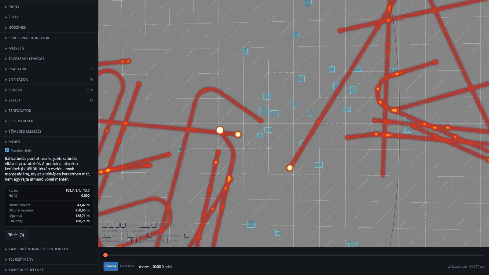

# Mérték

A **Mérték** az egeret vonalzóvá változtatja, és megmondja, mennyire forgalmas a kurzor alatti hely. Akkor használd, ha meg akarod tudni, milyen messze van két hely egymástól, vagy mekkora forgalma van egy helynek.

## Próbáld ki {#try-it}

1. Nyisd meg a **Mérték** részt az oldalsávban, és pipáld be a **Vonalzó aktív** opciót.
2. Kattints a bal gombbal három helyre a térképen. Minden kattintás egy pontot tesz le.
3. Olvasd le az **Útvonal összesen** (az egész útvonal hossza) és az **Utolsó szakasz** (az utolsó szakasz) értéket.
4. Jobb gombbal eltávolíthatod az utolsó pontot, vagy a **Törlés (3)** gombbal mindet.

| Művelet | Hatás |
|---|---|
| Bal kattintás | Egy pontot tesz oda, ahol a kurzor a talajsíkkal találkozik. Az a kattintás, amely a lenyomás és az elengedés között 4 képpontnál többet mozdult, kamera-húzás, nem pont. |
| Jobb kattintás | Eltávolítja az utolsó pontot. |
| Mozgatás | A kurzor pozíciója és az alatta lévő hő élőben frissül. |

A kamera a vonalzó bekapcsolt állapotában is működik: a húzással még lehet körülnézni, a billentyűkkel még lehet repülni. A vonalzó bekapcsolva minden kattintást megkap, ezért a [kattintásos kiválasztás](camera.md#click-to-pick) addig vár, amíg ki nem kapcsolod.

**A talajsík** a [térképkép](map-images.md) magassága, ha van betöltött térképkép; különben az adathalmaz legalacsonyabb Y-ja (térképkép nélkül 0). A pontok erre a síkra esnek, így a vonalzó a térkép felett mér, nem egy azon átmenő vonal mentén. 3D-s pályánál a sík továbbra is az adathalmaz legalacsonyabb Y-ja, nem a pálya felszíne - a valódi felszínen lévő ponthoz kapcsold ki a vonalzót, és kattints rá ([kattintásos kiválasztás](camera.md#click-to-pick)), ami a koordinátákat a pálya saját háromszögeiből olvassa ki.

## Kijelzők {#readouts}

| Sor | Jelentés |
|---|---|
| **Kurzor** | A kurzor alatti pont világ-X, Y, Z koordinátái, a síkon. |
| **Hő itt** | Mennyi hő van a kurzor képpontján. Nagyobb szám nagyobb forgalmat jelent azon a helyen. Ez az az érték, amelyet a színrámpa kap, mielőtt a telítési pont osztaná, így összehasonlítható a [Telítési pont](colour-and-exposure.md#saturation-point) értékével. |
| **Utolsó szakasz** | Távolság az utolsó ponttól a kurzorig (vagy az utolsó két pont között). |
| **Útvonal összesen** | Az összes ponton és a kurzoron átmenő töröttvonal hossza. |
| **Légvonal** | Háromdimenziós távolság az első ponttól a kurzorig (vagy az utolsó pontig). |
| **Csak talaj** | Ugyanaz, csak az X és Z tengelyen. |
| **Törlés (N)** | Eltávolítja az összes pontot. |

A távolságok egy egység alatt centiméterben, 1000 alatt méterben, fölötte kilométerben jelennek meg - feltéve, hogy egy világegység egy méter ([Tengelyek, egységek és idő](axes-units-and-time.md#unit-scale)). A koordináták világkoordináták, akkor is, ha egy tengely [megfordítva jelenik meg](camera.md#invert-world-axis).

A pontok és az őket összekötő vonal a nézetben átfedésként rajzolódnak, a rácsköz alapján méretezve. A vonalzó pontjai nincsenek elmentve a nézetekben; más adat betöltésekor is megmaradnak.

## Fejlesztőknek {#for-developers}

A **Hő itt** értékét legfeljebb 120 ms-onként olvassuk a GPU-ról, mert egyetlen képpont visszaolvasása megakasztja a csővezetéket. Ugyanazt az utat használja, mint az `engine.readHeatProbe()`: a képkocka írásakor használt erősítéssel osztja, így a félpontos akkumulációs úton (`?heat=f16`) ugyanazokban az egységekben van, mint egy 32 bites célon ([Félpontos akkumuláció](half-float-accumulation.md)).
