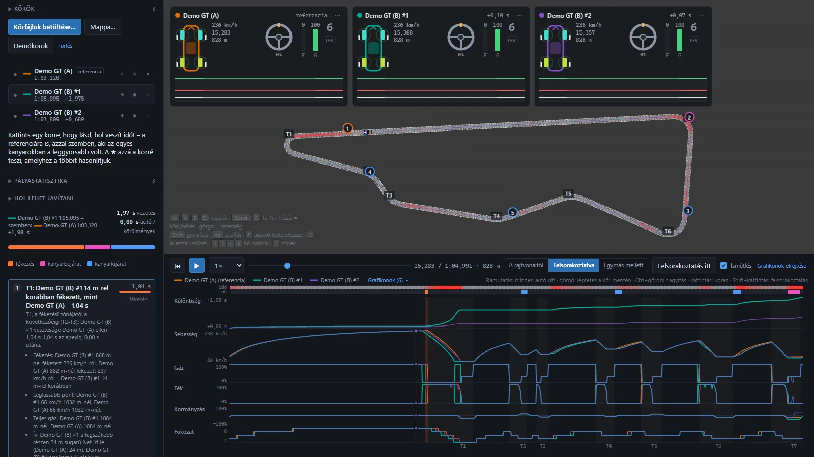

# Versenyelemzés

Ugyanazt a pályát kétszer hajtottad. A **Versenyelemzés** fül a két hajtást együtt játssza le 3D-ben, megmutatja, hol volt egy kör lassabb, és megmondja, miért. Még nincs körök? Nyomd meg a **Demókörök** gombot.

A fül egy pálya két vagy több körét hasonlítja össze. A vásznat, a kamerát és a betöltött pályamodellt (**Háttér / pálya**) a hőtérképpel osztja meg; minden más saját: saját oldalsávja és saját sávja a nézet alatt. Az olyan szavak, mint *kör*, *referencia* és *csúcs*, a [szójegyzékben](glossary.md) vannak.

Ez az oldal a fül térképe. Minden résznek saját oldala van:

| Oldal | Mit fed le |
|---|---|
| [Körök betöltése](race-loading-laps.md) | minden fájlformátum, mappák és pályák, autónevek, demókörök, a körlista, a referencia és a fókusz |
| [Visszajátszás és a 3D-s jelenet](race-replay-and-scene.md) | az átviteli sáv, a három visszajátszási mód, az autók összeigazítása, az üldöző kamera, a vonalak, térképek, autók, feliratok, tükrözött világok |
| [Diagramok és a HUD](race-charts-and-hud.md) | a távolságdiagramok, a grafikonválasztó, az egérmozgás és a nagyítás, az autókártyák, a csatornatáblázat |
| [Autóirányítási események](race-control-events.md) | blokkolások, kerékcsúszás, túlkormányzás, pörgések, alulkormányzás, találatok, ütközések, ABS/TC, kézifék, levegő – hogyan ismerjük fel mindegyiket, minden küszöbértékkel |
| [Kanyarról kanyarra elemzés](race-corner-analysis.md) | igazítás távolság szerint, kanyarok és szakaszok, egy kanyar időmérlege, minden ok és a sorrend, amelyben kipróbáljuk őket, a vonal alakja és a tanács |
| [Autóprofilok és összehasonlítás](race-car-profiles.md) | mit tud minden autó, a köreiből mérve; *Autók összehasonlítva*; mit dönt el az autó minden kanyarban |
| [Pályastatisztika](race-course-statistics.md) | sok kör egy pályán: hibák kanyaronként és fajtánként, a hibatérkép, a hőtérkép-export, a teljesítménykorlátok |
| [Versenyelemzés: a módszer](race-analytics.md) | a szabályok mögötti kutatás, forrásokkal |
| [Más versenyjátékok](other-games.md) | mit kezd a megjelenítő minden játék köreivel: a csúszást és a sodródást ott számolja ki, ahol a játék nem küldi, a tükrözött világok, a további csatornák |

## A képernyő {#the-screen}

**Oldalsáv**, fentről lefelé (a részek összecsukhatók):

1. **Körök** – betöltés, lista, megjelenítés és elrejtés, referencia, fókusz, üldözés. Lásd [Körök betöltése](race-loading-laps.md).
2. **Pályastatisztika** – csak három betöltött körtől. Lásd [Pályastatisztika](race-course-statistics.md).
3. **Hol lehet javítani** – a fókuszált kör megállapításai, kanyarról kanyarra. Lásd [Kanyarról kanyarra elemzés](race-corner-analysis.md).
4. **Kanyarról kanyarra** (vagy *Kanyarról kanyarra – X osztály*, több osztálynál) – a leggyorsabb kör minden kanyarban, és annak vonala. Két vagy több körnél látszik.
5. **Autóirányítás** – a fókuszált kör blokkolásai, csúszásai, túlkormányzásai és találatai. Lásd [Autóirányítási események](race-control-events.md).
6. **Autók összehasonlítva** (vagy **Az autó**, ha egy autó van) – lásd [Autóprofilok és összehasonlítás](race-car-profiles.md).
7. **Nézet** – melyik térkép van a pályára festve, és mi rajzolódik ki. Lásd [Visszajátszás és a 3D-s jelenet](race-replay-and-scene.md).
8. A közös **Pálya** és **Kamera és jelenet** panelek (a pályamodell, a tengelyek tükrözése, a kamera) – a hőtérképpel együtt vannak dokumentálva, és a [Kamera](camera.md) oldalon.

**A nézet** mutatja a pályát, a megtett vonalakat, a térképet, az autókat, a pályához rögzített feliratokat, és bal felül legfeljebb hat autókártyát (lásd [Diagramok és a HUD](race-charts-and-hud.md)). Ha nincs betöltött kör, ezt írja: „Nincs betöltött kör – húzz ide két vagy több körfájlt, vagy töltsd be a demóköröket az oldalsávról."

**A nézet alatti sáv** tartalmazza a visszajátszás átviteli sávját, és – hacsak el nincs rejtve – a távolságdiagramokat.

## Gyors kezdés {#quick-start}

1. Nyisd meg a **Versenyelemzés** fület (a **Hőtérkép** mellett, az oldalsáv tetején).
2. Vigyél be köröket. Nyomd meg a **Demókörök** gombot, hogy lásd, mit csinál a fül három kitalált körrel. Saját köreidhez előbb rögzítsd őket ([fájlformátumok és rögzítők](race-loading-laps.md#file-formats)), majd nyomd meg a **Körfájlok betöltése…** vagy a **Mappa…** gombot, vagy húzz fájlokat vagy mappákat a nézetre.
3. A leggyorsabb teljes kör lesz a referencia; a többi közül a leglassabb lesz a fókuszban. Kattints bármelyik körre a listában, hogy fókuszba kerüljön; a ★ jelöli ki a kört referenciának.
4. Olvasd el a **Hol lehet javítani** részt. Kattints egy megállapításra: az autók 40 m-rel előtte összeigazodnak, a kamera keretbe foglalja, a visszajátszás végigmegy rajta, és a mérések megnyílnak.
5. Húzd az egeret a diagramokra, hogy minden autót arra a méterre mozgasd; Shift+kattintás, hogy ott egy vonalba igazítsd őket.

## Billentyűzet {#keyboard}

Amíg a Verseny fül nyitva van:

| Billentyű | Mit csinál |
|---|---|
| **K** | lejátszás / szünet |
| **Home** | vissza a visszajátszás elejére |
| számbillentyűk | semmit (a hőtérképen módot váltanak) |

A szövegmezőbe vagy legördülő menübe gépelt billentyűket figyelmen kívül hagyjuk. A kamera billentyűi ugyanúgy működnek, mint a hőtérképen (**W A S D**, **Space** fel, **Q** le, **Shift** gyorsabban, **Alt** lassabban, egérrel nézés; mindez a [Kamera](camera.md) oldalon); az **F** keretbe foglalja a betöltött köröket (ahogy a körök betöltése is teszi).

## Sok kör {#many-laps}

- Minden betöltött kört elemzünk és számolunk; tucatnyi egy-két másodperc alatt készül el.
- **8** kör felett (`SHOW_ALL_UP_TO`) a hozzáadott körök csak akkor rajzolódnak ki, ha ők a referencia, a fókuszált kör, vagy a fókuszált kör osztályának legjobb köre. Az *Összes megjelenítése* / *Csak a vizsgáltak* kapcsol.
- **10** látható autó felett (`PLAIN_PAST`) a nem vizsgált körök (nem a fókusz, nem az üldözött autó és nem a referencia) vonalai ritkítva rajzolódnak: 6 m-enként egy pont 1,5 m helyett, és egyszerű autók.
- A diagramok legfeljebb **8** kört rajzolnak; a HUD legfeljebb **6** kártyát mutat.
- A pályastatisztika **3** körtől jelenik meg.

Részletek: [Pályastatisztika](race-course-statistics.md#performance-with-many-laps).

## Alapértelmezett nézetbeállítások {#default-view-settings}

| Beállítás | Alapérték |
|---|---|
| Térkép | Időtérkép |
| Megtett vonalak, Autók, Gumik és futómű, Feliratok, Pálya a körökből | be |
| Kártyák összes értéke | ki |
| Autóméret | 1× |
| Diagramok | látszanak |
| Visszajátszási mód | A vonaltól |
| Visszajátszás sebessége | 1× |
| Hurok | be |

Ezek egyike sincs mentve; újratöltéskor az alapértékekkel indul. A böngészőben megjegyzett dolgok: a nyelv, és a körfájlokból megtanult autónevek (lásd [Körök betöltése](race-loading-laps.md#car-names)).

## Fejlesztőknek {#for-developers}

### Mi történik körök betöltésekor {#what-happens-when-laps-are-loaded}

Ha a körök halmaza, a referencia vagy a nyelv megváltozik, az egész elemzés újrafut (`analyse` a [`src/race/analysis.ts`](https://github.com/Holdi601/3DHeat/blob/main/src/race/analysis.ts) fájlban):

1. Minden körhöz hozzáadjuk azokat a származtatott csatornákat, amelyeket a játék nem küld: sodródási szög, kerékcsúszás a kerékfordulatokból, levegőben, laza talaj, forgási sebesség ([`derive.ts`](https://github.com/Holdi601/3DHeat/blob/main/src/race/derive.ts)).
2. Kiválasztjuk a referenciát, minden kört rávetítünk annak útvonalára, és 2 m-enként újramintavételezzük ([`align.ts`](https://github.com/Holdi601/3DHeat/blob/main/src/race/align.ts)).
3. A körökből kiderítjük, tükrözött-e a játék világa ([`handedness.ts`](https://github.com/Holdi601/3DHeat/blob/main/src/race/handedness.ts)).
4. A kanyarokat a referencián találjuk meg, és egy fékezési zónától a következőig tartó szakaszokba csoportosítjuk ([`segments.ts`](https://github.com/Holdi601/3DHeat/blob/main/src/race/segments.ts)).
5. Autónként: a burkológörbéje (tapadás, fékezés, húzóerő sebességenként), a profilja, a gumigörbéi ([`envelope.ts`](https://github.com/Holdi601/3DHeat/blob/main/src/race/envelope.ts), [`profile.ts`](https://github.com/Holdi601/3DHeat/blob/main/src/race/profile.ts), [`control.ts`](https://github.com/Holdi601/3DHeat/blob/main/src/race/control.ts)).
6. Körönként és szakaszonként: mit csinált (fékpont, legkisebb sebességű pont, teljes gáz, …), és a vonal, amelyet megtett ([`line.ts`](https://github.com/Holdi601/3DHeat/blob/main/src/race/line.ts)).
7. Körönként: autóirányítási eseményei, mindegyik ahhoz mérve, amellyel ott összehasonlítjuk.
8. Körönként és szakaszonként: az időmérleg a hozzá hasonlított körhöz képest, és a megállapítás szavakban.
9. Körönként az időtérkép és az okok térképe.

A szövegek az aktuális nyelven készülnek; nyelvváltáskor az elemzés újra lefut (és átnevezi a demókörököt). Az elemzés hibája a **Körök** gombok alatt hibaként látszik, a körök pedig betöltve maradnak.

### Forrásfájlok {#source-files}

| Fájl | Szerep |
|---|---|
| `src/race/adapters.ts`, `ibt.ts` | körfájlok olvasása |
| `src/race/lap.ts`, `carNames.ts`, `synthetic.ts` | a körtípus, az elnevezés, a demókörök |
| `src/race/derive.ts`, `handedness.ts` | származtatott csatornák, tükrözött világok |
| `src/race/align.ts`, `segments.ts`, `line.ts` | távolságtengely, kanyarok, vonalak |
| `src/race/analysis.ts` | összehasonlított kanyarok, okok, megállapítások |
| `src/race/envelope.ts`, `profile.ts` | mit tud egy autó |
| `src/race/control.ts`, `impacts.ts` | autóirányítás, találatok és ütközések |
| `src/race/stats.ts` | sok kör |
| `src/race/replay.ts`, `scene.ts`, `glyph.ts`, `geometry.ts` | visszajátszás és rajzolás |
| `src/race/schema.ts`, `graphs.ts` | a csatornatáblázat, a diagramok sorai |
| `src/ui/race/*` | az oldalsáv, a diagramok, a HUD, a feliratok |
| `src/state/raceStore.ts` | a fül állapota és a visszajátszás órája |
