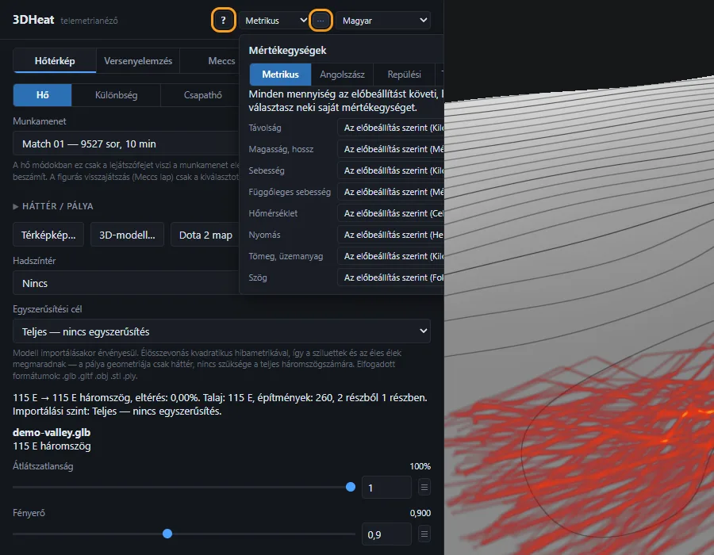
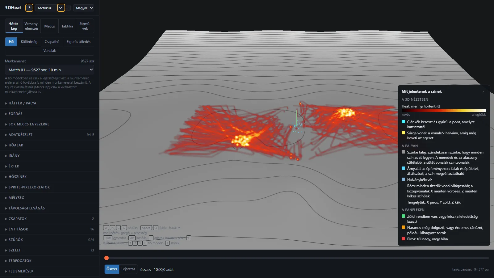
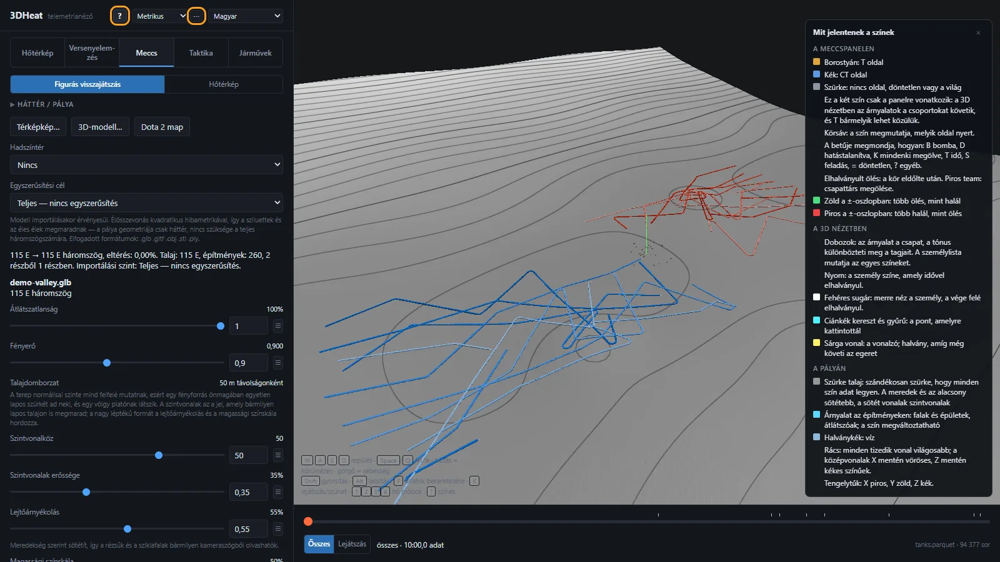

# Beállítások, egységek és billentyűk

Az oldalsáv tetején lévő kis vezérlők megváltoztatják, hogyan szól hozzád a nézegető: a nyelvet, az egységeket (méter vagy láb, km/h vagy csomó) és egy súgó módot, amely elmagyarázza a színeket. A választásaidat a böngésződ megjegyzi.

## A fejléc {#the-header}

Az oldalsáv tetején:

| Vezérlő | Mit csinál |
|---|---|
| **?** | Súgó mód: mit jelent minden szín (`?` vagy `F1` billentyűvel is) |
| **Egységek** menü | Metrikus, Imperiális, Repülési vagy Tengeri |
| **...** gomb az **Egységek** mellett | Megnyitja a „Válassz egységet minden mennyiséghez” ablakot: mennyiségenként egy-egy legördülő lista |
| **Nyelv** menü | A nézegető nyelve: [40 nyelv](languages.md), vagy a böngésző nyelve |

A dobozba beírt számokban használhatsz pontot vagy vesszőt is (`0.35` vagy `0,35`). A nézegető mindkettőt olvassa, és a számokat a nézegető nyelvének szokása szerint mutatja.

## Egységek {#units}

1. Válassz előre beállítottat az **Egységek** menüben. Minden mennyiség egyszerre vált.
2. Ha csak egy mennyiséget akarsz változtatni, kattints a mellette lévő **...** gombra, és válassz egységet ahhoz a mennyiséghez. A menü ezután egy `*`-ot tesz az előre beállított után.
3. Az olyan mennyiség, amelyet nem állítottál be, követi az előre beállítottat. Az „Előre beállított” választása visszaállít.

| Mennyiség | Metrikus (alapértelmezés) | Imperiális | Repülési | Tengeri |
|---|---|---|---|---|
| Távolság | km | mi | NM | NM |
| Magasság, hosszúság | m | ft | ft | m |
| Sebesség | km/h | mph | kt | kt |
| Függőleges sebesség | m/s | ft/min | ft/min | m/s |
| Hőmérséklet | °C | °F | °C | °C |
| Nyomás | hPa | inHg | hPa | hPa |
| Tömeg, üzemanyag | kg, l | lb, gal | lb, gal | t, m³ |
| Szög | fok | fok | fok | fok |

További egységek, amelyeket egy mennyiséghez választhatsz: távolság km, mi, NM; sebesség km/h, m/s, kt, mph; függőleges sebesség m/s, ft/min, m/min; hőmérséklet °C, °F, K; nyomás hPa, inHg, mmHg, psi; tömeg kg, lb, t; szög fok vagy NATO mil (6400 a körön). Az egységek mindenhol egyformák a nézegetőben: a feliratokban, a kártyákon, a grafikonokon és a statisztikákban.

## Súgó mód {#help-mode}

Nyomd meg a `?` vagy az `F1` billentyűt, vagy kattints a **?** gombra. Megmutatja a *Mit jelentenek a színek* részt: a 3D-s nézet jelmagyarázatait, a hőskálákat, a csapatszíneket, a pálya színeit, a panelek állapotszíneit, a meccs-panelt és a versenynézetet. Addig marad bekapcsolva, amíg ki nem kapcsolod. A Meccs fülön a meccs-panel színeit is elmagyarázza.

## Amit a böngésző megjegyez {#what-the-browser-remembers}

Ezek a beállítások a látogatások között a böngésződben maradnak meg (semmi sem megy sehová):

- a nyelv, az egységek és a súgó mód;
- a visszajátszás figura-, szimbólum-, címke-, kamera- és taktikai kijelzőbeállításai;
- a lejátszási sebesség és a tükrözés;
- könyvjelzők felvételenként, kötetek adathalmazonként, célrétegek;
- a külső MI-beállítások (a kulcs csak akkor, ha bepipálod a *Megjegyzés* opciót).

A hő-beállítások, a szűrők és a mód minden betöltéskor újra kezdődnek. A teljes, generált lista: [Tárolt beállítások](ref-settings-storage.md).

## Billentyűk, amelyeket a nézegető megtart a böngészőtől {#keys-the-viewer-keeps-from-the-browser}

A nagy adattal dolgozó munkamenet betöltése időbe telik, ezért a nézegető megakadályozza, hogy a böngésző véletlenül eldobja:

- A `Ctrl`/`Cmd` + azok a betűk, amelyek nyomtatnak, mentenek, megnyitnak, újratöltenek, bezárnak vagy új ablakot nyitnak, nem tesznek semmit a szövegmezőkön kívül; az `F1`, `F3`, `F5`, `F6` és `F7` sem tesz semmit.
- Ha adat vagy pálya van betöltve, a fül bezárása vagy újratöltése először rákérdez.
- Teljes képernyőn a nézegető zárolja a saját billentyűit (W, T, N, S, R, P, Q, Esc), hogy a böngésző ne vegye el őket.

A teljes lista: [Böngésző-billentyűk](ref-browser-keys.md). A nézegető összes saját billentyűje: [Billentyűzet- és egérhivatkozás](keyboard-reference.md).
