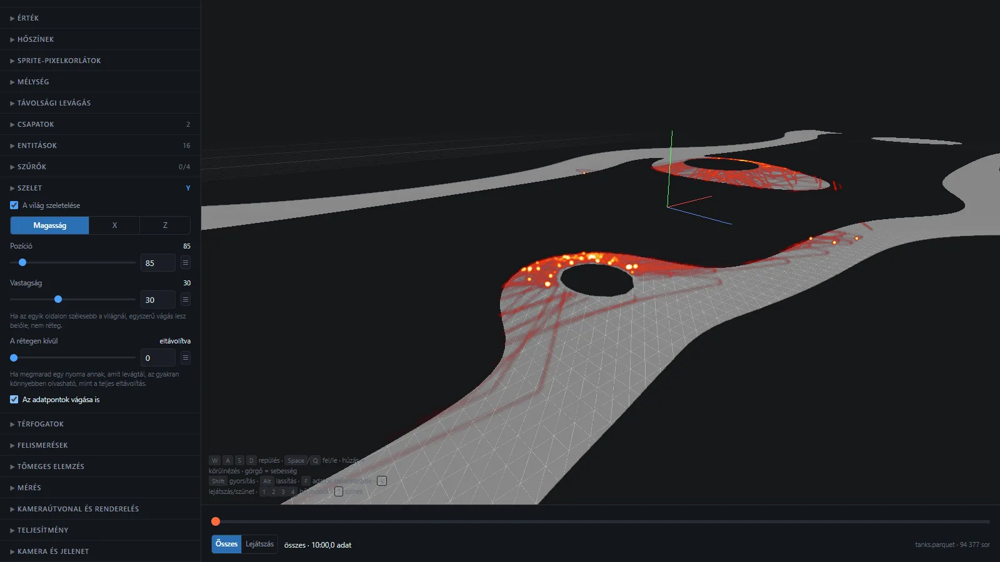

# Szelet

A **Szelet** úgy vágja szét a világot, mint egy tortaszeletet, így be lehet látni az épületek belsejébe. Akkor használd, ha a falak takarják az érdekes hőt, például hogy egy épület egy emeletét lásd.

## Próbáld ki {#try-it}

1. Tölts be egy pályát és némi adatot, és nyisd meg a **Szelet** részt.
2. Pipáld be az **A világ szeletelése** opciót. A tengely a **Magasság**.
3. Húzd felfelé és lefelé a **Pozíció** csúszkát: a réteg végigmegy a pályán.
4. Állítsd a **Vastagság** értékét vékonyra egy alaprajzhoz, vagy szélesre a „minden e fölött” nézethez.
5. Az **A rétegen kívül** értéket hagyd 0-n, hogy a többit eltávolítsa, vagy emeld, hogy halvány nyomot tartson meg.



A réteg **a pálya geometriáját és az adatpontokat együtt** vágja - ha csak a pályát vágnánk, a hő úgy lebegne, ahol egykor az épülete állt. Ez a [mélységi takarás](depth-and-culling.md) párja: ha a pálya helyesen takarja, ami mögötte van, akkor egy épület belseje is takarva van. A panel akkor látszik, ha van mit szeletelni (adathalmaz vagy 3D-s pálya); a fejléce bekapcsolva mutatja a tengelyt, egyébként *ki*.

```
oldalnézet        Pozíció = hol van a réteg
 ----------       Vastagság = milyen magas a réteg
 | 3. emelet |
 |=========|  <--- réteg (megtartva)
 | 2. emelet |  <--- kívül: eltávolítva (vagy halványan)
 | 1. emelet |
 ----------
```

## Vezérlők {#controls}

| Vezérlő | Alapérték | Jelentés |
|---|---|---|
| **A világ szeletelése** | ki | Bekapcsolja a réteget. Amíg a pozíció a kezdeti 0-n, a vastagság a kezdeti 500-on van, a bekapcsolás a tengely közepére és annak terjedelmének 15%-ára állítja őket. |
| Tengely | **Magasság** | *Magasság* (Y), *X* vagy *Z*. A tengely váltásakor a réteg az új tengely közepére ugrik. |
| **Pozíció** | a közép | A réteg közepe, világegységben, a tengely terjedelmén (500 lépésben). |
| **Vastagság** | a terjedelem 15%-a | A terjedelem 1/500-ától a kétszeresééig, logaritmikus lépésekben. Ha a terjedelemmel egyenlő széles, *a világon túl* jelzést kap: ekkor az egyik oldal túlnyúlik a világon, és ez már egyszerű vágás, nem réteg. |
| **A rétegen kívül** | 0, *eltávolítva* | Mennyi marad látható a rétegen kívüliből, 0-100%. A levágott rész halvány nyoma gyakran könnyebben olvasható, mint a teljes eltávolítása. |
| **Az adatpontok vágása is** | be | Kikapcsolva a hő egészben marad, így a vágáson át is látszik - hasznos, ha a réteg fölötti és alatti részt akarod látni. |

Egy tengely terjedelme a betöltött 3D-s pályáé, egyébként az adathalmazé.

A szelet független a [távolsági vágástól](depth-and-culling.md#distance-culling), amely a nézési irány mentén vág, nem a világtengely mentén; a kettő együtt működik. Bármely szeletbeállítás változtatása újraindítja a hőakkumulációt.

## Fejlesztőknek {#for-developers}

A réteget minden sor világpozícióján teszteljük a csúcsárnyalóban: a rétegen kívüli sor hozzájárulását megszorozzuk a *Kívül* értékkel, így 0-nál már a fragmens rajzolása előtt elutasításra kerül. A pálya-árnyalók ugyanezt a tesztet alkalmazzák a talaj, a szerkezetek és a víz minden fragmensére.
