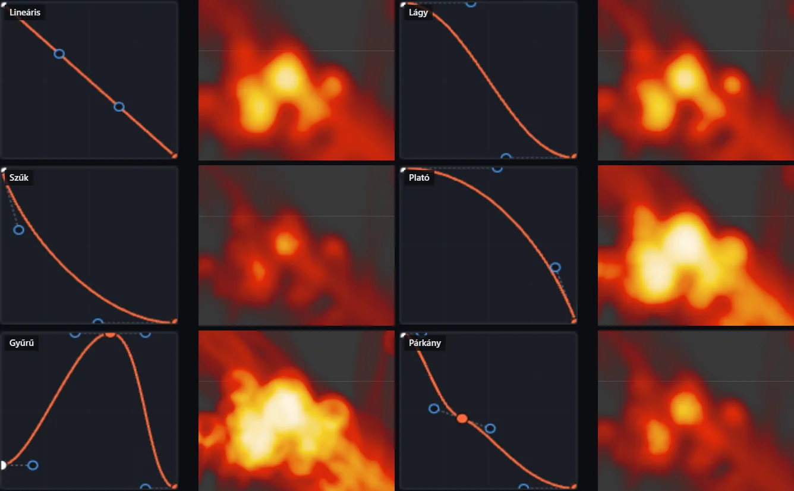

# Sprite-alak

Minden sor egy kerek sprite-ként rajzolódik, amely mindig a kamera felé néz. A mérete és a profilja a középpontjától a peremig – a **profil** – dönti el, hogy egy forrópont szoros pontnak, lágy felhőnek, korongnak vagy gyűrűnek látszik-e. Ezek a vezérlők az oldalsáv **Hőalak** és **Sprite-pixelkorlátok** szakaszában vannak, és a [Hő](heat.md), a [Különbség](difference.md), a [Csapathő](team-heat.md) módokra vonatkoznak, a [Vonal-hő](line-heat.md) módra pedig a vonal félszélességeként.

Bármelyiknek a megváltoztatása újraindítja a halmozást (a mezőt az új alakkal újra kell rajzolni).

Gondoljon minden pontra egy lágy fényfoltként. Egy kis folt egyedi helyeket mutat; egy nagy folt a szomszédokat felhővé olvasztja. Az alak dönti el, mennyire lágy a széle.



## Sprite-sugár {#sprite-radius}

A sprite sugara **világegységben** (méterben jelölve). Alapérték 6, és minden betöltéskor az adatok vízszintes kiterjedése / 120 – elég nagy ahhoz, hogy az útvonal mentén szomszédos minták sávvá olvadjanak, és ne egyetlen szálnak látszanak. Logaritmikus csúszka 0,05–2000, a fogantyú 50 000-ig húzható.


A távoli dolgok kisebbnek látszanak, ezért a sprite a távolsággal a képernyőn összemegy. Párhuzamos vetítésnél mindenhol ugyanakkora, ami részben az oka, hogy a párhuzamos nézet a jó választás forrópontok összehasonlításához ([Kamera](camera.md#projection)).

## Pixelkorlátok {#pixel-clamps}

A **Sprite-pixelkorlátok** (alapértelmezésben zárva) a fenti átváltás után korlátozzák a képernyőn látható sugarat.

| Vezérlő | Alapérték | Tartomány (jog) | Miért |
|---|---|---|---|
| **Min. pixelsugár** | 1 px | 0–16 (512) | Megakadályozza, hogy a távoli adatok egy pixel alá tűnjenek. |
| **Max. pixelsugár** | 96 px | 2–1024, logaritmikus (8192) | A túlrajzolás-védelem. Egy N pixelt lefedő sprite N keverési műveletbe kerül, ezért a kamerához közeli korlátlan sugár teszi a gyors képkockát lassúvá. A nézet magasságán túl már semmit nem korlátoz. |

Az **Azonos sűrűség minden nagyításnál** (a Hőalak szakaszban, alapértelmezésben be) a korlátokkal együtt működik. Az a sprite, amelyet egy korlát nagyobbá (távol) vagy kisebbé (közelről) tesz, megtartja azt a hőt, amelyet az igazi mérete adna, így egy szín bármely nagyításnál ugyanannyi sort jelent a talaj területegységére. Kikapcsolva a korlátozott sprite a korlátozott méretében adja teljes súlyát, és a kép megváltozik, ahogy befelé repül.

## Középponti és peremintenzitás {#centre-and-edge-intensity}

A hő, amelyet a sprite pontosan a középpontjában ad hozzá (**Középponti intenzitás**, alapérték 1, 0–10, jog 1000), és a peremén (**Peremintenzitás**, alapérték 0, -2–10, jog 1000). A *t* profilérték (1 a középpontban, 0 a peremen, a lecsengés vagy az alábbi görbe alakítja) közöttük keveredik (a képlet a [Fejlesztőknek](#for-developers) részben van).

A **negatív peremintenzitás** a peremen kivonja a hőt, így minden forrópont körül hűvös udvart vág ki, és élesíti a klasztereket egymástól. A láthatóság tartalmazza a [takarást](depth-and-culling.md) és a [szeletet](slice.md); az elhalványulás a [Élettartam](timeline.md#history) elhalványulása; az előjel ±1 a [Különbségben](difference.md).

## Profil alakja: Lecsengés vagy Görbe {#ramp-shape-falloff-or-curve}

A **Profil alakja** két módot kínál arra, hogyan alakítjuk a *t*-t a sprite-on át. A *d* a középponttól (0) a peremig (1) mért távolság:

### Lecsengés {#falloff}

Akkor látszik, ha a *Lecsengés* van kiválasztva (az alapérték).

- **Lecsengés** (alapérték 1,6, 0,1–8, jog 64): `t = (1 - d) ^ lecsengés`. Az 1 egyenes lineáris profil; a magasabb érték a hőt a középpont felé húzza, és szorosabbá teszi a forrópontot; 1 alatt korongba laposodik.
- **Lágy profil** (alapérték be): a *t*-re smoothstep S-görbét alkalmaz, így a sprite a peremén halványul el, ahelyett hogy egy látható szélnél végződne.

### A görbeszerkesztő {#the-curve-editor}

Akkor látszik, ha a *Görbe* van kiválasztva. Egy sprite szó szerinti keresztmetszete: a középponttól mért távolság vízszintesen (a *közép* balra, a *perem* jobbra), a hő függőlegesen. A görbe vezérlőpontokon átmenő darabonkénti köbös Bézier-görbe, mindegyiknek két fogantyúval.

| Művelet | Hatás |
|---|---|
| Dupla kattintás a grafikonon | Pontot ad hozzá az adott távolságnál (0,02 és 0,98 között tartva), a görbén és a görbe ottani meredekségével, így a hozzáadás semmit sem változtat, amíg nem húzza. |
| Pont húzása | Mozgatja. A magasságok 0 és 1 között maradnak. |
| Kis kör húzása | Meghajlítja a mellette lévő szakaszt (ezt a fogantyút mozgatja). |
| Alt-kattintás vagy jobb kattintás egy ponton | Eltávolítja. A két végpont nem távolítható el. |
| Egy előre beállított gomb | A görbét az előre beállított görbére cseréli. |

A végpontok a középpontban és a peremen rögzítettek; a magasságuk továbbra is az Öné.

**Előre beállítások** ([`curve.ts`](https://github.com/Holdi601/3DHeat/blob/main/src/state/curve.ts)):

| Előre beállítás | Alak | Használat |
|---|---|---|
| **Lineáris** | Egyenes 1-től 0-ig | Megegyezik a *Lecsengés* 1-gyel, a *Lágy profil* kikapcsolva. |
| **Lágy** | S-görbe | Az alapértelmezett görbe; amit a *Lágy profil* ad 1-es lecsengésnél. |
| **Szűk** | Meredek mag, hosszú halvány szegély | Ritka adatok. |
| **Plató** | Lapos, majd gyors lecsengés | Korongnak látszik, nem foltnak. |
| **Gyűrű** | 0,15 a középpontban, 1 a sugár 62%-ánál, 0 a peremen | Üreges sprite: azt mutatja, hol haladnak át az útvonalak, nem azt, hol állnak meg. |
| **Párkány** | Kétszakaszos lecsengés, 0,45 a 35%-nál | Elválasztja a sűrű magot a környezetétől. |

## Lapítás a talajsíkra {#flatten-onto-ground-plane}

A **Lapítás a talajsíkra** (alapértelmezésben ki) figyelmen kívül hagyja minden sor magasságát, és az összes hőt egy magasságban rajzolja ki – az adatkészlet legalacsonyabb Y értékén –, ez a klasszikus 2D-s térképes hőtérkép. Bekapcsolva a mélységi takarás és az *Elrejtés a terep mögött* ki van kapcsolva (minden pont pontosan arra a felületre kerülne, amelyhez képest vizsgáljuk), és a Mélység szakasz ezt ki is írja.

## Fejlesztőknek {#for-developers}

### Képletek {#formulas}

A képernyőn lévő sugár pixelben: `sugár × P[1][1] / w × nézetmagasság / 2`, ahol a `P` a vetítési mátrix, a `w` pedig a pont nézeti mélysége.

A hő, amelyet egy sprite hozzáad:

```
hozzáadott hő = mix(perem, középpont, t) × mintasúly × előjel × elhalványulás × láthatóság
```

### A görbe {#the-curve}

A fogantyúk vízszintesen a saját szakaszukra vannak szorítva, így a görbe mindig a távolság függvénye: ha egy fogantyút messze a következő pont mögé húzunk, az a ponthoz simulva lapul el, ahelyett hogy visszahajtaná a görbét, mert így az eredmény attól függene, melyik gyököt találta meg véletlenül a megoldó.

### A görbe rajzolása {#how-the-curve-is-drawn}

A görbe minden változáskor egy 256 bejegyzéses táblázatba kerül, 16 bites lebegőpontos textúraként töltődik fel, és töredékenként lineáris szűréssel mintavételezzük, félszöveges befelé léptetéssel, hogy mindkét vég pontos maradjon. Egy Bézier x szerinti megoldásához iteráció kell, ami nem fér a program legforróbb shaderébe, a táblázat-lekérés pedig olcsóbb, mint a lecsengés `pow()` függvénye. 16 bit és nem 8 bit, mert 8 bitnél sávosodás látszik, ha több ezer sprite összeadódott; a 16 bites félpontosság a WebGL2 alapkészletében szűrhető, míg a 32 biteshez bővítmény kell.
