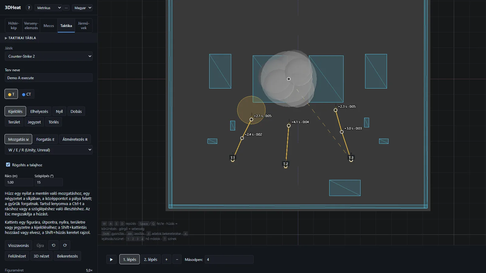

# Taktikatábla

A **Taktika** fül egy rajztábla csapattervekhez: kis figurákat helyez el a térképen, nyilakat rajzol arra, merre mennek, és lejátssza, ahogy történik. Egy kör vagy egy támadás megtervezésére használja, mielőtt játszik. A vásznat, a kamerát és a [pályát](levels.md) a többi fülrel osztja meg, másban nem; egy terv nem adat, és nem rajzol hőt.

## Az első terve {#your-first-plan}

1. Nyissa meg a **Taktika** fület. Válassza ki a **Játék**et (például Counter-Strike 2), Valorant esetén nyomja meg a **Valorant-térképek betöltése** gombot, és válasszon egy **Térképet**. Vagy töltsön be előbb egy [pályát](levels.md).
2. Válasszon egy **Oldalt** (ez adja a színt), és nyomja meg a **Felülnézet** gombot.
3. Válassza a **Hely** eszközt, válasszon egy figurát a **Figurák** listából (a **Figurák keresése** segít megtalálni), és kattintson a térképre. Helyezzen el kettőt vagy hármat.
4. Válassza a **Nyíl** eszközt, kattintson egy figurára, majd kattintson végig azon az úton, amelyen mennie kell, és az Enter megnyomásával zárja le a nyilat.
5. Nyomja meg a **+** gombot a nézet alatt a 2. lépés hozzáadásához. Minden figura ott kezdi, ahol a nyila véget ért. Ott rajzoljon további nyilakat.
6. Nyomja meg a **▶** gombot (vagy a `K`-t), hogy a tervet a mutatott lépéstől a végéig lejátssza.
7. Nevezze el a tervet a **Terv neve** mezőben, és nyomja meg a **Mentés** gombot.

## Terv indítása {#starting-a-plan}

| Vezérlő | Mit csinál |
|---|---|
| **Játék** | Kiválasztja az oldalakat és a figurákat, amelyeket a paletta kínál: Counter-Strike 2 (T, CT; játékosok és segédeszközök), Valorant (Támadó, Védő; játékosok és általános képességek), Battlefield, Squad, Arma (gyalogság, földi járművek, repülőgépek, csónakok), DCS / War Thunder / IL-2 (sugárhajtású gépek, légcsavaros gépek, helikopterek, légvédelem, szárazföld, hajók, fegyverek), és Egyéb. Egy már figurákat tartalmazó terv megtartja oldalait, ha a játék változik. |
| **Terv neve** | Az a név, amelyen a terv mentődik. |
| **Térkép**, **Valorant-térképek betöltése** | Valorant kiválasztásakor: a **Valorant-térképek betöltése** lekéri a térképek listáját a [valorant-api.com](https://valorant-api.com) oldalról; a **Térkép** ezután a kiválasztott térkép kistérképét pályaként teszi le, felülről keretezve. A képet a kiválasztáskor töltjük le, és soha nincs szállítva. A Riot közleménye látszik, amíg a képernyőn van (lásd lentebb). |
| **Oldal** | Az a oldal, amelyhez a következő figura, nyíl vagy terület tartozik; felveszi az oldal színét. |

Pálya nélkül a tábla a sík talajsík. Egy valódi térképen tervezéshez töltsön be pályát a **Pálya** alatt: egy CS2-térképet a CS2 eszközzel exportálva, egy pályát a könyvtárból, vagy egy térképképet.

## Eszközök {#tools}

| Eszköz | Kattintás | Megjegyzések |
|---|---|---|
| **Kijelölés** | Egy figura, egy útpont, egy nyíl, egy terület vagy egy jegyzet kijelöli. | A Shift+kattintás hozzáad vagy elvesz; a Shift+húzás dobozt rajzol arra, amit hozzá szeretne adni. A kijelölésen átalakító gizmo jelenik meg (lent); a `Delete` vagy `Backspace` eltávolítja. Az `M` a kijelölt figurát a következő kattintásra mozgatja. |
| **Hely** | Lerakja a kiválasztott figurát. | A figurát a **Figurák** paletta (a **Figurák keresése** mezővel) közül választja. Ha nincs kijelölés, az `R` a következő figurát 15°-kal elforgatja, mielőtt lerakja (a `Shift+R` az ellenkező irányba). |
| **Nyíl** | Minden kattintás hozzáad egy pontot; az Enter, dupla kattintás vagy jobb kattintás lezárja, az Esc eldobja. | **Eltolás**, **Támadás** (szélesebb fej) vagy **Figyelés** (vékony vonal szemmagasságban). Egy figurán kezdett nyíl az a figura útvonala ebben a lépésben: lejátszáskor a figura végigjárja, a következő lépés pedig ott kezdődik, ahol véget ért. |
| **Dobás** | A dobó, majd az, hová esik. | Szaggatott ív az egyikből a másikba, a kiválasztott segédeszköz (füst, villanás, molotov, ...) pedig ott jelenik meg, ahol landol, és ettől a lépéstől kezdve ott marad. |
| **Terület** | A közepe, majd a széle. | Korong az oldal színében. |
| **Jegyzet** | Ahová a jegyzet kerül; kéri a szövegét. | Tűként látszik, a szövege fölötte. |
| **Törlés** | Egy figura, nyíl, terület vagy jegyzet. | Eltávolítja ettől a lépéstől kezdve; első lépésében eltávolítja mindenhonnan. |

A **Visszavonás** és az **Újra** (`Ctrl+Z`; `Ctrl+Y` vagy `Ctrl+Shift+Z`) minden változáson végigmegy. A terv alatti sor megmutatja, hány figurája, nyila és lépése van. A **Felülnézet** egyenesen lefelé néz (ortografikus), a **3D nézet** visszaáll a perspektívára, a **Képkocka** a tervhez igazítja a nézetet, üres terv esetén a pályához.

A **Figuraméret** a táblán lévő minden figurát skálázza; 1× a valódi méret, ami nagy magasságból néhány pixel egy embernek.

## Mozgatás, forgatás és átméretezés {#moving-turning-and-scaling}

A tábla mindenen úgy mozgatható, mint egy 3D-s szerkesztőben: figurák, segédeszközök, jelölők, egyes útpontok és egész nyilak, területek és jegyzetek. A kijelölt elemek közepén gizmo jelenik meg:

| Mód | Billentyűk | Fogantyúk |
|---|---|---|
| **Eltolás** | W (vagy G) | Egy nyíl tengelyenként (X piros, Y zöld és felfelé, Z kék) mozgatja azon; egy négyzet a síkjában mozgatja; a közép a mutató alatti pálya fölött mozog. |
| **Forgatás** | E (vagy R) | Egy gyűrű tengelyenként forgat körülötte. Egy figura gyűrűi a saját irány-, dőlés- és billenési szögei; csoport a világtengelyek körül forog a közepe körül. |
| **Átméretezés** | R (vagy S) | Szétterít vagy összehúz a kijelölést a közepétől egy tengely mentén vagy minden irányban; egy terület sugara vele nő. |

A **Billentyűk** a W / E / R (Unity, Unreal) és a G / R / S (Blender) között vált; a billentyűk csak akkor választanak módot, ha van kijelölés, egyébként a kamerát repítik. Így az `R` kijelöléssel a W / E / R billentyűkkel **Átméretezés**, a G / R / S billentyűkkel **Forgatás**; kijelölés nélkül pedig a következő lerakandó figurát forgatja. Az összes táblabillentyű a [billentyűzeti referenciában](keyboard-reference.md#tactics-board) van. Húzás közben a **Ctrl** tartásával az eltolás a **Rács**ra (méterben), a forgatás az **Szög lépése**-re illeszkedik. A **Rögzítés a talajhoz** (alapértelmezés szerint be) a mozgatott embereket, járműveket, jelölőket, útpontokat és területeket a pálya felszínére teszi; a repülőgépek és helikopterek megtartják magasságukat, és az Y nyíl mentén húzás soha nem illeszkedik. A fogantyú húzása sosem mozgatja a kamerát. Az **Esc** megszakítja a húzást, és minden változás a Visszavonás egy lépése.

Az útpontok pontokként látszanak a látható lépés nyilain: kattintva kijelöli, húzva mozgatja, Delete-tel kiveszi. A **Kijelöltek** szakasz a kijelölés helyét méterben, egy figura irány-, dőlés- és billenési szögét fokban, egy terület sugarát pedig mindet beírható mezőként mutatja.

## Időzítés {#timing}

Egy figura útvonala időzített: minden szakasz annyi ideig tart, amekkora a hossza a pályán – a felszínen néhány méterenként mintavételezve, így egy domb vagy egy lépcső két pont között is számít –, az adott figura **mozgási módjának** sebességével az adott játékban, plusz egy útponton tartott **várakozás**. A gyalogság kúszik, guggol, sétál (csendben), fut vagy sprintel; a járművek és csónakok lassan, óvatosan, normálisan vagy rohanva haladnak; a repülőgépek és helikopterek lassan, utazósebességgel, harci sebességgel vagy maximumon repülnek. Egy mód, amellyel a játék nem rendelkezik (a CS2-ben nincs sprint), a legközelebbi meglévőt kapja. Hogy a lejtő hogyan lassít, az játékfüggő: a CS2-ben és a Valorantban csak a vízszintes távolság számít, ahogy a játékokban is; a realisztikus szimulátorok a gyalogságot felfelé (Tobler túrázási függvénye), a járműveket pedig a meredekség szerint lassítják.

A sebességek játékonkénti táblázatokból jönnek a forrásaikkal (lásd [Mozgási sebességek](tactics-speeds.md)): a CS2 a tartott fegyver szerint, a játék fegyverdefinícióiból; a Valorant fegyver szerint; a Battlefield, Squad, Arma és a légi játékok járműtípus és -osztály szerint. Az **Így mozog** egy figura profilját választja (egy fegyver, egy járműtípus); a **Saját (m/s)** felülírja bármely módot az adott figurára. A módok a tábla szerinti nevükön szerepelnek: *Kúszás*, *Guggolás*, *Séta (csendben)*, *Futás*, *Sprint*; *Óvatos*, *Normál*, *Rohanás*; *Lassú*, *Utazósebesség*, *Harc*, *Maximum*.

Minden útpont mutatja az előzőtől eltelt időt és a terv kezdete óta eltelt időt („+3,9 s · 0:12”). A kijelölt figura útvonala minden szakaszt felsorol a módjával, hosszával és idejével, a várakozással és az érkezéssel. Az **Időmérés** alatti **Érkezések** minden útvonalas figurát egy időtengelyre tesz, az első érkező felül. A **Valós időben lejátszás** (alapértelmezés szerint be) mellett egy lépés addig tart, amíg a leglassabb útvonal meg nem érkezik, és minden figura a saját sebességével mozog; a **Másodperc** ekkor a lépés legrövidebb hossza. A **Pályaegység méterenként** azt mondja meg, mi a pálya egysége: 39,37 a CS2-térképeknél (játékegységek), 1 a méteres térképeknél.

## Összehasonlítás meccsadatokkal {#compare-with-match-data}

A **Meccsfájlok betöltése…** a térkép CS2-meccstábláit olvassa (a CS2 eszköz Parquet-fájljait, tetszőleges számban; csak a szükséges oszlopokat, a háttérben); a **Betöltött adatok használata** a megjelenítőbe töltött adatot veszi. Ezután:

- A **Legkorábbi érkezés a térképen** a térképet színezi azzal az idővel, amely alatt egy játékos először ért el az egyes pontokra a kör kezdete óta – a **Leggyorsabb** gomb az összes körön át a leggyorsabbat, a **Tipikus (medián)** a középső kört mutatja –, zöldtől a korai, pirosig a késői, egy vagy mindkét oldalra. Megmutatja, mi lehetséges, és mikor.
- A kijelölt útvonalat összehasonlítja azzal, amit a játékosok a kezdetétől (vagy a kör kezdetétől) a végéig elértek; mindkét végpont a beállított sugarú korong: „Leggyorsabb megfigyelt 14,2 s, p10 15,0 s, medián 18,3 s 41 futásból; a terve 15,1 s”.
- A játékosok valóban elért sebességei – futás, séta, guggolás, a táblázatok séta- és guggolóoszlopaiból –, m/s-ban.

## Lépések {#steps}

A nézet alatti sáv tartalmazza a lépéseket. Egy terv egyel indul; a **+** hozzáad egyet, és minden figura ott kezdi, ahol az előző lépésben az útvonala véget ért; a **−** eltávolítja a látható lépést. A **Másodperc** azt mutatja, mennyi ideig tart a látható lépés lejátszva. A **▶** (K) a látható lépéstől a végéig játssza: az útvonallal rendelkező figurák végigjárják azt, a következő lépésben új helyre tett figurák oda csúsznak, a többiek állnak. Amíg egy lépés látszik, minden figura helye a következő lépésben halvány szellemként rajzolódik, az utolsó lépés nyilai pedig halványan a mostani alatt.

## Mentés {#saving}

A **Fájl** szakasz tartalmazza a **Mentés**, **Nyitó** és **Törlés** gombokat. A **Mentés** a tervet `<név>.h3dplan.json` fájlként írja (egyszerű JSON: oldalak, lépések, figurák lépésenként egy hellyel, nyilak, területek, jegyzetek); a **Nyitó** visszaolvassa. Más verziójú vagy nem terv fájlt az ok megjelölésével visszautasítunk. A **Törlés** kiüríti a tervet; a Visszavonás visszahozza.

## Figurák {#figures}

Minden figurát maga a megjelenítő épít: egyszerű alakok egy típus közzétett méretére, a szomszédaitól megkülönböztető jellemzőkkel – egy harckocsi úttest-kerekei és tornya, egy légvédelmi jármű fegyverei, rakétái és radarjai, egy repülőgép szárnyterve, farka és motorjai, egy helikopter rotorjai és csonka szárnyai. Semmi nem származik játékból. Egy játék által kitalált formát az osztálya általános figurájaként mutatunk. Hogyan találja meg az adat a figuráját: lásd [Figurák](figures.md#which-figure-a-unit-gets).

## A Riot közleménye {#riots-notice}

A Valorant-térképek a Riot Games „Legal Jibber Jabber” szabályzata szerint látszanak, amely a szabad közösségi projekteknek megengedi a használatukat, és ezt a közleményt kéri mindenhol, ahol megjelennek: *A 3DHeat a Riot Games „Legal Jibber Jabber” szabályzata alapján készült, a Riot Games tulajdonában lévő eszközöket használva. A Riot Games nem támogatja és nem szponzorálja ezt a projektet.* A táblán lévő képességek általános alakzatok, nem a Riot grafikái.
