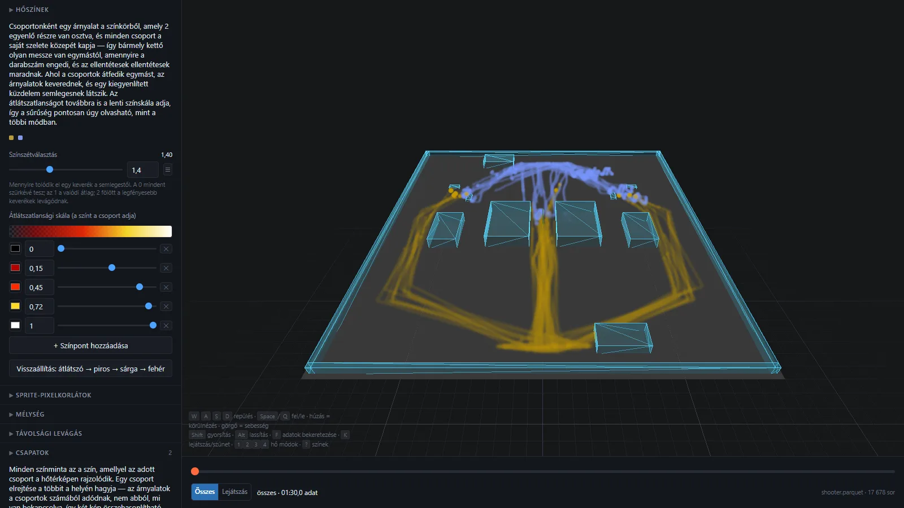

# Csapathő

A csapathő megmutatja, hol volt az egyes csapat, minden csapat a saját színében. Ahol a csapatok átfedik egymást, a színek keverednek.

A **Csapathő** (billentyű: 3) a [Hő](heat.md) sűrűségi mezője, minden [csoport](glossary.md) saját árnyalatot kap. Ahol a csoportok átfedik egymást, az árnyalataik keverednek; egyenlő küzdelemnél semleges színt kapunk. Az átlátszatlanság továbbra is pontosan úgy hordozza a sűrűséget, mint a többi módban, így a kép egyszerre válaszol arra, hogy *mennyi* és *kié*. Csoportoszlop kell hozzá.

Nem a [figura-réteg](box-replay.md): az egy figurát rajzol személyenként; ez egy hőmező, amelyet ugyanaz az oszlop színez.

## Használata {#how-to-use-it}

1. Nyomd meg a `3` billentyűt (vagy válaszd a **Csapathő** módot a módsávon).
2. Nyisd meg a **Hőszínek** részt. A színminták minden csoport színét mutatják; a minta fölé húzva megjelenik a csapat neve.
3. Ha minden szürkének látszik, emeld a **Színszétválasztás** értéket.
4. A [Csapatok listájában](teams-list.md) vedd ki a pipát egy csoport mellől, hogy kikerüljön; a többi szín a helyén marad.

## Vezérlők {#controls}

A **Hőszínek** részben:

| Vezérlő | Alapérték | Jelentés |
|---|---|---|
| Színminták | | Minden csoport színe az első 12 csoportnál, utána *+N további*. A fölé húzva megjelenik a csoport neve és a színe. |
| **Színszétválasztás** | 1,4 | Milyen messzire tolódik a keverék a semlegestől, 0-4. A 0 mindent szürkévé tesz; az 1 a valódi átlag; kb. 2 fölött a legfényesebb keverékek kilépnek a megjeleníthető tartományból, és csatornánként levágódnak, ami eltolja az árnyalatukat. |
| **Átlátszatlansági skála (a színt a csoport adja)** | az alapértelmezett hőskála | Itt csak a skála **alfája** számít: átlátszó, ahol nincs semmi, átlátszatlan a tetején. A színeit figyelmen kívül hagyjuk. |

Az a csoport, amelynek felirata „nincs csoport” jelent (`0`, üres, `none`, `unknown`, `null` vagy `-1`), szürkén rajzolódik.

Az összes többi hővezérlő - alak, telítés, válasz, minimális hő, mélység, vágás - ugyanúgy működik, mint a [Hő](heat.md) oldalon.

A [Csapatok listája](teams-list.md) ebben a módban minden csoport csapathő-színét mutatja a színmintájaként. Egy csoport elrejtése a többi csoport színét a helyén hagyja: az árnyalatok az összes csoport számából jönnek, nem abból, ami be van kapcsolva, így két kép összehasonlítható marad.

## Fejlesztőknek {#for-developers}

### A paletta {#the-palette}

A [`colors.ts`](https://github.com/Holdi601/3DHeat/blob/main/src/render/colors.ts) fájlból:

- A színek egy **Oklab** színsíkon élnek, rögzített fényerővel (0,7) és telítettséggel (0,115), így minden csoport egyformán fényes, és egy piros csoport nem tűnik melegebbnek, mint egy kék.
- *n* csoportnál a színkört *n* egyenlő részre osztjuk, és az *i*. csoport a részének **közepét** kapja, `(i + 0,5) / n` fordulatnyit. Bármely két csoport olyan messze van egymástól, amilyen messze a szám engedi, és az ellentétesek a szám bármely értékénél is ellentétesek maradnak.
- Legfeljebb **16** különböző árnyalatot használunk. Több csoportnál az azonosítókat ismételt felezéssel helyezzük el (bitfordított azonosítók: 0, ½, ¼, ¾, ⅛, …), hogy a szomszédos azonosítók ne osszanak meg árnyalatot; a 16 fölötti csoportok szükségszerűen osztoznak.
- Az a csoport, amelynek felirata „nincs csoport” jelent - `0`, üres, `none`, `unknown`, `null` vagy `-1`, a kis- és nagybetűket nem véve figyelembe -, **semleges szürkén** rajzolódik, és nem kap szeletet a körből. A csoportlistában csak az első ilyen felirat kezelődik így.

Az alapértelmezett szétválasztás 1,4 és nem 1, mert 1-nél öt egyenletesen elosztott árnyalat keveréke *szürke*: helyes, de olvashatatlan. Az 1 kicsit fölötti érték megtartja a döntetlent őszintén, miközben a 60/40-es megoszlás látható marad.

### Hogyan működik {#how-it-works}

A hőcélnak ebben a módban négy csatornája van. Minden sprite a *v* sűrűségét az első csatornához adja, a *v* × a csoport Oklab *a* és *b* koordinátáit a másodikhoz és a harmadikhoz. A kompozitálásnál a képpont keveréke a sűrűséggel súlyozott átlag: *a* = G / R, *b* = B / R, a színszétválasztással skálázva, és a paletta fényerején sRGB-re átalakítva. A felhalmozott sűrűséggel osztás az árnyalatot függetlenné teszi attól, mennyi adat van, és ezért hat minden sűrűségvezérlés csak az átlátszatlanságra.

A négycsatornás cél ugyanolyan felbontáson négyszer annyi GPU-memóriát használ, mint az egycsatornás hőcél.
