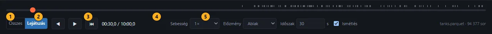

# Idővonal és lejátszás

A kép alatti sáv olyan, mint egy videólejátszó: az adatot filmként lejátszhatja, szüneteltetheti, ugrálhat benne és változtathatja a sebességet.

A nézet alatti sáv az idővonal ([`Timeline.tsx`](https://github.com/Holdi601/3DHeat/blob/main/src/ui/Timeline.tsx)). Eldönti, mely sorok látszanak bármely pillanatban. Időoszlop kell hozzá; ennek hiányában az egész sáv letiltva, a nézet az **Összes** módban marad, és az oldalsáv azt írja: *Nincs időoszlop ebben az adatban – az idővonal letiltva, és minden adatpont egyszerre látszik.*

## Összes és Lejátszás {#all-and-play}

Két felső szintű mód van, mert más kérdésre felelnek.

- **Összes** (alapértelmezés minden betöltésnél) figyelmen kívül hagyja a lejátszófejet, és minden olyan sort mutat, amely átmegy a szűrőkön. Ez a „hol történik ez” nézet, és nem ugyanaz, mint a végére tekerni. A görgetősáv letiltva, az óra pedig `összes ·  adat` feliratot mutat.
- **Lejátszás** az adatot időzített felvételként futtatja. Megjelenik a görgetősáv, a vezérlés és az előzmény-beállítások.

Az **Összes** választása a lejátszást is leállítja.

## A vezérlők {#the-controls}

| Vezérlő | Alapérték | Jelentése |
|---|---|---|
| Görgetősáv | a kezdet | A lejátszófej. Húzással tekerhető; 20 000 lépés a tartományon. |
| **Összes** / **Lejátszás** | Összes | Lásd fent. |
| ▶ / ❚❚ | szünet | Lejátszás vagy szünet; a `K` is. |
| ◀ **Visszafelé lejátszás (J)** | | Az adatot visszafelé játssza. Csak a **Figurás átfedés** módban látszik; a `J` billentyű itt is működik (lásd [Billentyűzet](#keyboard)). |
| ⏮ | | Vissza a tartomány elejére. |
| Óra | | `eltelt / összes` `mm:ss.s` formátumban (vagy `ó:pp:mm`), és ha az időoszlop abszolút időbélyeg, a lejátszófej falióra szerinti ideje `ÓÓ:PP:MMZ` formában (UTC). |
| **Sebesség** | 1× | Adat-másodperc valódi másodpercenként. A menüben 17 lépés van 0,01×-tól 1800×-ig (0,01, 0,02, 0,05, 0,1, 0,25, 0,5, 1, 2, 4, 8, 16, 32, 64, 128, 256, 600, 1800), plusz **Egyéni…**: bármely sebesség 0,001×-tól 3600×-ig (például 0,3 vagy 12), majd Enter; az Esc megtartja az aktuális sebességet. Az utolsó sebesség a következő látogatásig megmarad (lásd [Mentett beállítások](ref-settings-storage.md)). |
| **Előzmény** | Halmozott | Mi számít láthatónak a lejátszófejnél: *Halmozott*, *Ablak* vagy *Élettartam* (lentebb). |
| **Időszak** (Ablak; Vonalak módban az Élettartam is) | 30 s | A lejátszófejnél végződő ablak hossza; legalább 0,01 s. A [vonal-hőnél](line-heat.md#playback) ez a farok hossza. |
| **Tartalék élettartam** (csak Élettartam, Vonalak módon kívül) | 10 s | Meddig marad látható egy adatpont, ha a személyének nincs következő mintája. |
| **Elhalványulás** (csak Élettartam, Vonalak módon kívül) | 0,4 | Az élettartam azon hányada, amelyben az adatpont kifakul, 0–1. |
| **Ismétlés** | be | A végén újrakezdi; kikapcsolva a végén megáll. |
| Jobb oldal | | Az adatkészlet neve. |

A **tartomány** az adatkészlet időtartama – vagy a [figurás átfedésben](box-replay.md), ha van kiválasztott munkamenet, annak időtartama.

## Előzmény {#history}

Lejátszás módban:

- **Halmozott** – minden a tartomány kezdetétől a lejátszófejig. A hő felépül, ahogy játszik.
- **Ablak** – egy rögzített történeti szakasz, a lejátszófejnél végződve (*Időszak*).
- **Élettartam** – minden adatpont addig él, amíg **ugyanazon személy következő mintája** (ugyanabban a munkamenetben) meg nem érkezik, így minden pillanatban pontosan egy pozíció aktuális személyenként. Az az adatpont, amelynek a személye többé nem jelenik meg – halál, kapcsolatvesztés, a napló vége –, nem rendelkezik következő mintával, és a *Tartalék élettartam* ideig marad, nem tűnik el azonnal és nem marad örökké. Az adatpontok élettartamuk utolsó *Elhalványulás*-hányadában **kifakulnak**, nem pattannak le: személyenként egy élő mintával, ha egy adatpont egyik képkockáról a másikra eltűnik, az egész mező a mintavételi sebességgel villogna. Az *Elhalványulás* 0 visszaállítja a kemény vágást.

Az élettartam-módhoz időoszlop mellett személyoszlop is kell; ennek hiányában az előzmény betöltéskor Halmozottra esik vissza. A [vonal-hőnél](line-heat.md#playback) az előzmény határozza meg, meddig marad látható egy útvonal farka; a [figurás átfedésben](box-replay.md) a *Tartalék élettartam* azt adja meg, meddig tartjuk azt a személyt, akinek nincs további mintája.

## Lejátszási viselkedés {#playback-behaviour}

A képkockaciklusból ([`engine.ts`](https://github.com/Holdi601/3DHeat/blob/main/src/render/engine.ts)):

- A lejátszófej *képkockaidő × sebesség* értékkel halad. A képkockaidő 0,1 s-ra van korlátozva, így a lapok váltása nem ugrasztja a lejátszófejet.
- A lejátszás gomb megnyomása a tartomány legvégén az elejéről indítja, ahogy a médialejátszók. Minden betöltésnél a lejátszófej az elején áll, így az első lejátszás-gombnyomás lejátszik.
- A tartomány végén a lejátszófej visszaugrik az elejére (Ismétlés be), vagy ott megáll, és a lejátszás véget ér (Ismétlés ki).
- A görgetősáv minden képkockában közvetlenül a motor lejátszófejét olvassa; az alkalmazás állapota a tekerésnél, indításnál, megállításnál és ismétlésnél frissül.
- A Munkamenet-választóban egy munkamenet kiválasztása a munkamenet kezdetére tekeri a lejátszást.

## Miért sima és olcsó a lejátszás {#why-playback-is-smooth-and-cheap}

A sorok időrendben vannak tárolva, így egy időablak két bináris keresés az időoszlopon: a lejátszófej léptetése két egész számot mozdít, és egyetlen sort sem érint, a lejátszás költsége pedig az ablakban lévő sorok számától függ, nem az adatkészlet méretétől.

Az, hogy a hő stabil marad-e, miközben az ablak mozog, az előzménytől függ ([Halmozás](accumulation.md)):

- A **Halmozott** csak nőni tud, így minden képkocka csak azokat a sorokat adja hozzá, amelyek az utolsó óta láthatóvá váltak, teljes súllyal. A mező monoton módon épül fel, és a szünet nem változtat semmit, mert nincs több érkezés. (Az újrabecslés minden képkockában más véletlen részhalmazt világítana meg, majd elhalványítaná, ami lobbanó és eltűnő kitöréseknek látszik.)
- Az **Ablak** és az **Élettartam** valóban minden képkockában változik, és újra becsüljük, exponenciális mozgóátlagként keverve (0,34 súly az új képkockának), ami állandó állapotban torzítatlan, és sokkal csendesebb, mint az újrakezdés.
- Az Élettartam módban a jelölt sorok a *lejátszófej – max(az adat leghosszabb szünete, Tartalék élettartam)* időponttól a lejátszófejig terjednek; a shader ezután eldobja azokat a sorokat, amelyek élettartama lejárt, és alkalmazza az elhalványulást.

Az Összes és a Lejátszás közötti váltás, vagy az előzmény módosítása újraindítja a halmozást.

## Billentyűzet {#keyboard}

| Billentyű | Hatás |
|---|---|
| `K` | Lejátszás / szünet |
| `J` | Visszafelé lejátszás; újbóli megnyomásra szünet (csak Figurás átfedés) |
| `L` | Előre lejátszás; újbóli megnyomásra szünet (csak Figurás átfedés) |

A `J` és az `L` az idővonalat is **Lejátszás** módra kapcsolja. A billentyűk figyelmen kívül maradnak, amíg szövegdoboz vagy menü van fókuszban. A Versenyelemzés fülön a `K` a fül saját visszajátszását vezérli.
