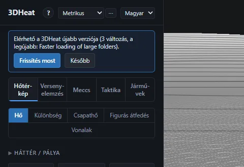

# Frissítések

A megjelenítő szól, ha van újabb verzió, és csak akkor frissíti magát, ha igent mondasz. A számítógépeden semmi nem változik a válaszod nélkül.

## A megjelenítő frissítése {#update-the-viewer}

1. **Az oldalon.** Ha van újabb verzió, egy doboz jelenik meg az oldalsáv tetején a név alatt: „A 3DHeat újabb verziója elérhető". Kattints a **Frissítés most** gombra. Az oldal ezután magától újratöltődik. A **Később** elrejti a dobozt, amíg újra nem töltöd az oldalt.
2. **Ha azt írja, hogy futtasd a restart.bat-ot**, zárd be a szerver ablakot (a fekete ablakot, amelyet a `start.bat` nyitott), majd kattints duplán a `restart.bat`-ra.
3. **A megjelenítő indításakor.** A `start.bat` is ellenőriz. Ha van újabb verzió, megkérdezi: **Update now? [Y/N]**. Nyomd meg az `Y`-t a frissítéshez. Nyomd meg az `N`-t, vagy várj 60 másodpercet válasz nélkül, és a meglévő verzió indul.



A változtatásokkal rendelkező saját példányt soha nem frissítjük helyetted: a doboz csak azt mondja, hogy frissítés vár, és azt, hogy commitold vagy stash-eld a változtatásaidat, majd futtasd a `git pull`-t. A git nélkül telepített példány (például egy zip-fájl) semmit sem mutat.

Az ellenőrzés működése lépésenként:

```
page ---(after 4 s, then every 6 h)---> dev server ---> git fetch
   behind?  no  -> nothing is shown
            yes -> your own changes or commits?  yes -> tell you only
                                                 no  -> [Update now] -> git pull
                                                        -> reload, or "run restart.bat"
```

## A biztonsági szabályok {#the-safety-rules}

- **Csak gyorsan előre** (`git pull --ff-only`): a frissítés soha nem egyesít, nem alapoz újra és nem ír át semmit.
- **Nincsenek helyi változtatások**: egy másolat, amelyben a követett fájlokban nem commitolt változtatások vannak (`git status --porcelain --untracked-files=no` nem üres), soha nem frissül automatikusan – valaki saját munkáját nem írja felül egy frissítés. Csak azt mondja meg, hogy frissítés vár. A nem követett fájlok (adat, exportok) nem számítanak változtatásnak.
- **Nincsenek helyi commitok**: egy másolat, amelynek olyan commitjai vannak, amelyek a feltöltőnek nincsenek meg („elágazott"), nem frissül – egy gyors előreugrás nem tudja felhozni, az egyesítés pedig a kézi `git pull` dolga. Az oldal és a `start.bat` ugyanazokkal a szavakkal mondja ezt, a `start.bat` pedig a meglévő verzióval indul.
- **Csak az oldalról maga**: a fejlesztőszerver frissítési kérésének egyedi fejlécet kell hordoznia, és ha van `Origin`, annak a szerver saját gazdagépéről kell jönnie (lent).
- Csak olyan git-másolatot frissítünk, amelynek van feltöltési ága; minden más (`.git` nélküli másolat, nincs git telepítve, statikus build) érintetlen marad, és nem mond semmit.

## Mit csinál a start.bat {#what-startbat-does}

A `start.bat` (kattints rá duplán; az ablak a szerver) sorrendben:

1. Megkeresi a Node.js-t – a `PATH`-on, különben a `%ProgramFiles%\nodejs`, `%ProgramFiles(x86)%\nodejs` vagy `%LOCALAPPDATA%\Programs\nodejs` helyen –, és ha hiányzik, felajánlja a telepítését a `winget install -e --id OpenJS.NodeJS.LTS` paranccsal (kérdezi, Y/N; utána újra kell nyitni az ablakot, hogy a Windows felvegye az új `PATH`-ot).
2. **Frissítések**, ha a git telepítve van, és a mappában van `.git`:
   - `git fetch --quiet` (hálózat vagy feltöltési ág nélkül csendben kihagyva);
   - megszámolja a `git rev-list --count HEAD..@{u}` kimenetét; ha nincs lemaradás, nem mond semmit;
   - helyi változtatások: „Van újabb verzió a 3DHeat-ből (N változás), de ebben a példányban helyi változtatások vannak, ezért nem frissül. Commitold vagy stash-eld őket, majd futtasd a git pull-t." – és a meglévő verzióval indul;
   - saját commitok (`git rev-list --count @{u}..HEAD` nem 0): „Van újabb verzió a 3DHeat-ből (N változás), de ebben a példányban olyan commitok vannak, amelyek az újabb verzióban nincsenek meg, ezért nem frissül. Frissítsd git pull-lal." – és a meglévő verzióval indul;
   - egyébként: „Van újabb verzió a 3DHeat-ből (N változás)." és a kérdés: **Update now? [Y/N]**. Az `N`, vagy a 60 másodpercig nem adott válasz kiírja: „Not updated; starting the version you have.", és a meglévő verzióval indul. `Y`-nál: „Updating...", jelzi, ha a `package.json` vagy a `package-lock.json` változik, lefuttatja a `git pull --ff-only` parancsot (ha ez még mindig nem sikerül – például hálózati hiba miatt –: „The update did not go through; starting the version you have."), majd a `git submodule update --init` parancsot (a rögzített eszközök, lásd [A dokumentáció karbantartása](maintaining.md#the-tools-under-exporters)), majd `npm install`-t, ha a csomagfájlok változtak, és van `node_modules`, végül: „Updated."
3. Megtagadja a második szerver indítását: ha már valami figyel a **5273**-as porton, ezt megmondja, és a `restart.bat` / `stop.bat` felé mutat.
4. Első futtatáskor (nincs `node_modules`) megkérdezi, mielőtt letölti a függőségeket (kb. 300 MB a `node_modules\`-ba, semmi rendszerszintűt).
5. Elindítja a fejlesztőszervert a `127.0.0.1:5273` címen (`--strictPort`), és amikor kész, megnyitja a böngészőt.

A `restart.bat` leállítja a szervert (a port alapján), és újra futtatja a `start.bat`-ot, így ugyanazt a kérdést teszi fel. A `stop.bat` csak leállítja.

## Fejlesztőknek {#for-developers}

### Futás közben: a frissítési útvonal {#while-it-runs-the-update-route}

A fejlesztőszerver (a `vite.config.ts`-ben lévő `heat3d-self-update` Vite-beépülő modul) a `/__heat3d/update` útvonalat szolgálja ki. Csak a fejlesztőszerveren létezik – statikus buildben és a `vite preview`-ban nem.

**`GET /__heat3d/update`** azt válaszolja meg, hogy a másolat le van-e maradva:

```json
{ "checkout": true, "upstream": "origin/main", "behind": 3, "ahead": 0, "dirty": false, "latest": "the newest commit's subject" }
```

- `checkout: false`, ha a mappa nem git-másolat;
- `git fetch --quiet`-et futtat **legfeljebb 30 percenként** (a közbeeső kérések azzal válaszolnak, amit legutóbb lehúztak);
- a `behind` / `ahead` a `git rev-list --count HEAD..@{u}` / `@{u}..HEAD` kimenetéből, a `dirty` a `git status --porcelain --untracked-files=no` kimenetéből, a `latest` a feltöltés legújabb commitjának tárgya;
- ha nincs feltöltési ág: `upstream: null` és `behind: 0`.

**`POST /__heat3d/update/apply`** felhozza a másolatot:

1. `403 { ok: false, reason: "forbidden" }` választ ad, hacsak a kérés nem tartalmazza az `X-Heat3d-Update: 1` fejlécet, és ha van `Origin`, annak a gazdagépe nem egyezik a kérés `Host`-jával. Egy oldalak közötti űrlap nem küldhet egyedi fejlécet CORS-előellenőrzés nélkül, ezt pedig ez a szerver nem engedélyezi.
2. Nincs teendő (nem másolat, nincs feltöltés, nincs lemaradás): `{ ok: true, updated: false }`.
3. Helyi változtatások: `{ ok: false, reason: "dirty" }`; helyi commitok: `{ ok: false, reason: "diverged" }`.
4. Egyébként: megjegyzi, mely fájlok változnak (`git diff --name-only HEAD @{u}`), lefuttatja a `git pull --ff-only` parancsot (2 perces időkorláttal), a `git submodule update --init` parancsot (hibáját figyelmen kívül hagyja), `npm install`-t, ha a `package.json` vagy a `package-lock.json` változott (15 perces időkorláttal), és ezt válaszolja: `{ ok: true, updated: true, restart }`. A `restart` megmondja, miért nem tudja a futó szerver felvenni a frissítést: `"dependencies"`, ha a függőségeket újratelepítették; `"config"`, ha csak egy `vite.config` fájl változott; `false`, ha semmit sem kell újraindítani.
5. Egy sikertelen git- vagy npm-parancs ezt válaszolja: `{ ok: false, reason: "<a hiba, legfeljebb 300 karakter>" }`.

A válaszok JSON-ök, `Cache-Control: no-store` fejléccel. A szerver csak a `127.0.0.1` címen hallgat, így az útvonal nem érhető el a hálózatról.

### Az értesítés az oldalon {#the-notice-in-the-page}

Az `UpdateBanner` a név alatt, az oldalsáv tetején:

- **4 másodperccel** az oldal betöltése után kérdezi az útvonalat (nem az első másodpercekben: az oldalnak adatkészletet kell betöltenie, és GPU-t kell indítania), és **6 óránként** újra, amíg az oldal nyitva marad.
- **Semmit nem mutat**, ha nincs ilyen útvonal (statikus build), a mappa nem git-másolat, vagy semmi sem újabb – egy értesítés minden indításkor olyan, amit az emberek megtanulnak figyelmen kívül hagyni.
- Lemaradva, helyi változtatások nélkül: „A 3DHeat újabb verziója elérhető (N változás, a legújabb: <tárgy>)." az **Frissítés most** és a **Később** gombokkal (a *Később* az oldal újratöltéséig elrejti).
- Lemaradva, helyi változtatásokkal: ugyanez a mondat, és „Ennek a másolatnak helyi változtatásai vannak, ezért nem frissül automatikusan; commitold vagy stash-eld őket, majd futtasd a git pull-t." – gomb nélkül.
- Az **Frissítés most** a `/apply`-nak küld („Frissítés..."). Ezután:
  - „Frissítve. Az oldal újratöltődik." – és 1,5 másodperc múlva újratölt (a szerver már az új fájlokat szolgálja ki);
  - ha a függőségeket újratelepítették: „Frissítve. A függőségei változtak: zárd be a szerver ablakot, és a befejezéshez futtasd a **restart.bat**-ot.";
  - ha csak a szerver beállításai változtak: „Frissítve. A szerver beállításai változtak: zárd be a szerver ablakot, és a befejezéshez futtasd a **restart.bat**-ot.";
  - ha végül nincs mit behozni (`updated: false` – a másolatot időközben felhozták, mondjuk a `start.bat`): „Nincs mit frissíteni: ez a másolat már a legújabb verzió." – és nincs újratöltés;
  - elutasítva: a *dirty* mondat, vagy „Ennek a másolatnak olyan commitjai vannak, amelyek a legújabb verzióban nincsenek meg; frissítsd git pull-lal.", vagy „A frissítés nem sikerült: <ok>".
