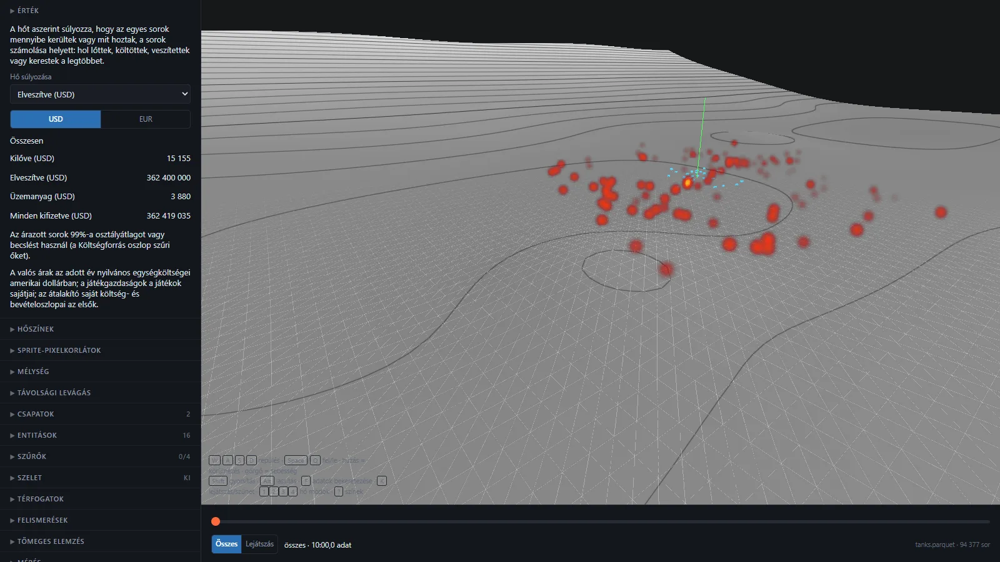

# Érték szerinti súlyozás

Minden lövésnek, lőszernek, elveszett járműnek és liter üzemanyagnak van ára. A nézegető kiszámolja, mibe került vagy mennyit hozott minden sor, és a hőt ennek szerint súlyozhatja, így a térkép azt mutatja, **hová ment a pénz**, nem azt, hol vannak a sorok.

## Használata {#how-to-use-it}

1. Tölts be adatot eseményekkel (lövések, ölések, halálesetek) és jármű- vagy fegyvernevekkel.
2. Nyisd meg az **Érték** részt a Hő oldalsávban.
3. Válaszd a **Hő súlyozása** elemet, például *Elveszett (USD)*. A hő most minden sor árát adja össze, nem az 1-et.
4. Olvasd le az **Összesen** értéket: minden értékoszlop összege a megjelenítettekre (a szűrők és az időablak érvényesek).
5. Ahol az árak valódi pénzek, megjelenik egy **USD / EUR** kapcsoló.

A sorok újraszámolásához válaszd a menü üres első elemét.

## Mi súlyozható {#what-can-be-weighed}

Az értékoszlopok betöltéskor íródnak hozzá, fajtánként és pénznemenként egyet:

| Fajta | Melyik sorra kerül | Hogyan kapja az árat |
|---|---|---|
| **Kilőve** | lövések és indítások | a fegyver, különben a lőszer fajtájának átlaga |
| **Elköltve** | vásárlás, megjelenés | a játék pénzoszlopai (például egy lövöldözős játék vásárlómenüje) |
| **Elvesztett** | halálok, megsemmisülések | a saját jármű, különben az osztályának átlaga |
| **Megsemmisült** | ölések | a célpont járműve |
| **Okozott sebzés** | találatok | a célpont értékének egy része |
| **Üzemanyag** | pozíciók | elhasznált üzemanyag, egy üzemanyag-oszlopból, vagy az osztályból és az időből becsülve |
| **Összesen kifizetve** | | kilőve + elköltve + elvesztett + üzemanyag |
| **Szerzett** | jutalmak | a játék saját jutalomoszlopai (`earn_…`) |
| **Nettó** | | szerzett mínusz kifizetett; előjeles hőként rajzolva (pozitív rámpa, ahol többet szereztünk, negatív, ahol többet fizettünk) |

Az oszlopnevek `cost_<fajta>_<pénznem>`, `earn_<pénznem>` és `net_<pénznem>`. Az olyan konvertáló, amely ismeri a játék saját pénznemét (például egy visszajátszás-konvertáló, amely játékbeli kreditet ír), felülírja a beépített árlistákat.

## Az árlisták {#the-price-tables}

| Lista | Pénznem |
|---|---|
| Valódi katonai eszközök: rakéták, bombák, lőszerek, ellenintézkedések, repülőgépek, helikopterek, szárazföldi járművek, hajók, üzemanyag | USD (EUR = USD × 0,92, a fix `EUR_PER_USD` a [`cost.ts`](https://github.com/Holdi601/3DHeat/blob/main/src/data/cost.ts) fájlban; nem élő árfolyam) |
| Lövöldözős játékok vásárlómenüi és ölési jutalmak | a játék kreditje |
| Tank- és hajójátékok | a játék kreditje |
| Stratégiai játékok (több erőforrás) | erőforrásonként egy oszlop, plusz egy összesítő |
| Hadijátékok | pontok |

A játékot az adat nevei alapján ismeri fel. A valódi árak nyilvános forrásokból származnak (költségvetési dokumentumok, enciklopédiák), vagy becslésként vannak jelölve; nincsenek infláció szerint igazítva. A táblák generált listája az [Értéktáblák](ref-value-tables.md) oldalon van.

## Becslések {#estimates}

A plusz kategóriaoszlop, a **Költségforrás**, megmondja, hogyan lett minden sor árazva: `table`, `class average`, `estimate` vagy `none`. Az Érték rész megmutatja, az árazott sorok mekkora része átlag vagy becslés. Ha csak pontosan árazott sorokat akarsz megtartani, a [Szűrők](filters.md) oldalon a **Költségforrás** alatt vedd ki a pipát a *becslés* és az *osztályátlag* mellől.

## Hol még jelenik meg az érték {#where-else-value-shows}

- [Elemzések](insights.md): a *Költséges talaj* és a *Kereső talaj* megállapítások.
- [Bontás](breakdown.md): csapatonként, játékosonként vagy fegyverenként a Szerzett, az Elveszett és a Nettó pénz.
- [Kötetek](volumes.md): az értékoszlopok a statisztikákban és az összehasonlításban.
