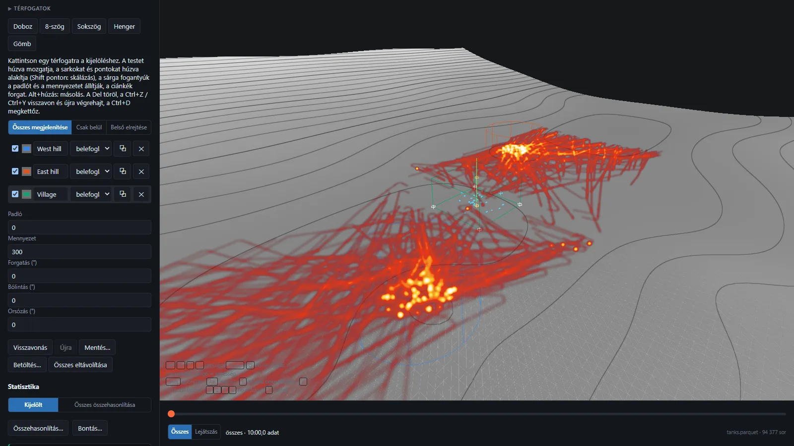
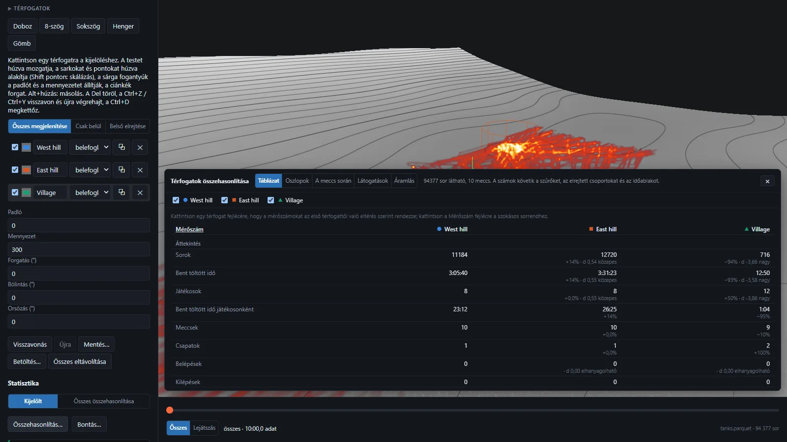
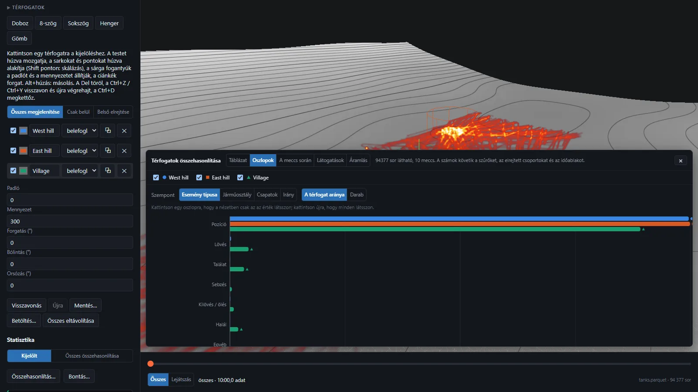

# Térfogatok és összehasonlítás

A **térfogat** egy láthatatlan doboz (vagy henger, vagy gömb), amelyet egy hely köré rajzol, hogy kérdezzen: mi történt itt bent? Használja arra, hogy megszámolja a leölt játékosokat egy híd mellett, összehasonlítson két dombot, vagy csak egy területen zajló aktivitást mutasson.

```
felülnézet               Ön rajzol egy alakzatot ->  a megjelenítő
+------------+           megszámolja, mi van benne:
|   ( A )    |            sorok, játékosok, halálok, idő ...
|        [B] |           Hasonlítsa össze A-t B-vel egymás mellett.
+------------+
```



A térfogatok mérik, mi történik bennük, a nézetet rájuk szűkítik, exportálják a soraikat, és egymás mellett összehasonlíthatók. Lásd még a [szójegyzéket](glossary.md) a sor, személy és meccs fogalmakhoz.

## Térfogat rajzolása {#draw-a-volume}

1. Nyissa meg a **Térfogatok** részt az oldalsávban.
2. Válasszon eszközt, és rajzoljon a 3D-s nézetben vagy a 2D-s térképen. A padló és a mennyezet az alatta lévő adatból indul. Az Esc megszakít.
3. Kattintson a térfogatra a kijelöléséhez; megjelennek a **Statisztika** adatai.

| Eszköz | Hogyan rajzolja |
|---|---|
| **Doboz** | Húzzon egy téglalapot (Shift: négyzet). Egy kattintás alapértelmezett dobozt helyez el. |
| **n-szög** | Húzzon a középpontból (a Shift szabályosan tartja). A *Sarkok* állítja n-et, 3 és 64 között (alapértelmezés 8, így a gomb **8-szög** feliratot mutat). |
| **Sokszög** | Kattintson a sarkokra; zárja le dupla kattintással, Entert nyomva vagy az első sarokra kattintva. A Backspace törli az utolsó sarkot. |
| **Henger** | Húzza a sugarat. |
| **Gömb** | Húzza a sugarat; a talajra támaszkodik. |

## Szerkesztés {#edit}

- Kattintson egy térfogatra a kijelöléséhez. A testét húzva mozgatja, a sarkait húzva alakítja át (a sarkon a Shift átméretez).
- A **sárga** fogantyúk a padlót és a mennyezetet állítják, a **ciánkék** fogantyú forgatja.
- Az Alt+húzás másol, a Del töröl, a Ctrl+Z / Ctrl+Y visszavon és újra megcsinál, a Ctrl+D duplikál. Az **Összes eltávolítása** minden térfogatot töröl.
- Pontos értékek: Padló, Mennyezet, Forgatás / Dőlés / Billenés (dobozok), Sugár (gömbök, hengerek).

Minden térfogatsornak van megjelenítés-jelölője, színe, neve, **belefoglal** vagy **kizár** gombja, valamint duplikáló és törlő gombja. A térfogatok adatkészletenként a böngészőben mentődnek, a **Mentés…** / **Betöltés…** pedig egy `volumes.json` fájlt ír és olvas.

## A nézet szűrése {#filter-the-view}

| Szűrő | Hatása |
|---|---|
| **Összes megjelenítése** (alapértelmezés) | A térfogatok csak mérnek. |
| **Csak belül** | A hő, a visszajátszás és a [találatelemzés](hit-analysis.md) csak azt mutatja, ami a belefoglalt térfogatokon belül, és a kizártakon kívül van. |
| **Belső elrejtése** | Az ellenkezője. |

A GPU-szűrő legfeljebb 8 térfogatot kezel, összesen 64 körvonalponttal; a túl sok térfogatot egy „!” jelöli. A statisztika és az exportálás továbbra is számolja.

## Statisztika {#statistics}

A **Statisztika** terület követi a szűrőket, az időablakot és az elrejtett csoportokat. A *Kijelölt* a kijelölt térfogatot mutatja, a *Mind összehasonlítása* minden térfogatot egymás mellett. Megmutatja:

- **Sorok belül (látható)** és **Sorok belül (minden adat)**, **Játékosok**, **Csapatok**, **Meccsek**, **Bent töltött idő**, **Belépések / kilépések**, **Csúcshő**, **Átlagos hő**, **Térfogat / alapterület** és egy **Mikor** hisztogramot;
- oszloponként: kategóriák az **Emelés** értékkel (a bent lévő arány osztva a teljes látható adat arányával), és számok tartománnyal, mediánnal és az 5–95%-os percentilisekkel.

A **Statisztika CSV / JSON formátumban** menti őket. Az **A belső adatok exportálása** a bent lévő sorokat CSV vagy Parquet formátumban írja (alapértelmezés szerint *Csak a látható sorok*), egy vagy minden térfogatra, egy oszloppal, amely megmondja, melyik térfogatban van az adott sor.

## Térfogatok összehasonlítása {#compare-volumes}

Két vagy több látható térfogat esetén nyomja meg az **Összehasonlítás…** gombot.

1. Rajzoljon három térfogatot, például Nyugati domb, Keleti domb és Falu.
2. Nyomja meg az **Összehasonlítás…** gombot a Statisztika alatt.
3. A **Táblázat** nézetben olvassa le minden érték eltérését az első térfogattól.
4. Váltson az **Oszlopok** nézetre, hogy az arányokat oszlopokként lássa.



| Nézet | Mit mutat |
|---|---|
| **Táblázat** | Sorok, bent töltött idő, játékosok, meccsek, csapatok, belépések, kilépések, látogatások, látogatás hossza, halálok, gyilkosságok, gyilkosság / halál, gyilkosság percenként, idő játékosonként, érték-oszlopok; csoportosítva esemény, járműosztály, játékos vagy MI, csapat és irány szerint. Minden érték mutatja az eltérését az első térfogattól, és egy hatásnagyságot (elhanyagolható, kicsi, közepes, nagy). Kattintson egy térfogat fejlécére, hogy az első térfogattól való távolság szerint rendezze. |
| **Oszlopok** | Darabszámok vagy arányok esemény, osztály, szereplő, csapat vagy irány szerint. Egy oszlopra kattintva a nézetet arra szűkíti. |
| **A meccs során** | Térfogatonként egy diagram a meccs perceiben: jelenlét, sorok vagy halálok. Kattintásra oda ugrik. |
| **Látogatások** | Doboz- és hegedűdiagramok arról, meddig tartanak a látogatások (logaritmikus skála). |
| **Áramlás** | Hová mennek a pályák egy-egy térfogat elhagyása után: átmenetmátrix vagy áramlási szalagok. |



## Tippek {#tips}

- Induljon egy megállapításból: a [Felismerések](insights.md) panelen a **Térfogat itt** henger alakú térfogatot ad a megállapítás helye köré.
- A **Bontás…** megnyitja a [Bontást](breakdown.md) a kijelölt térfogatra: kicsoda és mi teljesít a legjobban benne.
- Az [irányított hő](directional-heat.md) a kijelölt térfogaton belüli irányokat tudja diagramon ábrázolni.
- A [Járművek fül](hit-analysis.md#restrict-to-an-area) ugyanezeket a térfogatokat használja területszűrőnek.
