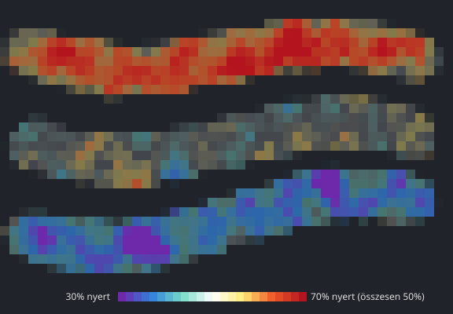

# Győzelmi arány: milyen gyakran nyer egy hely, egy útvonal vagy egy lépés

Hol áll egy játékos, merre megy, honnan dobja a gránátjait - és utána milyen gyakran nyeri meg az oldala a kört. A **győzelmi arány térképe** minden helyet aszerint színez, hogy az ottani sorok mekkora része tartozik olyan körhöz, amelyet a sor oldala megnyert, az összes megjelenített adat arányához képest: meleg, ahol nagyobb, hideg, ahol kisebb, semmi, ahol ugyanannyi.

*A kép kitalált adat: három útvonal egy üres pályán, soraik 68%-a, 50%-a és 33%-a nyert körökben.*

Olyan adat kell hozzá, amely megmondja, ki nyert: az [eredményoszlopok](data-formats.md#outcome-columns) (`won`, `matchWon`, `roundEndReason`). A CS2 és a War Thunder konverter írja őket, a Tacview-konverter pedig egy DCS-szerver hadjárataihoz ([DCS-szerverek](tacview-acmi.md#dcs-servers-who-won-and-how-each-sortie-ended)); bármely fájl tartalmazhatja.

## Próbálja ki {#try-it}

1. Töltsön be meccseket eredményoszloppal, és nyomja meg a `2` gombot (**Különbség**).
2. A **Különbség-felosztás** részben nyomja meg a **Nyert körök aránya** (vagy a **Nyert meccsek aránya**) gombot. Ez a nyert köröket a **+**, a vesztetteket a **−** oldalra teszi, és a panelt **+ aránya** módra váltja.
3. Olvassa le a színeket. A panel kiírja az összesített arányt: *Összesen az 1 200 000 sor 52,0%-a van a + oldalon.*
4. Szűkítse a [szűrőkkel](filters.md): egy oldal (T vagy CT), egy eseménytípus (*Pozíció*, hogy hol álltak az emberek, *Lövés* vagy *Kilövés (rakéta, lövedék, bomba)*, hogy honnan lőttek vagy dobtak), egy vásárlás, egy térkép.

Ha egy hely *Pozíció* sorokkal meleg, akkor az ott állók gyakrabban nyerték meg a kört. *Kilövés / ölés* sorokkal ez olyan hely, ahol a megszerzett ölések nyert körökhöz vezettek.

## A beállítások {#the-settings}

| Beállítás | Mit csinál | Alapérték |
|---|---|---|
| **Különbség** / **+ aránya** | maga a különbség, vagy a + oldal aránya a két oldal soraiból | Különbség |
| **Teljes szín ennél** | mennyivel az összesített arány fölött vagy alatt jelenik meg egy hely teljes színnel, pontban | ± 20 pont |
| **Legkevesebb sor egy hely színezéséhez** | a kevesebb sorral rendelkező hely nem kap színt; a szín ennek a felétől fokozatosan jelenik meg | 12 |
| **Húzás az összesített arány felé (sorok)** | minden hely ennyi sorral indul az összesített aránynál, így egy 3 soros hely, ahol mind nyert, nem 100%-ként jelenik meg | 12 |

Mindhárom a kész képre hat: a húzásuk soha nem indítja újra a gyűjtést.

Az arány bármely felosztásé lehet, nem csak a győzelmeké: a *+ aránya* oldalak szerinti felosztással azt mutatja, hol tették ki a T-k a jelenlét nagyobb részét, két térkép fájljai szerinti felosztással pedig azt, hol múlják felül az egyik fájl sorai a másikét.

## Sorok, nem körök {#rows-not-rounds}

A térkép sorokat számol. Egy játékos, aki húsz másodpercig egy helyen áll, minden mintánál hozzáad egy sort, mind ugyanabból a körből. Egy helyen tehát a közeli sorok a bizonyíték, nem a körök. Ezért van a minimum és a húzás sorokban megadva, és ezért nagyobbak egy kör értékénél.

Magukhoz a körökhöz:

- **[Bontás](breakdown.md)** egy ponton, a nézeten vagy egy térfogaton: a *Győzelem %* minden játékos körét egyszer számolja, ugyanígy a hely összesített aránya felé húzva (4 kör).
- **[Térfogatok](volumes.md)** statisztikája: *Győzelmi arány* - azok a körök, amelyekben játékos volt a térfogatban, mindegyik egyszer, az összes megjelenített adat aránya felé húzva, a darabszámokkal.

## Eredményszűrők {#outcome-filters}

A [Szűrők](filters.md) panel az eredményoszlopokat közvetlenül a megjelenítő saját oszlopai után mutatja: **Kör eredménye** és **Meccs eredménye** (*Bármelyik*, *Nyert*, *Vesztett*), valamint **Hogyan ért véget a kör** (kiiktatás, a bomba felrobbant, a bombát hatástalanították, lejárt az idő, feladás, döntetlen, célpont, tartott zónák, elvesztett jegyek, minden jármű elveszett), a megjelenítő nyelvén.

## Fejlesztőknek {#for-developers}

A hőmenet három összeget ír abba a négycsatornás célba, amelyet a csapathő használ: a hőt `R = Σ|v|`, a + oldal hőjét `P` és `S = Σ v²/w` értéket, ahol `w` a menet súlya (mintavételi súly szorozva a képkocka erősítésével). A kompozit beolvassa az arányt `P/R` (kernellel súlyozott átlag) és a sorok számát, amelyen nyugszik, `n = R²/S` (Kish-féle effektív mintaméret), az arányt az összesített felé húzza, `p = (n·P/R + m·r0)/(n + m)`, és `p - r0` értéket színez a tartományon a különbségskálákkal.

Az `n` kiejt minden tényezőt, amely egy pixel soraiban közös - a képkocka erősítését, a mintavételi súlyt, egy levágott sprite területsúlyát -, így a kép bármely nagyításnál és mintasűrűségnél ugyanaz, és a minden k-adik sort tartalmazó képkockák színugrás nélkül állnak össze egésszé. Az összesített arány a CPU oldalszámlálóiból jön, tized százalék pontossággal; semmi nem olvasódik vissza a GPU-ról. A számítás és ellenőrzései: [`render/rateMap.ts`](https://github.com/Holdi601/3DHeat/blob/main/src/render/rateMap.ts) és tesztje.

Annyiba kerül, mint a csapathő: a négycsatornás cél megnégyszerezi a hőmenet keverési sávszélességét, csak amíg a *+ aránya* be van kapcsolva.
